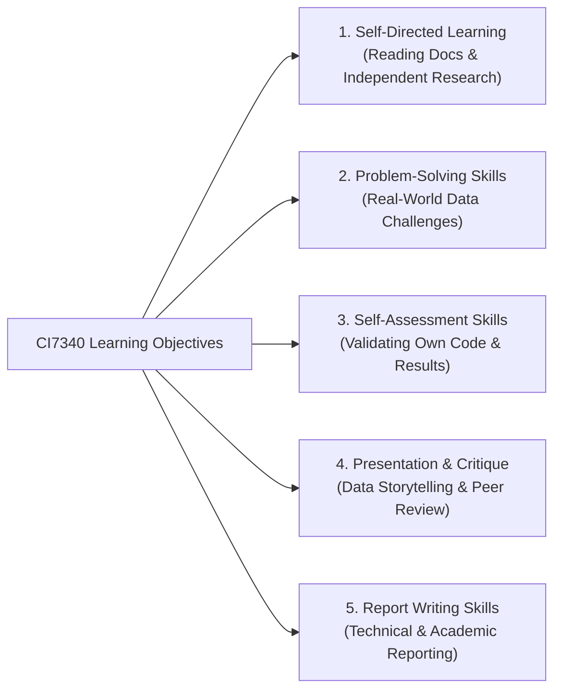
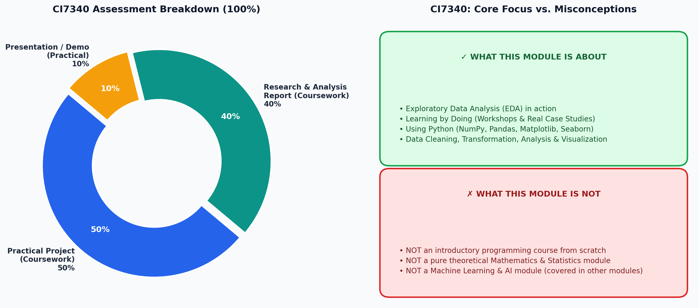
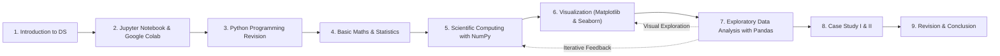

# පාඩම 1.1: Applied Data Programming (CI7340) පාඨමාලා හැඳින්වීම, අරමුණු සහ ඇගයීම් ව්‍යුහය (Module Overview, Expectations & Assessment Structure)

**මූලාශ්‍ර දේශන සටහන් (Source Lecture Notes):** `Introduction to Applied Data Programming Module.pdf` (Slides 1–13, Dr. Lochandaka Ranathunga)

> [!TIP]
> **📚 Prerequisite / Dependency Lesson Series:**
> මෙම පාඨමාලාවේ ප්‍රායෝගික කේතකරණය සඳහා භාවිතා කරන **Python Virtual Environments (`pip`, `venv`, `Conda`)**, **Jupyter Notebook** සහ **Google Colab** පිළිබඳ මූලික දැනුම ඔබට නොමැති නම්, පළමුව අපගේ සම්පූර්ණ Zero-to-Hero Dependency පාඩම් මාලාව කියවන්න:
> - [01_Python_Environments_Pip_Conda_and_Virtualenv.md](../dependencies/Dep_02_Jupyter_Notebook_and_Data_Science_Environment/01_Python_Environments_Pip_Conda_and_Virtualenv.md)
> - [02_Jupyter_Notebook_Architecture_Kernels_and_Shortcuts.md](../dependencies/Dep_02_Jupyter_Notebook_and_Data_Science_Environment/02_Jupyter_Notebook_Architecture_Kernels_and_Shortcuts.md)
> - [03_Markdown_Magic_Commands_and_Reproducible_DS_Workflows.md](../dependencies/Dep_02_Jupyter_Notebook_and_Data_Science_Environment/03_Markdown_Magic_Commands_and_Reproducible_DS_Workflows.md)

---

## හැඳින්වීම (Introduction)

MSc in Data Science පාඨමාලාවේ ඉතාම ප්‍රායෝගික සහ වැදගත් විෂයයක් වන **CI7340: Applied Data Programming** පාඩම් මාලාවේ පළමු ලිපියට ඔබව සාදරයෙන් පිළිගනිමු! ඔබ Lectures වලට සහභාගී නොවුණත්, මෙම විෂයයෙන් බලාපොරොත්තු වන්නේ කුමක්ද, එහි Learning Approach එක කෙබඳුද, සහ ඔබට ලකුණු ලැබෙන **Course Assessments** මොනවාද යන්න මුල සිටම පැහැදිලිව තේරුම් ගැනීම ඉතා වැදගත් වේ.

මෙම පාඨමාලාව සාම්ප්‍රදායිකව ගුරුවරයෙකු පැවසූ දේ කටපාඩම් කර විභාගයකට ලියන (**Traditional lecture-based approach**) විෂයයක් **නොවේ** (Slide 2). මෙය ප්‍රායෝගිකව Coding කරමින්, දත්ත විශ්ලේෂණය කරමින්, **Workshops** සහ සැබෑ ලෝකයේ **Case Studies** හරහා ක්‍රියාකාරීව ඉගෙන ගන්නා (**Active Learning / Learning by Doing**) විෂයයකි.

---

## 1. මෙම විෂයයෙන් ඔබ තුළ ගොඩනැගෙන ප්‍රධාන කුසලතා (Learning Objectives - Slide 2)

මෙම මොඩියුලය අවසානයේදී හුදෙක් Python කේත ලිවීමට එහා ගිය පුළුල් පර්යේෂණ සහ වෘත්තීය කුසලතා 5ක් ඔබ තුළ වර්ධනය කිරීම අරමුණු කරයි:

1. **Become self-directed learners (ස්වයං-අධ්‍යයන හැකියාව):** Data Science ක්ෂේත්‍රයේ තාක්ෂණයන් සහ Libraries දිනපතා වෙනස් වේ. එබැවින් තනිවම Official Documentation, පොත්පත් සහ Research Papers කියවා අලුත් දේ ඉගෙන ගැනීමේ හැකියාව.
2. **Develop problem-solving skills (ගැටලු විසඳීමේ කුසලතාව):** සැබෑ ලෝකයේ **Messy Data (අවිධිමත් දත්ත)** හමුවේ පැනනගින ව්‍යාපාරික හෝ පර්යේෂණ ගැටලුවකට ක්‍රමානුකූලව විසඳුම් සෙවීම.
3. **Self-assessment skills (ස්වයං-ඇගයීම් හැකියාව):** තමන් කළ විශ්ලේෂණයක හෝ ලියූ කේතයක නිවැරදිභාවය සහ අඩුපාඩු තමන්ටම පරීක්ෂා කර බලා වැඩිදියුණු කර ගැනීමේ හැකියාව.
4. **Presentation and critique skills (ඉදිරිපත් කිරීමේ සහ විචාරාත්මක කුසලතා):** දත්තවලින් සොයාගත් **Insights** අන් අයට පැහැදිලිව ඉදිරිපත් කිරීමටත්, වෙනත් අයෙකුගේ Data Analysis එකක් විද්‍යාත්මකව විචාරය (**Critique**) කිරීමටත් ඇති හැකියාව.
5. **Report writing skills (වාර්තා රචනා කිරීමේ හැකියාව):** විද්‍යාත්මක සහ වෘත්තීය මට්ටමින් **Research and Analysis Report** එකක් ලිවීමේ හැකියාව.



---

## 2. මෙම මොඩියුලය කුමක් ගැනද? සහ කුමක් ගැන නොවේද? (What This Module Is & Is Not! - Slides 3–4)

බොහෝ සිසුන් මෙම විෂයය පටලවා ගන්නා අවස්ථා තිබේ. Lecture Slides වල ඉතා පැහැදිලිව මෙම විෂයයේ සීමාවන් පෙන්වා දී ඇත:



### මෙම මොඩියුලය අදාළ වන්නේ (What this module IS about - Slide 3):
* **Exploratory Data Analysis (EDA - ගවේෂණාත්මක දත්ත විශ්ලේෂණය):** දත්ත ගවේෂණය කරමින් ඒවායේ සැඟවුණු **Patterns (රටාවන්)**, **Relationships (සම්බන්ධතා)** සහ **Outliers (අසාමාන්‍ය අගයන්)** හඳුනා ගැනීම.
* **Learning by Doing:** ප්‍රායෝගිකව Coding කරමින් සහ දත්ත සමඟ ගැටෙමින් ඉගෙනීම.
* **Solving Data Science Problems:** දැනට ඔබ සතු දැනුම සහ අලුතින් ඉගෙන ගන්නා ක්‍රමවේද භාවිතා කර Data Science ගැටලු විසඳීම.
* **Applied Data Science with Python:** Python භාෂාව භාවිතා කර දත්ත පිරිසිදු කිරීම (**Data Cleaning**), විශ්ලේෂණය කිරීම (**Data Analysis**) සහ ප්‍රස්තාර මගින් නිරූපණය කිරීම (**Data Visualization**).

### මෙම මොඩියුලය අදාළ නොවන්නේ (What this module is NOT! - Slide 4):
* **NOT an introduction to programming module:** ඔබට මූලික Programming සංකල්ප (`Variables`, `Loops`, `Functions`, `Control Flow`) ගැන මූලික අවබෝධයක් තිබිය යුතු අතර, පන්තියේදී කෙරෙන්නේ Python Revision එකක් සහ Data Science සඳහා Python යොදාගන්නා ආකාරය ඉගැන්වීමයි *(නමුත් කලබල නොවන්න: අපගේ Module 2 සහ Module 3 පාඩම් මාලාව මගින් Python මුල සිටම ආවරණය කර ඇත!)*.
* **NOT a mathematics and statistics module:** Data Science වලට අවශ්‍ය මූලික **Linear Algebra (රේඛීය වීජ ගණිතය)** සහ **Statistics (සංඛ්‍යානය)** පන්තියේදී මතක් කර දෙන නමුත්, ගැඹුරු ගණිතමය ඔප්පු කිරීම් මෙහි අරමුණ නොවේ; අරමුණ වන්නේ ඒවා Python හරහා දත්තවලට යොදා ගැනීමයි.
* **NOT a Machine Learning and AI module:** Machine Learning සහ Artificial Intelligence සඳහා ඔබට MSc පාඨමාලාවේ වෙනම මොඩියුල හමුවේ. මෙම විෂයයෙන් කෙරෙන්නේ Machine Learning Model එකකට දත්ත ලබා දීමට පෙර කළ යුතු වැදගත්ම කොටස වන **Data Wrangling, Data Cleaning, EDA සහ Data Visualization** ප්‍රගුණ කිරීමයි!

---

## 3. පාඨමාලාවේ ප්‍රධාන අරමුණු (Aims) සහ ඉගෙනුම් ඵල (Learning Outcomes - Slides 5–6)

### ප්‍රධාන අරමුණු (Aims - Slide 5):
1. දත්ත හැසිරවීම (**Data Manipulation**) සහ භාවිතය පිළිබඳ න්‍යායාත්මක හා ප්‍රායෝගික දැනුම ලබා දීම.
2. **Data-driven applications** ගොඩනැගීමට අවශ්‍ය පුළුල් සහ ශක්තිමත් ප්‍රායෝගික Programming කුසලතා ලබා දීම.
3. කර්මාන්තයේ භාවිතා වන නවීන මෙවලම් (**Industry-appropriate tools and technologies**) භාවිතා කරමින් සැබෑ ව්‍යාපෘති සඳහා එම දැනුම විචාරාත්මකව සහ ප්‍රතිවර්තනශීලීව (Critically and reflectively) යොදා ගැනීම.

### ඉගෙනුම් ඵල (Learning Outcomes - Slide 6):
මෙම මොඩියුලය සාර්ථකව අවසන් කරන ශිෂ්‍යයෙකුට පහත දේවල් කළ හැකි විය යුතුය:
* **LO1 (Data Preparation & Transformation):** **Structured Data (ව්‍යුහගත දත්ත)** සහ **Unstructured Data (ව්‍යුහගත නොවූ දත්ත)** විශ්ලේෂණය සඳහා සූදානම් කිරීම සහ විවිධ Platforms අතර දත්ත පරිවර්තනය කිරීමට සුදුසු ක්‍රමවේද තෝරා ගැනීම.
* **LO2 (Data Summary & Dimensionality Reduction):** Structured දත්ත ලබාගෙන, **Data Summary (දත්ත සාරාංශගත කිරීම)** සහ **Dimensionality Reduction (මානයන් අඩු කිරීම)** සඳහා Exploratory Data Mining ක්‍රමවේද හා Algorithms නිවැරදිව තෝරා ගැනීම සහ ඇගයීම.
* **LO3 (Pattern & Relationship Identification):** විශාල දත්ත කට්ටල (**Large datasets**) තුළ ඇති තොරතුරු අර්ථකථනය කිරීම සහ ඒවා අතර ඇති **Relationships (සම්බන්ධතා)** හඳුනාගෙන ප්‍රස්තාරිකව පෙන්වා දීම.
* **LO4 (Data Science Programming Environment):** Data Science සඳහා ගැළපෙන Programming Language එකකින් (`Python`), Environment එකක (`Jupyter Notebook` / `Google Colab`) සහ Infrastructure එකක කේත ලිවීම.
* **LO5 (Real-World Data Artefact):** සැබෑ ලෝකයේ දත්ත (**Real-world data**) මත පදනම් වූ ප්‍රායෝගික විසඳුමක් (**Artefact**) නිර්මාණය කරමින් Real-time applications සහ Data-driven ගැටලු පිළිබඳ අවබෝධය ප්‍රදර්ශනය කිරීම.

---

## 4. පාඨමාලාවේ ආවරණය වන මාතෘකා (Topics Covered - Slide 7)

දේශන සටහන්වලට අනුව මෙම පාඨමාලාව පහත ප්‍රධාන මාතෘකා 9 වටා ගොඩනැගී ඇත. *(වැදගත්: Slide 7 හි **"Note: This process is not linear!"** ලෙස අවධාරණය කර ඇති පරිදි, Data Science හිදී මෙම ක්‍රියාවලිය සරල රේඛීයව සිදු නොවන අතර නැවත නැවත පියවරයන් අතර එහා මෙහා යමින් **Iterative** ලෙස සිදු වේ)*:



1. **Introduction to Data Science (DS):** Data Warehousing, ETL, Big Data සහ Data Science Roadmap.
2. **Introduction to Jupyter Notebook and Google Colab:** කේත ලිවීමට සහ වාර්තා සැකසීමට භාවිතා කරන Interactive Environments *(මෙය ඉගෙනීමට අපගේ [Dep_02: Jupyter Notebook & Data Science Environment](../dependencies/Dep_02_Jupyter_Notebook_and_Data_Science_Environment/01_Python_Environments_Pip_Conda_and_Virtualenv.md) පාඩම් මාලාව කියවන්න!)*.
3. **Python Programming Revision:** Python Basics, Data Structures (`List`, `Tuple`, `Set`, `Dict`), Functions, Modules, `lambda` සහ List Comprehensions.
4. **Basic Maths and Statistics:** **Vectors (දෛශික)**, **Matrices (න්‍යාස)**, **Descriptive Statistics (විස්තරාත්මක සංඛ්‍යානය)** සහ **Inferential Statistics (අනුමාන සංඛ්‍යානය)**.
5. **Scientific Computing in Python using NumPy:** Multi-dimensional Arrays (`ndarray`) සහ වේගවත් Vectorized ගණිතමය ගණනය කිරීම්.
6. **Plotting and Visualization using Matplotlib and Seaborn:** දත්ත ප්‍රස්තාරිකව නිරූපණය කිරීමේ න්‍යාය සහ ප්‍රායෝගික කේතකරණය.
7. **Exploratory Data Analysis (EDA) with Pandas:** `Series` සහ `DataFrame` භාවිතයෙන් Data Cleaning, Manipulation සහ EDA.
8. **Case Study I and II:** සැබෑ දත්ත කට්ටල භාවිතා කරමින් කරන පූර්ණ ප්‍රායෝගික විශ්ලේෂණයන් (Classic Case Studies).
9. **Revision and Conclusion:** සමස්ත විෂය කරුණු සමාලෝචනය.

---

## 5. නිර්දේශිත පොත්පත්, Pre-Reading සහ උදව් ලබා ගන්නා ආකාරය (Slides 8–11)

### 5.1 නිර්දේශිත ප්‍රධාන පොත් 4 (Recommended Readings - Slides 8–9):

| පොතේ නම (Book Title) | කතුවරයා (Author) | ප්‍රකාශනය (Publisher) | වැදගත්කම (Why Read It?) |
| :--- | :--- | :--- | :--- |
| **Data Science from Scratch** *(Core Textbook)* | Joel Grus | O'Reilly Media, 2nd Ed (2019) | Libraries භාවිතා කිරීමට පෙර Pure Python වලින්ම මුල සිට Data Science සංකල්ප ගොඩනැගෙන ආකාරය තේරුම් ගැනීමට හොඳම ප්‍රධාන පෙළපොතයි (Official GitHub: `joelgrus/data-science-from-scratch`). |
| **Python for Data Analysis** | Wes McKinney | O'Reilly Media, 2nd Ed (2017) | `Pandas` library එක නිර්මාණය කළ Wes McKinney විසින්ම ලියන ලද, Data Wrangling, Pandas, NumPy සහ IPython සඳහා ඇති හොඳම අත්පොතයි. |
| **Python Data Science Handbook** | Jake VanderPlas | O'Reilly Media, 1st Ed (2017) | IPython, NumPy, Pandas, Matplotlib සහ Scikit-Learn එකම තැනකින් ප්‍රායෝගිකව ඉගෙන ගැනීමට ඉතාම වටිනා පොතකි. |
| **The Data Science Handbook** | Field Cady | John Wiley & Sons (2017) | සැබෑ ලෝකයේ Data Science ව්‍යාපෘතියක් සැලසුම් කරන ආකාරය (Data Science Roadmap) විස්තර කරන පොතයි *(මෙහි 2 වන පරිච්ඡේදය Lesson 1.6–1.8 හි ආවරණය වේ)*. |

### 5.2 Pre-Reading සහ Where to Look for Help (Slides 10–11):
* **Pre-Reading (පූර්ව සූදානම):**
  * Programming හි මූලික සංකල්ප (`Variables`, `Functions`, `Control Flow`, සහ `Arrays`/`Lists`, `Dictionaries` වැනි Python Data Structures).
  * මූලික **Linear Algebra (රේඛීය වීජ ගණිතය)** සහ **Statistics (සංඛ්‍යානය)**.
* **Where to Look for Help (Slide 11):**
  * නිල Python Library Homepages (`numpy.org`, `pandas.pydata.org`, `matplotlib.org`), Data Science Blogs (Towards Data Science, Real Python), Video Tutorials, සහ Slack/StackOverflow ප්‍රජාවන් අනුගමනය කරන්න. සියල්ලටම වඩා වැදගත් වන්නේ **දිනපතා ප්‍රායෝගිකව කේත ලියමින් පුහුණු වීමයි (Practice!)**.

---

## 6. ලකුණු ලබා දෙන ඇගයීම් ව්‍යුහය (Course Assessment Structure - Slide 12)

මෙම විෂයයට ලිඛිත විභාග ප්‍රශ්න පත්‍රයක් (Written Exam) වෙනුවට **100%ක්ම Coursework සහ Practical** මගින් ලකුණු ලබා දේ:

| Description of Assessment | Definitive Unistats Category | Percentage | ඔබ කළ යුතු දේ (What is Expected) |
| :--- | :---: | :---: | :--- |
| **1. Research and analysis report** | Coursework | **40%** | ලබා දෙන හෝ තෝරාගත් Real-world dataset එකක් මත Exploratory Data Analysis (EDA) සිදු කර, සංඛ්‍යානමය සහ ප්‍රස්තාරික සාක්ෂි සහිතව විද්‍යාත්මක වාර්තාවක් ලිවීම. |
| **2. Practical project** | Coursework | **50%** | සැබෑ ලෝකයේ දත්ත භාවිතා කරමින් Python (`NumPy`, `Pandas`, `Matplotlib`/`Seaborn`) හරහා Data Cleaning, Transformation සහ Analysis ඇතුළත් සම්පූර්ණ කේතමය විසඳුමක් (**Artefact**) ගොඩනැගීම. |
| **3. Presentation / Demo** | Practical | **10%** | ඔබ කළ ව්‍යාපෘතිය සහ සොයාගත් ප්‍රතිඵල පැහැදිලිව ඉදිරිපත් කිරීම සහ කේතය සජීවීව ක්‍රියාත්මක කර පෙන්වීම (**Live Demonstration**). |
| **Total** | | **100%** | |

---

## 🛠️ Practical Task / Hands-On Exercise (ප්‍රායෝගික අභ්‍යාසය)

### Scenario / Goal:
ඔබ CI7340 විෂයයෙන් **Distinction (≥ 70%)** සාමාර්ථයක් ලබා ගැනීමට ඉලක්ක කරන ශිෂ්‍යයෙකි. Slide 12 හි දක්වා ඇති ඇගයීම් ව්‍යුහය (**40% Report, 50% Practical Project, 10% Presentation/Demo**) අනුව ශිෂ්‍යයින් කිහිප දෙනෙකුගේ ලකුණු ගණනය කරන සහ ඔවුන්ගේ ලකුණුවල **Weighted Average (බරිත මධ්‍යන්‍යය)**, **Arithmetic Mean (සමාන්තර මධ්‍යන්‍යය)** සහ **Standard Deviation (සම්මත අපගමනය)** ගණනය කරන Python Script එකක් ලියන්න.

### Step-by-Step Tasks:
1. ඇගයීම් අංග 3හි බර තැබීම් (`weights = {"report": 0.40, "project": 0.50, "demo": 0.10}`) Dictionary එකක් ලෙස අර්ථ දක්වන්න.
2. ශිෂ්‍යයෙකුගේ ලකුණු 3 ලබා දුන් විට අවසාන මුළු ලකුණ (`Final Grade`) සහ සාමාර්ථ මට්ටම (`Distinction` ≥ 70, `Merit` 60–69, `Pass` 50–59, `Fail` < 50) ලබා දෙන Function එකක් ලියන්න.
3. ඔබට දැනට Research Report එකට ලකුණු `72` ක් සහ Presentation/Demo එකට ලකුණු `80` ක් ලැබී ඇතැයි උපකල්පනය කර, මුළු විෂයයෙන් **Distinction (`70.0`)** ලබා ගැනීමට ලකුණු 50%ක් හිමි **Practical Project** එකට අවම වශයෙන් ලකුණු කීයක් ලබා ගත යුතුදැයි සමීකරණය විසඳා සොයන්න:
   $$\text{Required Project Score} = \frac{\text{Target Total} - (0.40 \times \text{Report} + 0.10 \times \text{Demo})}{0.50}$$

### Starter Code:
```python
weights = {"report": 0.40, "project": 0.50, "demo": 0.10}

def evaluate_student(name, report_score, project_score, demo_score):
    # TODO: Calculate weighted final score and classification
    pass

# TODO: Calculate minimum project score needed for 70% Distinction if report=72 and demo=80
```

### Expected Output / Reference Solution:
```python
import numpy as np

weights = {"report": 0.40, "project": 0.50, "demo": 0.10}

def evaluate_student(name, report_score, project_score, demo_score):
    final_score = (
        report_score * weights["report"]
        + project_score * weights["project"]
        + demo_score * weights["demo"]
    )
    if final_score >= 70:
        grade = "Distinction"
    elif final_score >= 60:
        grade = "Merit"
    elif final_score >= 50:
        grade = "Pass"
    else:
        grade = "Fail"
    return {"name": name, "final_score": round(final_score, 2), "grade": grade}

students = [
    evaluate_student("Kasun", 72, 78, 80),
    evaluate_student("Nimali", 65, 62, 70),
    evaluate_student("Ruwan", 55, 58, 60),
]

for s in students:
    print(f"{s['name']:8s} -> Final Score: {s['final_score']:5.2f}% | Grade: {s['grade']}")

scores = [s["final_score"] for s in students]
print(f"\nClass Arithmetic Mean    : {np.mean(scores):.2f}%")
print(f"Class Standard Deviation : {np.std(scores):.2f}%")

# Minimum project score needed for Distinction (70%) given Report=72, Demo=80
target_total = 70.0
report_s, demo_s = 72.0, 80.0
min_project_needed = (target_total - (0.40 * report_s + 0.10 * demo_s)) / 0.50
print(f"\nMinimum Practical Project score needed for Distinction: {min_project_needed:.1f}%")
```

**Expected Output:**
```text
Kasun    -> Final Score: 75.80% | Grade: Distinction
Nimali   -> Final Score: 64.00% | Grade: Merit
Ruwan    -> Final Score: 57.00% | Grade: Pass

Class Arithmetic Mean    : 65.60%
Class Standard Deviation : 7.76%

Minimum Practical Project score needed for Distinction: 66.4%
```

---

## 📝 Summary & Exam Revision Cheat Sheet

| Aspect | Key Detail from Lecture Slides |
| :--- | :--- |
| **Module Code & Title** | **CI7340: Applied Data Programming** (Active Learning / Workshops & Case Studies). |
| **Core Focus** | **Exploratory Data Analysis (EDA)**, Data Cleaning, Manipulation & Visualization in Python. |
| **What It Is NOT** | Not an Intro Programming module, Not a pure Math/Stats module, Not an ML/AI module. |
| **Core Textbook** | *Data Science from Scratch* (2nd Ed, 2019) by Joel Grus. |
| **Assessment Weights** | **40%** Research & Analysis Report + **50%** Practical Project + **10%** Presentation/Demo = **100%**. |

---

**ඊළඟ පාඩම (Next Lesson):** [Lesson 1.2: Data Asset Organization, Data Warehousing & ETL](Lesson_1.2_Data_Asset_Organization_Data_Warehousing_and_ETL.md) — ආයතනයක දත්ත ගබඩා කරන ආකාරය, Data Warehousing සහ ETL ක්‍රියාවලිය මුල සිට සරලව ඉගෙන ගනිමු.
