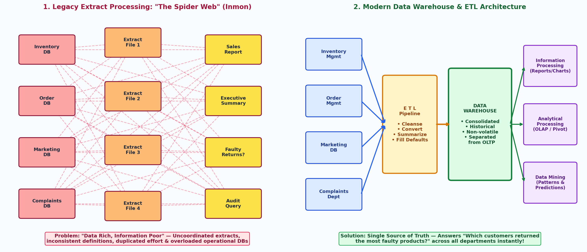
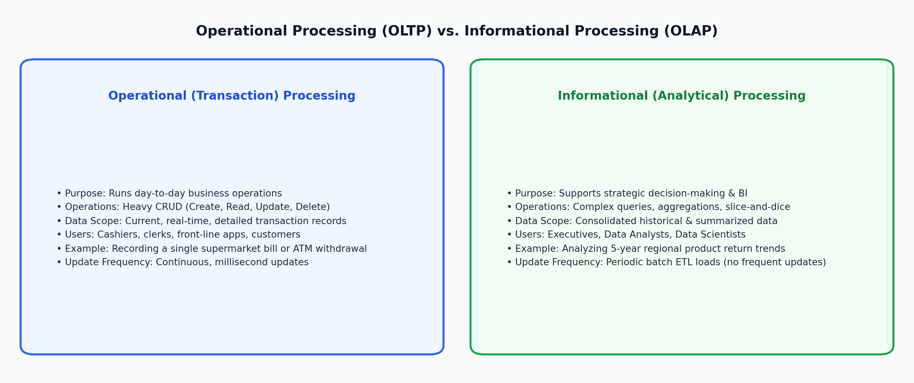
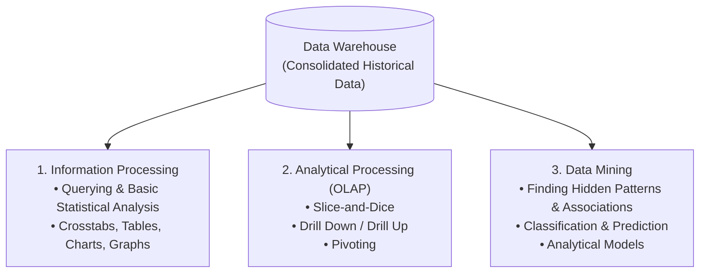
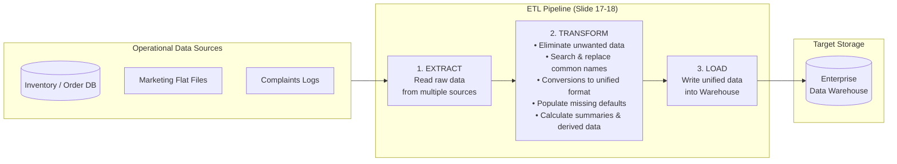

# පාඩම 1.2: දත්ත සංවිධානය, Data Warehousing සහ ETL ක්‍රියාවලිය (Data Asset Organization, Data Warehousing & ETL)

**මූලාශ්‍ර දේශන සටහන් (Source Lecture Notes):** `Introduction to Data Science.pdf` (Slides 1–18, Dr. L. Ranathunga)

> [!TIP]
> **📚 Prerequisite / Dependency Lesson Series:**
> මෙම පාඩමේදී සාකච්ඡා කෙරෙන **Relational Databases (RDBMS)**, **SQL Joins**, **OLTP vs. OLAP**, **Star Schema** සහ **ETL / Data Lakes** පිළිබඳ මූලික දැනුම ඔබට නොමැති නම්, පළමුව අපගේ සම්පූර්ණ Zero-to-Hero Dependency පාඩම් මාලාව කියවන්න:
> - [01_Relational_Databases_Tables_Keys_and_SQL_Basics.md](../dependencies/Dep_01_RDBMS_SQL_and_Data_Warehousing_Foundations/01_Relational_Databases_Tables_Keys_and_SQL_Basics.md)
> - [02_OLTP_vs_OLAP_and_Star_Snowflake_Schemas.md](../dependencies/Dep_01_RDBMS_SQL_and_Data_Warehousing_Foundations/02_OLTP_vs_OLAP_and_Star_Snowflake_Schemas.md)
> - [03_ETL_Pipelines_Data_Warehouses_Data_Marts_and_Data_Lakes.md](../dependencies/Dep_01_RDBMS_SQL_and_Data_Warehousing_Foundations/03_ETL_Pipelines_Data_Warehouses_Data_Marts_and_Data_Lakes.md)

---

## හැඳින්වීම (Introduction)

Data Science ගැන කතා කිරීමට පෙර, ආයතනයක් තුළ "දත්ත" (**Data Assets**) එකතු වන්නේ කෙසේද, ඒවා ගබඩා කරන්නේ කොහේද සහ තීරණ ගැනීම සඳහා එම දත්ත සූදානම් කරගන්නේ කෙසේද යන්න තේරුම් ගත යුතුය. බොහෝ ආයතන සතුව දත්ත විශාල ප්‍රමාණයක් තිබුණත්, ඒවායින් ප්‍රයෝජනවත් තීරණ ගැනීමට නොහැකි වී ඇත්තේ දත්ත නිවැරදිව සංවිධානය කර නොමැති නිසාය. මෙම පාඩමෙන් අපි **Database**, **Data Warehouse**, **Operational vs. Informational Processing (OLTP vs. OLAP)**, සහ **ETL (Extract, Transform, Load)** යන මූලික සංකල්ප ඉතා සරලව සහ ගැඹුරින් ඉගෙන ගනිමු.

---

## 1. මූලික අර්ථ දැක්වීම්: Data, Database සහ Warehouse (Slide 3)

දේශන සටහන් ආරම්භයේදීම (Slide 3) ඉතා වැදගත් මූලික පද 3ක් හඳුන්වා දෙයි:

1. **Data:** යම්කිසි දෙයක් පිළිබඳව ඇති කරුණු සහ තොරතුරු (*Facts and information about something*). උදාහරණයක් ලෙස පාරිභෝගිකයෙකුගේ නම, මිලදී ගත් භාණ්ඩය, දිනය සහ මිල.
2. **Database:** දත්ත ඇතුළත් කිරීම, කියවීම, වෙනස් කිරීම සහ මකා දැමීම (**CRUD Operations** — *Create, Read, Update, Delete*), සෙවීම (**Search**) සහ හැසිරවීම (**Manipulation**) පහසු වන පරිදි දත්ත ක්‍රමානුකූලව සංවිධානය කර ඇති පද්ධතියකි.
3. **Warehouse:** භාණ්ඩ හෝ දත්ත විශාල වශයෙන් එක්රැස් කර තබා ගන්නා මධ්‍යගත ස්ථානයකි (*A location for storing things*).

---

## 2. දත්ත ගබඩාකරණයේ ඉතිහාසය සහ "Spider Web" ගැටලුව (Slides 4–8)

පරිගණක පද්ධති ආරම්භ වූ මුල් කාලයේ (Slide 4–7, Data Warehousing හි පියා ලෙස සැලකෙන **Bill Inmon** ගේ ආකෘතියට අනුව) දත්ත ගබඩාකරණය පියවර 4ක් ඔස්සේ විකාශනය විය:

1. **Data Storage - The Beginnings (Slide 4):** මුලින්ම තිබුණේ එක් ප්‍රධාන Master File එකක් (බොහෝවිට Magnetic Tapes / Disks මත) සහ ඒ මත ක්‍රියාත්මක වන තනි පරිගණක වැඩසටහන් (Programs) කිහිපයක් පමණි.
2. **Extract Processing (Slide 5):** ආයතනවලට විවිධ වාර්තා (Reports) අවශ්‍ය වූ විට, ප්‍රධාන Database එකෙන් දත්ත කොටසක් පිටතට ගෙන (**Extract File**), වෙනම ගොනුවක් සාදාගෙන එයින් වාර්තා සැකසීමට පටන් ගත්තේය.
3. **Kept Growing (Slide 6):** කාලයත් සමඟ එක Extract ගොනුවකින් තවත් Extract ගොනුවක්ද, එයින් තවත් ගොනුවක්ද ලෙස පාලනයකින් තොරව දත්ත පිටපත් කිරීම් දහස් ගණනක් ඇති විය.
4. **Now a Spider Web (Slide 7):** අවසානයේදී ආයතනයේ දත්ත පද්ධතිය කිසිවෙකුට තේරුම් ගත නොහැකි මකුළු දැලක් (**Spider Web Architecture**) බවට පත් විය! එකම ප්‍රශ්නයට දෙපාර්තමේන්තු දෙකකින් එකිනෙකට පරස්පර වාර්තා දෙකක් ලැබෙන තත්ත්වයක් උදා විය.



### මෙම "Spider Web" තත්ත්වය නිසා ඇති වූ ප්‍රධාන ගැටලුව (Slide 8):
> **"Organisations are data rich and information poor."**  
> *(ආයතන සතුව දත්ත ඕනෑතරම් තිබුණත් [Data Rich], තීරණ ගැනීමට අවශ්‍ය නිවැරදි තොරතුරු නොමැති [Information Poor] තත්ත්වයකට පත් විය.)*

මීට හේතුව වූයේ බොහෝ පරිගණක පද්ධති නිර්මාණය කර තිබුණේ එදිනෙදා වැඩකටයුතු (**Operational Processing**) කරගෙන යාමට මිස, කළමනාකාරීත්වයට තීරණ ගැනීමට (**Decision Making**) අවශ්‍ය විශ්ලේෂණයන් සිදු කිරීමට නොවීමයි.

---

## 3. Operational Processing (OLTP) vs. Informational Processing (OLAP) (Slides 9–10)

දේශන සටහනේ 9 සහ 10 වන Slides මගින් දත්ත සැකසුම් ක්‍රම දෙකක ප්‍රධාන වෙනස පැහැදිලි කරයි:



| ලක්ෂණය (Feature) | Operational Processing (Transaction Processing / OLTP) | Informational Processing (Analytical Processing / OLAP) |
| :--- | :--- | :--- |
| **මූලික අරමුණ** | ආයතනයේ එදිනෙදා කටයුතු (**Daily operations**) පවත්වාගෙන යාම. | කළමනාකාරීත්වයට තීරණ ගැනීමට (**Decision making**) සහාය වීම. |
| **දත්තවල ස්වභාවය** | වර්තමාන, සවිස්තරාත්මක ගනුදෙනු දත්ත (**Raw transaction data**). | සාරාංශගත කළ (**Summarised**) සහ ඓතිහාසික (**Historical**) දත්ත. |
| **සිදුවන ක්‍රියාවලීන්** | දත්ත නිරන්තරයෙන් ඇතුළත් කිරීම සහ වෙනස් කිරීම (`INSERT`, `UPDATE`, `DELETE`). | දත්ත විශ්ලේෂණය කිරීම, සංසන්දනය කිරීම සහ වාර්තා ලබා ගැනීම (`SELECT` / Aggregations). |
| **උදාහරණ** | සුපිරි වෙළඳසැලක බිලක් කැඩීම, ATM යන්ත්‍රයකින් මුදල් ගැනීම. | පසුගිය වසර 5 තුළ වැඩිම අලෙවියක් තිබූ භාණ්ඩ මොනවාදැයි සෙවීම. |

> [!TIP]
> **📚 Deep-Dive Dependency Link:** OLTP සහ OLAP පද්ධතිවල Schema සැලසුම් (**3NF vs. Star Schema & Snowflake Schema**) ගැන ගැඹුරින් ඉගෙනීමට [02_OLTP_vs_OLAP_and_Star_Snowflake_Schemas.md](../dependencies/Dep_01_RDBMS_SQL_and_Data_Warehousing_Foundations/02_OLTP_vs_OLAP_and_Star_Snowflake_Schemas.md) කියවන්න.

---

## 4. Data Warehouse එකක අවශ්‍යතාවය සහ මූලික ලක්ෂණ (Slides 11–12)

එදිනෙදා ගනුදෙනු සිදුවන Operational Database එකකම විශාල විශ්ලේෂණ (Heavy Analytical Queries) දුවන්නට ගියහොත් මුළු ආයතනයේම එදිනෙදා පද්ධති මන්දගාමී වී බිඳ වැටිය හැක. 

එම නිසා, **එදිනෙදා Operational පද්ධතිවලට කිසිදු බාධාවක් නොවන පරිදි** (*without disturbing existing operational processing*) විශ්ලේෂණ කටයුතු සිදු කිරීම සඳහා **Data Warehousing** බිහි විය (Slide 11). එය විවිධ මූලාශ්‍රවලින් දත්ත එකතු කර, ඒකාබද්ධ කර (**Consolidate & Integrate**), නිවැරදි ව්‍යාපාරික තීරණ ගැනීමට ගැළපෙන ආකෘතියකින් ගබඩා කරයි.

### Data Warehouse එකක මූලික ලක්ෂණ 6 (Baselines of a Data Warehouse - Slide 12):
1. **Separated from Operational DB:** එදිනෙදා ගනුදෙනු සිදුවන Operational Database එකෙන් වෙන්ව පවතින වෙනම Database එකකි.
2. **No Frequent Updating:** තත්පරයෙන් තත්පරයට දත්ත වෙනස් කිරීමක් මෙහි සිදු නොවේ (කාලීනව Scheduled Batch වශයෙන් දත්ත එක් කෙරේ).
3. **Consolidated Historical Data:** වසර ගණනාවක ඒකාබද්ධ කළ ඓතිහාසික දත්ත මෙහි අඩංගු වේ.
4. **Supports Strategic Decisions:** ආයතනයේ ඉහළ විධායක නිලධාරීන්ට (**Executives**) උපායමාර්ගික තීරණ ගැනීමට දත්ත තේරුම් ගැනීම පහසු කරයි.
5. **Integration of Diverse Application Systems:** ආයතනයේ විවිධ දෙපාර්තමේන්තුවල ඇති වෙනස්ම වර්ගයේ පද්ධති (Inventory, Order, Marketing, Complaints) එකම තැනකට ඒකාබද්ධ කරයි.
6. **Consolidated Historical Data Analysis:** දිගුකාලීන **Trends (ප්‍රවණතා)** විශ්ලේෂණය කිරීමට ඉඩ සලසයි.

### Topic Gap Analysis — Bill Inmon's Four Formal Properties of a Data Warehouse:
දේශන සටහන්වල කරුණු තවදුරටත් පැහැදිලි කර ගැනීමට Bill Inmon විසින් Data Warehouse එකක් සඳහා ඉදිරිපත් කළ සම්මත ලක්ෂණ 4 මතක තබා ගැනීම විභාගවලට ඉතා වැදගත් වේ:
* **Subject-Oriented:** එදිනෙදා ක්‍රියාවලීන් වෙනුවට `Customer`, `Product`, `Sales` වැනි ප්‍රධාන ව්‍යාපාරික මාතෘකා වටා සංවිධානය කර ඇත.
* **Integrated:** විවිධ මූලාශ්‍රවල පරස්පරතා (Naming/Format conflicts) ඉවත් කර එකම සම්මතයකට ගෙනැවිත් ඇත.
* **Time-Variant:** සෑම දත්තයකටම කාල මුද්‍රාවක් (Timestamp / Historical period) ඇති අතර වසර 5–10ක ඉතිහාසය රඳවා ගනී.
* **Non-Volatile:** වරක් ඇතුළත් කළ ඓතිහාසික දත්ත මකා දැමීමක් හෝ වෙනස් කිරීමක් සිදු නොවේ (Read-only analytical history).

---

## 5. Business Intelligence (BI) ගැටලුව සහ Typical BI Architecture (Slides 13–16)

### Data Analytics අවශ්‍ය වන්නේ කාටද? (Slide 13)
* අතිවිශාල දත්ත ප්‍රමාණයක් මත පදනම්ව තීරණ ගන්නා අයට (**Decision makers**).
* විවිධ දත්ත මූලාශ්‍ර කිහිපයකින් තොරතුරු එකතු කර සංකීර්ණ ක්‍රියාවලීන් භාවිතා කරන පරිශීලකයින්ට.
* විශාල දත්ත ප්‍රමාණයක් මත ඉතා වේගයෙන් **Reports, Grids සහ Charts** ලබා ගැනීමට අවශ්‍ය අයට.

### ප්‍රායෝගික උදාහරණය (The Problem for Business Intelligence - Slide 14):
ආයතනයක ප්‍රධානියා මෙවැනි සරල ප්‍රශ්නයක් අසයි යැයි සිතන්න:  
> **"Which of our customers have returned the most faulty products?"**  
> *(අපගේ පාරිභෝගිකයින් අතරින් දෝෂ සහිත භාණ්ඩ වැඩියෙන්ම ආපසු භාර දී ඇත්තේ කවුරුන්ද?)*

මෙම ප්‍රශ්නයට පිළිතුරු දීමට ආයතනයේ වෙන වෙනම පවතින දෙපාර්තමේන්තු 4ක (**Data Silos**) දත්ත අවශ්‍ය වේ:
1. **Inventory Management** (භාණ්ඩ තොග පද්ධතිය)
2. **Order Management** (ඇණවුම් පද්ධතිය)
3. **Marketing Database** (පාරිභෝගික තොරතුරු පද්ධතිය)
4. **Complaints Department** (පැමිණිලි අංශයේ දත්ත)

Data Warehouse එකක් නොමැති නම්, මෙම දෙපාර්තමේන්තු 4හි පද්ධති එකිනෙකට සම්බන්ධ නැති නිසා මෙම ප්‍රශ්නයට පිළිතුරු සෙවීමට සති ගණනක් ගත වේ. නමුත් **Typical Business Intelligence Architecture (Slide 16)** එකකදී ETL හරහා මෙම පද්ධති 4හිම දත්ත Data Warehouse එකට ගෙනැවිත්, ඒ මතින් Departmental **Data Marts** සහ **OLAP / Reporting / Data Mining** මෙවලම් සම්බන්ධ කර ඇති නිසා තත්පර කිහිපයකින් පිළිතුර ලබා ගත හැක!

---

## 6. Data Warehouse එකක් මත සිදුවන ප්‍රධාන දත්ත සැකසුම් වර්ග 3 (Slide 15)

Data Warehouse එකක තැන්පත් කර ඇති දත්ත ප්‍රධාන මට්ටම් 3කින් විශ්ලේෂණය කළ හැක:



1. **Information Processing:**
   * Queries ලිවීම, මූලික සංඛ්‍යානමය ගණනය කිරීම් (**Basic statistical analysis**), වගු (**Crosstabs / Tables**) සහ ප්‍රස්තාර (**Charts / Graphs**) හරහා වාර්තා ලබා ගැනීම.
2. **Analytical Processing (OLAP):**
   * Multi-dimensional ලෙස දත්ත විශ්ලේෂණය කිරීම. මෙහිදී ප්‍රධාන OLAP operations 4ක් භාවිතා වේ:
     * **Slice-and-Dice:** දත්තවලින් විශේෂිත කොටසක් (උදා: 2024 වසරේ කොළඹ දිස්ත්‍රික්කයේ පමණක්) වෙන් කර බැලීම.
     * **Drill Down:** සාරාංශ දත්තයක සිට සවිස්තරාත්මක දත්ත දක්වා ගැඹුරට යාම (උදා: වාර්ෂික ආදායමේ සිට මාසික ආදායම $\rightarrow$ දෛනික ආදායම දක්වා).
     * **Drill Up (Roll Up):** සවිස්තරාත්මක දත්ත නැවත ඉහළ මට්ටමකට සාරාංශ කිරීම (දින $\rightarrow$ මාස $\rightarrow$ වසර).
     * **Pivoting:** වගුවක Rows සහ Columns හරවා විවිධ කෝණවලින් දත්ත නිරීක්ෂණය කිරීම.
3. **Data Mining:**
   * දත්ත තුළ සැඟවී ඇති රටාවන් (**Hidden patterns**) සහ සම්බන්ධතා (**Associations**) සොයා ගැනීම, Analytical models ගොඩනැගීම, **Classification (වර්ගීකරණය)** සහ **Prediction (පුරෝකථනය / අනාවැකි පළ කිරීම)**.

---

## 7. ETL ක්‍රියාවලිය: Extract, Transform and Load (Slides 16–18)

විවිධ Operational Databases වල ඇති අවිධිමත් දත්ත Data Warehouse එක වෙත ගෙන ඒමට භාවිතා කරන තාක්ෂණික පාලම **ETL** ලෙස හැඳින්වේ:



### ETL හි ප්‍රධාන කාර්යයන් (ETL Functionality - Slide 18):
Data Scientist කෙනෙකු Python (`Pandas`) මගින් කරන Data Wrangling ක්‍රියාවලියටම සමාන කාර්යයන් 5ක් ETL මෙවලම් මගින් සිදු කරයි:
1. **Conversions & Unified Format:** විවිධ දත්ත ආකෘති (උදා: විවිධ දින ආකෘති `DD/MM/YYYY` සහ `MM-DD-YYYY`, හෝ මුදල් ඒකක) එකම පොදු ආකෘතියකට (**Unified format**) හැරවීම.
2. **Eliminate unwanted data:** විශ්ලේෂණයට අනවශ්‍ය හෝ දෝෂ සහිත දත්ත ඉවත් කිරීම.
3. **Search and replace common names and definitions:** එකම දෙය විවිධ පද්ධතිවල විවිධ නම්වලින් තිබේ නම් (උදා: එක තැනක `M/F`, තව තැනක `Male/Female`) ඒවා එකම සම්මතයකට ගෙන ඒම.
4. **Calculate summaries and derived data:** පවතින දත්තවලින් අලුත් අගයන් (**Derived data**) සහ සාරාංශ (**Summaries**) ගණනය කිරීම (උදා: `Unit Price * Quantity = Total Revenue`).
5. **Populate missing data with defaults:** අඩුපාඩු සහිත හිස් දත්ත (**Missing values / Nulls**) සඳහා සුදුසු Default අගයන් ආදේශ කිරීම.

---

## 🛠️ Practical Task / Hands-On Exercise (ප්‍රායෝගික අභ්‍යාසය)

### Scenario / Goal:
Slide 14 හි දක්වා ඇති Business Intelligence ගැටලුව (**"Which of our customers have returned the most faulty products?"**) Python සහ `Pandas` භාවිතා කරමින් විසඳමු! ඔබට දෙපාර්තමේන්තු 3ක වෙන වෙනම පවතින වගු 3ක් (`marketing_customers`, `orders`, සහ `complaints_returns`) ලබා දී ඇත. Slide 18 හි දැක්වෙන ETL පියවර අනුගමනය කරමින් මෙම වගු 3 පිරිසිදු කර, ඒකාබද්ධ කර, වැඩියෙන්ම Faulty Products ආපසු භාර දුන් පාරිභෝගිකයා සොයා ගන්න.

### Step-by-Step Tasks:
1. **Extract & Standardize (Search & Replace):** `marketing_customers` වගුවේ `city` තීරුවේ `'CMB'` සහ `'Colombo'` ලෙස විවිධ නම්වලින් ඇති අගයන් `'Colombo'` ලෙස එකම සම්මතයකට ගෙන එන්න.
2. **Eliminate Unwanted Data & Populate Missing Defaults:** `complaints_returns` වගුවේ `reason == 'FAULTY'` වන පේළි පමණක් තෝරාගෙන, හිස් (`None`) `returned_qty` අගයන් සඳහා Default අගය ලෙස `1` ආදේශ කරන්න.
3. **Integrate & Summarize (Load to Analytical View):** වගු 3 `customer_id` සහ `order_id` ඔස්සේ Join (`pd.merge`) කර, එක් එක් පාරිභෝගිකයා ආපසු භාර දුන් මුළු Faulty භාණ්ඩ ගණන (`total_faulty_returned`) වැඩිම අගයේ සිට අඩුම අගයට පෙළගස්වන්න.

### Starter Code & Reference Solution:
```python
import pandas as pd

# 1. Raw Data from Separate Departmental Databases (Slide 14)
marketing_customers = pd.DataFrame([
    {"customer_id": 101, "name": "Kasun Perera",  "city": "CMB"},
    {"customer_id": 102, "name": "Nimali Silva",  "city": "Kandy"},
    {"customer_id": 103, "name": "Ruwan Fernando","city": "Colombo"},
])

orders = pd.DataFrame([
    {"order_id": 501, "customer_id": 101, "product": "Blender"},
    {"order_id": 502, "customer_id": 102, "product": "Toaster"},
    {"order_id": 503, "customer_id": 101, "product": "Iron"},
    {"order_id": 504, "customer_id": 103, "product": "Kettle"},
])

complaints_returns = pd.DataFrame([
    {"return_id": 1, "order_id": 501, "reason": "FAULTY",       "returned_qty": 2},
    {"return_id": 2, "order_id": 502, "reason": "WRONG_COLOR",  "returned_qty": 1},
    {"return_id": 3, "order_id": 503, "reason": "FAULTY",       "returned_qty": None},
    {"return_id": 4, "order_id": 504, "reason": "FAULTY",       "returned_qty": 1},
])

# 2. TRANSFORM Step:
# 2a. Search & replace common names
marketing_customers["city"] = marketing_customers["city"].replace({"CMB": "Colombo"})

# 2b. Eliminate non-faulty returns & populate missing defaults
faulty_df = complaints_returns[complaints_returns["reason"] == "FAULTY"].copy()
faulty_df["returned_qty"] = faulty_df["returned_qty"].fillna(1).astype(int)

# 3. INTEGRATE & ANALYZE (Answering the BI Question):
merged = (
    faulty_df
    .merge(orders, on="order_id", how="inner")
    .merge(marketing_customers, on="customer_id", how="inner")
)

bi_report = (
    merged.groupby(["customer_id", "name", "city"], as_index=False)["returned_qty"]
    .sum()
    .rename(columns={"returned_qty": "total_faulty_returned"})
    .sort_values(by="total_faulty_returned", ascending=False)
)

print("--- BI Report: Customers Returning the Most Faulty Products ---")
print(bi_report.to_string(index=False))
```

**Expected Output:**
```text
--- BI Report: Customers Returning the Most Faulty Products ---
 customer_id           name    city  total_faulty_returned
         101   Kasun Perera Colombo                      3
         103 Ruwan Fernando Colombo                      1
```

---

## 📝 Summary & Exam Revision Cheat Sheet

| Term / Concept | Key Exam Point |
| :--- | :--- |
| **"Data rich, information poor"** | Operational පද්ධතිවල දත්ත විශාල වශයෙන් තිබුණත් තීරණ ගැනීමට අවශ්‍ය විශ්ලේෂණාත්මක තොරතුරු නොමැති වීම (Slide 8). |
| **Operational (OLTP) vs. Informational (OLAP)** | OLTP එදිනෙදා ගනුදෙනු (`CRUD`) සඳහා වන අතර, OLAP ඓතිහාසික දත්ත මත තීරණ ගැනීමට (Decision Making) භාවිතා වේ. |
| **OLAP Operations** | `Slice-and-Dice`, `Drill Down`, `Drill Up (Roll Up)`, සහ `Pivoting` (Slide 15). |
| **ETL (Extract, Transform, Load)** | Conversions, Summarizations, Eliminating unwanted data, Standardizing names, සහ Populating missing defaults (Slide 18). |

---

**ඊළඟ පාඩම (Next Lesson):** [Lesson 1.3: Introduction to Big Data — Structured vs. Unstructured Data](Lesson_1.3_Introduction_to_Big_Data_Structured_vs_Unstructured.md) — Big Data යනු කුමක්ද, Heathrow ගුවන්තොටුපොළ හා Social Media උදාහරණ සහ Structured / Unstructured දත්ත අතර වෙනස ඉගෙන ගනිමු.
