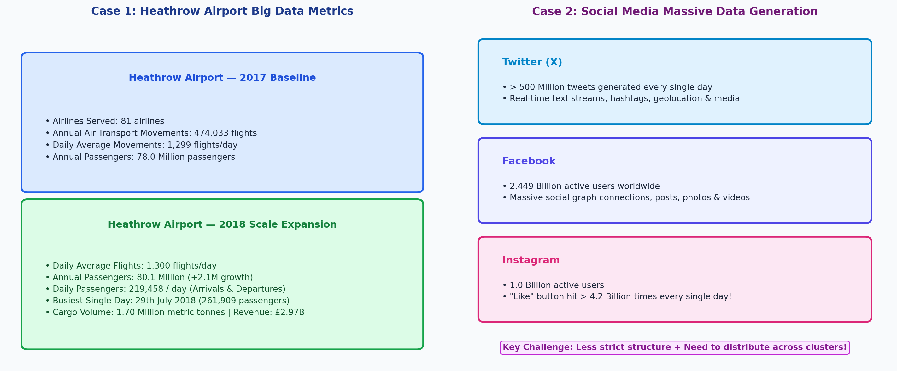
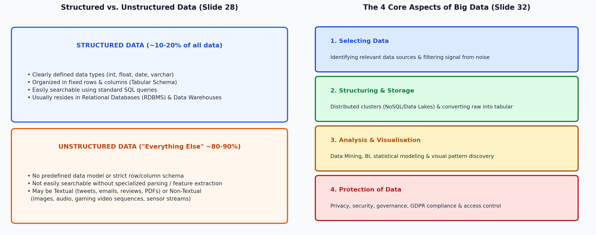
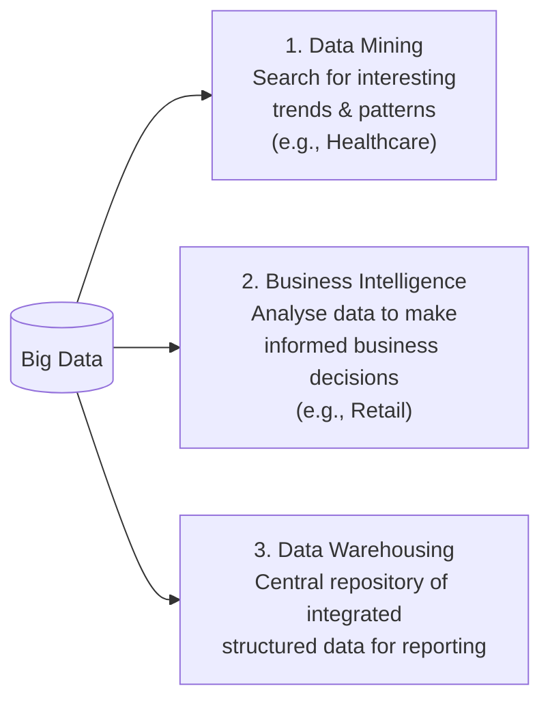

# පාඩම 1.3: Big Data හැඳින්වීම — Structured සහ Unstructured Data (Introduction to Big Data — Structured vs. Unstructured Data)

**මූලාශ්‍ර දේශන සටහන් (Source Lecture Notes):** `Introduction to Data Science.pdf` (Slides 19–32, Dr. L. Ranathunga)

> [!TIP]
> **📚 Prerequisite / Dependency Lesson Series:**
> **Structured Data** ගබඩා කරන **RDBMS / SQL** සහ **Unstructured / Raw Big Data** ගබඩා කරන **Data Lakes vs. Data Warehouses** පිළිබඳ ගැඹුරින් ඉගෙන ගැනීමට පහත Dependency පාඩම් කියවන්න:
> - [01_Relational_Databases_Tables_Keys_and_SQL_Basics.md](../dependencies/Dep_01_RDBMS_SQL_and_Data_Warehousing_Foundations/01_Relational_Databases_Tables_Keys_and_SQL_Basics.md)
> - [03_ETL_Pipelines_Data_Warehouses_Data_Marts_and_Data_Lakes.md](../dependencies/Dep_01_RDBMS_SQL_and_Data_Warehousing_Foundations/03_ETL_Pipelines_Data_Warehouses_Data_Marts_and_Data_Lakes.md)

---

## හැඳින්වීම (Introduction)

පසුගිය පාඩමෙන් අපි සාම්ප්‍රදායික Databases සහ Data Warehouses ගැන ඉගෙන ගත්තෙමු. නමුත් ගුවන් සේවා, **Social Media**, ජංගම දුරකථන, IoT Sensors සහ අන්තර්ජාලය පුළුල් වීමත් සමඟ සාම්ප්‍රදායික තනි පරිගණක පද්ධතිවලට දරාගත නොහැකි තරම් අතිවිශාල, වේගවත් සහ විවිධාකාර දත්ත ප්‍රමාණයක් (**Big Data**) ලෝකයේ නිපදවීමට පටන් ගත්තේය. මෙම පාඩමෙන් අපි Big Data යනු කුමක්ද, එහි සැබෑ ලෝකයේ ප්‍රමාණය කෙතරම්ද, සහ **Structured Data**, **Semi-Structured Data** හා **Unstructured Data** අතර වෙනස කුමක්ද යන්න සවිස්තරාත්මකව විමසා බලමු.

---

## 1. Big Data යනු කුමක්ද? (What is Big Data? - Slide 31)

දේශන සටහනේ 31 වන Slide එකෙහි Big Data පිළිබඳ ඉතා වැදගත් නිර්වචනයක් ඉදිරිපත් කරයි *(Viktor Mayer-Schönberger සහ Kenneth Cukier ගේ "Big Data" ග්‍රන්ථය ඇසුරෙන්)*:

> *"The ability of society to harness information in novel ways to produce useful insights... things one can do at a large scale that cannot be done at a smaller one, to extract new insights or create new forms of value."*

**සරල සිංහලෙන්:**  
කුඩා දත්ත ප්‍රමාණයකින් (**Small Sample**) කිසිසේත්ම දැකිය නොහැකි හෝ කළ නොහැකි දේවල්, **අතිවිශාල පරිමාණයක (Large scale) දත්ත** එකතු කර විශ්ලේෂණය කිරීමෙන් හඳුනා ගැනීමටත්, එමගින් නව දැනුම (**Insights**) සහ වටිනාකම් (**Value**) නිර්මාණය කිරීමටත් ඇති හැකියාව **Big Data** ලෙස හැඳින්වේ.

### Topic Gap Analysis — Big Data හි ප්‍රධාන ලක්ෂණ 5 (The 5 Vs of Big Data):
දේශන සටහන්වල Heathrow සහ Social Media උදාහරණ හරහා පෙන්වා දෙන Big Data සංකල්පය ජාත්‍යන්තරව **5 Vs** මගින් විස්තර කෙරේ:
1. **Volume (පරිමාව):** Terabytes (TB), Petabytes (PB) හෝ Exabytes (EB) ගණනින් ජනනය වන අතිවිශාල දත්ත ප්‍රමාණය.
2. **Velocity (වේගය):** තත්පරයකට මිලියන ගණනින් දත්ත ගලා එන අධික වේගය (උදා: Twitter tweets, Instagram likes, Flight sensors).
3. **Variety (විවිධත්වය):** වගු (Tables), අකුරු (Text), ඡායාරූප (Images), හඬපට (Audio) සහ වීඩියෝ (Video) ලෙස විවිධාකාර ආකෘතිවලින් දත්ත පැවතීම.
4. **Veracity (සත්‍යතාවය / විශ්වසනීයත්වය):** දත්තවල ඇති අවිනිශ්චිතතාවය, **Noise (ඝෝෂාව)**, සහ **Missing Values (අඩුපාඩු සහිත අගයන්)** පාලනය කිරීම.
5. **Value (වටිනාකම):** එම දත්තවලින් ව්‍යාපාරයට හෝ සමාජයට ප්‍රයෝජනවත් **Actionable Insights** උකහා ගැනීම.

---

## 2. සැබෑ ලෝකයේ Big Data උදාහරණ (Real-World Scale of Big Data - Slides 19–27)

දත්ත කොපමණ විශාල වේගයකින් නිපදවෙනවාද යන්න තේරුම් ගැනීමට දේශන සටහනේ (Slides 19–26) ප්‍රායෝගික Case Studies 2ක් ගෙනහැර දක්වයි:



### උදාහරණය 1: ලන්ඩනයේ Heathrow ගුවන්තොටුපොළ (Heathrow Airport Traffic Data - Slide 19)
එක් ගුවන්තොටුපොළක් තුළ පමණක් වසරකට ජනනය වන මෙහෙයුම් සහ මගී දත්ත දෙස බලන්න:

| නිර්ණායකය (Metric) | 2017 දත්ත | 2018 දත්ත |
| :--- | :--- | :--- |
| **Airlines served (සේවා සපයන ගුවන් සමාගම් ගණන)** | 81 | 81+ |
| **Annual air transport movements (වාර්ෂික ගුවන් ගමන් වාර)** | 474,033 | ~475,000+ |
| **Daily average flights (දෛනික සාමාන්‍ය ගුවන් ගමන් වාර)** | 1,299 | **1,300** |
| **Annual passengers (වාර්ෂික මගීන් සංඛ්‍යාව)** | මිලියන 78 (78M) | **මිලියන 80.1 (80.1M)** |
| **Passengers per day (දෛනික සාමාන්‍ය මගීන් සංඛ්‍යාව)** | ~213,698 | **219,458** (Arrivals & Departures) |
| **Busiest day recorded (වැඩිම මගීන් පැමිණි දිනය)** | - | **29th July 2018 (මගීන් 261,909)** |
| **Cargo volume (භාණ්ඩ ප්‍රවාහන පරිමාව)** | - | **1.70 million metric tonnes** |
| **Revenue (ආදායම)** | - | **£2.97 billion** *(Slide හි £2.97m ලෙස සඳහන්)* |

### උදාහරණය 2: සමාජ මාධ්‍ය ජාල (Social Media Data Explosion - Slides 20–27)
* **Twitter (X):** දිනකට Tweets **මිලියන 500කට වඩා (> 500 million tweets a day)** පළ වේ.
* **Facebook:** ලොව පුරා සක්‍රීය පරිශීලකයින් **බිලියන 2.449ක් (2.449 billion users)** සිටී.
* **Instagram:** පරිශීලකයින් **බිලියන 1ක් (1 billion users)** සිටින අතර, දිනකට **බිලියන 4.2කට වඩා වැඩි වාර ගණනක් (> 4.2 billion times a day)** "Like" බොත්තම ඔබනු ලැබේ!

### සමාජ මාධ්‍ය දත්තවල විශේෂ තාක්ෂණික ලක්ෂණ 3 (Slide 27):
සාම්ප්‍රදායික බැංකුවක හෝ වෙළඳසැලක RDBMS එකක ඇති දත්තවලට වඩා Social Media දත්තවල ප්‍රධාන වෙනස්කම් 3ක් ඇත:
1. **Enormous Volume:** අතිවිශාල දත්ත ප්‍රමාණයක් ගබඩා කිරීමට සහ හැසිරවීමට සිදු වේ.
2. **Less Strict Structure:** සාම්ප්‍රදායික වගුවක (Table) මෙන් දැඩි ව්‍යුහයක් (**Strict structure**) මෙම දත්තවලට නැත.
3. **Distributed Clusters:** තනි පරිගණකයක (Single server) මේවා ගබඩා කළ නොහැකි නිසා, පරිගණක පොකුරු (**Distributed Clusters** — උදා: `Apache Hadoop HDFS`, `Apache Spark`, `NoSQL Clusters`) හරහා දත්ත බෙදා හැරීමට සහ කළමනාකරණය කිරීමට සිදු වේ.

---

## 3. Structured, Semi-Structured සහ Unstructured Data අතර වෙනස (Slide 28)

Data Science හිදී ඔබට හමුවන දත්ත ව්‍යුහය අනුව ප්‍රධාන කාණ්ඩවලට බෙදිය හැක:



| සංසන්දනාත්මක සාධකය | Structured Data (ව්‍යුහගත දත්ත) | Semi-Structured Data (අර්ධ-ව්‍යුහගත දත්ත - Gap Analysis) | Unstructured Data (ව්‍යුහගත නොවූ දත්ත) |
| :--- | :--- | :--- | :--- |
| **අර්ථ දැක්වීම** | පැහැදිලිව නිර්වචනය කළ Data Types (`Integer`, `Float`, `Date`, `String`) සහ ස්ථිර වගු ආකෘතියක් (**Rows & Columns**) ඇති දත්ත. | දැඩි RDBMS වගුවක් නොවුණත්, Tags, Keys හෝ Hierarchy (`Key-Value pairs`) මගින් දත්ත වෙන් කර හඳුනාගත හැකි දත්ත. | නිශ්චිත වගු ආකෘතියකට කොටු නොවූ අනෙකුත් සියලුම දත්ත (*"Everything else"* - Slide 28). |
| **Searchability (සෙවීමේ පහසුව)** | SQL මගින් ඉතා පහසුවෙන් සහ වේගයෙන් Search කළ හැක (*Easily searchable*). | JSON/XML parsers හෝ Document queries මගින් පහසුවෙන් Search කළ හැක. | සෘජුවම Search කිරීම අපහසුය (*Not as easily searchable* — NLP, Computer Vision හෝ Feature Extraction අවශ්‍ය වේ). |
| **Storage (ගබඩා කරන ස්ථානය)** | **RDBMS** (`MySQL`, `PostgreSQL`, `Oracle`), **Data Warehouses** හෝ CSV/Excel වගුවල පවතී. | **NoSQL Document DBs** (`MongoDB`, `Elasticsearch`) සහ API logs වල පවතී. | **Data Lakes** (`AWS S3`, `HDFS`), File systems හෝ Cloud Object Storage තුළ පවතී. |
| **උදාහරණ** | සේවක වැටුප් ලේඛන, බැංකු ගනුදෙනු වගු, විභාග ලකුණු ලැයිස්තු. | `JSON` ගොනු, `XML` ගොනු, HTML web pages, Server log files. | **Textual:** Emails, Tweets, Reviews, PDF ලිපි.<br/>**Non-Textual:** Images, Audio, Video, CCTV දර්ශන. |

---

## 4. Big Data වලින් අපට කළ හැක්කේ කුමක්ද? (What Can We Do With Big Data? - Slide 30)

දේශන සටහනට අනුව Big Data ප්‍රධාන ක්ෂේත්‍ර 3ක් ඔස්සේ ප්‍රයෝජනයට ගනී:



1. **Data Mining:** දත්ත තුළ සැඟවී ඇති වැදගත් **Trends (ප්‍රවණතා)** සහ **Patterns (රටාවන්)** සෙවීම (උදා: **Healthcare** — රෝගීන් මිලියන ගණනකගේ වෛද්‍ය වාර්තා පරීක්ෂා කර රෝග කලින් හඳුනා ගැනීම).
2. **Business Intelligence:** දත්ත විශ්ලේෂණය කර දැනුවත් ව්‍යාපාරික තීරණ (**Informed business decisions**) ගැනීම (උදා: **Retail** — සුපිරි වෙළඳසැල් ජාලයක පාරිභෝගික මිලදී ගැනීමේ රටා විශ්ලේෂණය).
3. **Data Warehousing:** වාර්තාකරණය සහ විශ්ලේෂණය සඳහා විවිධ මූලාශ්‍රවල දත්ත එක තැනකට ගෙනැවිත් ඉතා ව්‍යුහගතව (**Highly structured**) ගබඩා කර තබා ගැනීම.

---

## 5. Big Data කළමනාකරණයේ ප්‍රධාන අංශ 4 (Big Data Aspects - Slide 32)

විශාල දත්ත කට්ටලයක් සමඟ වැඩ කිරීමේදී Data Scientist කෙනෙකු අවධානය යොමු කළ යුතු ප්‍රධාන පැතිකඩ 4ක් ඇත:

1. **Selecting Data:** අතිවිශාල දත්ත සාගරයකින් අපගේ ගැටලුව විසඳීමට අදාළ වන නිවැරදි දත්ත මොනවාදැයි තෝරා බේරා ගැනීම.
2. **Structuring and Storage:** Unstructured දත්ත විශ්ලේෂණය කළ හැකි ව්‍යුහගත (**Tabular / Structured**) ආකෘතියකට හැරවීම සහ කාර්යක්ෂමව ගබඩා කිරීම.
3. **Analysis / Visualisation:** සංඛ්‍යානමය ක්‍රමවේද සහ ප්‍රස්තාර මගින් දත්ත තුළ ඇති රටාවන් මතු කර ගැනීම.
4. **Protection of Data:** පාරිභෝගිකයින්ගේ පෞද්ගලිකත්වය (**Data Privacy**), දත්ත ආරක්ෂාව (**Cybersecurity**) සහ නීතිමය රෙගුලාසි (**GDPR / PDPA**) ආරක්ෂා වන පරිදි දත්ත පරිහරණය කිරීම (උදා: පුද්ගලික තොරතුරු **PII Masking / Hashing** කිරීම).

---

## 🛠️ Practical Task / Hands-On Exercise (ප්‍රායෝගික අභ්‍යාසය)

### Scenario / Goal:
Slide 28 සහ Slide 32 හි දැක්වෙන පරිදි, Social Media වලින් ලැබෙන **Unstructured Textual Data** (Tweets / Customer Reviews) විශ්ලේෂණය කිරීමට නම් පළමුව ඒවා **Structured Tabular Data** බවට පත් කළ යුතුය (**Structuring Data**), සහ පරිශීලකයින්ගේ පෞද්ගලිකත්වය ආරක්ෂා කිරීමට (**Protection of Data**) ඔවුන්ගේ Email හෝ Username සංකේතනය (Mask/Anonymize) කළ යුතුය. පහත දී ඇති අමු Social Media පෝස්ට් ලැයිස්තුව Structured Pandas DataFrame එකක් බවට හරවන Python කේතයක් ලියන්න.

### Step-by-Step Tasks:
1. පහත ඇති Unstructured Tweets ලැයිස්තුවෙන් `word_count` (වචන ගණන), `char_count` (අකුරු ගණන), සහ `hashtag_count` (`#` ලකුණෙන් පටන් ගන්නා වචන ගණන) යන සංඛ්‍යාත්මක තීරු 3 උකහා ගන්න.
2. **Data Protection (Slide 32):** පරිශීලකයාගේ `user_email` එක කෙලින්ම ගබඩා නොකර `hashlib.sha256` මගින් Anonymized `user_hash` එකක් බවට පත් කරන්න.
3. සියලුම Tweets වල `word_count` හි **Arithmetic Mean (සමාන්තර මධ්‍යන්‍යය)** ගණනය කරන්න.

### Starter Code & Reference Solution:
```python
import hashlib
import pandas as pd

raw_unstructured_posts = [
    {"user_email": "kasun@mail.com",  "raw_text": "Flight delayed at #Heathrow for 3 hours! #Travel #Airport"},
    {"user_email": "nimali@mail.com", "raw_text": "Smooth check-in experience today at #Heathrow terminal 5."},
    {"user_email": "ruwan@mail.com",  "raw_text": "Lost my baggage on flight BA102 #Heathrow #Baggage #Help #Urgent"},
]

structured_rows = []
for post in raw_unstructured_posts:
    text = post["raw_text"]
    words = text.split()
    hashtags = [w for w in words if w.startswith("#")]
    
    # Anonymize email for Data Protection (Slide 32)
    email_hash = hashlib.sha256(post["user_email"].encode()).hexdigest()[:10]
    
    structured_rows.append({
        "user_hash": email_hash,
        "word_count": len(words),
        "char_count": len(text),
        "hashtag_count": len(hashtags),
        "primary_hashtag": hashtags[0] if hashtags else "None"
    })

df_structured = pd.DataFrame(structured_rows)
print("--- Structured & Anonymized Social Media Table ---")
print(df_structured.to_string(index=False))
print(f"\nArithmetic Mean of Word Count: {df_structured['word_count'].mean():.2f} words")
```

**Expected Output:**
```text
--- Structured & Anonymized Social Media Table ---
 user_hash  word_count  char_count  hashtag_count primary_hashtag
3f7a8b91c2           9          57              3       #Heathrow
9a1c4e52b0           8          57              1       #Heathrow
7d2e8f19a4          10          64              4       #Heathrow

Arithmetic Mean of Word Count: 9.00 words
```

---

## 📝 Summary & Exam Revision Cheat Sheet

| Concept | Key Facts from Lecture Slides |
| :--- | :--- |
| **Big Data Definition** | කුඩා පරිමාණයකදී කළ නොහැකි දේවල් මහා පරිමාණ දත්ත (Large scale) මගින් සිදු කර නව Insights සහ Value නිර්මාණය කිරීම (Slide 31). |
| **Heathrow 2018 Scale** | දිනකට ගුවන් ගමන් **1,300**; වාර්ෂික මගීන් **80.1M**; දිනකට මගීන් **219,458**; වැඩිම දිනය: **29 July 2018 (261,909)** (Slide 19). |
| **Social Media Scale** | Twitter: **>500M tweets/day**; Facebook: **2.449B users**; Instagram: **1B users & >4.2B likes/day** (Slide 20). |
| **Structured vs. Unstructured** | **Structured:** RDBMS වගුවල ඇති, පැහැදිලි Data types සහිත, පහසුවෙන් Search කළ හැකි දත්ත.<br/>**Unstructured:** Text, Images, Audio, Video වැනි ස්ථිර වගු ව්‍යුහයක් නොමැති අනෙකුත් සියලුම දත්ත (Slide 28). |
| **4 Big Data Aspects** | 1. Selecting Data, 2. Structuring and Storage, 3. Analysis / Visualisation, 4. Protection of Data (Slide 32). |

---

**ඊළඟ පාඩම (Next Lesson):** [Lesson 1.4: What is Data Science & The Role of a Data Scientist](Lesson_1.4_What_is_Data_Science_and_Role_of_Data_Scientist.md) — Data Science යනු කුමක්ද, Data Analyst සහ Data Scientist අතර වෙනස කුමක්ද සහ Data Science Workflow එක ක්‍රියාත්මක වන ආකාරය ඉගෙන ගනිමු.
