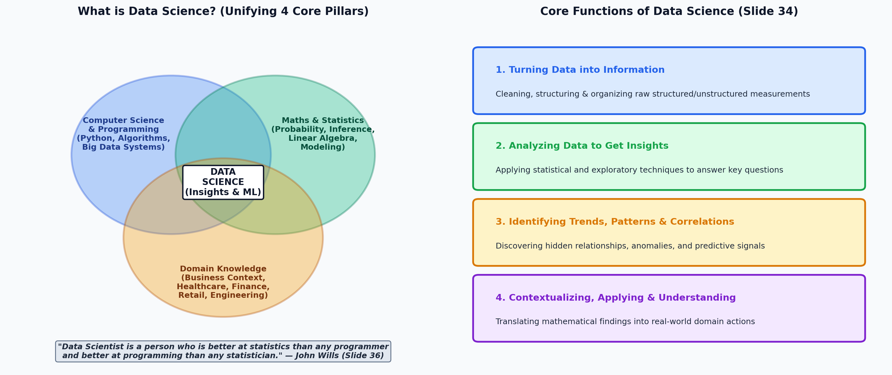
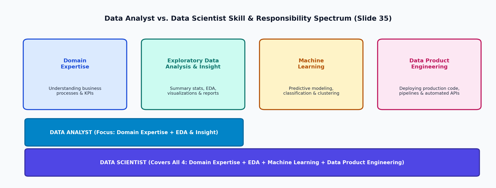
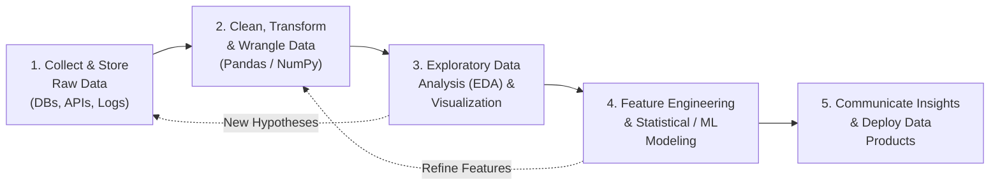

# පාඩම 1.4: Data Science යනු කුමක්ද සහ Data Scientist කෙනෙකුගේ කාර්යභාරය (What is Data Science & The Role of a Data Scientist)

**මූලාශ්‍ර දේශන සටහන් (Source Lecture Notes):** `Introduction to Data Science.pdf` (Slides 33–40, Dr. L. Ranathunga)

> [!TIP]
> **📚 Prerequisite / Dependency Lesson Series:**
> Data Analyst සහ Data Scientist කෙනෙකු දෛනිකව භාවිතා කරන **SQL / Data Warehouses** සහ **Jupyter Notebook Interactive Environment** පිළිබඳ මූලික දැනුම සඳහා පහත Dependency පාඩම් මාලාවන් පරිශීලනය කරන්න:
> - [Dep_01: RDBMS, SQL & Data Warehousing Foundations](../dependencies/Dep_01_RDBMS_SQL_and_Data_Warehousing_Foundations/01_Relational_Databases_Tables_Keys_and_SQL_Basics.md)
> - [Dep_02: Jupyter Notebook & Data Science Environment](../dependencies/Dep_02_Jupyter_Notebook_and_Data_Science_Environment/02_Jupyter_Notebook_Architecture_Kernels_and_Shortcuts.md)

---

## හැඳින්වීම (Introduction)

වර්තමාන තාක්ෂණික ලෝකයේ වැඩියෙන්ම කතාබහට ලක්වන විෂය ක්ෂේත්‍රය **Data Science** වේ. නමුත් සැබවින්ම Data Science යනු කුමක්ද? එය සාම්ප්‍රදායික **Statistics (සංඛ්‍යානය)** හෝ **Software Engineering** වලට වඩා වෙනස් වන්නේ කෙසේද? එමෙන්ම **Data Analyst** කෙනෙකු සහ **Data Scientist** කෙනෙකු අතර ඇති වෙනස කුමක්ද? මෙම පාඩමෙන් අපි එම සියලුම කරුණු පැහැදිලිව ඉගෙන ගනිමු.

---

## 1. Data Science යනු කුමක්ද? (What is Data Science? - Slides 33–34)

දේශන සටහන්වලට අනුව Data Science පහත ආකාරයට නිර්වචනය කළ හැක:

1. **An Inter-disciplinary Field (අන්තර්-විෂයයික ක්ෂේත්‍රයකි):** **Structured Data (ව්‍යුහගත දත්ත)** සහ **Unstructured Data (ව්‍යුහගත නොවූ දත්ත)** රාශියකින් දැනුම (**Knowledge**) සහ ගැඹුරු අවබෝධයන් (**Insights**) ලබා ගැනීම සඳහා විද්‍යාත්මක ක්‍රමවේද (**Scientific methods**), ක්‍රියාවලීන් (**Processes**), ඇල්ගොරිදම (**Algorithms**) සහ පද්ධති (**Systems**) භාවිතා කරන ක්ෂේත්‍රයකි.
2. **විෂයයන් 4ක එකතුවකි:** සැබෑ ලෝකයේ සංසිද්ධීන් දත්ත හරහා තේරුම් ගැනීමට සහ විශ්ලේෂණය කිරීමට පහත ක්ෂේත්‍ර 4 එකම සංකල්පයක් යටතට ගෙන එයි (*"A concept to unify..."*):
   * **Statistics (සංඛ්‍යානය)**
   * **Data Analysis (දත්ත විශ්ලේෂණය)**
   * **Machine Learning (යන්ත්‍ර ඉගෙනුම)**
   * **Domain Knowledge (අදාළ ව්‍යාපාරික හෝ විෂය ක්ෂේත්‍රය පිළිබඳ විශේෂඥ දැනුම)**
3. **සහසම්බන්ධ ක්ෂේත්‍ර:** Data Science යනු **Data Mining**, **Machine Learning**, සහ **Big Data** යන ක්ෂේත්‍ර සමඟ සෘජුවම බැඳී පවතින විෂයයකි.



### Data Science තුළ සිදුවන මූලික ක්‍රියාවලීන් 4 (Slide 34):
Data Science යනු පහත කරුණු හතරේම සංකලනයකි (**DIKW Hierarchy: Data $\rightarrow$ Information $\rightarrow$ Knowledge $\rightarrow$ Wisdom/Action**):
* **Turning data into information:** අමු දත්ත (Raw data) සංවිධානය කර අර්ථවත් තොරතුරු බවට පත් කිරීම.
* **Analyzing data to get insights:** තීරණ ගැනීමට වැදගත් වන ගැඹුරු කරුණු (Insights) මතු කර ගැනීමට දත්ත විශ්ලේෂණය කිරීම.
* **Identifying trends, patterns, and correlation in data:** දත්ත තුළ ඇති කාලීන **Trends (ප්‍රවණතා)**, **Patterns (රටාවන්)** සහ විචල්‍යයන් අතර ඇති **Correlation (සහසම්බන්ධතාවය)** හඳුනා ගැනීම.
* **Contextualizing, applying and understanding them:** එම සොයාගත් ගණිතමය කරුණු අදාළ ව්‍යාපාරික හෝ ප්‍රායෝගික පරිසරයට (**Domain Context**) ගළපා තේරුම් ගැනීම සහ ක්‍රියාවට නැංවීම.

### Topic Gap Analysis — Drew Conway's Data Science Venn Diagram & "The Danger Zone":
Data Science හි ප්‍රධාන කුසලතා 3 (Programming/Hacking Skills, Math & Statistics Knowledge, සහ Domain Expertise) එකිනෙක හමුවන ආකාරය සැලකූ විට:
* **Programming + Math/Stats (Domain Expertise නොමැතිව):** Machine Learning පර්යේෂණ.
* **Math/Stats + Domain Expertise (Programming නොමැතිව):** Traditional Research.
* **Programming + Domain Expertise (Math/Stats දැනුම නොමැතිව):** මෙය **"Danger Zone"** ලෙස හැඳින්වේ! මන්ද, සංඛ්‍යානමය මූලධර්ම (උදා: **Correlation vs. Causation**, **Sample Bias**) ගැන අවබෝධයක් නොමැතිව කේත පමණක් ධාවනය කරන පුද්ගලයෙකුට වැරදි නිගමනවලට එළඹී ව්‍යාපාරයකට විශාල හානියක් කළ හැකි බැවිනි.

---

## 2. Data Analyst සහ Data Scientist අතර වෙනස (Slide 35)

බොහෝ දෙනා Data Analyst සහ Data Scientist යන තනතුරු දෙක එකක් ලෙස වරදවා වටහා ගනිති. Slide 35 හි දැක්වෙන සටහන මගින් මෙම භූමිකාවන් දෙකෙහි පරාසය ඉතා පැහැදිලිව වෙන් කර පෙන්වයි:



| Capability Area (කුසලතා කලාපය) | Data Analyst | Data Scientist | පැහැදිලි කිරීම |
| :--- | :---: | :---: | :--- |
| **1. Domain Expertise** | ✅ | ✅ | ව්‍යාපාරික ගැටලුව සහ ක්ෂේත්‍රයේ ස්වභාවය තේරුම් ගැනීම දෙදෙනාටම අත්‍යවශ්‍ය වේ. |
| **2. Exploratory Data Analysis (EDA) & Insight** | ✅ | ✅ | දත්ත පිරිසිදු කර, සංඛ්‍යානමය සාරාංශ සහ Visualizations හරහා Reports සහ Insights ලබා දීම දෙදෙනාම සිදු කරයි. |
| **3. Machine Learning** | ❌ | ✅ | අනාගත අනාවැකි පළ කරන (**Predictive Models**) සහ වර්ගීකරණය කරන Machine Learning මොඩල ගොඩනැගීම Data Scientist ගේ විශේෂ කාර්යයකි. |
| **4. Data Product Engineering** | ❌ | ✅ | ගොඩනැගූ මොඩල සහ විශ්ලේෂණ කේත සැබෑ Production software / APIs ලෙස ක්‍රියාත්මක කිරීම Data Scientist විසින් සිදු කෙරේ. |

---

## 3. Data Scientist යනු කවුද? (Who is a Data Scientist? - Slides 36–38)

දේශන සටහනේ 36 වන Slide එකෙහි **John Wills** විසින් ඉදිරිපත් කළ ඉතා ප්‍රසිද්ධ නිර්වචනයක් දක්වා ඇත:

> **"Data Scientist is a person who is better at statistics than any programmer and better at programming than any statistician." — John Wills**

**මෙහි අදහස:**  
සාමාන්‍ය Software Programmer කෙනෙකුට කේත ලිවීමට හැකි වුවත් **Statistics (සංඛ්‍යානය)** පිළිබඳ ගැඹුරු දැනුමක් නැත. එලෙසම සාම්ප්‍රදායික Statistician කෙනෙකුට ගණිතමය හා සංඛ්‍යානමය දැනුම තිබුණත් විශාල දත්ත කට්ටල හැසිරවීමට අවශ්‍ය Python Programming හා Data Engineering කුසලතා නැත. **Data Scientist** යනු මෙම ලෝක දෙකම යා කරන පාලමයි!

### How Students View Data Science vs. Reality (Slides 37–38):
* බොහෝ සිසුන් සිතන්නේ Data Science යනු හුදෙක් ආකර්ෂණීය Machine Learning සහ Deep Learning ඇල්ගොරිදම ක්‍රියාත්මක කිරීම පමණක් බවයි.
* නමුත් සැබෑ ලෝකයේ Data Scientist කෙනෙකුගේ කාලයෙන් **70%–80%ක්ම** වැය වන්නේ:
  * ගැටලුව නිවැරදිව හඳුනා ගැනීමට (**Problem Framing**),
  * දත්ත එකතු කිරීමට සහ පිරිසිදු කිරීමට (**Data Collection, Cleaning & Wrangling**),
  * සහ **Exploratory Data Analysis (EDA)** හා **Visualization** කිරීමටයි!
* එමෙන්ම Slide 38 (*"There's no such thing as a single Data Scientist unicorn"*) මගින් පෙන්වා දෙන්නේ ආයතන බොහෝවිට එක් පුද්ගලයෙකුගෙන් සියලුම විෂයයන් බලාපොරොත්තු වුවත්, ප්‍රායෝගිකව Data Science යනු විවිධ කුසලතා එක්වන සංකීර්ණ භූමිකාවක් බවයි.

---

## 4. The Data Science Workflow සහ ප්‍රායෝගික යෙදවුම් (Slides 39–40)

සැබෑ Data Science ව්‍යාපෘතියක වැඩපිළිවෙළ (**The Data Science Workflow**) එකිනෙකට සම්බන්ධ පියවරයන්ගෙන් සමන්විත චක්‍රීය ක්‍රියාවලියකි:



### Data Science භාවිතා වන ප්‍රධාන ක්ෂේත්‍ර (Data Science Applications - Slide 40):
1. **Healthcare:** වෛද්‍ය ප්‍රතිබිම්බ (X-ray/MRI) විශ්ලේෂණය, රෝග කලින් හඳුනා ගැනීම, Genomics සහ Drug discovery.
2. **Banking & Finance:** වංචනික ගනුදෙනු හඳුනා ගැනීම (**Fraud Detection**), **Credit Risk Modeling** සහ Algorithmic trading.
3. **E-Commerce & Retail:** Netflix, Amazon, YouTube වැනි පද්ධතිවල පාරිභෝගිකයාට ගැළපෙන භාණ්ඩ හෝ වීඩියෝ නිර්දේශ කිරීම (**Recommendation Engines**), සහ Price optimization.
4. **Transport & Logistics:** Self-driving cars, Uber/PickMe Route optimization සහ Flight delay prediction.
5. **Telecommunications & Media:** පාරිභෝගිකයින් සේවාව අතහැර යාම කලින් හඳුනා ගැනීම (**Customer Churn Prediction**).

---

## 🛠️ Practical Task / Hands-On Exercise (ප්‍රායෝගික අභ්‍යාසය)

### Scenario / Goal:
Slide 34 හි සඳහන් පරිදි Data Science හි මූලික කාර්යය වන්නේ:
1. **Turning data into information**,
2. **Identifying trends, patterns, and Correlation (සහසම්බන්ධතාවය)**,
3. **Contextualizing insights**.

වෙළඳසැලක මාස 6ක වෙළඳ දැන්වීම් වියදම (`ad_spend_lkr`) සහ ලැබුණු විකුණුම් ආදායම (`sales_revenue_lkr`) පහත දී ඇත. **Data Analyst** කෙනෙකු මෙන් එහි සංඛ්‍යානමය සාරාංශය සහ **Pearson Correlation Coefficient (පියර්සන් සහසම්බන්ධතා සංගුණකය)** ගණනය කර, ඉන්පසු **Data Scientist** කෙනෙකු මෙන් **Simple Linear Regression (සරල රේඛීය ප්‍රතිගමනය)** මොඩලයක් මගින් ලබන මාසයේ රු. 80,000ක් දැන්වීම් සඳහා වියදම් කළහොත් ලැබිය හැකි ආදායම පුරෝකථනය (**Prediction**) කරන්න.

### Step-by-Step Tasks:
1. `ad_spend` සහ `sales_revenue` සඳහා **Arithmetic Mean (සමාන්තර මධ්‍යන්‍යය)** සහ **Standard Deviation (සම්මත අපගමනය)** ගණනය කරන්න (Data Analyst EDA).
2. `np.corrcoef()` භාවිතා කර විචල්‍ය දෙක අතර **Correlation (සහසම්බන්ධතාවය)** ගණනය කරන්න.
3. `np.polyfit(ad_spend, sales_revenue, deg=1)` භාවිතා කර Linear Regression රේඛාවේ බෑවුම (`slope` $m$) සහ අන්තඃඛණ්ඩය (`intercept` $c$) සොයා, `ad_spend = 80000` වන විට අපේක්ෂිත ආදායම ($\hat{y} = mx + c$) ගණනය කරන්න (Data Scientist Predictive Modeling).

### Starter Code & Reference Solution:
```python
import numpy as np

ad_spend = np.array([20000, 30000, 45000, 50000, 65000, 70000], dtype=float)
sales_revenue = np.array([150000, 210000, 290000, 330000, 410000, 445000], dtype=float)

# 1. Data Analyst Role: EDA Summary & Correlation
mean_sales = np.mean(sales_revenue)
std_sales = np.std(sales_revenue)
corr = np.corrcoef(ad_spend, sales_revenue)[0, 1]

print("=== 1. Data Analyst Output (EDA & Insights) ===")
print(f"Sales Arithmetic Mean    : LKR {mean_sales:,.2f}")
print(f"Sales Standard Deviation : LKR {std_sales:,.2f}")
print(f"Pearson Correlation (r)  : {corr:.4f} (Strong Positive Correlation)")

# 2. Data Scientist Role: Predictive Linear Regression Model (y = m*x + c)
slope, intercept = np.polyfit(ad_spend, sales_revenue, deg=1)
next_month_ad_budget = 80000.0
predicted_sales = slope * next_month_ad_budget + intercept

print("\n=== 2. Data Scientist Output (Predictive Model) ===")
print(f"Learned Model Equation   : Sales = {slope:.2f} * Ad_Spend + {intercept:,.2f}")
print(f"Predicted Sales (@80k)   : LKR {predicted_sales:,.2f}")
```

**Expected Output:**
```text
=== 1. Data Analyst Output (EDA & Insights) ===
Sales Arithmetic Mean    : LKR 305,833.33
Sales Standard Deviation : LKR 103,698.95
Pearson Correlation (r)  : 0.9989 (Strong Positive Correlation)

=== 2. Data Scientist Output (Predictive Model) ===
Learned Model Equation   : Sales = 5.86 * Ad_Spend + 32,487.80
Predicted Sales (@80k)   : LKR 501,073.17
```

---

## 📝 Summary & Exam Revision Cheat Sheet

| Topic | Key Takeaway |
| :--- | :--- |
| **4 Pillars of Data Science** | **Statistics** + **Data Analysis** + **Machine Learning** + **Domain Knowledge** (Slide 33). |
| **Data Analyst vs. Data Scientist** | දෙදෙනාටම Domain Expertise සහ EDA ඇත; නමුත් **Machine Learning** සහ **Data Product Engineering** යනු Data Scientist ගේ විශේෂ වගකීම් වේ (Slide 35). |
| **John Wills' Quote** | *"Better at statistics than any programmer and better at programming than any statistician."* (Slide 36). |

---

**ඊළඟ පාඩම (Next Lesson):** [Lesson 1.5: Tools for Data Science — Python vs. R vs. SAS](Lesson_1.5_Tools_for_Data_Science_Python_vs_R_vs_SAS.md) — Data Science සඳහා භාවිතා කරන ප්‍රධාන භාෂා 3 (Python, R, SAS) සංසන්දනය කරමින්, අපි Python තෝරා ගන්නේ ඇයි සහ එහි ඇති ප්‍රධාන Libraries මොනවාදැයි ඉගෙන ගනිමු.
