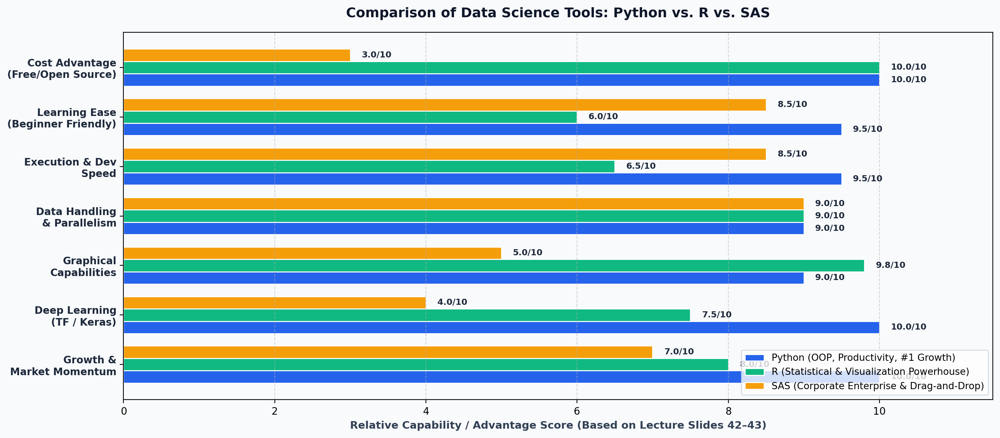
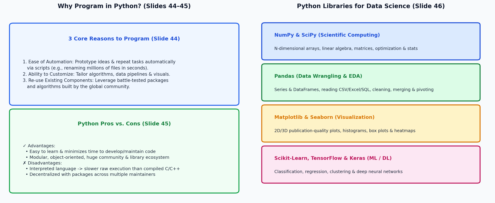
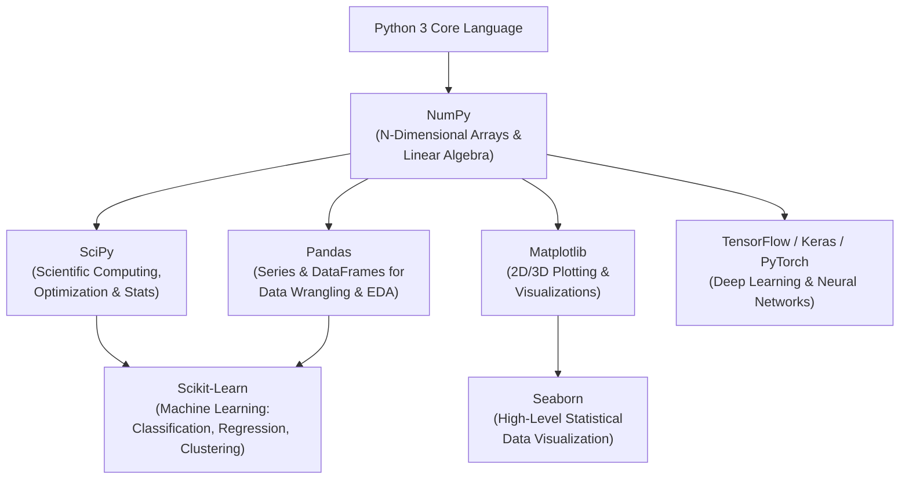

# පාඩම 1.5: Data Science සඳහා භාවිතා වන මෙවලම් — Python vs. R vs. SAS (Tools for Data Science — Python vs. R vs. SAS)

**මූලාශ්‍ර දේශන සටහන් (Source Lecture Notes):** `Introduction to Data Science.pdf` (Slides 41–46, Dr. L. Ranathunga)

> [!TIP]
> **📚 Prerequisite / Dependency Lesson Series:**
> මෙම පාඩමේදී හඳුන්වා දෙන **Python Environment Setup (`pip`, `Conda`, `Jupyter`)** මෙන්ම ප්‍රධාන Data Science Libraries 3 (**NumPy**, **Matplotlib**, **Pandas**) මුල සිටම ප්‍රායෝගිකව ඉගෙන ගැනීමට අපගේ Zero-to-Hero Dependency පාඩම් මාලාවන් කියවන්න:
> - **Environment & Jupyter:** [Dep_02: Python Environments, Pip, Conda & Jupyter Notebooks](../dependencies/Dep_02_Jupyter_Notebook_and_Data_Science_Environment/01_Python_Environments_Pip_Conda_and_Virtualenv.md)
> - **NumPy Zero-to-Hero:** [Module 4 — Dep_01: NumPy Zero-to-Hero Series](../dependencies/Dep_01_NumPy_Zero_to_Hero/01_What_is_NumPy_and_ndarrays_Memory_Architecture.md)
> - **Matplotlib Zero-to-Hero:** [Module 5 — Dep_01: Matplotlib Zero-to-Hero Series](../dependencies/Dep_01_Matplotlib_Zero_to_Hero/01_Matplotlib_Anatomy_Figure_Axes_and_Pyplot_vs_OO_API.md)
> - **Pandas Zero-to-Hero:** [Module 6 — Dep_01: Pandas Zero-to-Hero Series](../dependencies/Dep_01_Pandas_Zero_to_Hero/01_Pandas_Core_Architecture_Index_Series_and_DataFrame_Internals.md)

---

## හැඳින්වීම (Introduction)

Data Science ගැටලුවක් විසඳීම සඳහා නිවැරදි තාක්ෂණික මෙවලම් (**Tools**) සහ Programming Language එක තෝරා ගැනීම ඉතා වැදගත් වේ. ලෝකයේ Data Science සඳහා **Python, R, SAS, MATLAB** වැනි මෙවලම් රාශියක් භාවිතා වේ (Slide 41). මෙම පාඩමෙන් අපි ප්‍රධානතම මෙවලම් 3 වන **Python, R සහ SAS** එකිනෙකට සංසන්දනය කරමින්, Data Scientist කෙනෙකුට Programming අත්‍යවශ්‍ය වන්නේ ඇයි සහ Python හි ඇති ප්‍රධාන Data Science Libraries මොනවාද යන්න විමසා බලමු.

---

## 1. Python vs. R vs. SAS සවිස්තරාත්මක සංසන්දනය (Slides 42–43)

දේශන සටහනේ 42 සහ 43 වන Slides මගින් ප්‍රධාන නිර්ණායක 8ක් යටතේ Python, R සහ SAS සංසන්දනය කර ඇත:



| නිර්ණායකය (Feature) | Python | R | SAS |
| :--- | :--- | :--- | :--- |
| **1. Overview (මූලික හැඳින්වීම)** | කේත කියවීමේ පහසුව (**Code readability**) සහ ඵලදායිතාව (**Productivity**) මූලික කරගත්, ඉතා පුළුල්ව භාවිතා වන Object-Oriented භාෂාවකි. | නම්‍යශීලී සහ ප්‍රබල Scripting භාෂාවකි; SAS වලට ඇති Open-source විකල්පය (*Open source counterpart to SAS*) ලෙස සැලකේ. | මහා පරිමාණ ආයතන (**Huge corporates**) විසින් දැඩිව ප්‍රිය කරන, පුළුල් හැකියාවන් සහිත වාණිජ දත්ත විශ්ලේෂණ මෙවලමකි. |
| **2. Cost (පිරිවැය)** | **Free & Open Source** — ඕනෑම පුද්ගලයෙකුට හෝ ආයතනයකට නොමිලේ බාගත කර භාවිතා කළ හැක. | **Free & Open Source** — Python මෙන්ම සම්පූර්ණයෙන්ම නොමිලේ භාවිතා කළ හැක. | **Proprietary (මිල අධික වාණිජ මෘදුකාංගයකි)** — Free University Edition එකක් තිබුණත්, ආයතනවලට අතිවිශාල මුදලක් ගෙවීමට සිදු වේ. |
| **3. Learning Ease (ඉගෙනීමේ පහසුව)** | **Simple to learn** — ආධුනිකයින්ට මෙන්ම පළපුරුදු Data Scientists ලාටද පහසුවෙන් ඉගෙන ගත හැක. | **Steepest learning curve** — මේ තුන අතරින් ඉගෙනීමට අමාරුම භාෂාව වන අතර Coding පිළිබඳ හොඳ පෙර දැනුමක් අවශ්‍ය වේ. | **Easy to learn** — SQL භාෂාවට බොහෝ සෙයින් සමාන නිසා SQL දන්නා අයට ඉතා පහසුය. |
| **4. Speed (වේගය)** | High-level භාෂාවක් වන අතර වේගවත් හා තීරණාත්මක මෘදුකාංග (**Critical yet fast applications**) සඳහා ඉතා සුදුසුය. | Slide 42 ට අනුව සරල කාර්යයන් සඳහාද දිගු කේත ලිවීමට සිදුවන අවස්ථා ඇති බැවින් සාපේක්ෂව වේගය අඩුය. | **Drag-and-Drop** පහසුකම ඇති නිසා Coding ගැන වද නොවී Components තෝරාගෙන ඉක්මනින් වැඩ කළ හැක. |
| **5. Data Handling Capability** | **ඉතා ඉහළයි** — භාෂා තුනම විශාල දත්ත හැසිරවීම සහ **Parallel computations (සමාන්තර ගණනය කිරීම්)** අතින් එක හා සමානව ඉහළ මට්ටමක පවතී. | **ඉතා ඉහළයි** — Python හා SAS හා සමානවම හොඳ Data handling සහ Parallel computation හැකියාවක් ඇත. | **ඉතා ඉහළයි** — Parallel computations සහ විශාල දත්ත හැසිරවීමේ හැකියාව ඉහළය. |
| **6. Graphical Capabilities** | `Matplotlib`, `Seaborn` වැනි පැකේජ හරහා විශිෂ්ට ප්‍රස්තාරික හැකියාවන් ලබා දෙයි. | **Best visualization diversity** — `ggplot2`, `Lattice`, `RGIS` වැනි පැකේජ නිසා මේ තුන අතරින් ඉහළම ප්‍රස්තාරික විවිධත්වය R සතුය. | මෑතකදී දියුණු කර ඇතත්, Python සහ R වල ප්‍රස්තාරික හැකියාවන් අසලටවත් පැමිණිය නොහැක. |
| **7. Deep Learning** | **Leader** — `TensorFlow` සහ `Keras` (හා `PyTorch`) නිසා Deep Learning ක්ෂේත්‍රයේ දැවැන්තම දියුණුව Python සතුය. | `kerasR` සහ `keras` පැකේජ හරහා Python හි Keras පැකේජයට Interface එකක් ලෙස සම්බන්ධ වී ක්‍රියා කරයි. | SAS තුළ Deep Learning තවමත් ඉතා ප්‍රාථමික (**Infancy**) මට්ටමක පවතී. |
| **8. Popularity (ජනප්‍රියත්වය)** | පෙර නොවූ විරූ වේගයකින් (**Unprecedented growth**) වර්ධනය වී ඇති අතර අනෙක් භාෂා දෙකම අභිබවා වෙළඳපොළේ පෙරමුණ ගෙන ඇත. | Statisticians ලා සහ පර්යේෂකයින් අතර එහි විශාල පැකේජ ගබඩාව (CRAN) නිසා ඉතා ජනප්‍රියයි. | Corporate world හි මහා පරිමාණ සමාගම්වල (බැංකු, ඖෂධ සමාගම්) තවමත් බහුලව භාවිතා වේ. |

### Topic Gap Analysis — What about MATLAB? (Slide 41)
Slide 41 හි සඳහන් **MATLAB (Matrix Laboratory)** යනු ඉංජිනේරු විද්‍යාව, Signal Processing, Image Processing සහ Control Systems සඳහා විශ්වවිද්‍යාලවල බහුලව භාවිතා වන Matrix මූලික කරගත් වාණිජ (Proprietary) මෘදුකාංගයකි. නමුත් එහි අධික බලපත්‍ර පිරිවැය (License cost) සහ General-purpose web/production deployment සඳහා ඇති සීමාවන් නිසා, කර්මාන්තයේදී MATLAB වෙනුවට `Python + NumPy + SciPy + Matplotlib` භාවිතා කිරීම සම්මතය බවට පත්ව ඇත.

---

## 2. අපි කේත ලිවිය යුත්තේ ඇයි? (Why Program? - Slide 44)

Excel හෝ Drag-and-Drop මෘදුකාංග භාවිතා කරනවා වෙනුවට Python වැනි භාෂාවකින් Programming කිරීමට ප්‍රධාන හේතු 3ක් ඇත:



1. **Ease of Automation (ස්වයංක්‍රීයකරණයේ පහසුව):**
   * අපගේ අදහසක් ඉක්මනින් මූලාකෘතියක් (**Prototype**) ලෙස ගොඩනැගීමට ඉඩ සලසයි.
   * නැවත නැවත කළ යුතු ඒකාකාරී කාර්යයන් (**Repetitive tasks**) කුඩා Script එකක් මගින් ස්වයංක්‍රීයව සිදු කළ හැක.
   * *Slide Example:* ෆයිල් මිලියන ගණනක නම් වෙනස් කිරීම (**Rename millions of files**) අතින් කිරීමට මාස ගණනක් ගත වුවත්, Bash scripting හෝ Python program එකකින් තත්පර කිහිපයකින් කළ හැක!
2. **Ability to Customize (අභිරුචිකරණය කිරීමේ හැකියාව):**
   * පවතින මෘදුකාංගයක සීමාවන්ට කොටු නොවී, අපට අවශ්‍ය පරිදිම **Algorithm**, **Data transformation**, සහ **Visualization** වෙනස් කරගත හැක.
3. **Re-use Existing Components (පවතින කේත නැවත භාවිතා කිරීමේ හැකියාව):**
   * සෑම දෙයක්ම මුල සිට (From scratch) ලිවිය යුතු නැත! ලොව පුරා සිටින දක්ෂ විද්‍යාඥයින් සහ ඉංජිනේරුවන් විසින් දැනටමත් නිර්මාණය කර පරීක්ෂා කර ඇති **Libraries, Packages සහ Algorithms** අපගේ කේතයට `import` කර කෙලින්ම භාවිතා කළ හැක.

---

## 3. Python භාෂාවේ වාසි සහ අවාසි (Python Advantages & Disadvantages - Slide 45)

### Advantages (වාසි):
* **Ease of programming:** සරල ඉංග්‍රීසි භාෂාවට සමාන නිසා කේත ලිවීම ඉතා පහසුය.
* **Minimizes the time to develop and maintain code:** කේත ලිවීමට සහ නඩත්තු කිරීමට ගතවන කාලය අවම කරයි.
* **Modular and object-oriented:** කේතය කුඩා Modules, Packages සහ Classes ලෙස පිළිවෙළට සංවිධානය කළ හැක.
* **Large community of users:** ලොව පුරා මිලියන ගණනක ප්‍රජාවක් සිටින නිසා ඕනෑම ගැටලුවකට විසඳුම් ඉක්මනින් සොයාගත හැක.
* **A large standard and user-contributed library:** Python සමඟම ලැබෙන Standard Library එක (`os`, `sys`, `math`, `json`, `sqlite3`) මෙන්ම තෙවන පාර්ශවීය පැකේජ (**PyPI**) ලක්ෂ ගණනක් පවතී.

### Disadvantages (අවාසි):
* **Interpreted and therefore slower than compiled languages:** Python යනු Interpreted භාෂාවක් නිසා C හෝ C++ වැනි Compiled භාෂාවලට සාපේක්ෂව Pure Python loops වල ධාවන වේගය අඩුය *(නමුත් `NumPy` සහ `Pandas` ඇතුළතින් C/Cython භාෂාවෙන් ලියා ඇති නිසා Vectorization හරහා මෙම අවාසිය Data Science වලදී මඟහරවා ඇත!)*.
* **Decentralized with packages:** විවිධ පැකේජ විවිධ කණ්ඩායම් විසින් වෙන වෙනම නඩත්තු කරන නිසා සමහර අවස්ථාවල Package Versions අතර ගැළපීම් ගැටලු ඇති විය හැක *(මෙය විසඳන ආකාරය අපගේ [01_Python_Environments_Pip_Conda_and_Virtualenv.md](../dependencies/Dep_02_Jupyter_Notebook_and_Data_Science_Environment/01_Python_Environments_Pip_Conda_and_Virtualenv.md) පාඩමේ විස්තර කර ඇත)*.

---

## 4. Data Science සඳහා ඇති ප්‍රධාන Python Libraries (Slide 46)

මෙම පාඨමාලාව පුරාම අපි ප්‍රායෝගිකව භාවිතා කරන Python Data Science Ecosystem එක පහත පරිදි වේ:



1. **NumPy (Numerical Python):** Multi-dimensional arrays (`ndarray`), **Vectors (දෛශික)**, **Matrices (න්‍යාස)** සහ වේගවත් ගණිතමය ගණනය කිරීම් සඳහා පදනම සපයයි ([NumPy Dependency Series](../dependencies/Dep_01_NumPy_Zero_to_Hero/01_What_is_NumPy_and_ndarrays_Memory_Architecture.md)).
2. **SciPy (Scientific Python):** NumPy මත ගොඩනැගුණු විද්‍යාත්මක නියතයන්, Optimization සහ උසස් සංඛ්‍යානමය පරීක්ෂාවන් (`scipy.stats` — **Z-Score (සම්මත ලකුණු)**, **Hypothesis Testing (කල්පිත පරීක්ෂාව)**) සපයයි.
3. **Matplotlib & Seaborn:** දත්ත ප්‍රස්තාරිකව නිරූපණය කිරීමට (Line plots, Bar charts, Histograms, Scatter plots, Box plots, Heatmaps) භාවිතා වේ ([Matplotlib Dependency Series](../dependencies/Dep_01_Matplotlib_Zero_to_Hero/01_Matplotlib_Anatomy_Figure_Axes_and_Pyplot_vs_OO_API.md)).
4. **Pandas:** වගු ආකාරයේ දත්ත (`Series` සහ `DataFrame`) කියවීමට, පිරිසිදු කිරීමට, හැසිරවීමට සහ Exploratory Data Analysis (EDA) කිරීමට භාවිතා කරන ප්‍රධානතම පුස්තකාලයයි ([Pandas Dependency Series](../dependencies/Dep_01_Pandas_Zero_to_Hero/01_Pandas_Core_Architecture_Index_Series_and_DataFrame_Internals.md)).

---

## 🛠️ Practical Task / Hands-On Exercise (ප්‍රායෝගික අභ්‍යාසය)

### Scenario / Goal:
Slide 44 හි **"Why Program? — Ease of Automation"** යටතේ දක්වා ඇති ප්‍රායෝගික උදාහරණය (**"Eg: Rename millions of files"**) සහ **"Re-use existing components"** යන කරුණු දෙකම එකවර අත්හදා බලමු!
සමාගමක ශාඛාවලින් ලැබුණු CSV ගොනු රාශියක නම් අවිධිමත් ලෙස (`"Sales Report - Colombo (2024).CSV"`, `"sales_report__kandy_2024.csv"`, `"TEMP_backup.tmp"`) පවතී. Python මගින් එම ගොනු නාමයන් ස්වයංක්‍රීයව පිරිසිදු කර (`clean_snake_case`), ඉන්පසු `NumPy` සහ `Pandas` Libraries නැවත භාවිතා කරමින් (Re-use) තත්පරයෙන් පංගුවකින් සංඛ්‍යානමය සාරාංශයක් ගොඩනග는 Script එකක් ලියන්න.

### Step-by-Step Tasks:
1. අවිධිමත් ගොනු නාම ලැයිස්තුවකින් `.csv` නොවන ගොනු (උදා: `.tmp`) ඉවත් කරන්න.
2. ඉතිරි ගොනු නාම සියල්ල Simple අකුරු බවට පත් කර, හිස්තැන් සහ විශේෂ ලකුණු (`-`, `(`, `)`) ඉවත් කර සම්මත `snake_case.csv` ආකෘතියට ස්වයංක්‍රීයව Rename කරන Function එකක් ලියන්න.
3. `NumPy` සහ `Pandas` භාවිතා කර එක් එක් ගොනුවේ අඩංගු විකුණුම් දත්තවල **Arithmetic Mean (සමාන්තර මධ්‍යන්‍යය)** සහ **Median (මධ්‍යස්ථය)** ගණනය කරන්න.

### Starter Code & Reference Solution:
```python
import re
import numpy as np
import pandas as pd

messy_filenames = [
    "Sales Report - Colombo (2024).CSV",
    "sales_report__Kandy_2024.csv",
    "Sales-Report Galle [2024].csv",
    "TEMP_system_backup.tmp",
]

def batch_standardize_filenames(file_list):
    renamed_map = {}
    for fname in file_list:
        if not fname.lower().endswith(".csv"):
            continue
        base = fname[:-4].lower()
        # Replace any non-alphanumeric sequence with a single underscore
        clean_base = re.sub(r"[^a-z0-9]+", "_", base).strip("_")
        renamed_map[fname] = f"{clean_base}.csv"
    return renamed_map

clean_files = batch_standardize_filenames(messy_filenames)
print("=== 1. Automated File Renaming (Slide 44) ===")
for old_name, new_name in clean_files.items():
    print(f"'{old_name}'  -->  '{new_name}'")

# 2. Re-using NumPy & Pandas Components for Fast Analysis
df_summary = pd.DataFrame({
    "clean_file": list(clean_files.values()),
    "mean_sales": [np.mean([120, 150, 180]), np.mean([90, 110, 100]), np.mean([70, 85, 95])],
    "median_sales": [np.median([120, 150, 180]), np.median([90, 110, 100]), np.median([70, 85, 95])]
})
print("\n=== 2. Automated Branch Summary via NumPy & Pandas ===")
print(df_summary.to_string(index=False))
```

**Expected Output:**
```text
=== 1. Automated File Renaming (Slide 44) ===
'Sales Report - Colombo (2024).CSV'  -->  'sales_report_colombo_2024.csv'
'sales_report__Kandy_2024.csv'  -->  'sales_report_kandy_2024.csv'
'Sales-Report Galle [2024].csv'  -->  'sales_report_galle_2024.csv'

=== 2. Automated Branch Summary via NumPy & Pandas ===
                   clean_file  mean_sales  median_sales
sales_report_colombo_2024.csv       150.0         150.0
  sales_report_kandy_2024.csv       100.0         100.0
  sales_report_galle_2024.csv        83.333333     85.0
```

---

## 📝 Summary & Exam Revision Cheat Sheet

| Aspect | Python | R | SAS |
| :--- | :--- | :--- | :--- |
| **Cost & License** | Free & Open Source | Free & Open Source | Expensive Commercial (Proprietary) |
| **Learning Curve** | Simple & Beginner-friendly | Steepest learning curve | Easy (SQL-like + Drag-and-Drop) |
| **Visualization** | Excellent (`Matplotlib`, `Seaborn`) | Best diversity (`ggplot2`, `Lattice`) | Weakest of the three |
| **Deep Learning** | #1 Leader (`TensorFlow`, `Keras`) | Wrapper around Python Keras (`kerasR`) | In its infancy |
| **Why Program?** | 1. **Ease of Automation**, 2. **Ability to Customize**, 3. **Re-use Existing Components** (Slide 44). |

---

**ඊළඟ පාඩම (Next Lesson):** [Lesson 1.6: The Data Science Roadmap — Framing the Problem & Understanding Clients](Lesson_1.6_The_Data_Science_Roadmap_Framing_the_Problem.md) — Field Cady ගේ *The Data Science Handbook* ඇසුරෙන් සැබෑ ලෝකයේ Data Science ව්‍යාපෘතියක සම්පූර්ණ සැලැස්ම (Data Science Roadmap) සහ ගැටලුවක් නිවැරදිව නිර්වචනය කරන ආකාරය ඉගෙන ගනිමු.
