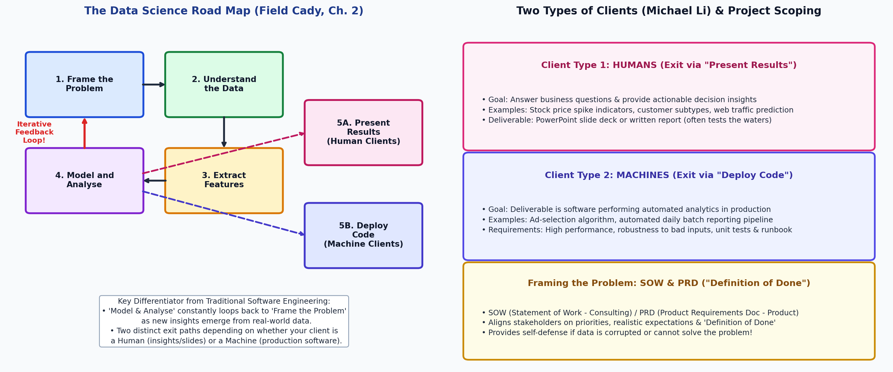
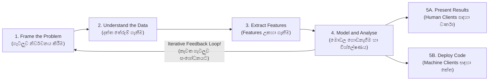

# පාඩම 1.6: Data Science සැලැස්ම — ගැටලුව නිර්වචනය කිරීම සහ සේවාදායකයින් හඳුනා ගැනීම (The Data Science Roadmap — Framing the Problem & Understanding Clients)

**මූලාශ්‍ර දේශන සටහන් (Source Lecture Notes):** `The Data Science Roadmap.pdf` (Chapter 2 of *The Data Science Handbook* by Field Cady, Pages 9–11)

> [!TIP]
> **📚 Prerequisite / Dependency Lesson Series:**
> Data Science ව්‍යාපෘතියකදී නම්‍යශීලීව කේත ලිවීමට සහ වාර්තා සැකසීමට භාවිතා කරන **Jupyter Notebooks, Markdown සහ Reproducible Workflows** පිළිබඳ මූලික දැනුම සඳහා පහත Dependency පාඩම කියවන්න:
> - [03_Markdown_Magic_Commands_and_Reproducible_DS_Workflows.md](../dependencies/Dep_02_Jupyter_Notebook_and_Data_Science_Environment/03_Markdown_Magic_Commands_and_Reproducible_DS_Workflows.md)

---

## හැඳින්වීම (Introduction)

අපගේ ෆෝල්ඩරයේ ඇති `The Data Science Roadmap.pdf` ගොනුව යනු *Field Cady* විසින් රචිත **The Data Science Handbook** ග්‍රන්ථයේ 2 වන පරිච්ඡේදයයි. සැබෑ ලෝකයේ Data Science ව්‍යාපෘතියක් ආරම්භයේ සිට අවසානය දක්වා ක්‍රියාත්මක වන ආකාරය, එහිදී මතුවන ප්‍රායෝගික බාධක (**Common pain points**) සහ සාම්ප්‍රදායික **Software Engineering** වලින් Data Science වෙනස් වන්නේ කෙසේද යන්න මෙහිදී ඉතා අගනා ලෙස පැහැදිලි කරයි.

මෙම පාඩමෙන් අපි **Data Science Road Map** හි සමස්ත ව්‍යුහය, **Human Clients vs. Machine Clients** අතර වෙනස, සහ පළමු පියවර වන **Frame the Problem (ගැටලුව රාමුගත කිරීම)** ගැඹුරින් ඉගෙන ගනිමු.

---

## 1. The Data Science Road Map — සමස්ත ක්‍රියාවලිය (Overview - Page 9)

Data Science ගැටලුවක් විසඳීමේ ක්‍රියාවලිය ප්‍රධාන පියවර 5කින් (පිටවන මාර්ග 2ක් සහිතව අදියර 6කින්) සමන්විත වේ:





### මූලික පියවර පෙළගැස්ම:
1. **Frame the Problem:** ව්‍යාපාරික අවශ්‍යතාවය (**Business use case**) තේරුම් ගෙන එය පැහැදිලි විශ්ලේෂණාත්මක ගැටලුවක් (**Well-defined analytics problem**) බවට පත් කිරීම.
2. **Understand the Data:** දත්ත සහ එම දත්තවලින් නිරූපණය වන සැබෑ ලෝකයේ සංසිද්ධීන් ගැඹුරින් පරීක්ෂා කිරීම (**Basic Questions, Data Wrangling & Exploratory Analysis**).
3. **Extract Features:** එම දත්තවලින් විශ්ලේෂණයට වැදගත් වන අර්ථවත් ලක්ෂණ (**Meaningful features**) වගු ආකාරයෙන් (**Tabular format**) වෙන් කර ගැනීම.
4. **Model and Analyse:** වෙන් කරගත් Features විශ්ලේෂණාත්මක හා Machine Learning මෙවලම්වලට ලබා දී සංඛ්‍යාත්මක ප්‍රතිඵල ලබා ගැනීම.
5. **Present Results / Deploy Code:** අවසාන ප්‍රතිඵලය වාර්තාවක් ලෙස ඉදිරිපත් කිරීම හෝ Production මෘදුකාංගයක් ලෙස ක්‍රියාත්මක කිරීම.

---

## 2. මෙම Roadmap එකෙහි ඇති ඉතාම වැදගත් විශේෂතා 2ක් (Pages 9–10)

Field Cady පෙන්වා දෙන පරිදි මෙම සැලැස්ම දෙස බැලීමේදී විශේෂ කරුණු දෙකක් හොඳින් මතක තබා ගත යුතුය:

### විශේෂතාව 1: "Model and Analyze" පියවර නැවත "Frame the Problem" වෙත ගමන් කරයි!
* සාම්ප්‍රදායික Software Engineering වලදී අපි මුලින්ම හදන්නේ කුමන මෘදුකාංගයක්ද යන්න ස්ථිරවම දනිමු.
* නමුත් Data Science වලදී, සැබෑ ලෝකය සහ දත්ත විශ්ලේෂණය අතර දැඩි ප්‍රතිපෝෂණ චක්‍රයක් (**Tight feedback loop**) පවතී. දත්ත විශ්ලේෂණය කරන විට අලුත් තොරතුරු සහ රටාවන් (**New insights**) හමු වේ. එවිට අප මුලින් ඇසූ ප්‍රශ්නය වෙනස් කිරීමට (**Reframe the question**) සිදු වේ!
* එම නිසා Data Scientist කෙනෙකු තම **Code base** එක ඉතාම **Flexible (නම්‍යශීලීව)** තබා ගත යුතු අතර, මෙම චක්‍රය කිහිප වතාවක්ම කරකවමින් ක්‍රමවේදයන් ශෝධනය (**Refine**) කළ යුතුය.

### විශේෂතාව 2: Roadmap එකෙන් පිටවන මාර්ග 2ක් ඇත — Human Clients vs. Machine Clients
*The Data Incubator* ආයතනයේ නිර්මාතෘ **Michael Li** පෙන්වා දුන් පරිදි Data Scientist කෙනෙකුට හමුවන සේවාදායකයින් (**Clients**) ප්‍රධාන වර්ග 2කි:

| සාධකය | 1. Human Clients (මිනිස් සේවාදායකයින්) | 2. Machine Clients (යන්ත්‍ර / පරිගණක සේවාදායකයින්) |
| :--- | :--- | :--- |
| **Exit Path (පිටවන මාර්ගය)** | **Present Results** (ප්‍රතිඵල ඉදිරිපත් කිරීම) | **Deploy Code** (කේතය පද්ධතියකට එක් කිරීම) |
| **මූලික අරමුණ** | පවතින දත්ත භාවිතා කර යම් ව්‍යාපාරික ගැටලුවකට පිළිතුරු සෙවීම සහ තීරණ ගැනීමට අවශ්‍ය **Business Insights** ලබා දීම. | යම් විශ්ලේෂණාත්මක කාර්යයක් ස්වයංක්‍රීයව ඉටු කරන **Piece of software (මෘදුකාංග කොටසක්)** නිර්මාණය කිරීම. |
| **පොතෙහි දක්වා ඇති උදාහරණ (Page 10)** | • කොටස් වෙළඳපොළේ මිල හදිසියේ ඉහළ යාමට (**Spikes in the price of a stock**) බලපාන Leading indicators මොනවාදැයි හඳුනා ගැනීම.<br/>• පාරිභෝගිකයින් ස්වභාවික කාණ්ඩවලට (**Natural subtypes / Customer segments**) බෙදෙනවාද සහ ඒවායේ ලක්ෂණ මොනවාදැයි සෙවීම.<br/>• එක් වෙබ් අඩවියක Traffic එක මගින් තවත් වෙබ් අඩවියක Traffic එක අනුමාන කළ හැකිදැයි පරීක්ෂා කිරීම. | • පාරිභෝගිකයෙකුට පෙන්විය යුතු හොඳම වෙළඳ දැන්වීම (**Ad**) තෝරන ඇල්ගොරිදමය ලියා සැබෑ දත්ත මත පුහුණු කර ක්‍රියාත්මක කිරීම.<br/>• සමාගමේ දෛනික දත්ත මත පදනම්ව සෑම දිනකම ස්වයංක්‍රීයව වාර්තා ජනනය කරන **Batch process** එකක් ලිවීම. |
| **Final Deliverable (අවසාන ප්‍රතිඵලය)** | **PowerPoint Slide Deck එකක් හෝ Written Report එකක්.** *(බොහෝවිට විශාල Production software ව්‍යාපෘතියකට යාමට පෙර ශක්‍යතාව පරීක්ෂා කිරීමට — "Test the waters" — මෙය භාවිතා වේ).* | **Production Software එකක්.** *(මෙය **High performance** විය යුතු අතර වැරදි දත්ත — **Bad inputs** — හමුවේ බිඳ නොවැටී **Robust** ලෙස ක්‍රියා කළ යුතුය).* |

---

## 3. පියවර 2.1: ගැටලුව රාමුගත කිරීම (Frame the Problem - Pages 10–11)

Field Cady ඉතා ප්‍රබල ප්‍රකාශයක් කරයි:
> *"The difference between great and mediocre data science is not about math or engineering: it is about asking the right question(s)... No amount of technical competence or statistical rigor can make up for having solved a useless problem."*  
> **(විශිෂ්ට Data Science සහ සාමාන්‍ය Data Science අතර වෙනස තීරණය වන්නේ ගණිතය හෝ ඉංජිනේරුකරණය මත නොව, නිවැරදි ප්‍රශ්නය ඇසීම මතයි! වැඩකට නැති ප්‍රශ්නයකට කොතරම් දක්ෂ ලෙස Statistical rigor එකකින් විසඳුමක් දුන්නත් එයින් කිසිදු ප්‍රයෝජනයක් නැත.)**

### Human Clients vs. Machine Clients සඳහා ගැටලුව නිර්වචනය කිරීම:
* **Human Clients නම්:** ව්‍යාපෘතිය ආරම්භ වන්නේ ඉතාම පුළුල් සහ අපැහැදිලි ප්‍රශ්නයකිනි (**Extremely open-ended question**). ආයතනයට යම් ගැටලුවක් (**Pain point**) ඇති බව දන්නා නමුත් විසඳුම කෙබඳු විය යුතුදැයි ඔවුන් නොදනී.
* **Machine Clients නම්:** ව්‍යාපාරික ගැටලුව පැහැදිලි වුවත්, මෘදුකාංගයේ සීමාවන් (**Constraints**: භාවිතා කළ යුතු Programming languages, **Runtime / Latency**, අනාවැකි කොපමණ නිවැරදි විය යුතුද යන **Accuracy** සීමාවන්) පිළිබඳව අපැහැදිලි බවක් පවතී.

එම නිසා වැඩ ආරම්භ කිරීමට පෙර **"Definition of Done"** (ව්‍යාපෘතියක් අවසන් සහ සාර්ථක යැයි සැලකීමට සම්පූර්ණ විය යුතු නිර්ණායක මොනවාද) යන්න පැහැදිලිව එකඟ විය යුතුය.

---

## 4. SOW (Statement of Work) සහ PRD (Product Requirements Document - Page 11)

විශාල ව්‍යාපෘතිවලදී මෙම එකඟතාවය Stakeholders ලා සමඟ සාකච්ඡා කර නිල ලේඛනයක් ලෙස සකස් කෙරේ:

1. **SOW (Statement of Work):** උපදේශන සේවා (**Consulting**) හෝ ස්වාධීන විමර්ශන ව්‍යාපෘතිවලදී භාවිතා වේ. ව්‍යාපෘතියේ කළ යුතු වැඩ කොටස, කාලසටහන (**Timelines**), පවතින දත්ත පිළිබඳ උපග්‍රන්ථය (**Data Appendix**) සහ ලබා දෙන ප්‍රතිඵල (**Deliverables**) මෙහි සඳහන් වේ.
2. **PRD (Product Requirements Document):** සමාගමක් තුළ නව මෘදුකාංග නිෂ්පාදනයක් (**Product**) ගොඩනගන විට එහි තිබිය යුතු ක්‍රියාකාරීත්වයන් (**Functionality**) විස්තර කරන ලේඛනයයි.

### SOW / PRD එකක් සැකසීමේ ප්‍රධාන වාසි 2:
* **Getting Everybody on the Same Page (Alignment):** කළ යුතු වැඩ කොටස, ප්‍රමුඛතාවයන් (**Priorities**) සහ ප්‍රායෝගිකව බලාපොරොත්තු විය හැකි ප්‍රතිඵල පිළිබඳව සියලුම පාර්ශවකරුවන් එකම අවබෝධයකට ගෙන එයි.
* **An Element of Self-Defense (ආත්ම ආරක්ෂාව!):** සමහර විට පවතින දත්තවලින් අදාළ ගැටලුව විසඳිය නොහැකි වීමට හෝ දත්ත විනාශ වී (**Corrupted**) තිබීමට පුළුවන. නැතහොත් පසුව සේවාදායකයාගේ අදහස වෙනස් විය හැක. නිසි ලෙස අත්සන් කළ SOW එකක් තිබීමෙන් *"අපි නොකියපු වැඩකට කාලය සහ මුදල් නාස්ති කළා"* යැයි කිසිවෙකුට ඔබට පහර දීමට හෝ නඩු පැවරීමට (**Attack or sue you**) නොහැකි වේ!

---

## 🛠️ Practical Task / Hands-On Exercise (ප්‍රායෝගික අභ්‍යාසය)

### Scenario / Goal:
විදුලි සංදේශ සමාගමක (Telecom Company) ප්‍රධානියා ඔබ වෙත පැමිණ මෙවැනි අපැහැදිලි ප්‍රශ්නයක් (**Vague business question**) ඉදිරිපත් කරයි:
> *"අපේ පාරිභෝගිකයින් ගොඩක් අපේ ජාලය අතහැර යනවා (Customer Churn). අපි මේක නවත්තන්නේ කොහොමද?"*

මෙම අපැහැදිලි ප්‍රශ්නය **Human Client** කෙනෙකු සඳහා සහ **Machine Client** කෙනෙකු සඳහා නිශ්චිත විශ්ලේෂණාත්මක ගැටලුවක් බවට **Frame** කර, ව්‍යාපෘතියේ **Statement of Work (SOW)** සහ **Definition of Done** ස්වයංක්‍රීයව පරීක්ෂා කරන Python Validator එකක් ලියන්න.

### Step-by-Step Tasks:
1. පහත දී ඇති SOW Dictionary ව්‍යුහය පරීක්ෂා කර එහි අනිවාර්ය කොටස් 6 (`project_title`, `client_type`, `framed_question`, `data_appendix`, `deliverables`, `definition_of_done`) අඩංගු වේදැයි පරීක්ෂා කරන Function එකක් ලියන්න.
2. Machine Client සඳහා ලබා දී ඇති මොඩලයේ ප්‍රතිඵල (`latency_ms`, `f1_score`, `missing_input_handled`) SOW හි දක්වා ඇති **Definition of Done** සීමාවන් සපුරාලන්නේදැයි පරීක්ෂා කරන්න.

### Starter Code & Reference Solution:
```python
sow_document = {
    "project_title": "Telecom Customer Churn Early-Warning System",
    "client_type": "Machine Client (with Executive Summary for Humans)",
    "vague_pain_point": "Customers are leaving our network.",
    "framed_question": "Predict probability of a postpaid user churning within the next 30 days based on 90-day usage & complaint logs.",
    "data_appendix": ["billing_history_db", "call_drop_logs", "customer_support_tickets"],
    "deliverables": ["Daily Batch Scoring Script (Python)", "Run Book Documentation", "Executive EDA Report"],
    "definition_of_done": {
        "max_runtime_minutes": 15.0,
        "min_recall_score": 0.80,
        "handles_null_inputs": True
    }
}

def evaluate_project_against_sow(sow, actual_metrics):
    dod = sow["definition_of_done"]
    checks = {
        "Runtime Constraint Met": actual_metrics["runtime_minutes"] <= dod["max_runtime_minutes"],
        "Recall Accuracy Met": actual_metrics["recall_score"] >= dod["min_recall_score"],
        "Robust to Bad/Null Inputs": actual_metrics["handles_null_inputs"] == dod["handles_null_inputs"]
    }
    all_passed = all(checks.values())
    return checks, all_passed

candidate_model_metrics = {
    "runtime_minutes": 9.5,
    "recall_score": 0.84,
    "handles_null_inputs": True
}

checks, status = evaluate_project_against_sow(sow_document, candidate_model_metrics)
print(f"Project: {sow_document['project_title']}")
print(f"Framed Question: {sow_document['framed_question']}\n")
for criterion, passed in checks.items():
    print(f" - {criterion:28s}: {'✅ PASS' if passed else '❌ FAIL'}")
print(f"\nOverall Definition of Done Status: {'🎉 PROJECT ACCEPTED' if status else '⚠️ REQUIRES ITERATION'}")
```

**Expected Output:**
```text
Project: Telecom Customer Churn Early-Warning System
Framed Question: Predict probability of a postpaid user churning within the next 30 days based on 90-day usage & complaint logs.

 - Runtime Constraint Met      : ✅ PASS
 - Recall Accuracy Met         : ✅ PASS
 - Robust to Bad/Null Inputs   : ✅ PASS

Overall Definition of Done Status: 🎉 PROJECT ACCEPTED
```

---

## 📝 Summary & Exam Revision Cheat Sheet

| Concept | Key Takeaway from Field Cady's Roadmap |
| :--- | :--- |
| **Roadmap Feedback Loop** | `Model and Analyze` පියවර නැවත `Frame the Problem` වෙත ගමන් කරයි; අලුත් Insights ලැබෙන විට ප්‍රශ්නය නැවත සංශෝධනය (Reframe) වේ. |
| **Human Clients** | Exit via **Present Results** (Slide deck / Written report); අරමුණ වන්නේ තීරණ ගැනීමට Business Insights ලබා දීමයි. |
| **Machine Clients** | Exit via **Deploy Code** (Production software / Batch process); Performance සහ Bad inputs දරා ගැනීමේ හැකියාව (Robustness) අත්‍යවශ්‍ය වේ. |
| **Definition of Done** | ව්‍යාපෘතියක් සාර්ථකව අවසන් යැයි සැලකීමට සම්පූර්ණ විය යුතු නිශ්චිත නිර්ණායක. |
| **SOW vs. PRD** | **SOW (Statement of Work):** Consulting ව්‍යාපෘති සඳහා කාලසටහන, Deliverables සහ ආත්ම ආරක්ෂාව (Self-defense) සලසයි.<br/>**PRD (Product Requirements Document):** සමාගමක් තුළ නිෂ්පාදනය කරන මෘදුකාංගයක ක්‍රියාකාරීත්වයන් දක්වයි. |

---

**ඊළඟ පාඩම (Next Lesson):** [Lesson 1.7: Grappling with Real-World Data — Basic Questions, Wrangling & Exploration](Lesson_1.7_Understanding_Data_Questions_Wrangling_and_Exploration.md) — අලුත් දත්ත කට්ටලයක් ලැබුණු විගස ඇසිය යුතු ප්‍රශ්න 10, Data Wrangling උපක්‍රම සහ Exploratory Analysis ගැන ඉගෙන ගනිමු.
