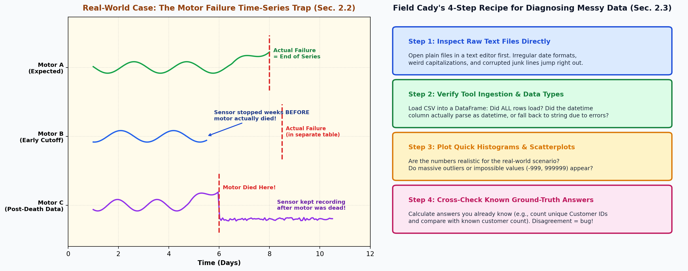
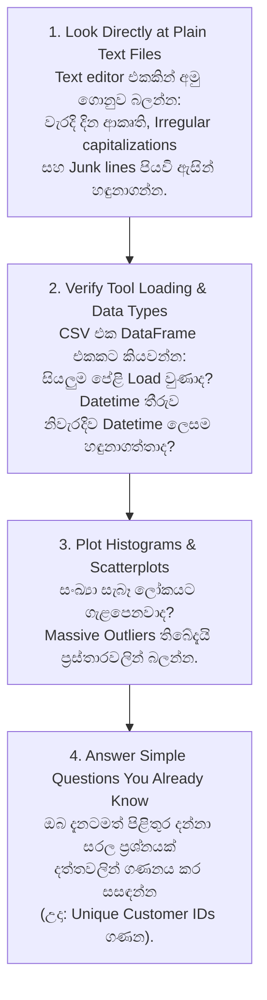

# පාඩම 1.7: සැබෑ ලෝකයේ දත්ත තේරුම් ගැනීම — මූලික ප්‍රශ්න, Data Wrangling සහ Exploratory Analysis (Understand the Data: Basic Questions, Wrangling & Exploration)

**මූලාශ්‍ර දේශන සටහන් (Source Lecture Notes):** `The Data Science Roadmap.pdf` (Sections 2.2, 2.3 & 2.4 of *The Data Science Handbook* by Field Cady, Pages 11–14)

> [!TIP]
> **📚 Prerequisite / Dependency Lesson Series:**
> මෙම පාඩමේදී භාවිතා වන **Unique Identifiers (PK/FK) සහ Table Joins (`LEFT JOIN` / Unmatched Keys)** මෙන්ම **Pandas DataFrames සහ Matplotlib Histograms/Scatterplots** පිළිබඳ මූලික දැනුම සඳහා පහත Dependency පාඩම් මාලාවන් කියවන්න:
> - [01_Relational_Databases_Tables_Keys_and_SQL_Basics.md](../dependencies/Dep_01_RDBMS_SQL_and_Data_Warehousing_Foundations/01_Relational_Databases_Tables_Keys_and_SQL_Basics.md)
> - [Module 5 — Dep_01: Matplotlib Zero-to-Hero Series](../dependencies/Dep_01_Matplotlib_Zero_to_Hero/01_Matplotlib_Anatomy_Figure_Axes_and_Pyplot_vs_OO_API.md)
> - [Module 6 — Dep_01: Pandas Zero-to-Hero Series](../dependencies/Dep_01_Pandas_Zero_to_Hero/01_Pandas_Core_Architecture_Index_Series_and_DataFrame_Internals.md)

---

## හැඳින්වීම (Introduction)

ගැටලුව නිවැරදිව නිර්වචනය කරගත් පසු (**Frame the Problem**), Data Science Roadmap හි දෙවන සහ වඩාත්ම කාලය ගතවන අදියර වන්නේ **Understand the Data (දත්ත තේරුම් ගැනීම)** යි. බොහෝ ආධුනිකයින් දත්ත ලැබුණු විගස කිසිදු පරීක්ෂාවකින් තොරව විශ්ලේෂණයට හෝ Machine Learning මොඩල සෑදීමට පැනීම නිසා විශාල වැරදිවලට හසු වේ.

මෙම පාඩමෙන් අපි අලුත් දත්ත කට්ටලයක් ලැබුණු විගස ඇසිය යුතු **මූලික ප්‍රශ්න 10**, අවිධිමත් දත්ත පිරිසිදු කරන **Data Wrangling** ක්‍රියාවලිය, සහ **Exploratory Analysis** මගින් දත්ත පිළිබඳ ඉවක් (**Intuition**) සහ **Hypotheses (කල්පිතයන්)** ගොඩනගා ගන්නා ආකාරය ඉගෙන ගනිමු.

---

## 1. පියවර 2.2: දත්ත පිළිබඳ ඇසිය යුතු මූලික ප්‍රශ්න 10 (Understand the Data: Basic Questions - Pages 11–12)

දත්ත කට්ටලයක් අතට ලැබුණු විගස, **Analysis paralysis** තත්ත්වයට ලක් නොවී, දත්තවල ඇති දෝෂ කලින්ම හඳුනා ගැනීමට පහත සම්මත ප්‍රශ්න 10 ඇසිය යුතුය:

1. **How big is the dataset?** — දත්ත කට්ටලය කොපමණ විශාලද? (Rows ගණන, Columns ගණන සහ ගොනුවේ ධාරිතාව MB/GB/TB).
2. **Is this the entire dataset?** — මෙය සම්පූර්ණ දත්ත කට්ටලයමද, නැතහොත් ඉන් කුඩා **Sample (නියැදියක්) / Subset** එකක් පමණක්ද?
3. **Is this data representative enough?** — මෙම දත්ත සමස්ත **Population (සංගහනය)** නියෝජනය කිරීමට ප්‍රමාණවත්ද? *(උදා: සමහර විට එක් විශේෂිත පරිශීලක කණ්ඩායමක පමණක් දත්ත එකතු කර තිබිය හැක — **Sampling Bias**).*
4. **Are there likely to be gross outliers or extraordinary sources of noise?** — දත්ත තුළ දැවැන්ත **Outliers (අසාමාන්‍ය අගයන්)** හෝ බාහිර **Noise (ඝෝෂාවන්)** තිබිය හැකිද? *(උදා: වෙබ් සර්වරයක Traffic දත්තවලින් 99%ක්ම එක් Denial-of-Service [DoS] සයිබර් ප්‍රහාරයක් නිසා ඇති වූවක් විය හැක!).*
5. **Might there be artificial data inserted into the dataset?** — කෘත්‍රිම හෝ පරීක්ෂණ දත්ත (**Artificial / Test data**) මෙම දත්ත අතරට මිශ්‍ර වී තිබිය හැකිද? *(කාර්මික පද්ධතිවල පරීක්ෂණ සඳහා ඇතුළත් කළ Dummy records බහුලව හමුවේ).*
6. **Are there any fields that are unique identifiers?** — එක් එක් පේළිය අනන්‍යව හඳුනාගත හැකි තීරු (**Unique Identifiers / Primary Keys** - උදා: `Customer_ID`, `NIC`) මොනවාද? වගු දෙකක් එකට සම්බන්ධ කිරීමේදී (**Joining datasets**) මේවා අත්‍යවශ්‍ය වේ.
7. **Are the supposedly unique identifiers actually unique? What does it mean if they aren't?** — Unique යැයි පැවසූ Identifiers සැබවින්ම Unique ද? එකම ID එක දෙවරක් තිබේ නම් (**Duplicate keys**) එහි තේරුම කුමක්ද?
8. **If there are two datasets A and B that need to be joined, what does it mean if something in A doesn't match anything in B?** — A සහ B වගු දෙක Join කරන විට A හි ඇති දත්තයකට අදාළව B හි කිසිවක් නොමැති නම් (**Unmatched keys in Joins**) එයට හේතුව කුමක්ද?
9. **When data entries are blank, where does that come from?** — දත්ත හිස්ව (**Blank / `NULL` / `NaN`**) පවතින්නේ නම් එයට හේතුව කුමක්ද? (සංවේදකය ක්‍රියා විරහිත වීමක්ද? පාරිභෝගිකයා පිළිතුරු නොදීමක්ද? අගය 0 වීමක්ද?).
10. **How common are blank entries?** — එවැනි **Missing Values (අඩුපාඩු සහිත හිස් අගයන්)** කොපමණ ප්‍රතිශතයක් දත්ත කට්ටලය පුරා පවතීද?

> [!CAUTION]
> **සියල්ලටම වඩා වැදගත්ම ප්‍රශ්නය (Page 12):**  
> *"The most important question to ask about the data is whether it can solve the business problem that you are trying to tackle."* — අප විසඳීමට උත්සාහ කරන ව්‍යාපාරික ගැටලුවට මෙම දත්ත මගින් පිළිතුරු ලබා දිය හැකිද? පිළිතුර "නැත" නම්, වහාම අමතර දත්ත මූලාශ්‍ර සෙවීමට හෝ සැලසුම් කළ ව්‍යාපෘතිය වෙනස් කිරීමට සිදු වේ.

### සැබෑ ලෝකයේ අත්දැකීමක්: මෝටර් ක්‍රියා විරහිත වීමේ උගුල (The Motor Failure Time-Series Trap - Page 12)
මූලික ප්‍රශ්න පරීක්ෂා නොකර විශ්ලේෂණයට පැනීමෙන් සිදුවූ වරදක් ගැන Field Cady තම පෞද්ගලික අත්දැකීමක් විස්තර කරයි:



* **ව්‍යාපෘතිය:** කර්මාන්තශාලාවක මෝටර් රාශියක භෞතික ලක්ෂණ සටහන් කළ **Time Series (කාල-ශ්‍රේණි)** දත්ත ලබා දී තිබුණි. මෝටරයක් ක්‍රියා විරහිත වීමට (Fail වීමට) පෙර පෙන්වන පූර්ව ලක්ෂණ (**Leading indicators of failure**) සෙවීම ඔහුගේ කාර්යය විය.
* **කළ වරද:** Time series දත්ත අවසන් වන්නේ මෝටරය කැඩුණු මොහොතේදී යැයි උපකල්පනය කළ ඔහු, සෑම මෝටරයකම **අවසාන දිනයේ දත්ත** ඊට පෙර දිනවල දත්ත සමඟ සංසන්දනය කරමින් සති දෙකක්ම වැඩ කළේය.
* **සති දෙකකට පසු හෙළි වූ සත්‍යය:**
  1. සමහර මෝටර්වල Time series දත්ත නතර වී තිබුණේ මෝටරය කැඩීමට **බොහෝ කලකට පෙරය**!
  2. තවත් සමහර මෝටර් කැඩී ගිය පසුවත් (**Dead motors**) සංවේදකය දිගටම දත්ත සටහන් කර තිබුණි!
  3. මෝටර් සැබවින්ම කැඩුණු වේලාවන් වෙනම වගුවක (**Separate table**) තිබූ අතර, ආරම්භයේදීම එම වගුව සමඟ Time series අවසන් වන වේලාවන් සසඳා බැලුවේ නම් සති දෙකක කාලය අපතේ නොයනු ඇත!

---

## 2. පියවර 2.3: Data Wrangling — අවිධිමත් දත්ත පිරිසිදු කිරීම (Pages 12–13)

**Data Wrangling** යනු අමු දත්ත (**Raw format**) ගබඩා කර ඇති තැනින් ලබාගෙන, අවශ්‍ය පිරිසිදු කිරීම් (**Cleaning**) සහ පෙරහන් කිරීම් (**Filtering**) සිදු කර, විශ්ලේෂණයට සුදුසු ක්‍රමවත් ආකෘතියකට (**Regular format**) පත් කරන Software Pipeline එකක් ගොඩනැගීමයි.

* සාම්ප්‍රදායික Statistician කෙනෙකුට නොමැති තාක්ෂණික කුසලතා Data Scientist කෙනෙකුට වඩාත්ම අවශ්‍ය වන්නේ මෙම Data Wrangling අදියරේදීය.
* **කාර්මික දත්ත පිළිබඳ රන් නියමය:** *"Industrial datasets are always more convoluted than you would think they reasonably should be. The question is not whether the problems exist but whether they impact your work."* (සැබෑ ලෝකයේ ආයතනික දත්ත ඔබ සිතනවාට වඩා හැමවිටම අවුල් සහගතය. ප්‍රශ්නය වන්නේ දත්තවල දෝෂ තිබේද යන්න නොව, එම දෝෂ ඔබේ විශ්ලේෂණයට බලපානවාද යන්නයි!).

### දත්ත කට්ටලයක දෝෂ හඳුනා ගැනීමේ පියවර 4ක වට්ටෝරුව (4-Step Recipe for Figuring Out How a Dataset is Broken - Page 13):



1. **අමු Text ගොනුව කෙලින්ම Text Editor එකකින් විවෘත කර බලන්න:** දත්ත Text/CSV ආකාරයෙන් තිබේ නම් මුලින්ම Text editor එකකින් බැලූ විට අක්‍රමවත් දින ආකෘති (**Irregular date formats**), **Irregular capitalizations** සහ වැඩකට නැති පේළි (**Junk lines**) පහසුවෙන්ම ඇසට හසුවේ.
2. **මෘදුකාංගයට දත්ත නිවැරදිව කියවිය හැකිදැයි පරීක්ෂා කරන්න:** උදාහරණයක් ලෙස CSV ගොනුවක් `Pandas DataFrame` එකකට කියවූ පසු:
   * ගොනුවේ තිබූ සියලුම පේළි (Rows) ප්‍රමාණය කියවී තිබේද? (නැතිනම් සමහර පේළිවල Columns ගණන වැරදි විය හැක).
   * `datetime` විය යුතු තීරුව සැබවින්ම `datetime` ලෙස කියවී තිබේද? (නැතිනම් එහි දින ආකෘතියේ දෝෂයක් නිසා සාමාන්‍ය `string/object` ලෙස කියවී තිබිය හැක).
3. **මූලික Histograms සහ Scatterplots කිහිපයක් ඇඳ බලන්න:** ලැබෙන අගයන් සැබෑ ලෝකයේ තත්ත්වයට ප්‍රායෝගිකව ගැළපෙනවාද? විශාල **Outliers (අසාමාන්‍ය අගයන්)** තිබේදැයි පරීක්ෂා කරන්න.
4. **ඔබ දැනටමත් පිළිතුර දන්නා සරල ප්‍රශ්න කිහිපයක් දත්තවලින් ගණනය කර සසඳා බලන්න:** උදාහරණයක් ලෙස ආයතනයේ සිටින මුළු පාරිභෝගිකයින් ගණන ඔබ දළ වශයෙන් දන්නේ නම්, දත්ත කට්ටලයේ ඇති `Unique Customer IDs` ගණන ගණනය කර එය හා සැසඳේදැයි බලන්න. එම අගයන් දෙක නොගැළපේ නම්, ඔබ දත්ත පිළිබඳව යමක් වරදවා වටහාගෙන ඇත!

---

## 3. පියවර 2.4: Exploratory Analysis — ගවේෂණාත්මක විශ්ලේෂණය (Pages 13–14)

දත්ත පිරිසිදු කර භාවිතයට ගත හැකි ආකෘතියකට ගත් පසු ඊළඟ පියවර වන්නේ **Exploratory Analysis (EDA)** යි. මෙහිදී සිදු කරන්නේ දත්ත විවිධ ආකාරවලට පෙරළමින්, විවිධ Visualizations අඳිමින්, සරල **Correlations (සහසම්බන්ධතා)** ගණනය කරමින් දත්ත තුළ ඇත්තේ කුමක්දැයි නිදහසේ ගවේෂණය කිරීමයි.

* **වැදගත් නියමයක්:** *"Feel free to calculate some correlations and similar things, but don't break out the fancy machine learning classifiers. Keep things simple and intuitive."* (මෙම අදියරේදී සංකීර්ණ Machine Learning Classifiers භාවිතා නොකරන්න! සියල්ල සරලව සහ ප්‍රායෝගිකව තබා ගන්න).

### Exploratory Analysis මගින් ඔබට ලැබෙන ප්‍රධාන ප්‍රතිඵල 2:
1. **An intuitive feel for the data (දත්ත පිළිබඳ ගැඹුරු ඉවක් ඇති වීම):** දත්තවල ප්‍රධාන රටාවන් ප්‍රස්තාරිකව පෙනෙන්නේ කෙසේද යන්න පිළිබඳ හොඳ හුරුවක් ලැබේ.
2. **A list of concrete hypotheses (නිශ්චිත උපකල්පන / කල්පිත ලැයිස්තුවක් ලැබීම):** දත්ත තුළ සිදුවන්නේ කුමක්ද යන්න පිළිබඳ පරීක්ෂා කළ හැකි **Hypotheses (කල්පිතයන්)** ගොඩනැගේ. බොහෝවිට මෙවැනි Hypothesis එකකට මුල් වන්නේ ඔබ ඇඳි ප්‍රබල ප්‍රස්තාරයකි:
   * පැහැදිලි රටාවක් පෙන්වන **Time Series (කාල-ශ්‍රේණි)** ප්‍රස්තාරයක්,
   * විචල්‍ය දෙකක් අතර ප්‍රබල සම්බන්ධයක් පෙන්වන **Scatterplot** එකක්,
   * හෝ කඳු දෙකක් සහිත **Bimodal Distribution (ද්වි-මාදිලි ව්‍යාප්තිය)** පෙන්වන **Histogram** එකක් (එනම් දත්ත තුළ එකිනෙකට වෙනස් උප-කණ්ඩායම් දෙකක් සැඟවී ඇති බව!).

> [!WARNING]
> **දත්ත විද්‍යාඥයින්ට Visualizations අවශ්‍ය නැතැයි සිතීම භයානක මිථ්‍යාවකි! (Page 14)**  
> බොහෝ Machine Learning ඇල්ගොරිදම ප්‍රස්තාරික නොවුණත්, හුදෙක් සංඛ්‍යා දෙස පමණක් බැලීමෙන් ඒවායේ ප්‍රතිඵල වැරදියට අර්ථකථනය වීමට ඇති ඉඩකඩ ඉතා වැඩිය (*උදා: **Anscombe's Quartet** හිදී එකිනෙකට හාත්පසින්ම වෙනස් දත්ත කට්ටල 4කට එකම **Arithmetic Mean (සමාන්තර මධ්‍යන්‍යය)**, **Variance (විචලතාවය)** සහ **Correlation (සහසම්බන්ධතාවය)** පවතින නමුත් ප්‍රස්තාර ඇඳ බැලූ විට ඒවායේ වෙනස ක්ෂණිකව පෙනේ*). දත්තවල සැබෑ ස්වභාවය තේරුම් ගැනීමේදී මිනිස් ඇසට (**Human eye**) ආදේශකයක් නොමැත!

---

## 🛠️ Practical Task / Hands-On Exercise (ප්‍රායෝගික අභ්‍යාසය)

### Scenario / Goal:
ඔබට කාර්මික පද්ධතියකින් ලැබුණු අමු දත්ත කට්ටලයක් (`df_raw`) පරීක්ෂා කිරීමට ලැබී ඇත. Section 2.2 හි දැක්වෙන **Basic Questions 10** සහ Section 2.3 හි **4-Step Messy Data Recipe** එක උපයෝගී කරගනිමින් එම දත්ත කට්ටලයේ ඇති සියලුම දෝෂ ස්වයංක්‍රීයව හඳුනා ගන්නා **Automated Data Health Audit** Python script එකක් ලියන්න.

### Step-by-Step Tasks:
1. **Dataset Size & Blank Entries (Q1, Q9, Q10):** මුළු Rows/Columns ගණන සහ එක් එක් තීරුවේ ඇති හිස් අගයන් (`NaN` / `None`) ප්‍රතිශතය සොයන්න.
2. **Unique Identifier Check (Q6, Q7):** `customer_id` තීරුව සැබවින්ම Unique ද නැතහොත් Duplicate IDs තිබේදැයි පරීක්ෂා කරන්න.
3. **Artificial / Test Data & Gross Outliers Check (Q4, Q5):** `customer_name` හි `'TEST'` හෝ `'DUMMY'` අඩංගු කෘත්‍රිම පේළි හඳුනා ගන්න, සහ `age` තීරුවේ අසාමාන්‍ය අගයන් (**Outliers (අසාමාන්‍ය අගයන්)** — උදා: `age < 0` හෝ `age > 120`) හඳුනා ගන්න.
4. **Join Match Check (Q8):** `df_orders` වගුවේ ඇති `customer_id` අගයන්ගෙන් කීයක් `df_raw` පාරිභෝගික වගුවේ නොමැතිද (**Orphan / Unmatched keys**) යන්න සොයන්න.

### Starter Code & Reference Solution:
```python
import pandas as pd
import numpy as np

df_raw = pd.DataFrame([
    {"customer_id": 101, "customer_name": "Kasun",       "age": 29,  "spend": 15000.0},
    {"customer_id": 102, "customer_name": "Nimali",      "age": 34,  "spend": None},
    {"customer_id": 102, "customer_name": "Nimali Dup",  "age": 34,  "spend": 22000.0},
    {"customer_id": 103, "customer_name": "TEST_USER_9", "age": 999, "spend": 0.0},
    {"customer_id": 104, "customer_name": "Ruwan",       "age": -5,  "spend": 18500.0},
    {"customer_id": 105, "customer_name": "Dilani",      "age": 41,  "spend": 5000000.0}, # DoS / Gross Outlier
])

df_orders = pd.DataFrame([
    {"order_id": 1, "customer_id": 101},
    {"order_id": 2, "customer_id": 999}, # Unmatched key!
])

print("=== AUTOMATED DATA HEALTH AUDIT (FIELD CADY'S 10 QUESTIONS) ===")
print(f"1. Dataset Shape             : {df_raw.shape[0]} rows x {df_raw.shape[1]} columns")
print(f"2. Missing Values (%)        :\n{(df_raw.isna().mean() * 100).round(1).to_string()}")

dup_ids = df_raw[df_raw.duplicated(subset=["customer_id"], keep=False)]["customer_id"].unique().tolist()
print(f"3. Duplicate Primary Keys    : {dup_ids}")

artificial_rows = df_raw[df_raw["customer_name"].str.contains("TEST|DUMMY", case=False, na=False)]
print(f"4. Artificial/Test Rows Found: { artificial_rows['customer_name'].tolist() }")

invalid_ages = df_raw[(df_raw["age"] < 0) | (df_raw["age"] > 120)]
print(f"5. Gross Age Outliers        : { invalid_ages[['customer_id', 'age']].to_dict(orient='records') }")

unmatched_orders = set(df_orders["customer_id"]) - set(df_raw["customer_id"])
print(f"6. Unmatched Join Keys (Q8)  : {unmatched_orders}")
```

**Expected Output:**
```text
=== AUTOMATED DATA HEALTH AUDIT (FIELD CADY'S 10 QUESTIONS) ===
1. Dataset Shape             : 6 rows x 4 columns
2. Missing Values (%)        :
customer_id       0.0
customer_name     0.0
age               0.0
spend            16.7
3. Duplicate Primary Keys    : [102]
4. Artificial/Test Rows Found: ['TEST_USER_9']
5. Gross Age Outliers        : [{'customer_id': 103, 'age': 999}, {'customer_id': 104, 'age': -5}]
6. Unmatched Join Keys (Q8)  : {999}
```

---

## 📝 Summary & Exam Revision Cheat Sheet

| Section | Core Checklist |
| :--- | :--- |
| **Basic Questions (2.2)** | Size, Entire vs. Sample, Representativeness, Gross Outliers/DoS Noise, Artificial/Test Data, Unique IDs & Duplicates, Join Mismatches, Blank (`NULL`) origins & frequency. |
| **Motor Failure Trap** | Time-series sensor දත්ත අවසන් වන වේලාව මෝටරය සැබවින්ම කැඩුණු වේලාව යැයි පරීක්ෂා නොකර උපකල්පනය කිරීමෙන් සති දෙකක් අපතේ යාම. |
| **4-Step Wrangling Recipe (2.3)** | 1. Inspect raw text file, 2. Verify DataFrame loading & `datetime` types, 3. Plot Histograms & Scatterplots, 4. Cross-check against known answers. |
| **Exploratory Analysis (2.4)** | Keep it simple (no fancy ML yet!); builds **Intuition** and **Concrete Hypotheses** using Visualizations. |

---

**ඊළඟ පාඩම (Next Lesson):** [Lesson 1.8: Feature Extraction, Modeling, Communication, Deployment & Iteration](Lesson_1.8_Feature_Extraction_Modeling_Communication_and_Deployment.md) — Module 1 හි අවසාන පාඩම ලෙස Feature Extraction, Modeling, ප්‍රතිඵල ඉදිරිපත් කිරීම, Code Deployment සහ Iteration පිළිබඳව ඉගෙන ගනිමු.
