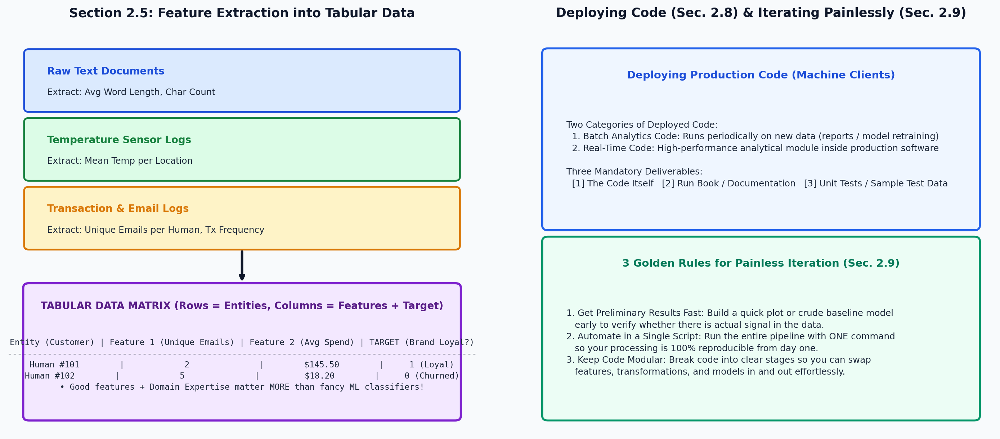
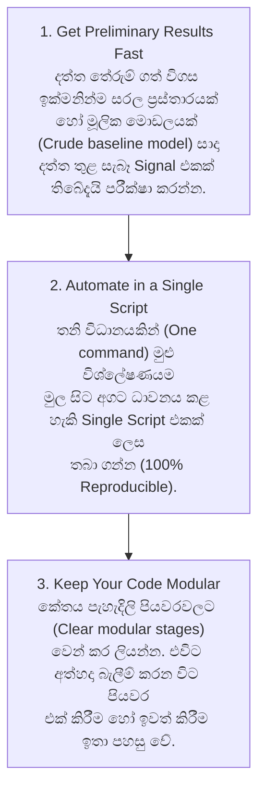

# පාඩම 1.8: Feature Extraction, Modeling, ප්‍රතිඵල ඉදිරිපත් කිරීම, Code Deployment සහ Iteration (Feature Extraction, Modeling, Communication, Deployment & Iteration)

**මූලාශ්‍ර දේශන සටහන් (Source Lecture Notes):** `The Data Science Roadmap.pdf` (Sections 2.5–2.10 of *The Data Science Handbook* by Field Cady, Pages 14–17)

> [!TIP]
> **📚 Prerequisite / Dependency Lesson Series:**
> මෙම පාඩමේදී සාකච්ඡා කෙරෙන **Reproducible Scripts, Modular Code සහ Automated Testing** පිළිබඳ ප්‍රායෝගික අවබෝධය සඳහා පහත Dependency පාඩම කියවන්න:
> - [03_Markdown_Magic_Commands_and_Reproducible_DS_Workflows.md](../dependencies/Dep_02_Jupyter_Notebook_and_Data_Science_Environment/03_Markdown_Magic_Commands_and_Reproducible_DS_Workflows.md)

---

## හැඳින්වීම (Introduction)

Module 1 හි අවසාන පාඩම වන මෙම ලිපියෙන් අපි *The Data Science Road Map* හි ඉතිරි ප්‍රධාන පියවරයන් 5 සහ සම්පූර්ණ පාරිභාෂික ශබ්දකෝෂය (**Glossary**) ඉගෙන ගනිමු:
1. **Extract Features (ලක්ෂණ උකහා ගැනීම)**
2. **Model (මොඩල ගොඩනැගීම සහ විශ්ලේෂණය)**
3. **Present Results (මිනිස් සේවාදායකයින්ට ප්‍රතිඵල ඉදිරිපත් කිරීම)**
4. **Deploy Code (පරිගණක සේවාදායකයින් සඳහා කේත ක්‍රියාත්මක කිරීම)**
5. **Iterating (නැවත නැවත ශෝධනය කිරීමේ ක්‍රමවේද)**

---

## 1. පියවර 2.5: Extract Features — අමු දත්තවලින් ලක්ෂණ උකහා ගැනීම (Pages 14–15)

**Feature (ලක්ෂණයක්)** යනු ඔබේ දත්තවලින් උකහා ගන්නා, යම් සැබෑ ලෝකයේ වස්තුවක් හෝ පුද්ගලයෙකු (**Entity**) විස්තර කරන **සංඛ්‍යාවක් (Number)** හෝ **කාණ්ඩයකි (Category / Label)**.

* *උදාහරණ 1 (Text Document):* ලිපියක ඇති වචනවල සාමාන්‍ය දිග (**Average word length**) හෝ මුළු අකුරු ගණන (**Number of characters**) Feature එකක් ලෙස උකහා ගත හැක.
* *උදාහරණ 2 (Temperature Measurements):* යම් ප්‍රදේශයක උෂ්ණත්ව මිනුම්වලින් එම ස්ථානයේ සාමාන්‍ය උෂ්ණත්වය (**Average temperature / Arithmetic Mean (සමාන්තර මධ්‍යන්‍යය)**) Feature එකක් ලෙස ගත හැක.



### Tabular Data (වගුගත දත්ත) බවට පත් කිරීම:
ප්‍රායෝගිකව Feature Extraction යනු ඔබේ අමු දත්ත කට්ටල (**Raw datasets**) **පේළි (Rows) සහ තීරු (Columns) සහිත වගුවක් (Tabular Data)** බවට පත් කිරීමයි:
* **සෑම පේළියක්ම (Row):** සැබෑ ලෝකයේ එක් ඒකකයක් (**Entity** — උදා: එක් පාරිභෝගිකයෙකු, එක් ගනුදෙනුවක්, එක් මෝටරයක්) නිරූපණය කරයි.
* **සෑම තීරුවක්ම (Column):** එම ඒකකය විස්තර කරන එක් තොරතුරක් (**Feature** — බොහෝවිට සංඛ්‍යාවක්) නිරූපණය කරයි.
* සරල Scatterplots වල සිට සංකීර්ණ Neural Networks දක්වා සියලුම විශ්ලේෂණ මෙවලම් ක්‍රියාත්මක වන්නේ මෙම **Tabular Data** මතය!

### Feature Extraction පිළිබඳ වැදගත්ම කරුණු 4:
1. **Machine Learning වලටත් වඩා වැදගත්ම දෙය මෙයයි:** *"Extracting good features is the most important thing for getting your analysis to work. It is much more important than good machine learning classifiers, fancy statistical techniques, or elegant code."* — විශේෂයෙන්ම වෙබ් පිටු හෝ ඡායාරූප වැනි සූදානම් කළ Features නොමැති දත්තවලදී, ඔබ ඒවා සංඛ්‍යා බවට පත් කරන්නේ කෙසේද යන්න මත ව්‍යාපෘතියේ සාර්ථකත්වය හෝ අසාර්ථකත්වය තීරණය වේ!
2. **Domain Expertise සමඟ දැඩිව බැඳී පවතී:** මෙය Data Science හි වඩාත්ම නිර්මාණශීලී කොටසයි. හොඳ Feature එකක් සෑමවිටම සැබෑ ලෝකයේ සංසිද්ධියක් නිරූපණය කරන බැවින් ක්ෂේත්‍රයේ ප්‍රවීණයන් (**Domain experts**) සමඟ සමීපව වැඩ කළ යුතුය.
3. **Entity එක කුමක්දැයි තීරණය කිරීම (Choosing the Entity & Entity Resolution):**
   * *උදාහරණය (Page 15):* ඔබට පාරිභෝගිකයින්ගේ නම සහ Email ලිපිනය ඇතුළත් Transaction logs ලැබී ඇතැයි සිතන්න. ඔබේ වගුවේ එක් පේළියක් (Row) වෙන් කරන්නේ **එක් Email ලිපිනයකටද (One row per e-mail address)** නැතහොත් **එක් පුද්ගලයෙකුටද (One row per human)**?
   * බොහෝ විට අපට අවශ්‍ය වන්නේ එක් පුද්ගලයෙකුට එක් පේළියක් වෙන් කිරීමයි (එවිට එම පුද්ගලයා සතු මුළු Unique Email ලිපින ගණන ඉතා හොඳ Feature එකක් විය හැක!). නමුත් එහිදී නම් දෙස බලා පුද්ගලයින් දෙදෙනෙකු එක් අයෙකුමදැයි හඳුනා ගන්නේ කෙසේද (**Entity Resolution**) යන සංකීර්ණ ප්‍රශ්නයට මුහුණ දීමට සිදු වේ.
4. **Target Variable එකත් නිර්මාණය කිරීමට සිදුවිය හැක:**
   * අපි අනාවැකි පළ කිරීමට උත්සාහ කරන විචල්‍යය **Target Variable (ඉලක්කගත විචල්‍යය)** ලෙස හැඳින්වේ.
   * සමහර විට දත්ත තුළ Target Variable එක සෘජුවම දක්නට නොලැබේ! *උදාහරණය (Page 15):* පාරිභෝගිකයින් තම සන්නාම පක්ෂපාතීත්වය (**Brand Loyalty**) අතහරිනවාදැයි පුරෝකථනය කිරීමට ලැබුණු ව්‍යාපෘතියකදී, දත්තවල "Loyalty" නමින් තීරුවක් නොතිබුණි. තිබුණේ පාරිභෝගික ගනුදෙනු ලොග් පමණි. එබැවින් "Loyalty" යන්න ගණිතමය වශයෙන් මනින සූත්‍රයක් (**Target variable**) මුලින්ම නිර්මාණය කිරීමට සිදු විය!

---

## 2. පියවර 2.6: Model — මොඩල ගොඩනැගීම සහ විශ්ලේෂණය (Page 15)

Features වගුවක් ලෙස සකසා ගත් පසු ඊළඟ පියවර වන්නේ Machine Learning හෝ Statistical මොඩලයක් යෙදීමයි:
* **Classification (වර්ගීකරණය):** පාරිභෝගිකයෙකු තවමත් ආයතනයට පක්ෂපාතීද (`Loyal` vs. `Not Loyal`) යන්න වර්ගීකරණය කරන **Classifier** එකක්.
* **Regression (ප්‍රතිගමනය):** හෙට දිනයේ කොටස් මිල (**Stock price**) කීයක් වේවිදැයි අඛණ්ඩ සංඛ්‍යාත්මක අගයක් ලෙස අනුමාන කරන **Regression Model** එකක්.
* **Clustering (පොකුරුගත කිරීම):** පාරිභෝගිකයින් ස්වභාවික කාණ්ඩවලට (**Customer segments**) වෙන් කරන **Clustering Algorithm** එකක්.

### මොඩලවල ප්‍රතිඵල ගැඹුරින් විශ්ලේෂණය කිරීම:
මොඩලයක් පුහුණු කළ පමණින් වැඩය අවසන් නොවේ. පහත ප්‍රශ්නවලට පිළිතුරු සෙවිය යුතුය:
* **Clustering (පොකුරුගත කිරීම)** මගින් කාණ්ඩ හඳුනා ගත්තේ නම්, සැබෑ ලෝකයේදී එම කාණ්ඩවලින් අදහස් වන්නේ කවුරුන්ද?
* ඔබේ Classifier එක ප්‍රායෝගිකව භාවිතා කිරීමට තරම් නිවැරදිද?
* **මොඩලය අසාර්ථක වන අවස්ථා (Cases in which it fails) වල ඇති විශේෂත්වය කුමක්ද?** — මොඩලයට වැරදුණු දත්ත (**False Positives / False Negatives**) පරීක්ෂා කිරීමෙන් ඊළඟ වටයේදී (**Next iteration**) අලුතින් එක් කළ යුතු Features මොනවාදැයි හොඳම අදහස් ලැබේ!
* **Human Client vs. Machine Client:** ඔබේ සේවාදායකයා මිනිසෙකු නම්, දත්තවල විවිධ පැතිකඩ පෙන්වීමට විවිධ ආකාරයට Tune කළ මොඩල කිහිපයක් භාවිතා කළ හැක. නමුත් සේවාදායකයා පරිගණකයක් (**Machine Client**) නම්, Production හි ධාවනය කිරීම සඳහා එක් නිශ්චිත ප්‍රධාන මොඩලයක් (**Single canonical model**) තෝරාගත යුතුය.

---

## 3. පියවර 2.7: Present Results — ප්‍රතිඵල සන්නිවේදනය කිරීම (Pages 15–16)

ඔබේ සේවාදායකයා මිනිසුන් නම් (සහ බොහෝවිට Machine client ව්‍යාපෘතිවලදී පවා), ඔබ කළ කාර්යය සහ සොයාගත් ප්‍රතිඵල විස්තර කරමින් **Slide Deck එකක් (Presentation)** හෝ **Written Report එකක්** ඉදිරිපත් කිරීමට සිදු වේ.

* **Data Science සන්නිවේදනයේ අභියෝගය:** ඔබ ඉදිරිපත් කරන කරුණු ඉතාම තාක්ෂණික (**Highly technical**) වුවත්, ඔබට සවන් දෙන පිරිස විවිධ පසුබිම්වලට අයත් කණ්ඩායම් 4කි:
  1. **Business Stakeholders** (ව්‍යාපාරික ප්‍රධානීන් — ROI, ලාභය සහ උපායමාර්ගික තීරණ ගැන උනන්දු වේ),
  2. **Domain Experts** (ක්ෂේත්‍රයේ විශේෂඥයින් — සැබෑ ලෝකයේ ක්‍රියාවලීන් සමඟ ගැළපේදැයි බලයි),
  3. **Software Engineers** (මෘදුකාංග ඉංජිනේරුවන් — පද්ධති ක්‍රියාකාරීත්වය, APIs සහ වේගය ගැන උනන්දු වේ),
  4. **Business Analysts** (ව්‍යාපාර විශ්ලේෂකයින් — KPIs සහ ප්‍රවණතා ගැන උනන්දු වේ).
* මෙම සෑම කණ්ඩායමකටම තේරෙන භාෂාවෙන් හා ඔවුන්ට හුරුපුරුදු ඉදිරිපත් කිරීමේ ශෛලියෙන් තාක්ෂණික කරුණු පැහැදිලි කිරීමට Data Scientist කෙනෙකු දක්ෂ විය යුතුය.

---

## 4. පියවර 2.8: Deploy Code — කේතය නිෂ්පාදන පද්ධතියට එක් කිරීම (Page 16)

ඔබේ අවසාන සේවාදායකයා පරිගණක නම් (**Machine Clients**), අනාගතයේදී අන් අය විසින් නිරන්තරයෙන් ධාවනය කරන කේත (**Production code**) නිර්මාණය කිරීම ඔබේ වගකීමයි.

### Deploy කරන කේතවල ප්‍රධාන වර්ග 2:
1. **Batch Analytics Code:** අනාගතයේදී එකතු වන දත්ත මත කාලීනව (උදා: දිනපතා හෝ සතිපතා) ස්වයංක්‍රීයව ධාවනය වන කේත. මෙමගින් මිනිසුන්ට කියවිය හැකි වාර්තා ජනනය කිරීම හෝ වෙනත් කේතයක් විසින් භාවිතා කරන Statistical/ML මොඩලයක් නැවත පුහුණු කිරීම (**Retrain**) සිදු වේ.
2. **Real-Time Code:** විශාල මෘදුකාංග පද්ධතියක් තුළ ක්ෂණිකව (තත්පරයෙන් පංගුවකදී) ක්‍රියාත්මක වන විශ්ලේෂණ මොඩියුලයකි. මෙය High-performance programming language එකකින් සහ Software Engineering හොඳම පිළිවෙත් (**Best practices**) අනුව ලිවිය යුතුය.

### මෙම අදියරේදී ලබා දිය යුතු අනිවාර්ය දේවල් 3 (Three Typical Deliverables):
1. **The Code Itself:** නිවැරදිව සංවිධානය කළ Source code එක.
2. **Documentation / "Run Book":** කේතය ධාවනය කරන ආකාරය සහ නඩත්තු කරන ආකාරය විස්තර කරන ලේඛනය (**Run Book**) හෝ කේතය තුළම අඩංගු කළ Embedded Documentation එක.
3. **Automated Tests / Sample Input Dataset:** කේතය නිවැරදිව ක්‍රියා කරන බව තහවුරු කරන පරීක්ෂාවන් — Real-time කේත සඳහා **Unit Tests** ද, Batch ක්‍රියාවලීන් සඳහා සියලුම විශේෂ අවස්ථා (**Edge cases**) ආවරණය වන **Sample Input Dataset එකක් සහ බලාපොරොත්තු වන Output එක** ද ලබා දිය යුතුය.

---

## 5. පියවර 2.9: Iterating — නැවත නැවත ශෝධනය කිරීමේ රන් නියමයන් 3 (Pages 16–17)

Data Science යනු සාම්ප්‍රදායික Software Engineering වලටත් වඩා බෙහෙවින් **Iterative (පුනරාවර්තන)** ක්‍රියාවලියකි; මන්ද කුමන Features සාර්ථක වේද සහ කුමන මොඩලය හොඳින්ම ක්‍රියා කරයිද යන්න අප කලින් නොදන්නා නිසාය. එබැවින් වෙනස්කම් ඉතා පහසුවෙන් (**Painlessly**) කළ හැකි පරිදි ඔබේ වැඩපිළිවෙළ ගොඩනගා ගැනීමට Field Cady උපදෙස් 3ක් ලබා දෙයි:



---

## 6. පියවර 2.10: සම්පූර්ණ පාරිභාෂික ශබ්දකෝෂය (Glossary - Page 17)

මෙම පරිච්ඡේදය අවසානයේ දක්වා ඇති අනිවාර්යයෙන්ම මතක තබා ගත යුතු නිර්වචන 7 පහත දැක්වේ:

| පදය (Term) | නිර්වචනය (English Definition from Textbook) | සරල සිංහල පැහැදිලි කිරීම |
| :--- | :--- | :--- |
| **Data wrangling** | The nitty-gritty task of cleaning data and getting it into a standard format that is suitable for downstream analysis. | අමු දත්ත පිරිසිදු කර ඉදිරි විශ්ලේෂණ කටයුතු සඳහා සුදුසු සම්මත ආකෘතියකට පත් කිරීමේ ප්‍රායෝගික ක්‍රියාවලිය. |
| **Exploratory analysis** | A stage of analysis that focuses on exploring the data to generate hypotheses about it. Exploratory analysis relies heavily on visualizations. | දත්ත පිළිබඳ **Hypotheses (කල්පිතයන්)** ගොඩනැගීම සඳහා Visualizations බහුලව භාවිතා කරමින් දත්ත ගවේෂණය කරන අදියර. |
| **Feature** | A small piece of data, usually a number or a label, that is extracted from your data and characterizes some entity in your dataset. | දත්ත කට්ටලයේ ඇති යම් ඒකකයක් (**Entity**) විස්තර කිරීම සඳහා අමු දත්තවලින් උකහා ගන්නා සංඛ්‍යාවක් හෝ ලේබලයක්. |
| **Product requirements document (PRD)** | A document that specifies exactly what functionality a planned product should have. | සැලසුම් කළ මෘදුකාංග නිෂ්පාදනයක තිබිය යුතු ක්‍රියාකාරීත්වයන් නිශ්චිතවම දක්වන ලේඛනය. |
| **Production code** | Software that is run repeatedly and maintained. It especially refers to source code of software product that is distributed to other people. | අඛණ්ඩව ධාවනය වන සහ නඩත්තු කරනු ලබන, සැබෑ පද්ධතිවල හෝ පාරිභෝගිකයින් අතර භාවිතා වන මෘදුකාංග කේතය. |
| **Statement of work (SOW)** | A document that specifies what work is to be done in a project, relevant timelines, and specific deliverables. | ව්‍යාපෘතියක කළ යුතු වැඩ කොටස, කාලසටහන සහ ලබා දිය යුතු අවසාන ප්‍රතිඵල නිශ්චිතව දක්වන ගිවිසුම් ලේඛනය. |
| **Target variable** | A feature that you are trying to predict in machine learning. Sometimes, it is already in your data, and other times, you must construct it yourself. | Machine Learning මගින් අප පුරෝකථනය කිරීමට (**Predict** කිරීමට) උත්සාහ කරන විචල්‍යය. |

---

## 🛠️ Practical Task / Hands-On Exercise (ප්‍රායෝගික අභ්‍යාසය)

### Scenario / Goal:
Section 2.5 හි Field Cady විස්තර කරන **Customer Transaction Logs & Brand Loyalty** ගැටලුව සහ Section 2.8–2.9 හි **Modular Code + Unit Tests** එකවර ප්‍රායෝගිකව ගොඩනගමු!
ඔබට පාරිභෝගිකයින්ගේ ගනුදෙනු ලොග් (`transaction_logs`) ලබා දී ඇත. එහි එකම පුද්ගලයා විවිධ Email ලිපින භාවිතා කර ඇත. **One row per human** වන පරිදි පාරිභෝගික මට්ටමේ **Tabular Features** උකහා ගෙන, `is_loyal` නමැති **Target Variable (ඉලක්කගත විචල්‍යය)** නිර්මාණය කර, එම Pipeline එක නිවැරදිව ක්‍රියා කරන බවට **Unit Test** එකක් මගින් තහවුරු කරන්න.

### Step-by-Step Tasks:
1. **Modular Stage 1 (`clean_names`):** පාරිභෝගික නම්වල හිස්තැන් සහ Capital/Simple අකුරු සම්මත කර (`Title Case`) එකම පුද්ගලයා හඳුනා ගන්න.
2. **Modular Stage 2 (`extract_customer_features`):** එක් එක් පුද්ගලයාට එක් පේළියක් (**One row per human**) වන සේ:
   * `unique_emails`: ඔහු සතු Unique Email ලිපින ගණන,
   * `tx_count`: මුළු ගනුදෙනු ගණන,
   * `avg_spend`: ගනුදෙනුවක **Arithmetic Mean (සමාන්තර මධ්‍යන්‍යය)**,
   * `days_since_last_tx`: අවසාන ගනුදෙනුවේ සිට ගතවූ දින ගණන උකහා ගන්න.
3. **Modular Stage 3 (`construct_target_variable`):** `tx_count >= 2` සහ `days_since_last_tx <= 30` නම් `is_loyal = 1` ලෙසත් නැතහොත් `0` ලෙසත් **Target Variable** එක නිර්මාණය කරන්න.
4. **Stage 4 (`run_unit_tests`):** `assert` ප්‍රකාශ භාවිතා කර Pipeline එකේ Output එක නිවැරදිදැයි පරීක්ෂා කරන්න (Section 2.8 Deliverable 3).

### Starter Code & Reference Solution:
```python
import pandas as pd

raw_logs = pd.DataFrame([
    {"name": "kasun perera",  "email": "kasun@gmail.com",  "amount": 5000.0, "days_ago": 5},
    {"name": "Kasun Perera ", "email": "kasun.p@work.com", "amount": 7000.0, "days_ago": 18},
    {"name": "Nimali Silva",  "email": "nimali@mail.com",  "amount": 3500.0, "days_ago": 65},
    {"name": "Ruwan Fernando","email": "ruwan@mail.com",   "amount": 9000.0, "days_ago": 10},
    {"name": "ruwan fernando","email": "ruwan@mail.com",   "amount": 11000.0,"days_ago": 2},
])

def extract_customer_features(df_logs: pd.DataFrame) -> pd.DataFrame:
    df = df_logs.copy()
    df["clean_person_name"] = df["name"].str.strip().str.title()
    
    features = df.groupby("clean_person_name", as_index=False).agg(
        unique_emails=("email", "nunique"),
        tx_count=("amount", "count"),
        avg_spend=("amount", "mean"),
        days_since_last_tx=("days_ago", "min")
    )
    # Construct Target Variable: Brand Loyalty
    features["is_loyal_target"] = (
        (features["tx_count"] >= 2) & (features["days_since_last_tx"] <= 30)
    ).astype(int)
    return features

def run_unit_tests(df_feat: pd.DataFrame):
    assert len(df_feat) == 3, "Expected exactly 3 unique human entities!"
    kasun_row = df_feat[df_feat["clean_person_name"] == "Kasun Perera"].iloc[0]
    assert kasun_row["unique_emails"] == 2, "Kasun should have 2 unique emails!"
    assert kasun_row["is_loyal_target"] == 1, "Kasun should be classified as loyal (1)!"
    print("✅ All Unit Tests Passed Successfully!")

df_tabular_features = extract_customer_features(raw_logs)
print("--- Extracted Tabular Features & Constructed Target Variable ---")
print(df_tabular_features.to_string(index=False))
print()
run_unit_tests(df_tabular_features)
```

**Expected Output:**
```text
--- Extracted Tabular Features & Constructed Target Variable ---
clean_person_name  unique_emails  tx_count  avg_spend  days_since_last_tx  is_loyal_target
     Kasun Perera              2         2     6000.0                   5                1
     Nimali Silva              1         1     3500.0                  65                0
   Ruwan Fernando              1         2    10000.0                   2                1

✅ All Unit Tests Passed Successfully!
```

---

🎉 **Module 1 සම්පූර්ණයි!**  
දැන් ඔබට පාඨමාලාවේ අරමුණු, Data Warehousing, OLTP vs. OLAP, ETL, Big Data, Data Science, RDBMS/SQL හා Jupyter Environments යන Dependency පාඩම් මාලාවන් සහ සැබෑ ලෝකයේ Data Science Roadmap එක පිළිබඳ 100%ක් සම්පූර්ණ න්‍යායාත්මක හා ප්‍රායෝගික අවබෝධයක් ඇත.

**ඊළඟ මොඩියුලය (Next Module):** `Module_02_Python_Programming_Foundations` — `Python Intro 3.pdf` සහ `f1.ipynb` ඇසුරෙන් Python ක්‍රමලේඛනය මුල සිට ගැඹුරට ඉගෙන ගනිමු!
