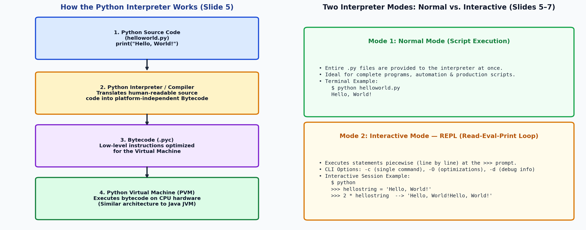
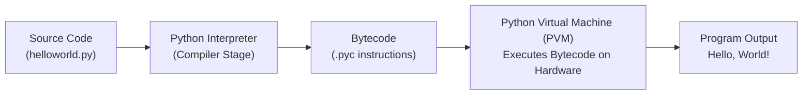

# Lesson 2.1: Introduction to Python & The Python Interpreter (Python හැඳින්වීම සහ Interpreter ක්‍රියාකාරීත්වය)

**මූලාශ්‍ර දේශන සටහන් (Source Lecture Notes):** `Python Intro 3.pdf` (Slides 1–7, Dr. Lochandaka Ranathunga) & `f1.ipynb`

> [!TIP]
> **📚 Prerequisite / Dependency Lesson Series:**  
> Python Virtual Machine (PVM) එක මගින් පරිගණකයේ **RAM (Stack vs. Heap Memory)** තුළ Objects ගබඩා කරන සහ කළමනාකරණය කරන ආකාරය පිළිබඳ මූලික දැනුම ලබා ගැනීමට අපගේ Zero-to-Hero Dependency පාඩම කියවන්න:
> - [Dep 01.1: How RAM Works — Stack vs. Heap & `PyObject` Structure](../dependencies/Dep_01_Computer_Memory_Pointers_and_Object_References/01_How_RAM_Works_Stack_vs_Heap_and_PyObject_Structure.md)

---

## හැඳින්වීම (Introduction)

Module 2 වෙත ඔබව සාදරයෙන් පිළිගනිමු! Data Science, Machine Learning සහ Exploratory Data Analysis (EDA) සඳහා අප භාවිතා කරන ප්‍රධානතම Programming Language එක **Python** වේ. මෙම පාඩමෙන් අපි Python භාෂාවේ ඉතිහාසය, එහි සුවිශේෂී ලක්ෂණ (Notable Features), **Python Interpreter** එක ඇතුළතින් ක්‍රියා කරන ආකාරය (**Bytecode** සහ **Python Virtual Machine - PVM**), සහ Python කේත ධාවනය කළ හැකි ප්‍රධාන ආකාර දෙක (**Normal Mode** සහ **Interactive REPL Mode**) පිළිබඳව සවිස්තරාත්මකව ඉගෙන ගනිමු.

---

## 1. About Python — Python පිළිබඳ මූලික හැඳින්වීම (Slide 2)

* **ආරම්භය (Origins):** 1980 දශකයේ අගභාගයේදී **Guido van Rossum** විසින් Python භාෂාව නිර්මාණය කිරීම ආරම්භ කරන ලදී.
* **ජනප්‍රියත්වය (Popularity):** Data Science, Artificial Intelligence සහ Web Development වර්ධනයත් සමඟ පසුගිය දශකය තුළ ලොව ජනප්‍රියතම Programming Language එක බවට පත් විය.
* **Python 3.x is the future of Python:** වර්තමානයේ සහ අනාගතයේ සම්මත Python සංස්කරණය **Python 3.x** වේ *(Python 2.x නිල වශයෙන් 2020 දී භාවිතයෙන් ඉවත් කරන ලදී - End of Life)*.
* **Interpreted, Very-High-Level Programming Language:** මිනිසාට කියවීමට සහ තේරුම් ගැනීමට ඉතාම පහසු (Very-high-level) මෙන්ම **Interpreter** එකක් මගින් ක්‍රියාත්මක වන භාෂාවකි.
* **Supports a Multitude of Programming Paradigms (Multi-paradigm Support):** එකම ආකෘතියකට කොටු නොවී පහත සියලුම Programming Paradigms වලට Python සහාය දක්වයි:
  * **OOP (Object-Oriented Programming)**
  * **Functional Programming**
  * **Procedural Programming**
  * **Logic & Structured Programming**
* **General Purpose & Very Comprehensive Standard Library:** Python යනු එක් කාර්යයකට පමණක් සීමා වූ භාෂාවක් නොවේ (General purpose). Python සමඟම ලැබෙන ("Batteries Included") **Standard Library** එක තුළ **Numeric modules**, **Crypto services**, **OS interfaces**, **Networking modules**, **GUI support**, සහ **Development tools** රාශියක් අන්තර්ගත වේ.

---

## 2. Notable Features & Getting Started (Slides 3–4)

### Notable Features (කැපී පෙනෙන ලක්ෂණ - Slide 3):
1. **Easy to learn:** සරල සහ පිරිසිදු Syntax එකක් ඇති නිසා ඉගෙනීමට ඉතාම පහසුය.
2. **Supports quick development:** ඉතා අඩු කේත පේළි ගණනකින් වේගයෙන් Prototypes සහ Software ගොඩනැගිය හැක.
3. **Cross-platform:** Windows, Linux, macOS ඇතුළු ඕනෑම Operating System එකක එකම ආකාරයට ක්‍රියා කරයි.
4. **Open Source:** නිදහස් හා විවෘත මූලාශ්‍ර (Free and Open-Source) මෘදුකාංගයකි.
5. **Extensible & Embeddable:** අවශ්‍ය නම් C/C++ වලින් ලියූ වේගවත් කේත කොටස් (උදා: NumPy C extensions) Python තුළට එක් කළ හැකි අතර (**Extensible**), වෙනත් C/C++ Application එකක් තුළට Python Interpreter එක ඇතුළත් කිරීමටද (**Embeddable**) හැකිය.
6. **Large standard library and active community:** විශාල Standard Library එකක් සහ ලොව පුරා විසිරුණු ක්‍රියාකාරී ප්‍රජාවක් සිටින නිසා ඕනෑම ගැටලුවකට විසඳුම් සහ Third-party packages පහසුවෙන් සොයාගත හැක.

### Getting Started: IDEs & Code Editors (Slide 4):
* **Jupyter Notebook (`.ipynb`) / JupyterLab:** Data Science සහ Exploratory Data Analysis සඳහා වඩාත්ම ජනප්‍රිය Interactive මෙවලමයි (අපගේ `f1.ipynb` ගොනුව මීට උදාහරණයකි).
* **PyCharm / VS Code / Eclipse:** පූර්ණ පහසුකම් සහිත **IDEs (Integrated Development Environments)**.
* **Vim, Emacs, Notepad++:** සැහැල්ලු **Code / Text Editors**.
* සාමාන්‍ය Python script ගොනුවක File extension එක සෑමවිටම **`.py`** වේ (උදා: `helloworld.py`).

---

## 3. How the Python Interpreter Works (Slide 5)

Python යනු **Interpreted** භාෂාවකි. නමුත් එය කෙලින්ම Source Code පේළියෙන් පේළිය CPU එක මත ධාවනය කරනවා වෙනුවට, Java භාෂාවට සමාන පියවර දෙකක Architecture එකක් අනුගමනය කරයි:





1. **Bytecode Compilation:** ඔබ Python වැඩසටහනක් ක්‍රියාත්මක කරන විට, Python Interpreter එක විසින් මුලින්ම ඔබේ Python Source Code එක **Bytecode** (`.pyc`) නමැති අතරමැදි (Intermediate), Platform-independent උපදෙස් මාලාවකට පරිවර්තනය කරයි.
2. **Python Virtual Machine (PVM) Execution:** ඉන්පසු එම Bytecode එක **Python Virtual Machine (PVM)** එක මගින් කියවා Hardware/CPU එක මත ක්‍රියාත්මක කරනු ලබයි (මෙය Java හි JVM එක ක්‍රියා කරන ආකාරයට බොහෝ සෙයින් සමානය).

---

## 4. Two Execution Modes: Normal Mode vs. Interactive Mode (Slides 5–7)

Python Interpreter එක ප්‍රධාන Modes දෙකකින් භාවිතා කළ හැක:

### 1. Normal Mode (Script Mode - Slide 6)
* මෙහිදී සම්පූර්ණ `.py` Source File එකක් එකවර Interpreter එක වෙත ලබා දේ.
* උදාහරණයක් ලෙස ඔබේ Editor එකේ `helloworld.py` නමින් ගොනුවක් සාදා පහත පේළිය ලියා Save කරන්න:

```python
print("Hello, World!")
```

* ඉන්පසු Terminal එකෙන් පහත විධානය ලබා දුන් විට මුළු `.py` ගොනුවම එකවර ක්‍රියාත්මක වේ:

```bash
$ python helloworld.py
Hello, World!
```

### 2. Interactive Mode / REPL (Slide 7)
* මෙහිදී Terminal එකේ `python` (හෝ `python3`) ලෙස ටයිප් කර Enter කළ විට `>>>` ලෙස Primary Prompt එකක්ද, Multi-line blocks සඳහා `...` ලෙස Secondary Prompt එකක්ද ලැබේ.
* මෙය **REPL (Read-Eval-Print Loop)** ලෙස හැඳින්වේ:
  * **Read:** පරිශීලකයා ටයිප් කරන Python statement/expression එක කියවයි.
  * **Eval (Evaluate):** එය ක්ෂණිකව Evaluate කරයි.
  * **Print:** එහි ප්‍රතිඵලය ඒ මොහොතේම තිරයේ පෙන්වයි.
  * **Loop:** ඊළඟ විධානය ලබා දෙන තුරු නැවත බලා සිටියි.

#### Interactive Mode Walkthrough (Slide 7 & `f1.ipynb` Cell 1):
```python
$ python
>>> print("Hello, World!")
Hello, World!
>>> hellostring = "Hello, World!"
>>> hellostring
'Hello, World!'
>>> 2 * 5
10
>>> 2 * hellostring
'Hello, World!Hello, World!'
>>> for i in range(0, 3):
...     print("Hello, World!")
...
Hello, World!
Hello, World!
Hello, World!
>>> exit()
$
```
*(වැදගත් නිරීක්ෂණයක්: Interactive REPL එකේදී සහ Jupyter Notebook cells වලදී `print()` නොමැතිව `hellostring` හෝ `2 * 5` ලෙස ටයිප් කළ විටද එහි Return representation එක කෙලින්ම තිරයේ පෙන්වයි! නමුත් Normal `.py` script එකකදී තිරයේ පෙන්වීමට නම් අනිවාර්යයෙන්ම `print()` භාවිතා කළ යුතුය).*

### Python Command-Line Interface (CLI) Options (Slide 7):
Terminal එකෙන් `python` ධාවනය කිරීමේදී ලබා දිය හැකි විශේෂ Flags 3ක් Slide 7 හි දක්වා ඇත:

| CLI Option | කාර්යය (Description) | උදාහරණය (Example) |
| :--- | :--- | :--- |
| **`-c <cmd>`** | `.py` ගොනුවක් නොමැතිව තනි Python විධානයක් (**Single command**) කෙලින්ම Terminal එකේදීම ක්‍රියාත්මක කරයි. | `python -c "print(2 * 5)"` |
| **`-O`** | මූලික ප්‍රශස්තකරණයන් (**Basic optimizations**) සහිතව Optimized Bytecode (`.opt-1.pyc`) ජනනය කරයි (`assert` ප්‍රකාශ ඉවත් කරයි). | `python -O script.py` |
| **`-d`** | Parser එකෙහි **Debugging info** පෙන්වයි. | `python -d script.py` |

> [!NOTE]
> **Gap Analysis — `f1.ipynb` හි Jupyter Notebook සහ List Comprehension හැඳින්වීම (Cells 1–6):**  
> අපගේ `f1.ipynb` Notebook එක ආරම්භ වන්නේ `print('Hello, Welcome to Jupyter Notebook with Python')` යන පේළියෙනි. ඉන්පසු `newlist = [x**2 for x in range(0,6)]` මගින් `0` සිට `5` දක්වා සංඛ්‍යාවල **Square Numbers (වර්ග සංඛ්‍යා)** ලැයිස්තුවක් (`[0, 1, 4, 9, 16, 25]`) නිර්මාණය කර, එයට `newlist.append('Apple')` එක් කර `'Apple' in newlist` (`True`) පරීක්ෂා කරයි. Jupyter Notebook එකක එක් Cell එකක සෑදූ විචල්‍යයක් (`newlist`) ඊළඟ Cells සියල්ලටම මතකයේ පවතින බව මෙයින් පැහැදිලි වේ.

---

## 5. 🛠️ Practical Task / Hands-On Exercise (ප්‍රායෝගික අභ්‍යාසය)

### Scenario / Goal:
ඔබ Data Science පාඨමාලාවේ පළමු ප්‍රායෝගික පරීක්ෂණය ලෙස Python Interpreter එකෙහි String Repetition, Range Iteration සහ `f1.ipynb` හි ආරම්භක **Square Numbers (වර්ග සංඛ්‍යා)** ජනනය කිරීමේ කේතය ලියා පරීක්ෂා කළ යුතුය.

### Step-by-Step Tasks:
1. `welcome_msg = "Hello, Welcome to Jupyter Notebook with Python"` නමින් විචල්‍යයක් සාදා එය මුද්‍රණය කරන්න (`f1.ipynb` Cell 1).
2. `banner = "Python! "` යන String එක `* 3` ගුණ කිරීමේ ක්‍රියාකරු භාවිතා කර තුන් වරක් එක දිගට මුද්‍රණය කරන්න (Slide 7 හි `2 * hellostring` සංකල්පය).
3. `range(0, 6)` සහ List Comprehension (`[x**2 for x in range(0, 6)]`) භාවිතා කර `newlist` සාදා, එයට `'Apple'` එක් කර (`.append()`), `'Apple' in newlist` පරීක්ෂාවේ ප්‍රතිඵලය සහ සම්පූර්ණ ලැයිස්තුව මුද්‍රණය කරන්න (`f1.ipynb` Cells 2–6).
4. Python හි Built-in `dis` (Disassembler) මොඩියුලය භාවිතා කර `2 * 5` ගණනය කරන කුඩා ශ්‍රිතයක **Bytecode** උපදෙස් මාලාව පරීක්ෂා කරන්න (Slide 5).

### Starter Code:
```python
import dis

# Task 1: Print welcome message from f1.ipynb
welcome_msg = "Hello, Welcome to Jupyter Notebook with Python"
# TODO: Print welcome_msg

# Task 2: Repeat banner string 3 times
banner = "Python! "
# TODO: Print 3 * banner

# Task 3: Reproduce f1.ipynb Cells 2-6
# TODO: Create newlist = [x**2 for x in range(0, 6)], append 'Apple', and check membership

# Task 4: Inspect Python Bytecode using dis
def multiply_demo():
    return 2 * 5

# TODO: Call dis.dis(multiply_demo)
```

### Expected Output / Reference Solution:
```python
import dis

# Task 1: Print welcome message from f1.ipynb
welcome_msg = "Hello, Welcome to Jupyter Notebook with Python"
print(welcome_msg)

# Task 2: Repeat banner string 3 times
banner = "Python! "
print(3 * banner)

# Task 3: Reproduce f1.ipynb Cells 2-6
newlist = [x**2 for x in range(0, 6)]
print("Initial squares:", newlist)
newlist.append('Apple')
print("Is 'Apple' in newlist?:", 'Apple' in newlist)
print("Updated newlist:", newlist)

# Task 4: Inspect Python Bytecode using dis
def multiply_demo():
    return 2 * 5

print("\nBytecode for multiply_demo():")
dis.dis(multiply_demo)
```

**Expected Output:**
```text
Hello, Welcome to Jupyter Notebook with Python
Python! Python! Python! 
Initial squares: [0, 1, 4, 9, 16, 25]
Is 'Apple' in newlist?: True
Updated newlist: [0, 1, 4, 9, 16, 25, 'Apple']

Bytecode for multiply_demo():
  ...           0 RETURN_CONST             1 (10)
```

---

## 6. Summary & Exam Revision Cheat Sheet (සාරාංශය)

| සංකල්පය (Concept) | වැදගත් කරුණු (Key Exam Points) |
| :--- | :--- |
| **Creator & Version** | Guido van Rossum (1980s); **Python 3.x** වර්තමාන සම්මතයයි. |
| **Execution Pipeline** | Source Code (`.py`) $\rightarrow$ **Bytecode** (`.pyc`) $\rightarrow$ **Python Virtual Machine (PVM)**. |
| **Normal vs. Interactive Mode** | **Normal Mode:** සම්පූර්ණ `.py` ගොනුවක් ධාවනය කරයි (`python script.py`). **Interactive Mode:** **REPL (Read-Eval-Print Loop)** මගින් පේළියෙන් පේළිය ක්ෂණිකව ධාවනය කරයි. |
| **CLI Options** | `-c` (Single command), `-O` (Basic optimizations), `-d` (Debugging info). |

---

**ඊළඟ පාඩම (Next Lesson):** [Lesson 2.2: Python Syntax Fundamentals, Dynamic Typing & Numeric Types](Lesson_2.2_Python_Syntax_Dynamic_Typing_and_Numeric_Types.md) — Python හි Indentation නීති, Comments/Docstrings, Strong & Dynamic Typing සහ Numeric Data Types ගැන ඉගෙන ගනිමු.
