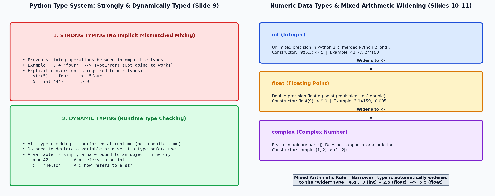
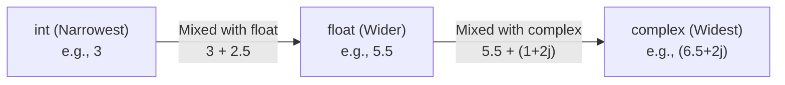

# Lesson 2.2: Python Syntax Fundamentals, Dynamic Typing & Numeric Types (Python මූලික ව්‍යාකරණ, Dynamic Typing සහ සංඛ්‍යාත්මක දත්ත වර්ග)

**මූලාශ්‍ර දේශන සටහන් (Source Lecture Notes):** `Python Intro 3.pdf` (Slides 8–11, Dr. Lochandaka Ranathunga) & `f1.ipynb`

> [!TIP]
> **📚 Prerequisite / Dependency Lesson Series:**  
> මෙම පාඩමේදී හමුවන **Dynamic Typing**, විචල්‍යයන් මතකයේ ගබඩා වන ආකාරය (`PyObject`), **Binary Number System (ද්වීමය සංඛ්‍යා පද්ධතිය)** සහ **IEEE-754 Floating-Point Precision (ඉපිලෙන ලක්ෂ්‍ය නිරවද්‍යතාවය)** ගැඹුරින් තේරුම් ගැනීමට පහත Dependency පාඩම් කියවන්න:
> - [Dep 01.1: How RAM Works — Stack vs. Heap & `PyObject` Structure](../dependencies/Dep_01_Computer_Memory_Pointers_and_Object_References/01_How_RAM_Works_Stack_vs_Heap_and_PyObject_Structure.md)
> - [Dep 01.2: Variables as Name Tags, `id()`, and `is` vs. `==`](../dependencies/Dep_01_Computer_Memory_Pointers_and_Object_References/02_Variables_as_Name_Tags_id_is_vs_Double_Equals.md)
> - [Dep 02.1: Binary, Hexadecimal & IEEE-754 Floating-Point Precision (`0.1 + 0.2 != 0.3`)](../dependencies/Dep_02_Number_Systems_Binary_Unicode_and_Hash_Tables/01_Binary_Hexadecimal_and_IEEE754_Floating_Point_Precision.md)

---

## හැඳින්වීම (Introduction)

C, C++ හෝ Java වැනි භාෂාවකින් කේත ලියා ඇති අයෙකුට Python දුටු විගස පෙනෙන ප්‍රධාන වෙනස්කම් දෙකක් තිබේ: Python වල Code blocks වෙන් කිරීමට `{}` සඟල වරහන් භාවිතා නොවන අතර, Variables සෑදීමේදී `int x = 5;` ලෙස Data Type එක කලින් ප්‍රකාශ කිරීමට (Declare කිරීමට) අවශ්‍ය නොවේ.

මෙම පාඩමෙන් අපි Python හි **Significant Whitespace / Indentation** නීතිය, **Comments & Docstrings**, Python යනු **Strongly සහ Dynamically Typed** භාෂාවක් වන්නේ ඇයි, සහ Python හි ඇති **Numeric Data Types (`int`, `float`, `complex`)** ගැන ගැඹුරින් ඉගෙන ගනිමු.

---

## 1. Some Fundamentals: Indentation & Comments (Slide 8)

### 1. Whitespace is Significant in Python (Indentation Rule):
* C, C++ හෝ Java වැනි වෙනත් භාෂාවලදී Code block එකක් වෙන් කර පෙන්වීමට `{}` හෝ `()` භාවිතා කළත්, **Python භාවිතා කරන්නේ Indentation (පේළිය ආරම්භයේ තබන හිස්තැන් ප්‍රමාණය) ය!**
* එකම Code block එකකට (උදා: `for` loop එකක්, `if` statement එකක් හෝ `def` function එකක් ඇතුළත) අයත් සියලුම පේළි එකම ප්‍රමාණයකින් (PEP 8 සම්මතය ලෙස **Spaces 4ක්**) දකුණට කර (Indent කර) ලිවිය යුතුය. Indentation නොගැළපුණහොත් `IndentationError` එකක් ලැබේ.

### 2. Comments & Docstrings:
* **Single-line comments (`#`):** තනි පේළියක Comment එකක් ලිවීමට `#` ලකුණ භාවිතා කරයි. `#` ලකුණෙන් පසු එම පේළියේ ලියන කිසිවක් Python Interpreter එක මගින් ක්‍රියාත්මක නොකරයි.
* **Multi-line comments / Docstrings (`""" ... """`):** පේළි කිහිපයක විස්තරයක් ලිවීමට උඩුකොමා තුනක් (`"""` හෝ `'''`) ආරම්භයේ සහ අවසානයේ යොදයි. සාමාන්‍යයෙන් Functions, Classes සහ Modules පිළිබඳ විස්තරාත්මක ලේඛන (**Documentation Strings / Docstrings**) ලිවීමට මෙය භාවිතා වේ.
* **Best Practice (Slide 8):** *"Comments should express information that cannot be expressed in code – do not restate code."* (කේතයෙන්ම පැහැදිලිව පෙනෙන දෙය නැවත Comment එකක් ලෙස නොලියන්න; කේතයෙන් කෙලින්ම ප්‍රකාශ කළ නොහැකි "ඇයි එසේ කළේ" යන තාර්කික හේතුව පැහැදිලි කිරීමට Comments භාවිතා කරන්න).

```python
# here's a single-line comment
for i in range(0, 3):
    print(i)

def myfunc():
    """here's a comment about
    the myfunc function"""
    print("I'm in a function!")
```

---

## 2. Python Typing: Strongly and Dynamically Typed (Slide 9)

දේශන සටහනේ 9 වන Slide එකෙහි ඉතාම වැදගත් වාක්‍යයක් සඳහන් වේ:
> **"Python is a strongly, dynamically typed language."**

බොහෝ දෙනා "Dynamic Typing" සහ "Weak Typing" පටලවා ගනිති. මෙම ලක්ෂණ දෙකෙහි නිවැරදි තේරුම පහත රූපසටහනෙන් සහ පැහැදිලි කිරීමෙන් බලමු:



### 1. Strong Typing (ප්‍රබල දත්ත වර්ග පරීක්ෂාව)
* Python විසින් Static type checking (කේතය ධාවනයට පෙර Type පරීක්ෂාව) සිදු නොකළත්, **නොගැළපෙන දත්ත වර්ග දෙකක් (Mismatched types) ස්වයංක්‍රීයව එකට මිශ්‍ර කර ගණනය කිරීම් සිදු කිරීමට ඉඩ නොදේ!**
* **උදාහරණය (Slide 9):** ඔබ සංඛ්‍යාවකට (`int`) වචනයක් (`str`) එකතු කිරීමට උත්සාහ කළහොත්:
  ```python
  >>> 5 + "four"
  TypeError: unsupported operand type(s) for +: 'int' and 'str'
  ```
* මෙවැනි අවස්ථාවක ඔබ විසින්ම පැහැදිලිව (**Explicit Type Conversion / Type Casting**) එක් දත්ත වර්ගයක් අනෙක් වර්ගයට පරිවර්තනය කළ යුතුය:
  ```python
  >>> str(5) + "four"
  '5four'
  >>> 5 + int("4")
  9
  ```

### 2. Dynamic Typing (ගතික දත්ත වර්ගීකරණය)
* සියලුම Type checking සිදු කරනු ලබන්නේ කේතය ධාවනය වන මොහොතේදීය (**At runtime**).
* එම නිසා Variable එකක් භාවිතා කිරීමට පෙර එය Declare කිරීමට හෝ එයට Data Type එකක් ලබා දීමට අවශ්‍ය නැත.
* එකම Variable නාමයකට (Name Tag එකකට) මුලින් `int` object එකක්ද, පසුව `str` object එකක්ද Bind කළ හැක:
  ```python
  >>> x = 10          # දැන් x යොමු වී ඇත්තේ int object එකක් වෙතය
  >>> x = "Python"    # දැන් x යොමු වී ඇත්තේ str object එකක් වෙතය
  ```
  *(මෙහිදී RAM එක තුළ Name Tag Rebinding සිදුවන ආකාරය දැනගැනීමට [Dep 01.2: Variables as Name Tags](../dependencies/Dep_01_Computer_Memory_Pointers_and_Object_References/02_Variables_as_Name_Tags_id_is_vs_Double_Equals.md) බලන්න).*

---

## 3. Data Types: Numeric Types (Slides 10–11)

Python හි සංඛ්‍යාත්මක දත්ත වර්ග (**Numeric Subtypes**) පහත පරිදි වේ:

| Numeric Subtype | Constructor | Python 2.x vs. Python 3.x විශේෂත්වය සහ විස්තරය |
| :--- | :--- | :--- |
| **`int` — Integer (පූර්ණ සංඛ්‍යා)** | `int()` | දශමස්ථාන රහිත ධන හෝ සෘණ පූර්ණ සංඛ්‍යා. Python 2.x හිදී C භාෂාවේ `long int` වලට සමාන සීමාවක් තිබුණත්, **Python 3.x හිදී `int` එකකට ඕනෑම විශාලත්වයක — Unlimited Precision (අසීමිත නිරවද්‍යතාවය) — සංඛ්‍යාවක් ගබඩා කළ හැක!** |
| **`long` — Long Integer** | `long()` *(Py 2 පමණි)* | Python 2.x හිදී අසීමිත විශාලත්වයක පූර්ණ සංඛ්‍යා සඳහා භාවිතා විය. **Python 3.x හිදී `int` තුළටම මෙය ඒකාබද්ධ කර ඇති නිසා `long` වෙනම නොමැත.** |
| **`float` — Floating-Point (දශම සංඛ්‍යා)** | `float()` | දශමස්ථාන සහිත සංඛ්‍යා. මෙය C භාෂාවේ `double` (**64-bit IEEE-754 Double-Precision Floating-Point**) වලට සමාන වේ. |
| **`complex` — Complex Numbers (සංකීර්ණ සංඛ්‍යා)** | `complex(real, imag)` | **Real Part (තාත්වික කොටස)** සහ **Imaginary Part (අතාත්වික කොටස `j`)** සහිත සංඛ්‍යා (උදා: `1 + 2j`). |

> [!TIP]
> **📚 Dependency Link — IEEE-754 Floating-Point Precision:**  
> Python හි `0.1 + 0.2 == 0.3` පරීක්ෂා කළ විට `False` ලැබෙන්නේ ඇයි සහ `math.isclose()` භාවිතා කරන්නේ කෙසේද යන්න දැනගැනීමට [Dep 02.1: Binary, Hexadecimal & IEEE-754 Floating-Point Precision](../dependencies/Dep_02_Number_Systems_Binary_Unicode_and_Hash_Tables/01_Binary_Hexadecimal_and_IEEE754_Floating_Point_Precision.md) පාඩම කියවන්න.

### Mixed Arithmetic & Type Widening Rule (Slide 10):
* `complex` හැර අනෙකුත් සියලුම Numeric types සාමාන්‍ය ගණිතමය ක්‍රියාවලි සහ විශාලත්වය සැසඳීම් (`<`, `>`, `<=`, `>=`) සඳහා සහාය දක්වයි *(Complex numbers අතර `<` හෝ `>` සැසඳීම් කළ නොහැක)*.
* **Mixed Arithmetic & Mixed Comparisons Rule:** ඔබ වෙනස් Numeric types දෙකක් (උදා: `int` සහ `float`) එකට ගණනය කරන විට හෝ සසඳන විට (`3 < 3.5`), පටු පරාසයක් ඇති (**"Narrower"**) දත්ත වර්ගය ස්වයංක්‍රීයව පුළුල් (**"Wider"**) දත්ත වර්ගය බවට පරිවර්තනය වේ (**Type Widening / Coercion**)!



### Supported Numeric Operations (Slide 11):
```python
$ python
>>> 3 + 2           # Addition (එකතු කිරීම)
5
>>> 18 % 5          # Modulus / Remainder (බෙදීමෙන් ඉතිරිය ලබා ගැනීම)
3
>>> abs(-7)         # Absolute Value (නිරපේක්ෂ අගය / ධන අගය)
7
>>> float(9)        # int -> float Constructor conversion
9.0
>>> int(5.3)        # float -> int Truncation (දශම කොටස කපා හරියි)
5
>>> complex(1, 2)   # Complex Number Constructor (1 + 2j)
(1+2j)
>>> 2 ** 8          # Exponentiation (ඝාතීයකරණය / බලය ලබා ගැනීම: 2^8)
256
```

### Gap Analysis: Division Operators (`/` vs. `//`) in Python 2 vs. Python 3
* **True Division (`/`):** Python 3 හිදී `/` මගින් පූර්ණ සංඛ්‍යා දෙකක් බෙදුවද සෑමවිටම නිවැරදි දශම අගය (`float`) ලබා දෙයි (උදා: `7 / 2` $\rightarrow$ `3.5`). *(Python 2 හිදී `7 / 2` මගින් දශම කොටස කපා හැර `3` ලබා දුන්නේය)*.
* **Floor Division / Integer Division (පූර්ණ සංඛ්‍යා බෙදීම - `//`):** දශම කොටස ඉවත් කර පූර්ණ සංඛ්‍යාත්මක 몫ය (Quotient) ලබා ගැනීමට Python 3 හිදී `//` භාවිතා කරයි (උදා: `7 // 2` $\rightarrow$ `3`).

---

## 4. 🛠️ Practical Task / Hands-On Exercise (ප්‍රායෝගික අභ්‍යාසය)

### Scenario / Goal:
ඔබ භෞතික විද්‍යා හා විදුලි ඉංජිනේරු පරීක්ෂණාගාරයක දත්ත ගණනය කරන Python script එකක් ලියමින් සිටියි. එහිදී Strong Typing, Explicit Type Conversion, **Modulus / Remainder (බෙදීමෙන් ඉතිරිය)**, **Exponentiation (ඝාතීයකරණය)**, සහ **Complex Numbers (සංකීර්ණ සංඛ්‍යා)** භාවිතා කර පහත ගණනය කිරීම් සිදු කළ යුතුය.

### Step-by-Step Tasks:
1. `sensor_str = "125"` සහ `offset = 25` යන විචල්‍ය දෙක සාදා, Strong Typing දෝෂයක් නොඑන පරිදි Explicit Conversion (`int()`) භාවිතා කර ඒවායේ එකතුව ගණනය කරන්න.
2. තත්පර `total_seconds = 3672` ක කාලයක් පැය (`// 3600`), මිනිත්තු සහ ඉතිරි තත්පර (`%`) බවට Floor Division (`//`) සහ **Modulus / Remainder (`%`)** භාවිතා කර වෙන් කරන්න.
3. `int(9.8)` (Truncation) සහ `round(9.8)` (Rounding) අතර වෙනස මුද්‍රණය කර පෙන්වන්න.
4. විදුලි පරිපථයක Impedance අගයන් දෙකක් ලෙස `z1 = complex(4, 3)` සහ `z2 = complex(2, -1)` සාදා, ඒවායේ එකතුව (`z1 + z2`) සහ `z1` හි **Magnitude / Absolute Value (නිරපේක්ෂ විශාලත්වය - `abs(z1)`)** ගණනය කරන්න ($\sqrt{4^2 + 3^2} = 5.0$).

### Starter Code:
```python
# Task 1: Explicit Type Conversion
sensor_str = "125"
offset = 25
# TODO: Convert sensor_str to int and add offset

# Task 2: Convert 3672 seconds into hours, minutes, and remaining seconds using // and %
total_seconds = 3672
# TODO: Calculate hours, minutes, seconds

# Task 3: Compare int(9.8) vs round(9.8)
# TODO: Print both values

# Task 4: Complex number operations
z1 = complex(4, 3)
z2 = complex(2, -1)
# TODO: Print z1 + z2 and abs(z1)
```

### Expected Output / Reference Solution:
```python
# Task 1: Explicit Type Conversion
sensor_str = "125"
offset = 25
calibrated_val = int(sensor_str) + offset
print("Task 1 - Calibrated Value:", calibrated_val, "| Type:", type(calibrated_val))

# Task 2: Convert 3672 seconds into hours, minutes, and remaining seconds
total_seconds = 3672
hours = total_seconds // 3600
remaining_after_hours = total_seconds % 3600
minutes = remaining_after_hours // 60
seconds = remaining_after_hours % 60
print(f"Task 2 - {total_seconds}s = {hours}h : {minutes}m : {seconds}s")

# Task 3: Compare int(9.8) vs round(9.8)
print("Task 3 - int(9.8) truncates to:", int(9.8), "| round(9.8) rounds to:", round(9.8))

# Task 4: Complex number operations
z1 = complex(4, 3)
z2 = complex(2, -1)
print("Task 4 - z1 + z2:", z1 + z2, "| Magnitude abs(z1):", abs(z1))
```

**Expected Output:**
```text
Task 1 - Calibrated Value: 150 | Type: <class 'int'>
Task 2 - 3672s = 1h : 1m : 12s
Task 3 - int(9.8) truncates to: 9 | round(9.8) rounds to: 10
Task 4 - z1 + z2: (6+2j) | Magnitude abs(z1): 5.0
```

---

## 5. Summary & Exam Revision Cheat Sheet (සාරාංශය)

| සංකල්පය (Concept) | වැදගත් කරුණු (Key Exam Points) |
| :--- | :--- |
| **Indentation** | Python හි Code blocks වෙන් කිරීමට `{}` වෙනුවට Whitespace Indentation (Spaces 4) භාවිතා කරයි. |
| **Comments vs. Docstrings** | Single-line: `#`. Multi-line documentation: `"""Docstring"""`. |
| **Strong Typing** | නොගැළපෙන Types (`5 + "four"`) ස්වයංක්‍රීයව මිශ්‍ර නොකරයි; Explicit conversion (`int()`, `str()`) අවශ්‍ය වේ. |
| **Dynamic Typing** | Type පරීක්ෂාව Runtime හිදී සිදුවේ; Variable declarations අවශ්‍ය නොවේ. |
| **Type Widening** | Mixed arithmetic වලදී පටු වර්ගය පුළුල් වර්ගයට හැරේ: `int` $\rightarrow$ `float` $\rightarrow$ `complex`. |

---

**ඊළඟ පාඩම (Next Lesson):** [Lesson 2.3: Sequence Data Types — Strings, Unicode, Lists & Tuples](Lesson_2.3_Sequence_Data_Types_Strings_Unicode_Lists_Tuples.md) — Python හි Sequence Data Types වන Strings, Unicode Strings, Lists, Nested Lists සහ Tuples ගැන (`Python Intro 3.pdf` සහ `f1.ipynb` ඇසුරෙන්) ඉගෙන ගනිමු.
