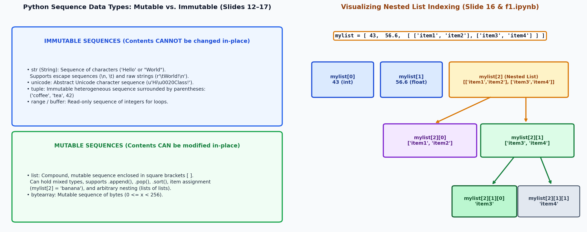
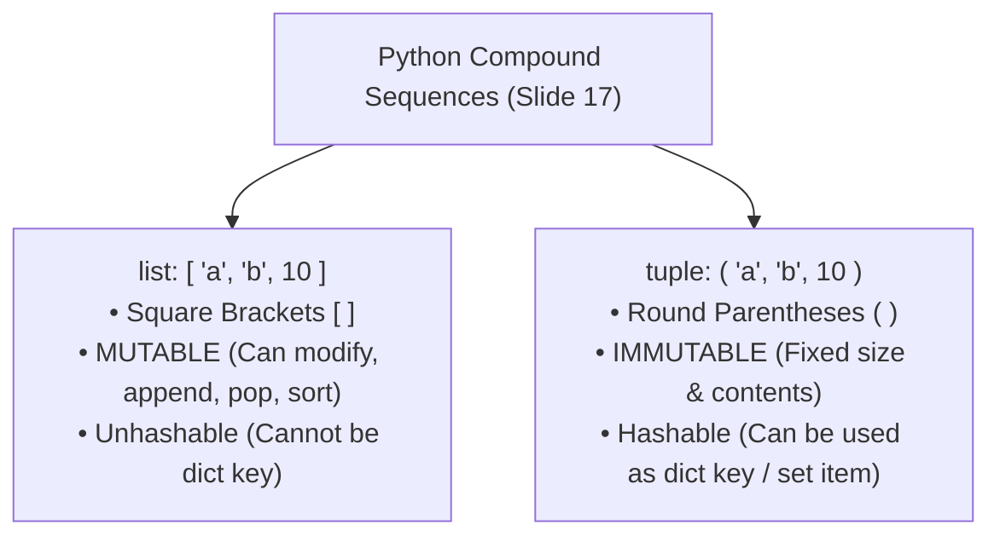

# Lesson 2.3: Sequence Data Types — Strings, Unicode, Lists & Tuples (`str`, `unicode`, `list`, `tuple`)

**මූලාශ්‍ර දේශන සටහන් (Source Lecture Notes):** `Python Intro 3.pdf` (Slides 12–17, Dr. Lochandaka Ranathunga) & `f1.ipynb` (Cells 7–14)

> [!TIP]
> **📚 Prerequisite / Dependency Lesson Series:**  
> මෙම පාඩමේදී හමුවන **Unicode Strings / UTF-8 Byte Encoding (`.encode('utf-8')`)** සහ **Mutable (`list`) vs. Immutable (`str`, `tuple`)** මතක හැසිරීම බින්දුවේ සිට ඉගෙන ගැනීමට පහත Dependency පාඩම් කියවන්න:
> - [Dep 02.2: Character Encoding — ASCII, Unicode Code Points & UTF-8](../dependencies/Dep_02_Number_Systems_Binary_Unicode_and_Hash_Tables/02_Character_Encoding_ASCII_Unicode_Code_Points_and_UTF8.md)
> - [Dep 01.3: Mutability, Aliasing, Shallow Copy (`.copy()`) & Deep Copy (`copy.deepcopy()`)](../dependencies/Dep_01_Computer_Memory_Pointers_and_Object_References/03_Mutability_Aliasing_Shallow_Copy_and_Deep_Copy.md)

---

## හැඳින්වීම (Introduction)

දත්ත එකතුවක් අනුපිළිවෙළකට (**Ordered Sequence**) ගබඩා කර තබා ගැනීම සඳහා Python හි **Sequence Data Types** භාවිතා වේ. දේශන සටහනේ 12 වන Slide එකට අනුව Python හි Sequence Subtypes 7ක් ඇත:
1. **`str` (Strings)**
2. **`unicode` (Unicode Strings)**
3. **`list` (Lists)**
4. **`tuple` (Tuples)**
5. **`bytearray`**
6. **`buffer`** *(Python 3 හි `memoryview`)*
7. **`range` objects**

මේවා අතරින් Data Science හිදී නිරන්තරයෙන්ම භාවිතා වන්නේ **Strings (`str`), Lists (`list`), Tuples (`tuple`)** සහ Enumeration-controlled loops සඳහා භාවිතා වන **`range`** වේ. මෙම පාඩමෙන් අපි මේවායේ ලක්ෂණ, **Mutable (වෙනස් කළ හැකි)** සහ **Immutable (වෙනස් කළ නොහැකි)** ව්‍යුහයන් අතර වෙනස, සහ **Nested Lists** (ලැයිස්තු තුළ ඇති ලැයිස්තු) හසුරුවන ආකාරය ප්‍රායෝගිකව ඉගෙන ගනිමු.



---

## 1. Sequence Types: Strings (`str` - Slides 13–14)

**String (`str`)** එකක් යනු අනුක්‍රමිකව පෙළගැස්වූ අකුරු හෝ සංකේත සමූහයකි (Sequence of characters).

### Strings හි මූලික ලක්ෂණ:
* **නිර්මාණය කිරීම:** Single-quotes (`'...'`) හෝ Double-quotes (`"..."`) තුළ අකුරු ලිවීමෙන් String එකක් සෑදිය හැක.
* **Strings are Immutable (වෙනස් කළ නොහැක!):** String එකක් සෑදූ පසු එහි ඇති තනි අකුරක් එතැනම වෙනස් කිරීමට (`mystring[0] = 'A'` ලෙස) හැකියාවක් නැත (`TypeError: 'str' object does not support item assignment`).
* **Escape Sequences:** `\t` (Horizontal Tab), `\n` (Newline / අලුත් පේළියක්) වැනි විශේෂ Escape sequences සඳහා සහාය දක්වයි.
* **Raw Strings (`r"..."`):** String එකකට ඉදිරියෙන් **`r`** අකුර යෙදූ විට (උදා: `r"\tWorld!\n"`), එහි ඇති `\t` හෝ `\n` Escape sequences ලෙස නොසලකා ඒ අයුරින්ම (**Raw value**) ආරක්ෂා කරයි! Windows file paths සහ Regular Expressions වලදී මෙය ඉතා ප්‍රයෝජනවත් වේ.
* **String Formatting (`%`, `.format()`, සහ `f-strings`):** C භාෂාවට සමාන `%` formatting operator එක මෙන්ම `.format()` සහ `f"..."` ක්‍රමවේදයන්ද Python සතුය.
* **Automatic String Literal Concatenation:** String literals දෙකක් එක ලඟ තැබූ විට (`"Python is " "so cool."`) `+` ලකුණ නොමැතිවම ස්වයංක්‍රීයව එකට Concatenate වේ!

#### ප්‍රායෝගික කේත උදාහරණය (Slide 14):
```python
# ex.py
mystring = "Hi, I'm a string!"
print("\tHello,\n")
print(r"\tWorld!\n")
print("Python is " "so cool.")
```

**Output (`$ python ex.py`):**
```text
	Hello,

\tWorld!\n
Python is so cool.
```

---

## 2. Sequence Types: Unicode Strings (Slide 15)

ඉංග්‍රීසි ASCII අකුරුවලට අමතරව ලෝකයේ ඕනෑම භාෂාවක අකුරු (උදා: ජර්මන් `äöü`, සිංහල, දෙමළ, Emojis) සහ විශේෂ සංකේත ගබඩා කිරීමට සහ හැසිරවීමට **Unicode Strings** භාවිතා වේ.

> [!TIP]
> **📚 Deep-Dive Dependency Guide:**  
> ASCII, Unicode Code Points (`\u0020`, `\xe4`) සහ UTF-8 Byte Encoding ක්‍රියා කරන ආකාරය පිළිබඳ සම්පූර්ණ රූපමය පැහැදිලි කිරීම සඳහා [Dep 02.2: Character Encoding — ASCII, Unicode Code Points & UTF-8](../dependencies/Dep_02_Number_Systems_Binary_Unicode_and_Hash_Tables/02_Character_Encoding_ASCII_Unicode_Code_Points_and_UTF8.md) කියවන්න.

* String එකකට ඉදිරියෙන් **`u`** යෙදීමෙන් Unicode string එකක් දැක්විය හැක.
* `\u0020` (Space character) හෝ `\xe4` (`ä`) වැනි **Unicode-Escape** කේත භාවිතා කළ හැක.
* Unicode string එකක් UTF-8 byte sequence එකක් බවට හැරවීමට **`.encode('utf-8')`** ක්‍රමවේදය භාවිතා වේ.

### Gap Analysis: Python 2 vs. Python 3 Unicode Handling (Slide 15)
* **Python 2 හිදී (Slide 15):** සාමාන්‍ය `"..."` යනු Byte string එකක් වූ අතර, Unicode සඳහා `u"..."` ද, Raw Unicode සඳහා `ur"..."` ද, Bytes නැවත Unicode කිරීමට `unicode(newstr, 'utf-8')` ද භාවිතා විය.
* **Python 3 හිදී (Modern Standard):** සෑම සාමාන්‍ය `str` (`"..."`) එකක්ම **පෙරනිමියෙන්ම Unicode වේ!** `.encode('utf-8')` මගින් `bytes` object එකක් (`b'...'`) ලැබෙන අතර, එම `bytes` නැවත `str` බවට හැරවීමට **`newstr.decode('utf-8')`** (හෝ `str(newstr, 'utf-8')`) භාවිතා කරයි.

```python
myunicodestr1 = u"Hi Class!"
myunicodestr2 = u"Hi\u0020Class!"
print(myunicodestr1, myunicodestr2)

newunicode = u'\xe4\xf6\xfc'
print(newunicode)

# Unicode str -> UTF-8 bytes (.encode)
newstr = newunicode.encode('utf-8')
print("Encoded UTF-8 bytes:", newstr)

# UTF-8 bytes -> Unicode str (.decode in Python 3, replaces Python 2 unicode())
print("Decoded back to str:", newstr.decode('utf-8'))
```
**Output:**
```text
Hi Class! Hi Class!
äöü
Encoded UTF-8 bytes: b'\xc3\xa4\xc3\xb6\xc3\xbc'
Decoded back to str: äöü
```

---

## 3. Sequence Types: Lists (`list` - Slide 16 & `f1.ipynb` Cells 7–14)

Python හි වඩාත්ම ප්‍රයෝජනවත් සහ නම්‍යශීලී **Compound Data Type** එක වන්නේ **List (`list`)** එකයි.

### Lists හි ප්‍රධාන ලක්ෂණ 4:
1. **Initialization:** කොටු වරහන් `[ ]` තුළ අගයන් කොමාවලින් වෙන් කර ලිවීමෙන් හෝ `list()` constructor එක මගින් සෑදිය හැක.
2. **Heterogeneous (Mixed Data Types):** එකම List එකක් තුළ `int`, `float`, `str` සහ තවත් `list` එකක් වුවද එකවර ගබඩා කළ හැක (`f1.ipynb` Cell 7: `mylist = [43, 56.6, 'Banana']`).
3. **Lists are Mutable:** Strings හෝ Tuples මෙන් නොව, List එකක් සෑදූ පසු එහි ඕනෑම Index ස්ථානයක ඇති අගයක් වෙනස් කිරීමට, අලුත් අගයන් එකතු කිරීමට (`.append()`) හෝ ඉවත් කිරීමට (`.pop()`) හැකිය.
4. **Lists are Nestable:** List එකක් ඇතුළත තවත් List එකක්, ඒ ඇතුළත තවත් List එකක් ලෙස ඕනෑම ගැඹුරකට (**Multi-dimensional / Nested Lists**) ගබඩා කළ හැක!

### දේශන සටහනේ කේත උදාහරණය (Slide 16):
```python
mylist = [42, 'apple', u'unicode apple', 5234656]
print(mylist)
# Output: [42, 'apple', 'unicode apple', 5234656]

# Index 2 හි අගය වෙනස් කිරීම (In-place Mutation!)
mylist[2] = 'banana'
print(mylist)
# Output: [42, 'apple', 'banana', 5234656]

# Index 3 ට Nested List එකක් (List of Lists) ආදේශ කිරීම
mylist[3] = [['item1', 'item2'], ['item3', 'item4']]
print(mylist)
# Output: [42, 'apple', 'banana', [['item1', 'item2'], ['item3', 'item4']]]

# Python 3 Gap Analysis Note on .sort():
# Python 2 හිදී විවිධ Data types (int සහ str) එකට තිබුණත් mylist.sort() ක්‍රියා කළ නමුත්,
# Python 3 හි Strong Typing නිසා int සහ str සැසඳිය නොහැක (TypeError: '<' not supported).
# එබැවින් Python 3 හිදී String representation අනුව Sort කිරීමට key=str ලබා දිය හැක:
mylist.sort(key=str)
print(mylist)
# Output: [42, [['item1', 'item2'], ['item3', 'item4']], 'apple', 'banana']

# අවසාන අගය ඉවත් කර ආපසු ලබා ගැනීම (.pop())
print(mylist.pop())
# Output: banana

# List Comprehension මගින් අලුත් List එකක් සෑදීම
mynewlist = [x * 2 for x in range(0, 5)]
print(mynewlist)
# Output: [0, 2, 4, 6, 8]
```

### `f1.ipynb` Walkthrough: Multi Lists with Nested Lists (Cells 7–14)
අපගේ `f1.ipynb` Notebook එකෙහි Nested List එකක ඇතුළත ඇති අගයන් වෙත පියවරෙන් පියවර පිවිසෙන (**Chained Indexing**) ආකාරය පෙන්වා දී ඇත:

```python
mylist = [43, 56.6, 'Banana']
print(mylist)            # [43, 56.6, 'Banana']
print(len(mylist))       # 3

# 2 වන Index එකට Nested List එකක් ආදේශ කිරීම
mylist[2] = [['item1', 'item2'], ['item3', 'item4']]
print(mylist)
# Output: [43, 56.6, [['item1', 'item2'], ['item3', 'item4']]]

# Chained Indexing මගින් ඇතුළත අගයන් ලබා ගැනීම:
print(mylist[2])         # [['item1', 'item2'], ['item3', 'item4']]
print(mylist[2][1])      # ['item3', 'item4']  (Accessing items in a list of list)
print(mylist[2][1][0])   # 'item3'
```

---

## 4. Sequence Types: Tuples (`tuple` - Slide 17)

**Tuple (`tuple`)** එකක් යනු List එකකට බොහෝ සෙයින් සමාන, විවිධ වර්ගයේ දත්ත (Varying types) රඳවා තබා ගත හැකි **Compound Data Type** එකකි. නමුත් එහි ප්‍රධාන වෙනස්කම් දෙකක් ඇත:
1. **Parentheses `( )` භාවිතා කරයි:** අගයන් කොමාවලින් වෙන් කර වටකුරු වරහන් තුළ ලියනු ලැබේ: `mytuple = ('coffee', 'tea')`. *(තනි අගයක් පමණක් ඇති Tuple එකක් සෑදීමේදී අගට කොමාවක් තැබිය යුතුය: `single_tuple = ('coffee',)`).*
2. **Tuples are Immutable (වෙනස් කළ නොහැක!):** Tuple එකක් සෑදූ පසු එහි අගයන් වෙනස් කිරීමට (`mytuple[0] = 'milk'`), අලුතින් අගයන් එක් කිරීමට හෝ ඉවත් කිරීමට **නොහැක**!



---

## 5. 🛠️ Practical Task / Hands-On Exercise (ප්‍රායෝගික අභ්‍යාසය)

### Scenario / Goal:
ඔබ පර්යේෂණාගාරයක Dataset Metadata ගබඩා කිරීම සඳහා Strings, Unicode, Nested Lists සහ Immutable Tuples භාවිතා කරන Data Container script එකක් ගොඩනැගිය යුතුය.

### Step-by-Step Tasks:
1. Windows file path එකක් වන `C:\new_data\test_results.csv` යන්න Escape sequence දෝෂ (`\n`, `\t`) ඇති නොවන පරිදි **Raw String (`r"..."`)** එකක් ලෙස ගබඩා කර මුද්‍රණය කරන්න.
2. `german_city = "M\u00fcnchen"` යන Unicode string එක මුද්‍රණය කර, එය `.encode('utf-8')` මගින් UTF-8 bytes බවට හරවා එහි Character length එක සහ Byte length එක සසඳන්න.
3. `f1.ipynb` හි ආකාරයට `experiment = [101, 98.6, [['Sample_A', 'Pass'], ['Sample_B', 'Fail']]]` නමින් Nested List එකක් සාදා, Chained Indexing මගින් `'Fail'` යන අගය ලබාගෙන, එය `'Pass'` බවට In-place වෙනස් කරන්න.
4. `gps_coord = (6.9271, 79.8612)` නමින් Tuple එකක් සාදා, එහි පළමු අගය වෙනස් කිරීමට උත්සාහ කිරීමේදී ලැබෙන `TypeError` එක `try...except` මගින් පෙන්වන්න.

### Starter Code:
```python
# Task 1: Store file path using a Raw String
file_path = r"C:\new_data\test_results.csv"
# TODO: Print file_path

# Task 2: Unicode string encoding
german_city = "M\u00fcnchen"
# TODO: Print german_city, its len(), its UTF-8 encoded bytes, and len() of bytes

# Task 3: Nested List indexing and mutation
experiment = [101, 98.6, [['Sample_A', 'Pass'], ['Sample_B', 'Fail']]]
# TODO: Access 'Fail', change it to 'Pass' in-place, and print experiment

# Task 4: Demonstrate Tuple Immutability
gps_coord = (6.9271, 79.8612)
# TODO: Try modifying gps_coord[0] inside try...except TypeError
```

### Expected Output / Reference Solution:
```python
# Task 1: Store file path using a Raw String
file_path = r"C:\new_data\test_results.csv"
print("Task 1 - Raw file path:", file_path)

# Task 2: Unicode string encoding
german_city = "M\u00fcnchen"
utf8_bytes = german_city.encode('utf-8')
print(f"Task 2 - City: {german_city} | Char len: {len(german_city)} | UTF-8 Bytes: {utf8_bytes} | Byte len: {len(utf8_bytes)}")

# Task 3: Nested List indexing and mutation
experiment = [101, 98.6, [['Sample_A', 'Pass'], ['Sample_B', 'Fail']]]
print("Task 3 - Before mutation, status of Sample_B:", experiment[2][1][1])
experiment[2][1][1] = 'Pass'
print("Task 3 - After mutation, experiment:", experiment)

# Task 4: Demonstrate Tuple Immutability
gps_coord = (6.9271, 79.8612)
try:
    gps_coord[0] = 7.0000
except TypeError as e:
    print("Task 4 - Tuple is immutable! Caught error:", e)
```

**Expected Output:**
```text
Task 1 - Raw file path: C:\new_data\test_results.csv
Task 2 - City: München | Char len: 7 | UTF-8 Bytes: b'M\xc3\xbcnchen' | Byte len: 8
Task 3 - Before mutation, status of Sample_B: Fail
Task 3 - After mutation, experiment: [101, 98.6, [['Sample_A', 'Pass'], ['Sample_B', 'Pass']]]
Task 4 - Tuple is immutable! Caught error: 'tuple' object does not support item assignment
```

---

## 6. Summary & Exam Revision Cheat Sheet (සාරාංශය)

| Sequence Subtype | Syntax / Example | Mutable ද? | ප්‍රධාන විභාග කරුණු (Key Exam Points) |
| :--- | :--- | :--- | :--- |
| **`str`** | `"Hello"`, `r"\tRaw"` | ❌ Immutable | Escape sequences (`\n`, `\t`), Raw strings (`r"..."`), Auto-concatenation. |
| **Unicode (`str`)** | `u"Hi\u0020Class"`, `'\xe4'` | ❌ Immutable | `.encode('utf-8')` $\rightarrow$ `bytes`; `.decode('utf-8')` $\rightarrow$ `str`. |
| **`list`** | `[43, 56.6, ['a', 'b']]` | ✅ **Mutable** | Heterogeneous, Nestable (`mylist[2][1][0]`), In-place methods (`.append()`, `.pop()`, `.sort()`). |
| **`tuple`** | `('coffee', 'tea')` | ❌ Immutable | වේගවත් සහ ආරක්ෂිතයි; Dictionary key එකක් ලෙස භාවිතා කළ හැක. |

---

**ඊළඟ පාඩම (Next Lesson):** [Lesson 2.4: Common & Mutable Sequence Operations](Lesson_2.4_Common_and_Mutable_Sequence_Operations.md) — සියලුම Sequences වලට පොදු ක්‍රියාවලි (Indexing, Slicing `s[i:j:k]`, Concatenation, `in`) සහ Mutable Sequences (`list`) වලට පමණක් විශේෂිත ක්‍රියාවලි සියල්ල වගු සහ උදාහරණ සහිතව ඉගෙන ගනිමු.
