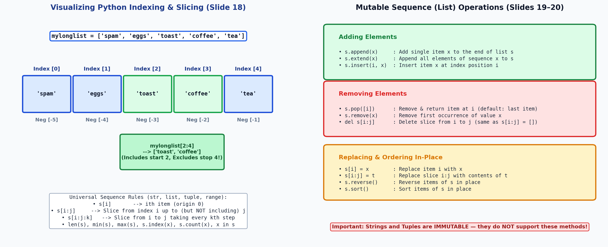
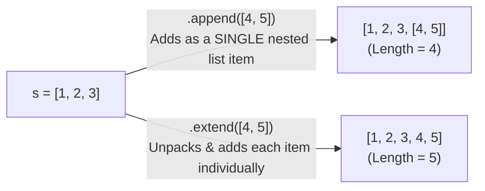

# Lesson 2.4: Common & Mutable Sequence Operations (පොදු සහ වෙනස් කළ හැකි අනුක්‍රමික ක්‍රියාවලි)

**මූලාශ්‍ර දේශන සටහන් (Source Lecture Notes):** `Python Intro 3.pdf` (Slides 18–20, Dr. Lochandaka Ranathunga) & `f1.ipynb` (Cells 41–51)

> [!TIP]
> **📚 Prerequisite / Dependency Lesson Series:**  
> මෙම පාඩමේ Slide 18 හි සඳහන් වන **`s * n` (Shallow Copies)** සහ Mutable Sequences (`list`) එතැනම වෙනස් කිරීමේදී (**In-place Mutation**) මතකයේ සිදුවන ක්‍රියාවලිය ගැඹුරින් තේරුම් ගැනීමට පහත Dependency පාඩම කියවන්න:
> - [Dep 01.3: Mutability, Aliasing, Shallow Copy (`.copy()`) & Deep Copy (`copy.deepcopy()`)](../dependencies/Dep_01_Computer_Memory_Pointers_and_Object_References/03_Mutability_Aliasing_Shallow_Copy_and_Deep_Copy.md)

---

## හැඳින්වීම (Introduction)

පසුගිය පාඩමෙන් අපි Strings, Lists සහ Tuples යන **Sequence Data Types** හඳුනා ගත්තෙමු. මෙම පාඩමෙන් අපි:
1. **Common Sequence Operations (Slide 18)** — එනම් `str`, `list`, `tuple`, `range` යන සියල්ලටම පොදු Indexing, Slicing (`s[i:j:k]`), Concatenation (`+`), Repetition (`*`) සහ Membership (`in`) පරීක්ෂාවන්, සහ
2. **Mutable Sequence Operations (Slides 19–20)** — එනම් `list` සහ `bytearray` සඳහා පමණක් භාවිතා කළ හැකි **In-place Mutations** පිළිබඳව සවිස්තරාත්මකව ඉගෙන ගනිමු.



---

## 1. Common Sequence Operations (Slide 18)

Immutable (`str`, `tuple`, `range`) සහ Mutable (`list`, `bytearray`) යන **සියලුම** Sequence Data Types පහත වගුවේ දැක්වෙන ක්‍රියාවලි 12 සඳහා සහාය දක්වයි:

| Operation | Result (Slide 18 Specification) | සරල සිංහල පැහැදිලි කිරීම සහ උදාහරණය (`s = ['a', 'b', 'c', 'd']`) |
| :--- | :--- | :--- |
| **`x in s`** | `True` if an item of `s` is equal to `x`, else `False`. | `x` යන අගය `s` තුළ තිබේ නම් `True` ද, නැතිනම් `False` ද ලබා දෙයි. (`'b' in s` $\rightarrow$ `True`) |
| **`x not in s`** | `False` if an item of `s` is equal to `x`, else `True`. | `x` යන අගය `s` තුළ **නොමැති** නම් `True` ලබා දෙයි. (`'z' not in s` $\rightarrow$ `True`) |
| **`s + t`** | The concatenation of `s` and `t`. | `s` සහ `t` Sequences දෙක එකට ඈඳා (**Concatenation**) අලුත් Sequence එකක් සාදයි. |
| **`s * n`** හෝ **`n * s`** | `n` **shallow copies** of `s` concatenated. | `s` හි **Shallow Copies** `n` ගණනක් එක දිගට ඈඳයි. (`['a'] * 3` $\rightarrow$ `['a', 'a', 'a']`) |
| **`s[i]`** | `i`th item of `s`, origin 0. | `0` සිට පටන් ගන්නා **Zero-based Index** අංකයට අනුව `i` වන ස්ථානයේ ඇති අගය ලබා දෙයි. (`s[0]` $\rightarrow$ `'a'`, `s[-1]` $\rightarrow$ `'d'`) |
| **`s[i:j]`** | Slice of `s` from `i` to `j`. | `i` වන Index එකේ සිට `j` වන Index එකට **පෙර** (`j-1` දක්වා) කොටස කපා (**Slice**) ලබා දෙයි. |
| **`s[i:j:k]`** | Slice of `s` from `i` to `j` with step `k`. | `i` සිට `j` දක්වා පියවර `k` බැගින් (**Step / Stride `k`**) පනිමින් අගයන් ලබා දෙයි. (`s[::-1]` මගින් පිටපතක් Reverse කරයි). |
| **`len(s)`** | Length of `s`. | `s` තුළ ඇති මුළු අගයන් ගණන (Length) ලබා දෙයි. (`len(s)` $\rightarrow$ `4`) |
| **`min(s)`** | Smallest item of `s`. | `s` තුළ ඇති කුඩාම අගය (**Minimum (අවම අගය)**) ලබා දෙයි. (`min([5, 2, 9])` $\rightarrow$ `2`) |
| **`max(s)`** | Largest item of `s`. | `s` තුළ ඇති විශාලතම අගය (**Maximum (උපරිම අගය)**) ලබා දෙයි. (`max([5, 2, 9])` $\rightarrow$ `9`) |
| **`s.index(x[, i[, j]])`** | Index of the first occurrence of `x` in `s`. | `x` යන අගය `s` තුළ **පළමුවෙන්ම** හමුවන Index ස්ථානය ($i \le k < j$) ලබා දෙයි (Slides 18 & 20). |
| **`s.count(x)`** | Total number of occurrences of `x` in `s`. | `x` යන අගය `s` තුළ කී වතාවක් යෙදී ඇත්දැයි ($s[i] == x$ වන වාර ගණන) ගණන් කරයි. |

### ප්‍රායෝගික Python උදාහරණය (Slide 18):
```python
$ python
>>> mylist = ["spam", "eggs", "toast"]   # List of strings!
>>> "eggs" in mylist
True
>>> len(mylist)
3
>>> mynewlist = ["coffee", "tea"]
>>> mylist + mynewlist                   # Sequence Concatenation (+)
['spam', 'eggs', 'toast', 'coffee', 'tea']
>>> mytuple = tuple(mynewlist)           # Converting list to tuple
>>> mytuple
('coffee', 'tea')
>>> mytuple.index("tea")                 # Finding index of "tea"
1
>>> mylonglist = ['spam', 'eggs', 'toast', 'coffee', 'tea']
>>> mylonglist[2:4]                      # Slicing from index 2 up to (but excluding) 4
['toast', 'coffee']
```

> [!IMPORTANT]
> **Slicing (`s[i:j]`) හි Half-Open Interval `[i, j)` රන් නීතිය:**  
> Python හි `s[i:j]` ලෙස Slice කරන විට ආරම්භක Index එක (`i`) **ඇතුළත් වන** අතර (**Inclusive**), අවසාන Index එක (`j`) **ඇතුළත් නොවේ** (**Exclusive**)! එබැවින් `mylonglist[2:4]` මගින් ලැබෙන්නේ Index `2` (`'toast'`) සහ Index `3` (`'coffee'`) යන අගයන් $4 - 2 = 2$ පමණි.

---

## 2. Mutable Sequence Operations (Slides 19–20)

`list` වැනි **Mutable Sequence Types** වලට ඉහත පොදු ක්‍රියාවලි 12ට අමතරව, List එකේ අන්තර්ගතය අලුත් Object එකක් නොසාදා එතැනම (**In-place**) වෙනස් කළ හැකි විශේෂ ක්‍රියාවලි 12ක් ඇත:

| Operation | Result (Slides 19–20 Specification) | සරල සිංහල පැහැදිලි කිරීම සහ උදාහරණය |
| :--- | :--- | :--- |
| **`s[i] = x`** | Item `i` of `s` is replaced by `x`. | `i` වන ස්ථානයේ ඇති අගය ඉවත් කර ඒ වෙනුවට `x` ආදේශ කරයි. |
| **`s[i:j] = t`** | Slice of `s` from `i` to `j` is replaced by the contents of `t`. | `i` සිට `j` දක්වා කොටස වෙනුවට `t` iterable එකෙහි ඇති අගයන් ආදේශ කරයි. |
| **`del s[i:j]`** | Same as `s[i:j] = []`. | `i` සිට `j` දක්වා ඇති Slice කොටස List එකෙන් මකා දමයි. |
| **`s[i:j:k] = t`** | The elements of `s[i:j:k]` are replaced by those of `t`. | පියවර `k` බැගින් තෝරාගත් Extended slice ස්ථානවලට `t` හි අගයන් ආදේශ කරයි *(`t` හි දිග Slice එකේ දිගට සමාන විය යුතුය)*. |
| **`del s[i:j:k]`** | Removes the elements of `s[i:j:k]` from the list. | පියවර `k` බැගින් තෝරාගත් අගයන් List එකෙන් ඉවත් කරයි. |
| **`s.append(x)`** | Add `x` to the end of `s`. | `x` යන තනි අයිතමය List එකේ අගටම එක් කරයි. |
| **`s.extend(x)`** | Appends the contents of `x` to `s`. | `x` නමැති Sequence/Iterable එකක ඇති සියලුම අගයන් වෙන වෙනම `s` හි අගට එක් කරයි. |
| **`s.insert(i, x)`** | Insert `x` at position `i`. | `i` වන Index ස්ථානයට `x` ඇතුළත් කරයි (`f1.ipynb` Cell 51 හි `in_item` ක්‍රියාවලිය). |
| **`s.pop([i])`** | Same as `x = s[i]; del s[i]; return x`. | `i` වන ස්ථානයේ අගය List එකෙන් ඉවත් කර එය Return කරයි. `i` ලබා නොදුනහොත් (`s.pop()`) **අවසාන අගය** ඉවත් කර ලබා දෙයි. |
| **`s.remove(x)`** | Same as `del s[s.index(x)]`. | `x` යන අගය **පළමුවෙන්ම** හමුවන ස්ථානයෙන් එය මකා දමයි (`x` නොමැති නම් `ValueError` ලබා දෙයි). |
| **`s.reverse()`** | Reverses the items of `s` in place. | List එකේ අගයන්ගේ පිළිවෙළ අග සිට මුලට එතැනම (**In-place**) හරවයි (`None` return කරයි). |
| **`s.sort([key[, reverse]])`** | Sort the items of `s` in place. | List එකේ අගයන් Ascending හෝ Descending (`reverse=True`) පිළිවෙළට එතැනම Sort කරයි (`None` return කරයි). *(Python 2 හි තිබූ `cmp` parameter එක Python 3 හිදී ඉවත් කර `key` භාවිතා වේ)*. |

---

## 3. `.append(x)` vs. `.extend(x)` සහ In-Place Methods (`None` Return Trap!)

### 1. `.append(x)` සහ `.extend(x)` අතර තීරණාත්මක වෙනස:



```python
# 1. append() භාවිතය:
s1 = [1, 2, 3]
s1.append([4, 5])
print(s1)          # Output: [1, 2, 3, [4, 5]]  (Nested list එකක් ලෙස තනි අයිතමයක් එක් වේ)

# 2. extend() භාවිතය:
s2 = [1, 2, 3]
s2.extend([4, 5])
print(s2)          # Output: [1, 2, 3, 4, 5]    (අගයන් වෙන වෙනම අගට එක් වේ)
```

### 2. In-Place Mutation Methods (`.sort()`, `.reverse()`, `.append()`) මගින් `None` ලබා දීමේ උගුල:
බොහෝ ආධුනිකයන් `mylist = mylist.sort()` ලෙස ලියා මුළු List එකම `None` බවට පත් කර ගනිති!
* `mylist.sort()` සහ `mylist.reverse()` මගින් මුල් List එක **In-place** වෙනස් කරන අතර, Return කරන්නේ `None` ය!
* ඔබට මුල් List එක වෙනස් නොකර අලුත් Sorted List එකක් ලබා ගැනීමට අවශ්‍ය නම් Built-in **`sorted(mylist)`** ශ්‍රිතය භාවිතා කරන්න.

---

## 4. 🛠️ Practical Task / Hands-On Exercise (ප්‍රායෝගික අභ්‍යාසය)

### Scenario / Goal:
ඔබ ආහාර නිෂ්පාදන ආයතනයක (`f1.ipynb` Cells 42–51 හි දැක්වෙන `['fish bun', 'toast', 'bread', 'patty']`) Inventory ලැයිස්තුවක් මත Slicing, Extended Slicing, Insertion, Removal සහ In-place Sorting ක්‍රියාවලි සිදු කළ යුතුය.

### Step-by-Step Tasks:
1. `bakery = ['fish bun', 'toast', 'bread', 'patty']` ලැයිස්තුව සාදා, `.append(67)` මගින් අගට `67` එක් කර, `.copy()` මගින් `bakery_copy` නමින් Shallow copy එකක් සාදා ගන්න (`f1.ipynb` Cells 42–49).
2. `bakery_copy` හි Index `2` හි අගය `89` බවට වෙනස් කර (`bakery_copy[2] = 89`), ඉන්පසු `.insert(2, 'egg')` දෙවරක් භාවිතා කර `['fish bun', 'toast', 'egg', 'egg', 89, 'patty', 67]` ලැයිස්තුව ප්‍රතිනිර්මාණය කරන්න (`f1.ipynb` Cell 51).
3. Slicing (`s[i:j]` සහ `s[i:j:k]`) භාවිතා කර `bakery_copy` හි: (a) Index 1 සිට 4 දක්වා කොටස (`s[1:5]`), (b) දෙවන අයිතමය බැගින් (`s[::2]`), සහ (c) අග සිට මුලට (`s[::-1]`) Slice කර මුද්‍රණය කරන්න.
4. `prices = [120, 45, 300, 85, 45, 210]` ලැයිස්තුවේ `45` යෙදී ඇති වාර ගණන (`.count(45)`), කුඩාම (`min`) හා විශාලම (`max`) මිල ගණන්, සහ Descending order එකට (`.sort(reverse=True)`) පෙළගැස්වූ ලැයිස්තුව මුද්‍රණය කරන්න.

### Starter Code:
```python
# Task 1: Create bakery list, append 67, and make a shallow copy
bakery = ['fish bun', 'toast', 'bread', 'patty']
# TODO: Append 67 and create bakery_copy = bakery.copy()

# Task 2: Replace index 2 with 89 and insert 'egg' twice at index 2 (f1.ipynb Cell 51)
# TODO: Mutate bakery_copy and print both bakery_copy and original bakery

# Task 3: Slicing operations on bakery_copy
# TODO: Print bakery_copy[1:5], bakery_copy[::2], and bakery_copy[::-1]

# Task 4: Sequence statistics and in-place descending sort on prices
prices = [120, 45, 300, 85, 45, 210]
# TODO: Print count(45), min(prices), max(prices), and sort prices in descending order
```

### Expected Output / Reference Solution:
```python
# Task 1: Create bakery list, append 67, and make a shallow copy
bakery = ['fish bun', 'toast', 'bread', 'patty']
bakery.append(67)
bakery_copy = bakery.copy()

# Task 2: Replace index 2 with 89 and insert 'egg' twice at index 2 (f1.ipynb Cell 51)
bakery_copy[2] = 89
bakery_copy.insert(2, 'egg')
bakery_copy.insert(2, 'egg')
print("Task 2 - Modified bakery_copy:", bakery_copy)
print("Task 2 - Original bakery safe:", bakery)

# Task 3: Slicing operations on bakery_copy
print("Task 3a - Slice [1:5] :", bakery_copy[1:5])
print("Task 3b - Step [::2]  :", bakery_copy[::2])
print("Task 3c - Reverse[::-1]:", bakery_copy[::-1])

# Task 4: Sequence statistics and in-place descending sort on prices
prices = [120, 45, 300, 85, 45, 210]
print(f"Task 4 - count(45): {prices.count(45)} | min: {min(prices)} | max: {max(prices)}")
prices.sort(reverse=True)
print("Task 4 - Sorted descending:", prices)
```

**Expected Output:**
```text
Task 2 - Modified bakery_copy: ['fish bun', 'toast', 'egg', 'egg', 89, 'patty', 67]
Task 2 - Original bakery safe: ['fish bun', 'toast', 'bread', 'patty', 67]
Task 3a - Slice [1:5] : ['toast', 'egg', 'egg', 89]
Task 3b - Step [::2]  : ['fish bun', 'egg', 89, 67]
Task 3c - Reverse[::-1]: [67, 'patty', 89, 'egg', 'egg', 'toast', 'fish bun']
Task 4 - count(45): 2 | min: 45 | max: 300
Task 4 - Sorted descending: [300, 210, 120, 85, 45, 45]
```

---

## 5. Summary & Exam Revision Cheat Sheet (සාරාංශය)

| කාණ්ඩය (Category) | ප්‍රධාන Operations | විභාග මතක සටහන (Exam Tip) |
| :--- | :--- | :--- |
| **Common Operations** (`str`, `tuple`, `list`, `range`) | `x in s`, `s + t`, `s * n`, `s[i]`, `s[i:j:k]`, `len(s)`, `min(s)`, `max(s)`, `s.index(x)`, `s.count(x)` | මේවා මුල් Sequence එක වෙනස් නොකරයි (Immutable types මතද ක්‍රියා කරයි). |
| **Mutable Slice Assignment** (`list` පමණි) | `s[i] = x`, `s[i:j] = t`, `del s[i:j]`, `s[i:j:k] = t`, `del s[i:j:k]` | Extended slice assignment (`s[i:j:k] = t`) හිදී දෙපසම දිග සමාන විය යුතුය. |
| **Mutable List Methods** (`list` පමණි) | `.append(x)`, `.extend(x)`, `.insert(i, x)`, `.pop([i])`, `.remove(x)`, `.reverse()`, `.sort()` | `.pop()` හැර අනෙක් සියලුම In-place methods මගින් Return කරන්නේ `None` ය! |

---

**ඊළඟ පාඩම (Next Lesson):** [Lesson 2.5: Sets and Dictionaries (Mappings)](Lesson_2.5_Sets_and_Dictionaries_Mappings.md) — අනුපිටපත් ඉවත් කරන Sets (`set`, `frozenset`) සහ Key-Value යුගල ගබඩා කරන Dictionaries (`dict`) පිළිබඳව (`Python Intro 3.pdf` සහ `f1.ipynb` හි රසායනික මවුලික ස්කන්ධ උදාහරණය ඇසුරෙන්) ඉගෙන ගනිමු.
