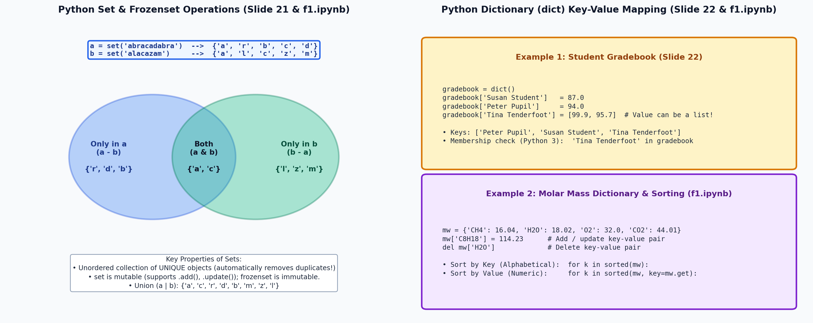
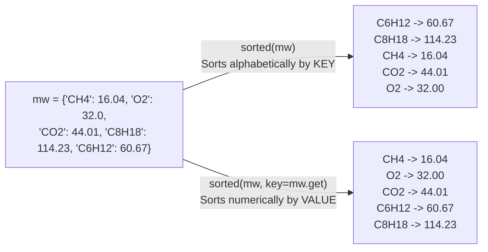

# පාඩම 2.5: කුලක සහ ශබ්දකෝෂ — Sets සහ Dictionaries (Sets and Dictionaries / Mappings)

**මූලාශ්‍ර දේශන සටහන් (Source Lecture Notes):** `Python Intro 3.pdf` (Slides 21–22, Dr. Lochandaka Ranathunga) & `f1.ipynb`

---

## හැඳින්වීම (Introduction)

මෙතෙක් අපි කතා කළ Strings, Lists සහ Tuples යන සියල්ලම අනුක්‍රමිකව (`0, 1, 2...` යන Index අංක අනුව) දත්ත ගබඩා කරන **Sequence Data Types** විය. නමුත් සැබෑ ලෝකයේ දත්ත විශ්ලේෂණයේදී අපට තවත් විශේෂ අවශ්‍යතා දෙකක් පැන නගී:
1. දත්ත එකතුවක ඇති **අනුපිටපත් (Duplicates) ස්වයංක්‍රීයව ඉවත් කර** අනන්‍ය අගයන් (Unique items) පමණක් තබා ගැනීම සහ ගණිතමය කුලක ක්‍රියාවලි (Set operations) සිදු කිරීම $\rightarrow$ මේ සඳහා **`set`** භාවිතා වේ.
2. අංකිත Index එකක් වෙනුවට, අර්ථවත් **නමක් හෝ යතුරක් (Key) භාවිතා කර ඊට අදාළ අගය (Value) ක්ෂණිකව සොයා ගැනීම** (උදා: ශිෂ්‍යයාගේ නමින් ලකුණු සෙවීම හෝ රසායනික සූත්‍රයෙන් මවුලික ස්කන්ධය සෙවීම) $\rightarrow$ මේ සඳහා **`dict` (Dictionary)** භාවිතා වේ.



> [!TIP]
> **📚 Prerequisite / Dependency Lesson Series:**  
> මෙම පාඩමේදී සාකච්ඡා කෙරෙන Hash Tables, $O(1)$ Search Efficiency, Keys Immutable විය යුතු හේතුව සහ Unique Set Operations පිටුපස ඇති පරිගණක විද්‍යාත්මක පදනම ඉගෙන ගැනීමට:
> - [Dep 02.3: How Hash Functions & Hash Tables Power Sets and Dictionaries](../dependencies/Dep_02_Number_Systems_Binary_Unicode_and_Hash_Tables/03_How_Hash_Functions_and_Hash_Tables_Power_Sets_and_Dicts.md)
> - [Dep 01.3: Mutability, Aliasing, Shallow Copy and Deep Copy](../dependencies/Dep_01_Computer_Memory_Pointers_and_Object_References/03_Mutability_Aliasing_Shallow_Copy_and_Deep_Copy.md)

---

## 1. Basic Built-in Data Types: Sets (`set` සහ `frozenset` - Slide 21 & `f1.ipynb`)

Python හි කුලක වර්ග දෙකක් ඇත:
* **`set`:** අනුපිළිවෙළක් නොමැති, **අනන්‍ය (Unique - එකම අගය දෙවරක් නොපවතින)** වස්තූන්ගේ එකතුවකි (*An unordered collection of unique objects*). මෙය **Mutable** (අලුත් අගයන් එක් කළ හැකි) ව්‍යුහයකි.
* **`frozenset`:** `set` එකෙහිම **Immutable (වෙනස් කළ නොහැකි)** සංස්කරණයයි.

### දේශන සටහනේ ප්‍රායෝගික කේත උදාහරණය (Slide 21):
```python
>>> basket = ['apple', 'orange', 'apple', 'pear', 'orange']
>>> fruit = set(basket)         # List එක Set එකක් බවට හැරවූ විට Duplicates ඉවත් වේ!
>>> fruit
{'orange', 'pear', 'apple'}

>>> 'orange' in fruit           # සාමාජිකත්වය පරීක්ෂා කිරීම (Fast membership testing)
True
>>> 'crabgrass' in fruit
False

# String එකක ඇති අනන්‍ය අකුරු (Unique characters) වෙන් කර ගැනීම:
>>> a = set('abracadabra')
>>> b = set('alacazam')
>>> a
{'a', 'r', 'b', 'c', 'd'}

# කුලක අතර ගණිතමය ක්‍රියාවලි (Mathematical Set Operations):
>>> a - b                       # Difference: a හි ඇති නමුත් b හි නැති අකුරු
{'r', 'd', 'b'}

>>> a | b                       # Union (මේලය): a හෝ b යන දෙකෙන් එකක හෝ ඇති සියලුම අකුරු
{'a', 'c', 'r', 'd', 'b', 'm', 'z', 'l'}

>>> a & b                       # Intersection (ඡේදනය): a සහ b දෙකටම පොදු අකුරු
{'a', 'c'}
```

### `f1.ipynb` හි Set යාවත්කාලීන කිරීමේ උදාහරණය (`.update()`):
```python
a = set('sgkddhsk')
print(a)          # Output: {'d', 'g', 'h', 'k', 's'} (අනුපිටපත් ඉවත් වී ඇත)

# Set එකට අලුත් අගයක් එක් කිරීම (.update() හෝ .add())
a.update('q')
print(a)          # Output: {'d', 'g', 'h', 'k', 'q', 's'}
```

---

## 2. Basic Built-in Data Types: Mapping — Dictionaries (`dict` - Slide 22)

**Dictionary (`dict`)** එකක් යනු **Hash Table** එකකි. එය අනන්‍ය යතුරු සමූහයක් (**Keys**) ඕනෑම වර්ගයක අගයන් (**Arbitrary Objects / Values**) වෙත සම්බන්ධ කරයි (`{key1: value1, key2: value2}`).

> [!NOTE]
> Module 6 හිදී අපි ඉගෙන ගන්නා `Pandas DataFrame` එකක් සෑදීමට බහුලවම භාවිතා කරන්නේ Python Dictionary එකකි! එබැවින් Dictionary හොඳින් තේරුම් ගැනීම Data Science සඳහා ඉතාම වැදගත් වේ.

### දේශන සටහනේ Gradebook උදාහරණය (Slide 22):
```python
>>> gradebook = dict()                          # හිස් Dictionary එකක් සෑදීම (හෝ {})
>>> gradebook['Susan Student'] = 87.0           # අලුත් Key-Value යුගලයක් එක් කිරීම
>>> gradebook
{'Susan Student': 87.0}

>>> gradebook['Peter Pupil'] = 94.0
>>> gradebook.keys()                            # සියලුම Keys ලබා ගැනීම
dict_keys(['Susan Student', 'Peter Pupil'])
>>> gradebook.values()                          # සියලුම Values ලබා ගැනීම
dict_values([87.0, 94.0])

# යතුරක් Dictionary එක තුළ තිබේදැයි පරීක්ෂා කිරීම:
# (සටහන: Python 2 හි gradebook.has_key('Tina Tenderfoot') භාවිතා වූ අතර,
# Python 3 හිදී ඒ සඳහා 'in' ක්‍රියාකරු භාවිතා කරයි)
>>> 'Tina Tenderfoot' in gradebook
False

>>> gradebook['Tina Tenderfoot'] = 99.9
>>> gradebook
{'Peter Pupil': 94.0, 'Susan Student': 87.0, 'Tina Tenderfoot': 99.9}

# පවතින Key එකකට List එකක් Value එක ලෙස ආදේශ කිරීම (Updating value with a List!):
>>> gradebook['Tina Tenderfoot'] = [99.9, 95.7]
>>> gradebook
{'Peter Pupil': 94.0, 'Susan Student': 87.0, 'Tina Tenderfoot': [99.9, 95.7]}
```

---

## 3. ප්‍රායෝගික අභ්‍යාසය: `f1.ipynb` හි රසායනික මවුලික ස්කන්ධ (Molar Mass) Dictionary විශ්ලේෂණය

අපගේ `f1.ipynb` ප්‍රායෝගික Notebook එකෙහි විවිධ රසායනික සංයෝගවල මවුලික ස්කන්ධයන් (Molar masses) Dictionary එකක ගබඩා කර, ඒවා හසුරුවන සහ Sort කරන ආකාරය ඉතා අගනා ලෙස පෙන්වා දී ඇත:

```python
# 1. Dictionary එක නිර්මාණය කිරීම
mw = {'CH4': 16.04, 'H2O': 18.02, 'O2': 32.0, 'CO2': 44.01}

# 2. Keys, Values සහ Membership පරීක්ෂාව
print(mw.keys())        # dict_keys(['CH4', 'H2O', 'O2', 'CO2'])
print(mw.values())      # dict_values([16.04, 18.02, 32.0, 44.01])
print('O2' in mw)       # True

# 3. අලුත් සංයෝග එකතු කිරීම
mw['C8H18'] = 114.23
mw['C6H12'] = 60.67

# 4. යතුර භාවිතා කර අගයක් ලබා ගැනීම සහ මකා දැමීම (Retrieve & Delete)
print(mw['H2O'])        # 18.02
del mw['H2O']           # 'H2O' යුගලය Dictionary එකෙන් ඉවත් කරයි

# 5. For loop එකක් මගින් Dictionary එක හරහා ගමන් කිරීම (Iterating through a Dictionary)
for species in mw.keys():
    print("The molar mass of {:<s} is {:<7.2f}".format(species, mw[species]))
```

### Dictionary එකක් Sort කරන ආකාර 2 (`f1.ipynb`):
Dictionary එකක් පිළිවෙළට පෙළගැස්වීමේදී (Sorting) අපට **Key එක (අකාරාදී පිළිවෙළ) අනුව** හෝ **Value එක (සංඛ්‍යාත්මක අගය) අනුව** Sort කළ හැක:



```python
# ක්‍රමය 1: Key එකේ අකාරාදී පිළිවෙළට (Alphabetical order by Key) Sort කිරීම
for species in sorted(mw):
    print(" {:<8s} {:>7.2f}".format(species, mw[species]))

# ක්‍රමය 2: Value එකේ (මවුලික ස්කන්ධයේ) කුඩාම අගයේ සිට විශාලම අගයට Sort කිරීම (key=mw.get)
for species in sorted(mw, key=mw.get):
    print(" {:<8s} {:>7.2f}".format(species, mw[species]))
```

**Output (Sorted by Value using `key=mw.get`):**
```text
 CH4        16.04
 O2         32.00
 CO2        44.01
 C6H12      60.67
 C8H18     114.23
```

---

**ඊළඟ පාඩම (Next Lesson):** [Lesson 2.6: Control Flow Tools — Conditionals, Loops & `range()`](Lesson_2.6_Control_Flow_Conditionals_Loops_and_Range.md) — `while` loops, `if/elif/else`, `for` loops, `range()`, `break/continue/pass/else` සහ ප්‍රායෝගික ගැටලු දෙකක් වන **ප්‍රථමක සංඛ්‍යා (Prime Numbers)** හා **Fibonacci ඉරට්ටේ සංඛ්‍යා එකතුව** ගැන ඉගෙන ගනිමු.

---

## 🛠️ Practical Task / Hands-On Exercise (ප්‍රායෝගික අභ්‍යාසය)

### Scenario:
University Library Management System එකක සිසුන් විසින් පොත් ලබා ගැනීමේ දත්ත (Transactions) Analyze කිරීමට Python Sets සහ Dictionaries යොදා ගැනීම.

### Step-by-Step Tasks:
1. **Task 1 (Unique Visitors):** දින දෙකක පැමිණි Student IDs ලැයිස්තු දෙකක් (`day1 = [101, 102, 105, 101, 108]`, `day2 = [102, 105, 110, 112]`) Sets බවට හරවා මුළු Unique සිසුන් ගණන (Union) සහ දින දෙකේදීම පැමිණි සිසුන් (Intersection) සොයන්න.
2. **Task 2 (Set Difference):** Day 1 පමණක් පැමිණි, Day 2 නොපැමිණි සිසුන් සොයන්න (`difference`).
3. **Task 3 (Dictionary Aggregation):** පොත් වල ISBN සහ ඒවායේ පවතින පිටපත් ගණන Dictionaries මඟින් ගබඩා කර නව පොතක් ඇතුළත් කිරීම සහ පිටපත් ගණන යාවත්කාලීන කිරීම සිදු කරන්න.
4. **Task 4 (Safely Reading with `.get()`):** පද්ධතියේ නොමැති ISBN අංකයක් සෙවීමේදී `KeyError` එකක් ඇති නොවී Default message එකක් ලබා ගැනීමට `.get()` භාවිතා කරන්න.

### Reference Solution (පියවරෙන් පියවර විසඳුම):
```python
# Task 1: Unique visitors & Intersection
day1 = [101, 102, 105, 101, 108]
day2 = [102, 105, 110, 112]

set_day1 = set(day1)
set_day2 = set(day2)

total_unique_students = set_day1 | set_day2
both_days_students = set_day1 & set_day2
print(f"Total Unique Students: {total_unique_students}")
print(f"Students Attended Both Days: {both_days_students}")

# Task 2: Set Difference
only_day1 = set_day1 - set_day2
print(f"Students Attended Only Day 1: {only_day1}")

# Task 3 & 4: Inventory Dictionary
inventory = {
    "978-0134685991": {"title": "Effective Python", "copies": 4},
    "978-1449355739": {"title": "Learning Python", "copies": 2}
}

# Update existing and add new
inventory["978-0134685991"]["copies"] += 1
inventory["978-1491957660"] = {"title": "Fluent Python", "copies": 3}

# Safe query with .get()
query_isbn = "978-0000000000"
result = inventory.get(query_isbn, "Book Not Found in Library System")
print(f"Search Result for '{query_isbn}': {result}")
```

---
