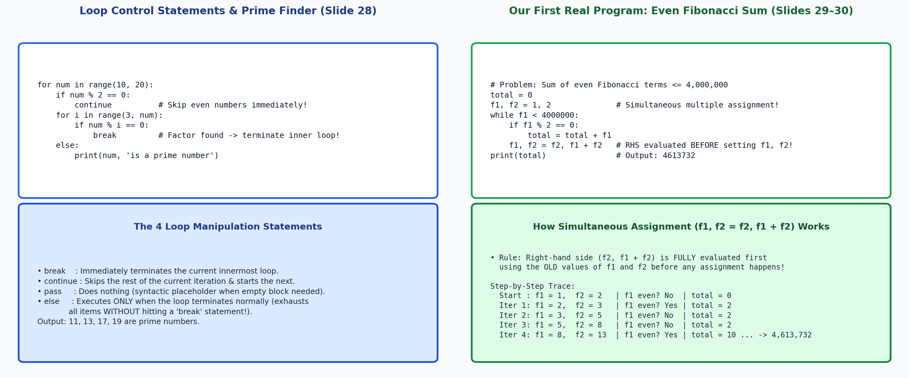
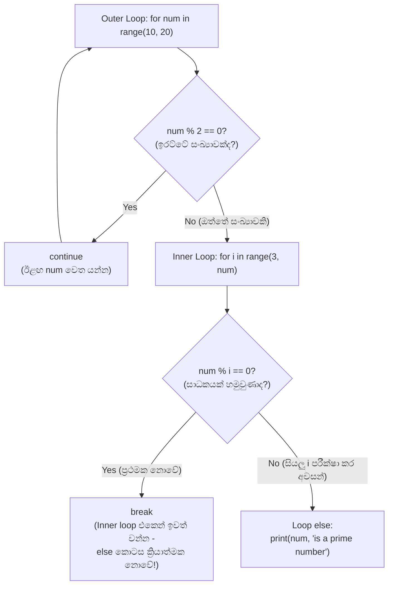

# පාඩම 2.6: ගැලීම් පාලන මෙවලම් — Conditionals, Loops සහ `range()` (Control Flow Tools — Conditionals, Loops & `range()`)

**මූලාශ්‍ර දේශන සටහන් (Source Lecture Notes):** `Python Intro 3.pdf` (Slides 23–30, Dr. Lochandaka Ranathunga) & `f1.ipynb`

---

> [!TIP]
> **📚 Prerequisite / Dependency Lesson Series:**  
> මෙම පාඩමේදී භාවිතා වන Integer Range Memory Optimization (`range()`) සහ Boolean Logic පිළිබඳ පරිගණක විද්‍යාත්මක මූලධර්ම ගැඹුරින් තේරුම් ගැනීමට:
> - [Dep 02.1: Binary, Hexadecimal and IEEE-754 Floating Point Precision](../dependencies/Dep_02_Number_Systems_Binary_Unicode_and_Hash_Tables/01_Binary_Hexadecimal_and_IEEE754_Floating_Point_Precision.md)
> - [Dep 01.1: How RAM Works - Stack vs Heap and PyObject Structure](../dependencies/Dep_01_Computer_Memory_Pointers_and_Object_References/01_How_RAM_Works_Stack_vs_Heap_and_PyObject_Structure.md)

---

## හැඳින්වීම (Introduction)

ඕනෑම පරිගණක වැඩසටහනකදී යම් කොන්දේසියක් (Condition) මත පදනම්ව තීරණ ගැනීමට සහ යම් කේත කොටසක් නැවත නැවත ක්‍රියාත්මක කිරීමට (Looping/Iteration) **Control Flow Tools** අත්‍යවශ්‍ය වේ.

මෙම පාඩමෙන් අපි:
1. **`while` loops** (Slide 23),
2. **`if`, `elif`, `else` කොන්දේසි සහ Nested `if` ප්‍රකාශ** (Slides 24–25 & `f1.ipynb`),
3. **`for` loops සහ `range()` ශ්‍රිතය** (Slides 26–27),
4. **Loop පාලන ප්‍රකාශ 4 (`break`, `continue`, `pass`, සහ Loop `else` - ප්‍රථමක සංඛ්‍යා සෙවීමේ උදාහරණය)** (Slide 28), සහ
5. **අපගේ පළමු සැබෑ Python වැඩසටහන (Even Fibonacci Sum සහ Simultaneous Multiple Assignment)** (Slides 29–30) පිළිබඳව සවිස්තරාත්මකව ඉගෙන ගනිමු.



---

## 1. `while` Loops (Slide 23)

දී ඇති කොන්දේසියක් (Conditional expression) සත්‍ය (`True`) වී පවතින තාක් කල් කේත කොටසක් නැවත නැවත ක්‍රියාත්මක කිරීමට `while` loop එක භාවිතා වේ:

```python
while expression:
    statements
```

* **වැදගත් නීතිය:** Python හිදී ඕනෑම ශූන්‍ය නොවන සංඛ්‍යාවක් (`Non-zero value`, උදා: `1`, `-5`) හෝ හිස් නොවන වස්තුවක් **`True`** ලෙස සැලකෙන අතර, `0`, `None`, `False`, හෝ හිස් `""`/`[]` යන ඒවා **`False`** ලෙස සැලකේ!
* `while` පේළියට පහළින් එකම ප්‍රමාණයකින් Indent කර ඇති සියලුම පේළි එම Loop එකෙහි කේත කොටසට (Single block of code) අයත් වේ.

### දේශන සටහනේ උදාහරණය (Slide 23 & `f1.ipynb`):
```python
i = 1
while i < 4:
    print(i)
    i = i + 1

flag = True
while flag and (i < 8):
    print(flag, i)
    i = i + 1
```
**Output:**
```text
1
2
3
True 4
True 5
True 6
True 7
```

---

## 2. `if`, `elif`, සහ `else` කොන්දේසි ප්‍රකාශ (Slides 24–25 & `f1.ipynb`)

### 1. මූලික `if` ප්‍රකාශය සහ තාර්කික ක්‍රියාකරුවන් (`and`, `or`, `not` - Slide 24):
```python
a = 1       # 1 යනු True ලෙස සැලකේ
b = 0       # 0 යනු False ලෙස සැලකේ

if a:
    print("a is true!")
if not b:
    print("b is false!")
if a and b:
    print("a and b are true!")
if a or b:
    print("a or b is true!")
```
**Output:**
```text
a is true!
b is false!
a or b is true!
```

### 2. `else`, `elif` සහ Nested `if` ප්‍රකාශ (Slide 25):
* `if` කොන්දේසිය අසත්‍ය (`False`) වූ විට ක්‍රියාත්මක වීමට **`else:`** භාවිතා කළ හැක.
* කොන්දේසි කිහිපයක් පිළිවෙළට පරීක්ෂා කිරීමට ("else if" සඳහා) Python හි **`elif`** යන විශේෂ පදය භාවිතා කරයි.
* එමෙන්ම එක `if` ප්‍රකාශයක් ඇතුළත තවත් `if` ප්‍රකාශයක් (**Nested `if`**) ලිවිය හැක:

```python
a = 1
b = 0
c = 2

if a > b:
    if a > c:
        print("a is greatest")
    else:
        print("c is greatest")
elif b > c:
    print("b is greatest")
else:
    print("c is greatest")
```
**Output:** `c is greatest`

### 3. `f1.ipynb` හි විභාග ලකුණු ශ්‍රේණිගත කිරීමේ (Marks Grading) උදාහරණය:
```python
m1 = int(input("Enter the marks:"))
if m1 < 40:
    print('You are Fail')
elif m1 < 50:
    print('You got C')
elif m1 < 60:
    print('You got C+')
elif m1 < 70:
    print('You got B')
else:
    print('You got A')
```

---

## 3. `for` Loops සහ `range()` ශ්‍රිතය (Slides 26–27)

Python හි `for` loop එක ඕනෑම Sequence එකක (String එකක, List එකක, Tuple එකක හෝ `range` එකක) ඇති අගයන් එකින් එක ලබා ගනිමින් මුල සිට අගට ගමන් කරයි:

```python
for var in sequence:
    statements
```

### දේශන සටහනේ `for` loop උදාහරණය (Slide 26):
```python
# 1. String එකක අකුරු හරහා ගමන් කිරීම:
for letter in "aeiou":
    print("vowel: ", letter)

# 2. List එකක අගයන් හරහා ගමන් කිරීම:
for i in [1, 2, 3]:
    print(i)

# 3. range() මගින් සංඛ්‍යා පරාසයක් හරහා ගමන් කිරීම:
for i in range(0, 3):
    print(i)
```

### `range(start, stop, step)` ක්‍රියා කරන ආකාරය (Slide 27):
* `range()` මගින් පූර්ණ සංඛ්‍යා අනුක්‍රමයක් ජනනය කරයි.
* *(ඓතිහාසික සටහන: Python 2 හි `range()` මගින් සම්පූර්ණ List එකම එකවර මතකයේ සෑදූ අතර, `xrange()` මගින් අගයන් අවශ්‍ය වන විට පමණක් ජනනය කළේය. **Python 3 හිදී `range()` යන්නම එම මතක-කාර්යක්ෂම [Lazy/On-demand] `range` object එක බවට පත් කර ඇත!** එබැවින් බිලියනයක පරාසයක් වුවද මතකය පිරී යාමකින් තොරව `range()` මගින් හැසිරවිය හැක).*

```python
# 0 සිට 4 ට පෙර (0, 1, 2, 3)
for i in range(0, 4):
    print(i)

# 0 සිට 8 ට පෙර, පියවර 2 බැගින් (0, 2, 4, 6)
for i in range(0, 8, 2):
    print(i)

# 20 සිට 14 ට පෙර, පියවර -2 බැගින් ආපස්සට (20, 18, 16)
for i in range(20, 14, -2):
    print(i)
```

---

## 4. Loop පාලන ප්‍රකාශ 4: `break`, `continue`, `pass`, සහ `else` (Slide 28)

Python හි Loop එකක ගමන් මග පාලනය කිරීමට විශේෂ ප්‍රකාශ 4ක් ඇත:

1. **`break`:** දැනට ක්‍රියාත්මක වන Loop එක ඒ මොහොතේම සම්පූර්ණයෙන්ම නතර කර ඉන් පිටතට පනියි.
2. **`continue`:** දැනට ක්‍රියාත්මක වන වටයේ (Current iteration) ඉතිරි පේළි මඟහැර වහාම Loop එකේ **ඊළඟ වටය (Next iteration)** ආරම්භ කරයි.
3. **`pass`:** කිසිවක් සිදු නොකරයි (Do nothing). ව්‍යාකරණමය වශයෙන් (Syntactically) පේළියක් අනිවාර්යයෙන්ම තිබිය යුතු නමුත් කිසිදු ක්‍රියාවක් කිරීමට අවශ්‍ය නැති විට හිස් තැන පිරවීමට භාවිතා කරයි.
4. **Loop `else:` (Python හි සුවිශේෂී ලක්ෂණයකි!):** `for` හෝ `while` loop එකකට පසුව `else:` කොටසක් ලිවිය හැක. **මෙම `else:` කොටස ක්‍රියාත්මක වන්නේ Loop එක `break` වීමකින් තොරව සාමාන්‍ය පරිදි අවසානය දක්වාම ක්‍රියාත්මක වී අවසන් වුවහොත් පමණි!**



### ප්‍රථමක සංඛ්‍යා සෙවීමේ කේතය (Prime Number Finder - Slide 28 & `f1.ipynb`):
```python
for num in range(10, 20):
    if num % 2 == 0:
        continue                        # ඉරට්ටේ සංඛ්‍යා මඟහරින්න
    for i in range(3, num):
        if num % i == 0:
            break                       # බෙදෙන සංඛ්‍යාවක් හමුවුණොත් Inner loop එක නවත්වන්න
    else:
        print(num, 'is a prime number') # break නොවී Inner loop එක අවසන් වූ විට පමණක් ක්‍රියාත්මක වේ!
```
**Output:**
```text
11 is a prime number
13 is a prime number
17 is a prime number
19 is a prime number
```

---

## 5. අපගේ පළමු සැබෑ Python වැඩසටහන: Fibonacci ගැටලුව (Slides 29–30)

### ගැටලුව (Project Euler Problem 2 - Slide 29):
* **Fibonacci අනුක්‍රමය** යනු මුල් පද දෙක `1` සහ `2` ලෙස ගෙන, ඊළඟ සෑම පදයක්ම ඊට පෙර පද දෙකෙහි එකතුවෙන් ලබා ගන්නා සංඛ්‍යා රටාවයි:
  $$1, 2, 3, 5, 8, 13, 21, 34, 55, 89, \dots$$
* **අභියෝගය:** අගය මිලියන හතරට ($4,000,000$) නොවැඩි Fibonacci පද අතරින් **ඉරට්ටේ සංඛ්‍යාවල (Even-valued terms) එකතුව** සොයන්න.

### විසඳුම සහ Simultaneous Multiple Assignment (Slide 30):
```python
from __future__ import print_function
total = 0
f1, f2 = 1, 2               # එකම පේළියෙන් විචල්‍ය දෙකකටම අගයන් ආදේශ කිරීම!

while f1 < 4000000:
    if f1 % 2 == 0:         # f1 ඉරට්ටේ සංඛ්‍යාවක්දැයි පරීක්ෂා කිරීම
        total = total + f1
    f1, f2 = f2, f1 + f2    # පැරණි f1 සහ f2 භාවිතයෙන් එකවර අලුත් අගයන් ආදේශ කිරීම!

print(total)
```
**Output:** `4613732`

> [!IMPORTANT]
> **`f1, f2 = f2, f1 + f2` ක්‍රියා කරන ආකාරය (Multiple Assignment Rule):**  
> Python හි `=` ලකුණට දකුණු පසින් ඇති කොටස (`f2, f1 + f2`) **සම්පූර්ණයෙන්ම ගණනය කර අවසන් වූ පසුව** පමණක් වම් පස ඇති `f1` සහ `f2` විචල්‍යයන්ට එම අගයන් ආදේශ වේ! එම නිසා තාවකාලික විචල්‍යයක් (`temp`) භාවිතා නොකර ඉතාම කෙටියෙන් සහ නිවැරදිව Fibonacci පද ඉදිරියට ගෙන යා හැක.

---

**ඊළඟ පාඩම (Next Lesson):** [Lesson 2.7: Defining Functions, Reference Semantics & User Input](Lesson_2.7_Defining_Functions_Reference_Semantics_and_Input.md) — Module 2 හි අවසාන පාඩම ලෙස `def` මගින් Functions නිර්මාණය කිරීම, Pass-by-Reference හැසිරීම, `__name__ == "__main__"` සහ `input()` ගැන ඉගෙන ගනිමු.

---

## 🛠️ Practical Task / Hands-On Exercise (ප්‍රායෝගික අභ්‍යාසය)

### Scenario:
විශ්වවිද්‍යාල ශිෂ්‍ය ලකුණු දත්ත විශ්ලේෂණය කිරීම සඳහා Control Flow (`if-elif-else`, `for`, `while`, `break`, `continue`, `else`) සහ Multiple Assignment භාවිතයෙන් Algorithm එකක් නිර්මාණය කිරීම.

### Step-by-Step Tasks:
1. **Task 1 (Grade Classifier):** ලකුණු ලැයිස්තුවක් (`[45, 78, 89, 92, 33, 67, 105, -5]`) හරහා `for` loop එකක් ධාවනය කර Invalid marks (`< 0` හෝ `> 100`) සඳහා `continue` භාවිතා කර ඉතිරි අගයන් Grading Scale එකකට (`A: >=75`, `B: >=65`, `C: >=50`, `F: <50`) වර්ගීකරණය කරන්න.
2. **Task 2 (Fibonacci Generator with Multiple Assignment):** Slide 28 හි සඳහන් `f1, f2 = f2, f1 + f2` multiple assignment ක්‍රමය යොදාගෙන අගය 1,000 නොඉක්මවන සියලුම Even Fibonacci සංඛ්‍යාවල එකතුව `while` loop එකක් මඟින් ගණනය කරන්න.
3. **Task 3 (Prime Number Search with Loop Else):** 2 සිට 50 දක්වා සංඛ්‍යා අතර ඇති Prime Numbers සෙවීමට Nested Loops සමඟ `for ... else` clause එක ප්‍රායෝගිකව යොදන්න.

### Reference Solution (පියවරෙන් පියවර විසඳුම):
```python
# Task 1: Grade Classifier with continue
marks = [45, 78, 89, 92, 33, 67, 105, -5]
classified = []

for m in marks:
    if m < 0 or m > 100:
        print(f"Skipping Invalid Mark: {m}")
        continue
    if m >= 75:
        grade = "A"
    elif m >= 65:
        grade = "B"
    elif m >= 50:
        grade = "C"
    else:
        grade = "F"
    classified.append((m, grade))

print("Classified Marks:", classified)

# Task 2: Even Fibonacci Sum under 1000
f1, f2 = 0, 1
even_fib_sum = 0

while f2 < 1000:
    if f2 % 2 == 0:
        even_fib_sum += f2
    f1, f2 = f2, f1 + f2

print(f"Sum of Even Fibonacci numbers < 1000: {even_fib_sum}")

# Task 3: Prime Numbers using for ... else
primes = []
for num in range(2, 51):
    for i in range(2, int(num ** 0.5) + 1):
        if num % i == 0:
            break
    else:
        # Loop else fires ONLY if no break occurred
        primes.append(num)

print("Prime Numbers between 2 and 50:", primes)
```

---
