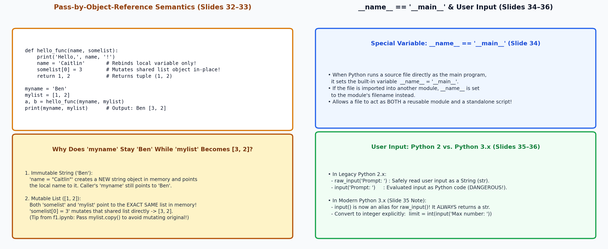
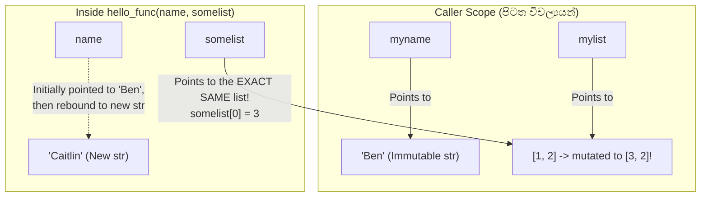

# පාඩම 2.7: ශ්‍රිත නිර්මාණය කිරීම, Reference Semantics සහ User Input (Defining Functions, Reference Semantics & User Input)

**මූලාශ්‍ර දේශන සටහන් (Source Lecture Notes):** `Python Intro 3.pdf` (Slides 31–36, Dr. Lochandaka Ranathunga) & `f1.ipynb`

---

> [!TIP]
> **📚 Prerequisite / Dependency Lesson Series:**  
> Python හි Function Argument Passing (`Pass-by-Object-Reference`), Memory Frames සහ Mutability පිළිබඳ පරිගණක විද්‍යාත්මක පසුබිම පහත Dependency පාඩම් මඟින් විස්තර කෙරේ:
> - [Dep 01.2: Variables as Name Tags, `id()`, `is` vs `==`](../dependencies/Dep_01_Computer_Memory_Pointers_and_Object_References/02_Variables_as_Name_Tags_id_is_vs_Double_Equals.md)
> - [Dep 01.3: Mutability, Aliasing, Shallow Copy and Deep Copy](../dependencies/Dep_01_Computer_Memory_Pointers_and_Object_References/03_Mutability_Aliasing_Shallow_Copy_and_Deep_Copy.md)

---

## හැඳින්වීම (Introduction)

Module 2 හි අවසාන පාඩම වන මෙම ලිපියෙන් අපි කේතයක් නැවත නැවත භාවිතා කළ හැකි කොටස්වලට බෙදා වෙන් කරන **Functions (ශ්‍රිත)** පිළිබඳව ඉගෙන ගනිමු. මෙහිදී:
1. **`def` සහ `return` මගින් ශ්‍රිත නිර්මාණය කිරීම** (Slide 31),
2. **Pass-by-Reference හැසිරීම** — ශ්‍රිතයක් ඇතුළතදී String එකක් වෙනස් කළ විට පිටත විචල්‍යය වෙනස් නොවන්නේ ඇයි සහ List එකක් වෙනස් කළ විට පිටත List එකත් වෙනස් වන්නේ ඇයි (Slides 32–33 & `f1.ipynb`),
3. **`__name__ == "__main__"` විශේෂ පාරිසරික විචල්‍යය** (Slide 34), සහ
4. **පරිශීලකයාගෙන් දත්ත ලබා ගැනීම (`input()` vs. `raw_input()`)** (Slides 35–36) පිළිබඳව ගැඹුරින් විමසා බලමු.



---

## 1. Python හි ශ්‍රිතයක් නිර්මාණය කිරීම (`def` & `return` - Slide 31)

Python හි ශ්‍රිතයක් (Function) නිර්මාණය කරනු ලබන්නේ **`def`** යන මූලපදය (Keyword) භාවිතා කිරීමෙනි:

```python
def function_name(args):
    statements
    return values
```

* **ව්‍යාකරණ නීති:**
  1. `def` පදයට පසුව ශ්‍රිතයේ නම (`function_name`), වටකුරු වරහන් තුළ පරාමිතීන් (`(args)`) සහ අවසානයට දෙතිතක් (`:`) තිබිය යුතුය.
  2. ශ්‍රිතයට අයත් සියලුම පේළි (Body of the function) අනිවාර්යයෙන්ම **Indent** කර තිබිය යුතුය.
  3. ශ්‍රිතයකින් පිටතට අගයක් හෝ අගයන් ලැයිස්තුවක් ආපසු ලබා දීමට **`return`** මූලපදය භාවිතා කරයි.

```python
# ශ්‍රිතය නිර්මාණය කිරීම (Defining the function)
def print_greeting():
    print("Hello!")
    print("How are you today?")

# ශ්‍රිතය කැඳවීම (Calling the function)
print_greeting()
```
**Output:**
```text
Hello!
How are you today?
```

---

## 2. Pass-by-Reference හැසිරීම සහ අගයන් කිහිපයක් Return කිරීම (Slides 32–33)

දේශන සටහනේ 32 වන Slide එකෙහි ඉතා වැදගත් නීතියක් සඳහන් වේ:
> **"All parameters in the Python language are passed by reference."**  
> *(තාක්ෂණිකව මෙය **Pass-by-Object-Reference** ලෙස හැඳින්වේ — එනම් ශ්‍රිතයකට විචල්‍යයක් යවන විට යැවෙන්නේ මතකයේ ඇති වස්තුවට අදාළ යොමුව [Reference] යි).*

මෙය **Immutable** (වෙනස් කළ නොහැකි - උදා: `str`, `int`, `tuple`) සහ **Mutable** (වෙනස් කළ හැකි - උදා: `list`, `dict`, `set`) වස්තූන් කෙරෙහි බලපාන ආකාරය පහත උදාහරණයෙන් බලන්න:

### උදාහරණය 1 (Slide 32):
```python
def hello_func(name, somelist):
    print("Hello,", name, "!\n")
    name = "Caitlin"        # Immutable string එකක් නැවත ආදේශ කිරීම (Local rebinding)
    somelist[0] = 3         # Mutable list එකේ 0 වන අගය එතැනම වෙනස් කිරීම (In-place mutation)
    return 1, 2             # අගයන් දෙකක් එකවර Return කිරීම!

myname = "Ben"
mylist = [1, 2]

a, b = hello_func(myname, mylist)
print(myname, mylist)
print(a, b)
```

**Output:**
```text
Hello, Ben !

Ben [3, 2]
1 2
```



**ඇයි `myname` වෙනස් නොවී `'Ben'` ලෙසම පැවතුණේත්, `mylist` එක `[3, 2]` බවට වෙනස් වුණේත්?**
1. **`name = "Caitlin"`:** Strings යනු Immutable වස්තූන්ය. එබැවින් `name = "Caitlin"` ලියූ විට මතකයේ අලුත්ම `"Caitlin"` වස්තුවක් සෑදී ශ්‍රිතය ඇතුළත ඇති `name` විචල්‍යය පමණක් එයට යොමු වේ. පිටත ඇති `myname` තවමත් යොමු වී ඇත්තේ `"Ben"` වෙතය!
2. **`somelist[0] = 3`:** Lists යනු Mutable වස්තූන්ය. පිටත `mylist` සහ ඇතුළත `somelist` යන දෙකම යොමු වී ඇත්තේ මතකයේ ඇති **එකම List එක** වෙතය. එබැවින් `somelist[0] = 3` මගින් එම හවුල් List එකේ පළමු අගය වෙනස් කළ විට, පිටත ඇති `mylist` එකද `[3, 2]` බවට වෙනස් වේ!

### උදාහරණය 2: පන්ති ප්‍රශ්නය (Quiz - Slide 33):
පහත කේතයේ Output එක කුමක්ද?
```python
def hello_func1(names):
    for n in names:
        print("Hello,", n, "!")
    names[0] = 'Susie'
    names[1] = 'Pete'
    names[2] = 'Will'

names = ['Susan', 'Peter', 'William']
hello_func1(names)
print("The names are now", names, ".")
```
**Output:**
```text
Hello, Susan !
Hello, Peter !
Hello, William !
The names are now ['Susie', 'Pete', 'Will'] .
```

### `f1.ipynb` හි විසඳුම: මුල් List එක වෙනස් නොවී ආරක්ෂා කර ගැනීමට `.copy()` භාවිතය!
ඔබට මුල් List එක වෙනස් වීමට ඉඩ නොදී ස්වාධීන පිටපතක් (Independent copy) සෑදීමට අවශ්‍ය නම් **`mylist.copy()`** භාවිතා කළ යුතු බව `f1.ipynb` හි පෙන්වා දී ඇත:
```python
myl1 = ['fish bun', 'toast', 'bread', 'patty']
myl3 = myl1.copy()      # ස්වාධීන පිටපතක් සාදයි
myl3[2] = 89            # myl3 වෙනස් කළත් myl1 වෙනස් නොවේ!
print(myl3)             # ['fish bun', 'toast', 89, 'patty']
print(myl1)             # ['fish bun', 'toast', 'bread', 'patty']
```

---

## 3. `__name__ == "__main__"` සහ Fibonacci විසඳුම (Slide 34)

Python Interpreter එක ආරම්භ වන විට විශේෂ පාරිසරික විචල්‍යයන් (Special built-in variables - දෙපසින්ම Underscores දෙක බැගින් ඇති `__name__` වැනි) ස්වයංක්‍රීයව සකසයි.

* ඔබ `.py` ගොනුවක් ප්‍රධාන වැඩසටහන ලෙස කෙලින්ම ක්‍රියාත්මක කරන විට (`python script.py`), Python විසින් `__name__` විචල්‍යයේ අගය **`"__main__"`** ලෙස සකසයි.
* මෙය භාවිතා කර අපගේ Fibonacci වැඩසටහන පහත පරිදි ඉතා පිරිසිදු Function එකක් ලෙස ලිවිය හැක:

```python
def even_fib():
    total = 0
    f1, f2 = 1, 2
    while f1 < 4000000:
        if f1 % 2 == 0:
            total = total + f1
        f1, f2 = f2, f1 + f2
    return total

if __name__ == "__main__":
    print(even_fib())
```

---

## 4. පරිශීලක ආදානයන් ලබා ගැනීම: `input()` vs. `raw_input()` (Slides 35–36)

වැඩසටහනක් ක්‍රියාත්මක වන අතරතුර පරිශීලකයාගෙන් (Keyboard එකෙන්) අගයක් ලබා ගැනීමේදී Python 2 සහ Python 3 අතර වැදගත් වෙනසක් ඇත:

1. **Python 2.x හි තිබූ ශ්‍රිත දෙක:**
   * **`raw_input('Prompt: ')`:** පරිශීලකයා ටයිප් කරන ඕනෑම දෙයක් ආරක්ෂිතව **String (`str`)** එකක් ලෙස ආපසු ලබා දෙයි.
   * **`input('Prompt: ')` *(Python 2 හිදී අනතුරුදායකයි!)*:** පරිශීලකයා ටයිප් කරන String එක ලබාගෙන එය Python ප්‍රකාශනයක් (Python expression) ලෙස Evaluate කරයි (උදා: `2+2*5` ටයිප් කළ විට `12` ලබා දෙයි). පරිශීලකයා හානිකර කේතයක් ටයිප් කළහොත් එයත් ක්‍රියාත්මක වන නිසා Python 2 හි `input()` භාවිතා නොකළ යුතු බව Slide 35 හි අවධාරණය කරයි.
2. **Python 3.x හි වර්තමාන තත්ත්වය (Slide 35 Note):**
   * **Python 3.x හිදී `raw_input()` ඉවත් කර ඇති අතර, සාමාන්‍ය `input()` ශ්‍රිතයම පැරණි `raw_input()` ලෙස ආරක්ෂිතව ක්‍රියා කරයි!** එනම් Python 3 හිදී `input()` මගින් සෑමවිටම ලබා දෙන්නේ **String (`str`)** එකකි.
   * එම String එක ගණනය කිරීමකට ගැනීමට නම් `int(input(...))` හෝ `float(input(...))` මගින් සංඛ්‍යාවකට හරවා ගත යුතුය.

### පරිශීලකයා දෙන ඕනෑම සීමාවකට (`n`) Fibonacci එකතුව සොයන සම්පූර්ණ කේතය (Slide 36):
```python
def even_fib(n):
    total = 0
    f1, f2 = 1, 2
    while f1 < n:
        if f1 % 2 == 0:
            total = total + f1
        f1, f2 = f2, f1 + f2
    return total

if __name__ == "__main__":
    # Python 3 හිදී input() මගින් String එකක් ලබා ගන්නා අතර int(limit) මගින් එය පූර්ණ සංඛ්‍යාවකට හරවයි
    limit = input("Enter the max Fibonacci number: ")
    print(even_fib(int(limit)))
```
**Output:**
```text
Enter the max Fibonacci number: 4000000
4613732
```

---

🎉 **Module 2 සම්පූර්ණයි!**  
දැන් ඔබ `Python Intro 3.pdf` හි ඇති සියලුම මූලික Python සංකල්ප 100%ක් ආවරණය කර ඇත.

**ඊළඟ මොඩියුලය (Next Module):** `Module_03_Modular_and_Intermediate_Python` — `Python 3-2.pdf` සහ `f1.ipynb` ඇසුරෙන් Python Modules, `sys.path`, Default Argument Pitfall, `*args`/`**kwargs`, `lambda` සහ List Comprehensions ගැඹුරින් ඉගෙන ගනිමු!

---

## 🛠️ Practical Task / Hands-On Exercise (ප්‍රායෝගික අභ්‍යාසය)

### Scenario:
දත්ත විශ්ලේෂණ කාර්යයකදී (Data Processing Pipeline) Clean Function එකක් සහ Summary Statistics ලබාදෙන Multiple-Return Function එකක් Pass-by-Object-Reference නීතිවලට අනුකූලව නිර්මාණය කිරීම.

### Step-by-Step Tasks:
1. **Task 1 (Multiple Return Values):** සංඛ්‍යා ලැයිස්තුවක් ආදානය කර එහි Mean (මධ්‍යන්‍යය), Min, Max, සහ Element Count එක Tuple එකක් ලෙස නැවත ලබාදෙන `calc_summary(numbers)` ශ්‍රිතය ලියන්න. Tuple Unpacking මඟින් අගයන් වෙනම Variables වලට ලබාගන්න.
2. **Task 2 (Pass-by-Object-Reference Demonstration):** මුල් ලැයිස්තුව වෙනස් නොකර (Pure Function) නව Clean ලැයිස්තුවක් ලබාදෙන `clean_data(records)` ශ්‍රිතයක් ලියන්න. පිටතින් ලබාදුන් මුල් ලැයිස්තුවට Function එක තුළදී සිදුවූ බලපෑම `id()` සහ equality මඟින් සසඳන්න.
3. **Task 3 (`if __name__ == "__main__":` Implementation):** Script එක Direct Execute කරන විට Interactive Mode එකෙන් අගයන් ලබා ගැනීමටත්, Module එකක් ලෙස Import කරන විට Auto Run නොවීමටත් `__name__ == "__main__"` කොටස ඇතුළත් කරන්න.

### Reference Solution (පියවරෙන් පියවර විසඳුම):
```python
def calc_summary(numbers):
    """Calculates basic descriptive summary statistics."""
    if not numbers:
        return 0.0, 0, 0, 0
    total = sum(numbers)
    count = len(numbers)
    mean_val = total / count
    min_val = min(numbers)
    max_val = max(numbers)
    return mean_val, min_val, max_val, count

def clean_data(raw_list):
    """Demonstrating Pure Function without mutating caller's list."""
    # Create a fresh copy to avoid side-effects (Aliasing bug)
    cleaned = [x for x in raw_list if x is not None and x >= 0]
    return cleaned

if __name__ == "__main__":
    dataset = [12, -4, 45, 67, None, 89, 90]
    print(f"Original Dataset ID: {id(dataset)}")
    
    cleaned_dataset = clean_data(dataset)
    print(f"Cleaned Dataset ID : {id(cleaned_dataset)} (Independent Object)")
    print(f"Original Unchanged : {dataset}")
    
    mean_val, min_val, max_val, count = calc_summary(cleaned_dataset)
    print(f"Summary -> Count: {count}, Mean: {mean_val:.2f}, Min: {min_val}, Max: {max_val}")
```

---
