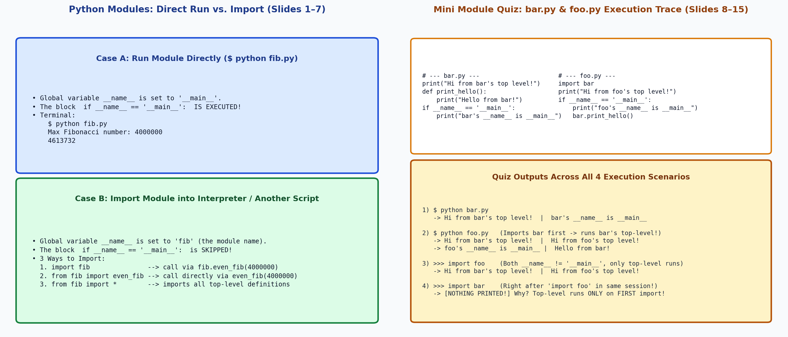
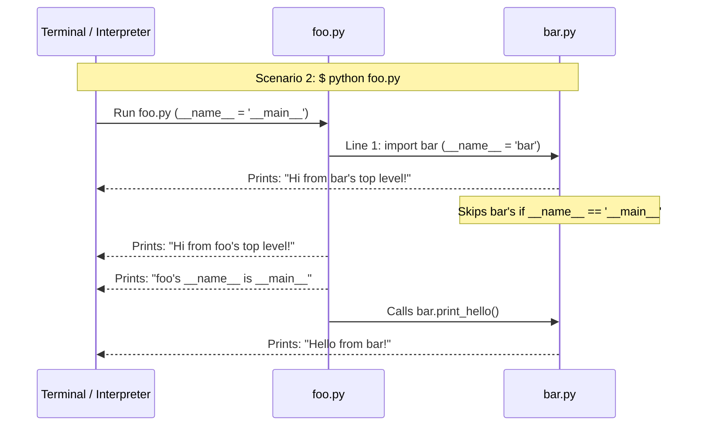

# Lesson 3.1: Python Modules, Import Mechanics & `__name__ == "__main__"`

**මූලාශ්‍ර දේශන සටහන් (Source Lecture Notes):** `Python 3-2.pdf` (Slides 1–15, Dr. Lochandaka Ranathunga) & `f1.ipynb` (Cells 34–51)

> [!TIP]
> **📚 Prerequisite / Dependency Lesson Series (පූර්ව අවශ්‍යතා පාඩම් මාලාව):**  
> මෙම පාඩමේදී භාවිතා වන **Namespaces (`globals()`, `locals()`, `dir()`)**, **LEGB Variable Scope**, සහ **Generator Functions (`yield`)** පිළිබඳ මූලික දැනුම ඔබට නොමැති නම්, පළමුව අපගේ සම්පූර්ණ Zero-to-Hero Dependency පාඩම් මාලාව කියවන්න:
> - [Dep 01.1: What is a Namespace? — `globals()`, `locals()`, and `dir()`](../dependencies/Dep_01_Python_Namespaces_LEGB_Scope_and_Call_Stack/01_What_is_a_Namespace_globals_locals_and_dir.md)
> - [Dep 01.2: The LEGB Scope Rule, `global`, and `nonlocal` Keywords](../dependencies/Dep_01_Python_Namespaces_LEGB_Scope_and_Call_Stack/02_The_LEGB_Scope_Rule_global_and_nonlocal_Keywords.md)
> - [Dep 02.3: Generator Functions (`yield`) and Generator Expressions](../dependencies/Dep_02_Functional_Programming_Iterators_and_Generators/03_Generator_Functions_yield_and_Generator_Expressions.md)

---

## හැඳින්වීම (Introduction)

Module 3 වෙත ඔබව සාදරයෙන් පිළිගනිමු! අප ලියන කේත විශාල වන විට සියල්ලම එකම ගොනුවක ලිවීම ප්‍රායෝගික නොවේ. කේතය පිළිවෙළට සංවිධානය කර තබා ගැනීමට (**Modular Programming**) සහ එක වරක් ලියූ Functions වෙනත් වැඩසටහන්වලට නැවත භාවිතා කිරීමට (**Code Reusability**) Python හි **Modules** භාවිතා වේ.

මෙම පාඩමෙන් අපි:
1. **Python Module එකක් යනු කුමක්ද සහ `__name__` Global Variable එකෙහි හැසිරීම**,
2. **Module එකක් සෘජුවම ධාවනය කිරීම (`python fib.py`) සහ Import කිරීම (`import fib`) අතර වෙනස**,
3. **Import කළ හැකි ප්‍රධාන ආකාර 3 සහ Namespace ආරක්ෂාව**,
4. **දේශන සටහනේ `bar.py` සහ `foo.py` Mini Module Quiz එකෙහි අවස්ථා 4 (සහ Circular Imports ගැටලුව)**, සහ
5. **`f1.ipynb` හි `.py` හා `.ipynb` ගොනු Modules ලෙස Import කරන ආකාරය** ගැඹුරින් ඉගෙන ගනිමු.



---

## 1. Python Module එකක් යනු කුමක්ද? (What is a Module? - Slides 1–3)

* **Definition:** Python definitions (Functions, Classes, Variables) සහ executable statements අඩංගු ඕනෑම Text file එකක් **Module** එකක් ලෙස හැඳින්වේ.
* **File Name & Suffix:** Module එකේ නමට අගින් **`.py`** suffix එක එක් කිරීමෙන් ගොනු නාමය සෑදේ (උදා: Module නාමය `fib` නම් ගොනු නාමය `fib.py` වේ).
* **`__name__` Global Variable:**
  1. Module එකක් තවත් තැනකට **Import කරන විට**, එම Module එක තුළ `__name__` global variable එකෙහි අගය වන්නේ **Module එකේ නමයි** (`"fib"`).
  2. නමුත් එම Module එක Command line එකෙන් **සෘජුවම Script එකක් ලෙස ක්‍රියාත්මක කරන විට (`$ python fib.py`)**, `__name__` විචල්‍යයේ අගය **`"__main__"`** බවට පත් වේ!
* **Top-level Statements ක්‍රියාත්මක වන වේලාව (Slide 3):** Module එකක් තුළ Functions වලින් පිටත (Top-level හි) ලියා ඇති executable statements ක්‍රියාත්මක වන්නේ:
  1. ගොනුව සෘජුවම Script එකක් ලෙස ධාවනය කරන විට, හෝ
  2. `import` ප්‍රකාශයක් මගින් එම Module එක **පළමු වතාවට (Only the first time)** Import කරන මොහොතේදී පමණි!

---

## 2. `fib.py` Module එක සෘජුවම ධාවනය කිරීම vs. Import කිරීම (Slides 4–7 & `f1.ipynb` Cell 34)

**Fibonacci Sequence (ෆිබොනාචි අනුක්‍රමය)** යනු `1, 2` න් ආරම්භ වී, ඊළඟ සෑම සංඛ්‍යාවක්ම පෙර සංඛ්‍යා දෙකේ එකතුවෙන් (`1, 2, 3, 5, 8, 13, 21, 34, 55, 89, ...`) සෑදෙන සංඛ්‍යා රටාවකි. `n` අගයට අඩු සියලුම **Even Numbers (ඉරට්ටේ සංඛ්‍යා)** වල **Summation (එකතුව)** සොයන පහත කේතය `fib.py` නමැති ගොනුවක ගබඩා කර ඇතැයි සිතන්න:

```python
''' Module fib.py '''
from __future__ import print_function   # (Slide 6: Python 2/3 print() compatibility)

def even_fib(n):
    total = 0
    f1, f2 = 1, 2                       # Multiple / Tuple assignment in one statement
    while f1 < n:
        if f1 % 2 == 0:
            total = total + f1
        f1, f2 = f2, f1 + f2
    return total

if __name__ == "__main__":
    limit = input("Max Fibonacci number: ")
    print(even_fib(int(limit)))
```

*(Gap Analysis Note — Slide 6 හි `from __future__ import print_function` යොදා ඇත්තේ පැරණි Python 2 පරිසරයක වුවද Python 3 හි මෙන් `print()` ශ්‍රිතයක් ලෙස භාවිතා කිරීමට හැකි වීම සඳහාය).*

### අවස්ථාව 1: Command Line එකෙන් සෘජුවම ධාවනය කිරීම (Slide 4)
මෙහිදී `__name__` හි අගය `"__main__"` වන නිසා `if __name__ == "__main__":` කොටස ක්‍රියාත්මක වී පරිශීලකයාගෙන් අගයක් ඉල්ලයි:
```bash
$ python fib.py
Max Fibonacci number: 4000000
4613732
```

### අවස්ථාව 2: Module එක Import කර භාවිතා කරන ක්‍රම 3 (Slides 5–7)
සම්මතයක් ලෙස (By convention), සියලුම `import` ප්‍රකාශ `.py` ගොනුවේ ඉහළින්ම (Top of the file) ලිවිය යුතුය.

> [!NOTE]
> **🔗 Namespace Deep-Dive:** පහත Import ක්‍රම 3 මගින් Python හි `globals()` Symbol Table එක වෙනස් වන ආකාරය පිළිබඳව වැඩිදුර ඉගෙනීමට [Dep 01.1: What is a Namespace?](../dependencies/Dep_01_Python_Namespaces_LEGB_Scope_and_Call_Stack/01_What_is_a_Namespace_globals_locals_and_dir.md) බලන්න.

| Import Method | Code Example | Namespace Behavior & Recommendation |
| :--- | :--- | :--- |
| **1. `import <module>`** *(Slide 5–6)* | `>>> import fib`<br/>`>>> fib.even_fib(4000000)`<br/>`4613732` | `fib` නමින් වෙනම Module Object එකක් සාදයි. එහි ඇති definitions වෙත `fib.even_fib` ලෙස Member access (`.`) මගින් පමණක් පිවිසිය හැක. **Namespace Pollution වළක්වන ආරක්ෂිතම ක්‍රමයයි.** |
| **2. `from <module> import <name>`** *(Slide 7)* | `>>> from fib import even_fib`<br/>`>>> even_fib(4000000)`<br/>`4613732` | `even_fib` ශ්‍රිතය කෙලින්ම අපගේ Interpreter එකේ Global Namespace එකට ගෙන එයි. `fib.` ලෙස ඉදිරියෙන් නොලියා කෙලින්ම `even_fib()` ලෙස කැඳවිය හැක. |
| **3. `from <module> import *`** *(Slide 7)* | `>>> from fib import *`<br/>`>>> even_fib(4000000)` | Module එකේ ඇති සියලුම public definitions එකවර කෙලින්ම Import කරයි. (විශාල ව්‍යාපෘතිවලදී නම් ගැටීම් ඇති විය හැකි බැවින් ප්‍රවේශමෙන් භාවිතා කරන්න). |

---

## 3. Mini Module Quiz: `bar.py` සහ `foo.py` ක්‍රියාකාරීත්වය (Slides 8–15)

දේශන සටහනේ 8 සිට 15 දක්වා Slides මගින් Modules දෙකක් එකිනෙක Import කරන විට ලැබෙන Output එක පිළිබඳ ඉතාම වැදගත් Quiz එකක් ඉදිරිපත් කරයි.

අප සතුව පහත ගොනු දෙක ඇත:

**1. `bar.py` ගොනුව:**
```python
''' Module bar.py '''
print("Hi from bar's top level!")

def print_hello():
    print("Hello from bar!")

if __name__ == "__main__":
    print("bar's __name__ is __main__")
```

**2. `foo.py` ගොනුව:**
```python
''' Module foo.py '''
import bar
print("Hi from foo's top level!")

if __name__ == "__main__":
    print("foo's __name__ is __main__")
    bar.print_hello()
```

දැන් පහත අවස්ථා 4හිදී ලැබෙන Output එක පියවරෙන් පියවර විමසා බලමු:



### Quiz Question 1: `$ python bar.py` කෙලින්ම ධාවනය කළ විට කුමක් සිදුවේද? (Slides 9–10)
* `bar.py` හි Top-level `print` එක ක්‍රියාත්මක වේ.
* `bar.py` කෙලින්ම ධාවනය කළ නිසා එහි `__name__ == "__main__"` සත්‍ය වේ.
```text
$ python bar.py
Hi from bar's top level!
bar's __name__ is __main__
```

### Quiz Question 2: `$ python foo.py` කෙලින්ම ධාවනය කළ විට කුමක් සිදුවේද? (Slides 11–12)
1. `foo.py` හි පළමු පේළිය වන `import bar` ක්‍රියාත්මක වේ. එවිට `bar.py` කියවන අතර එහි Top-level හි ඇති `"Hi from bar's top level!"` මුද්‍රණය වේ (`bar` Import කළ නිසා `bar` හි `__name__` අගය `'bar'` වන බැවින් `if __name__ == "__main__":` කොටස ක්‍රියාත්මක නොවේ!).
2. ඉන්පසු `foo.py` හි ඊළඟ පේළිය වන `"Hi from foo's top level!"` මුද්‍රණය වේ.
3. `foo.py` කෙලින්ම ධාවනය කළ නිසා `foo` හි `__name__ == "__main__"` සත්‍ය වේ. එබැවින් `"foo's __name__ is __main__"` මුද්‍රණය වී, `bar.print_hello()` කැඳවීමෙන් `"Hello from bar!"` මුද්‍රණය වේ!
```text
$ python foo.py
Hi from bar's top level!
Hi from foo's top level!
foo's __name__ is __main__
Hello from bar!
```

### Quiz Questions 3 & 4: Interpreter එක තුළදී මුලින්ම `import foo` කර, ඊළඟට `import bar` කළ විට කුමක් සිදුවේද? (Slides 13–15)
```python
$ python
>>> import foo
Hi from bar's top level!
Hi from foo's top level!
>>> import bar
>>>
```
* **ඇයි `>>> import foo` කළ විට පේළි දෙකක් පමණක් මුද්‍රණය වුණේ?** `foo` Import කරන විට එය විසින් `bar` Import කරයි. එබැවින් `bar` සහ `foo` දෙකෙහිම Top-level පේළි දෙක පමණක් ක්‍රියාත්මක වන අතර, දෙකම Import කළ නිසා දෙකෙහිම `__name__ == "__main__"` කොටස් ක්‍රියාත්මක නොවේ.
* **ඇයි ඊළඟ පේළියේ `>>> import bar` කළ විට කිසිවක්ම මුද්‍රණය නොවුණේ?! (`sys.modules` Module Caching):** `import foo` කරන අවස්ථාවේදීම `bar` මොඩියුලය පළමු වතාවට Import වී Python හි **`sys.modules`** නමැති Module Cache Dictionary එකට පැටවී අවසන්ය! Python හිදී Module එකක Top-level ප්‍රකාශ ක්‍රියාත්මක වන්නේ **පළමු වතාවට Import කරන විට පමණක්** බැවින්, දෙවන වර `import bar` කළ විට කිසිවක් නැවත ක්‍රියාත්මක නොවේ!

> [!WARNING]
> **Gap Analysis — Circular Import Pitfall (`foo.py` imports `bar`, and `bar.py` imports `foo`):**  
> ඉහත උදාහරණයේදී `foo.py` තුළ `import bar` තිබෙන අතරම, `bar.py` තුළත් `import foo` ලියා තිබුණහොත් කුමක් සිදුවේද?  
> එය **Circular Import (චක්‍රීය ආයාත කිරීමක්)** ලෙස හැඳින්වේ. එවිට පළමු Module එක සම්පූර්ණයෙන් Load වීමට පෙර දෙවැන්න විසින් පළමු Module එකේ Function එකක් කැඳවීමට උත්සාහ කළහොත් `AttributeError: partially initialized module ... has no attribute ... (most likely due to a circular import)` දෝෂය හට ගනී! එබැවින් Modules දෙකක් එකිනෙක මත රඳා පවතින ලෙස සැලසුම් කිරීමෙන් වළකින්න.

---

## 4. `f1.ipynb` හි Modules Import කිරීම සහ Mutable List Reference Passing (Cells 35–51)

අපගේ `f1.ipynb` ප්‍රායෝගික Notebook එකෙහි Module Aliasing (`import ... as ...`), `.ipynb` ගොනු Modules ලෙස Import කිරීම, සහ Module Function එකකට List එකක් යැවූ විට මතකයේ සිදුවන දේ පෙන්වා දී ඇත:

```python
# 1. සාමාන්‍ය .py මොඩියුලයක් Alias එකක් (m1) සහිතව Import කිරීම (Cells 35–36)
import addin as m1
m1.addint(56, 34)               # Output: 90

# 2. වෙනත් Jupyter Notebook (.ipynb) ගොනුවක් Module එකක් ලෙස Import කිරීම (Cells 37–40)
# !pip install import_ipynb
import import_ipynb
import fibnmod as fibci         # fibnmod.ipynb ගොනුව මොඩියුලයක් ලෙස Import කරයි!

fibci.fibn1(100000)             # Output: 60696
fibci.fibn1(10000)              # Output: 3382
```

### `f1.ipynb` (Cells 41–51): Module Function එකකට List එකක් යැවූ විට සිදුවන Reference Aliasing vs `.copy()`
> [!TIP]
> **📚 Cross-Module Prerequisite:** Python හි Object References, Aliasing, සහ Shallow/Deep Copy පිළිබඳ මූලික පාඩම සඳහා [Module 2 — Dep 01: Computer Memory, Pointers & Object References](../dependencies/Dep_01_Computer_Memory_Pointers_and_Object_References/01_How_RAM_Works_Stack_vs_Heap_and_PyObject_Structure.md) බලන්න.

`f1.ipynb` හි `add_list_item` මොඩියුලයට `myl1` ලැයිස්තුව යැවූ විට සිදුවන දේ බලන්න:
```python
import add_list_item as mylib1

myl1 = ['fish bun', 'toast', 'bread', 'patty']
myl2 = mylib1.add_item(67, myl1)    # myl1 වෙතම 67 append කර එම List reference එකම ආපසු ලබා දෙයි!

# myl1 සහ myl2 යන දෙකම යොමු වන්නේ එකම List Object එකටයි (Aliasing):
myl2[2] = 89
print(myl1)  # ['fish bun', 'toast', 89, 'patty', 67] -> myl1 ද වෙනස් වී ඇත!

# මුල් ලැයිස්තුව ආරක්ෂා කර ගැනීමට .copy() (Shallow Copy) භාවිතය (Cell 49):
myl1[2] = 'bread'
myl3 = myl1.copy()
myl3[2] = 89
print("myl3:", myl3)  # ['fish bun', 'toast', 89, 'patty', 67]
print("myl1:", myl1)  # ['fish bun', 'toast', 'bread', 'patty', 67] (ආරක්ෂිතයි!)
```

---

## 🛠️ Practical Task / Hands-On Exercise (ප්‍රායෝගික අභ්‍යාසය)

### Scenario / Goal:
ඔබ Data Science ව්‍යාපෘතියක් සඳහා සංඛ්‍යා ලැයිස්තුවක **Arithmetic Mean (සමාන්තර මධ්‍යන්‍යය)** සහ **Even Number Summation (ඉරට්ටේ සංඛ්‍යාවල එකතුව)** ගණනය කරන `stats_helper.py` නමින් Reusable Module එකක් නිර්මාණය කළ යුතුය. එය සෘජුවම Run කළ විට පරීක්ෂණ දත්ත මුද්‍රණය කළ යුතු අතර, වෙනත් ගොනුවකට Import කළ විට නිහඬව Functions පමණක් ලබා දිය යුතුය.

### Step-by-Step Tasks:
1. `even_sum(numbers)` නමින් ලැයිස්තුවක ඇති Even Numbers (`n % 2 == 0`) වල එකතුව ආපසු ලබා දෙන Function එකක් ලියන්න.
2. `compute_mean(numbers)` නමින් ලැයිස්තුවේ Arithmetic Mean (`sum(numbers) / len(numbers)`) ආපසු ලබා දෙන Function එකක් ලියන්න.
3. `if __name__ == "__main__":` ආරක්ෂක කොටස (Main guard) යොදා, ගොනුව සෘජුවම ධාවනය කරන විට පමණක් `[10, 15, 20, 25, 30]` සඳහා ප්‍රතිඵල මුද්‍රණය වන සේ සකසන්න.
4. `safe_append(item, target_list)` නමින් මුල් ලැයිස්තුව වෙනස් නොකර (`.copy()` භාවිතා කර) අලුත් ලැයිස්තුවකට `item` එක් කර Return කරන ශ්‍රිතයක් එක් කරන්න.

### Starter Code:
```python
''' Module stats_helper.py '''

def even_sum(numbers):
    # TODO: Return sum of even numbers in 'numbers'
    pass

def compute_mean(numbers):
    # TODO: Return arithmetic mean of 'numbers'
    pass

def safe_append(item, target_list):
    # TODO: Copy target_list, append item, and return the new list without mutating target_list
    pass

# TODO: Add if __name__ == "__main__": block to test with [10, 15, 20, 25, 30]
```

### Expected Output / Reference Solution:
```python
''' Module stats_helper.py '''

def even_sum(numbers):
    total = 0
    for n in numbers:
        if n % 2 == 0:
            total += n
    return total

def compute_mean(numbers):
    if not numbers:
        return 0.0
    return sum(numbers) / len(numbers)

def safe_append(item, target_list):
    new_list = target_list.copy()
    new_list.append(item)
    return new_list

if __name__ == "__main__":
    sample_data = [10, 15, 20, 25, 30]
    print("Running stats_helper.py directly (__name__ == '__main__')")
    print("Even Sum :", even_fib_or_sum := even_sum(sample_data))
    print("Mean     :", compute_mean(sample_data))
    
    updated_data = safe_append(99, sample_data)
    print("Original :", sample_data)
    print("Updated  :", updated_data)
```

**Expected Output (when run directly):**
```text
Running stats_helper.py directly (__name__ == '__main__')
Even Sum : 60
Mean     : 20.0
Original : [10, 15, 20, 25, 30]
Updated  : [10, 15, 20, 25, 30, 99]
```

---

## 📝 Summary & Exam Revision Cheat Sheet

| Execution / Import Mode | Command / Syntax | Value of `__name__` | Does `if __name__ == "__main__":` Run? | When Top-Level Statements Execute |
| :--- | :--- | :--- | :--- | :--- |
| **Direct Script Execution** | `$ python fib.py` | `"__main__"` | **Yes (`True`)** | Every time the script is executed. |
| **Standard Module Import** | `import fib` | `"fib"` | **No (`False`)** | **Only the first time** imported in the session (`sys.modules` cache). |
| **Module Alias Import** | `import addin as m1` | `"addin"` | **No (`False`)** | Only on first import; accessed via `m1.addint()`. |
| **Selective Attribute Import** | `from fib import even_fib` | `"fib"` | **No (`False`)** | Only on first import; `even_fib` bound directly to caller's namespace. |
| **Wildcard Import** | `from fib import *` | `"fib"` | **No (`False`)** | Only on first import; imports all public symbols into caller's namespace. |

---

**ඊළඟ පාඩම (Next Lesson):** [Lesson 3.2: The Module Search Path (`sys.path` & `PYTHONPATH`)](Lesson_3.2_The_Module_Search_Path_sys_path_and_PYTHONPATH.md) — ඔබ `import` විධානයක් ලබා දුන් විට Python විසින් එම Module ගොනුව පරිගණකයේ සොයන නිශ්චිත අනුපිළිවෙළ (`sys.path` සහ `PYTHONPATH`) ගැන ඉගෙන ගනිමු.
