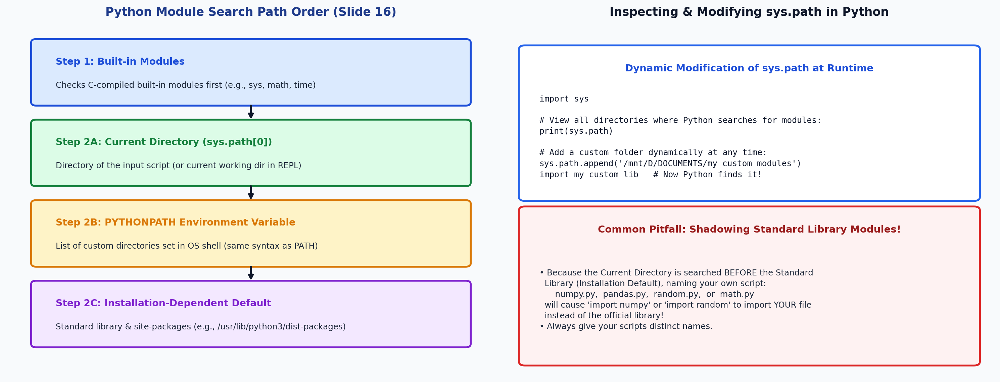
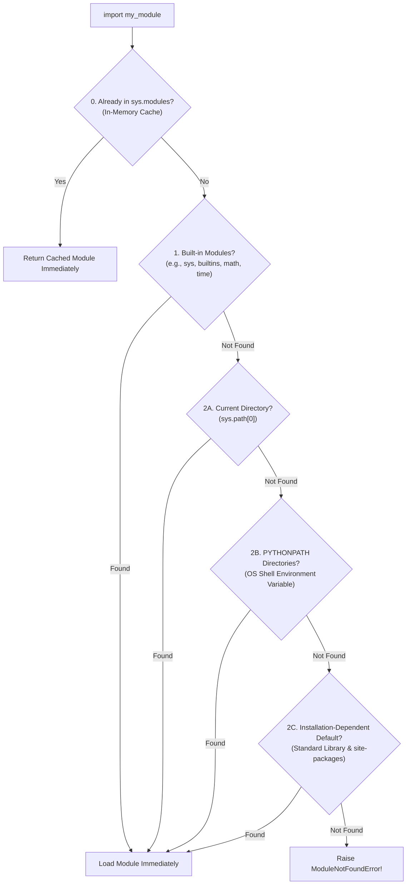

# Lesson 3.2: The Module Search Path — `sys.path` and `PYTHONPATH`

**මූලාශ්‍ර දේශන සටහන් (Source Lecture Notes):** `Python 3-2.pdf` (Slide 16, Dr. Lochandaka Ranathunga) & `f1.ipynb` (Cells 35–41)

> [!TIP]
> **📚 Prerequisite / Dependency Lesson Series (පූර්ව අවශ්‍යතා පාඩම් මාලාව):**  
> Module එකක් Import වූ පසු එය Python මතකයේ Namespace Dictionary එකක් ලෙස ගබඩා වන ආකාරය (`globals()`, `dir()`, `module.__dict__`) පිළිබඳ මූලික දැනුම සඳහා අපගේ Dependency පාඩම් මාලාව කියවන්න:
> - [Dep 01.1: What is a Namespace? — `globals()`, `locals()`, and `dir()`](../dependencies/Dep_01_Python_Namespaces_LEGB_Scope_and_Call_Stack/01_What_is_a_Namespace_globals_locals_and_dir.md)
> - [Dep 01.2: The LEGB Scope Rule, `global`, and `nonlocal` Keywords](../dependencies/Dep_01_Python_Namespaces_LEGB_Scope_and_Call_Stack/02_The_LEGB_Scope_Rule_global_and_nonlocal_Keywords.md)

---

## හැඳින්වීම (Introduction)

ඔබ Python වැඩසටහනක `import fib`, `import addin as m1` (`f1.ipynb`), හෝ `import numpy` ලෙස ලියූ විට, එම Module ගොනුව පරිගණකයේ කොතැනක තිබේදැයි Python මුලින්ම දන්නේ නැත. එබැවින් Python විසින් නිශ්චිත **Search Order (සෙවුම් අනුපිළිවෙළකට)** පරිගණකයේ Directories පරීක්ෂා කරමින් එම Module එක සොයා ගනී.

මෙම පාඩමෙන් අපි **Module Search Path** එකෙහි අනුපිළිවෙළ, **`sys.path`** විචල්‍යය, **`PYTHONPATH`** Environment Variable එක, සහ වැඩසටහනක් ක්‍රියාත්මක වන අතරතුර (Runtime හිදී) වෙනත් ෆෝල්ඩරයක ඇති Module එකක් සම්බන්ධ කර ගන්නා ආකාරය ඉගෙන ගනිමු.



---

## 1. Python විසින් Module එකක් සොයන නිශ්චිත අනුපිළිවෙළ (Slide 16)

Module එකක් Import කරන විට Python පහත ස්ථාන **අනුපිළිවෙළින් (In order)** පරීක්ෂා කරයි:



### Step 1: Built-in Modules
* මුලින්ම Python Interpreter එක තුළම C භාෂාවෙන් ගොඩනගා ඇති **Built-in modules** (උදා: `sys`, `builtins`, `time`, `itertools`) අතර එම නම තිබේදැයි බලයි (`sys.builtin_module_names` මගින් මේවා බලාගත හැක).

### Step 2: Directories Listed in the `sys.path` Variable
Built-in modules අතර නොමැති නම්, Python විසින් `sys` මොඩියුලයේ ඇති **`sys.path`** නමැති List එකෙහි සඳහන් Directories පිළිවෙළට පරීක්ෂා කරයි. `sys.path` විචල්‍යය ආරම්භයේදී පහත ස්ථාන 3න් Initialize වේ (Slide 16):

1. **The Current Directory (`sys.path[0]`):**
   * ඔබ ක්‍රියාත්මක කළ Python script එක පිහිටා ඇති ෆෝල්ඩරය (හෝ Interactive REPL / Jupyter Notebook mode එකේදී ඔබ දැනට සිටින Working directory එක `''`). `f1.ipynb` හි `import addin as m1` ක්‍රියා කළේ `addin.py` ගොනුව Current Directory එකෙහි තිබූ නිසාය!
2. **`PYTHONPATH` (OS Environment Variable):**
   * මෙහෙයුම් පද්ධතියේ Shell variable එකක් වන `PATH` විචල්‍යයට සමාන Syntax එකකින් ලබා දිය හැකි, ඔබේ පෞද්ගලික Python modules තබා ඇති ෆෝල්ඩර ලැයිස්තුවකි:
     - **Linux / macOS (`:` colon-separated):** `export PYTHONPATH="/home/user/my_modules:/opt/shared_py"`
     - **Windows (`;` semicolon-separated):** `set PYTHONPATH=C:\my_modules;D:\shared_py`
3. **The Installation-Dependent Default:**
   * Python ස්ථාපනය කිරීමේදී පිහිටුවන ලද Standard Library ෆෝල්ඩර (`os`, `json`, `pathlib`, `random`) සහ `pip` මගින් ස්ථාපනය කළ Third-party packages (`site-packages` / `dist-packages` - උදා: `numpy`, `pandas`, `matplotlib`, `import_ipynb`) පිහිටි ෆෝල්ඩර.

---

## 2. `sys.path` පරීක්ෂා කිරීම සහ Runtime හිදී වෙනස් කිරීම (Modifying `sys.path` at Runtime)

දේශන සටහනේ 16 වන Slide එකෙහි අවසාන කරුණ ලෙස මෙසේ සඳහන් වේ:
> *"The `sys.path` variable can be modified by a Python program to point elsewhere at any time."*

`sys.path` යනු සාමාන්‍ය Python **List of Strings (`list[str]`)** එකකි. එබැවින් ඔබට වෙනත් ෆෝල්ඩරයක ඇති `.py` ගොනුවක් Import කර ගැනීමට අවශ්‍ය නම්, `sys.path.append()` හෝ `sys.path.insert()` මගින් එම ෆෝල්ඩරයේ Path එක ඕනෑම මොහොතක එක් කළ හැක!

### ප්‍රායෝගික කේත උදාහරණය:
```python
import sys

# 1. දැනට Python මොඩියුල සොයන ෆෝල්ඩර ලැයිස්තුව බැලීම:
print("Current sys.path entries:")
for idx, p in enumerate(sys.path):
    print(f"  [{idx}] {p!r}")

# 2. වෙනත් තැනක ඇති ෆෝල්ඩරයක් sys.path වෙත එක් කිරීම:
custom_dir = '/mnt/D/DOCUMENTS/my_shared_modules'
if custom_dir not in sys.path:
    sys.path.append(custom_dir)

# 3. දැන් එම ෆෝල්ඩරයේ ඇති ඕනෑම .py ගොනුවක් සාමාන්‍ය පරිදි Import කළ හැක!
# import custom_helper
```

> [!WARNING]
> **වැදගත් ප්‍රායෝගික අවවාදයක් (Module Shadowing Pitfall):**  
> Python විසින් Standard Library සහ `site-packages` පරීක්ෂා කිරීමට **පෙර** ඔබේ **Current Directory (`sys.path[0]`)** පරීක්ෂා කරයි!  
> එම නිසා ඔබ අත්වැරදීමකින් ඔබේ ෆෝල්ඩරයේ සාදන පරීක්ෂණ ගොනුවකට `numpy.py`, `pandas.py`, `math.py`, හෝ `random.py` වැනි නමක් තැබුවහොත්, ඔබ `import numpy` හෝ `import random` කරන විට සැබෑ පුස්තකාලය වෙනුවට ඔබේම ගොනුව Import වී වැඩසටහන `AttributeError` එකකින් බිඳ වැටේ! එසේ වූ විට `print(numpy.__file__)` මගින් කුමන ගොනුව Load වී ඇත්දැයි ක්ෂණිකව හඳුනාගත හැක.

---

## 🛠️ Practical Task / Hands-On Exercise (ප්‍රායෝගික අභ්‍යාසය)

### Scenario / Goal:
ඔබේ ව්‍යාපෘතියේ ප්‍රධාන Script එක එක් ෆෝල්ඩරයක ඇති අතර, Data Cleaning සඳහා ලියූ `cleaner_utils.py` නමැති Module එක වෙනත් තාවකාලික ෆෝල්ඩරයක (`/tmp/custom_msc_libs`) පිහිටා ඇත. `sys.path` භාවිතා කර එම බාහිර ෆෝල්ඩරයේ ඇති Module එක සාර්ථකව Import කර ධාවනය කරන Python Script එකක් ලියන්න.

### Step-by-Step Tasks:
1. `os.makedirs('/tmp/custom_msc_libs', exist_ok=True)` මගින් වෙනම ෆෝල්ඩරයක් සාදා, එහි `clean_text(s)` නමින් ශ්‍රිතයක් අඩංගු `cleaner_utils.py` ගොනුවක් Python මගින්ම ලියන්න.
2. `sys.path` වෙනස් කිරීමට පෙර `import cleaner_utils` කිරීමට උත්සාහ කළහොත් `ModuleNotFoundError` ලැබෙන බව `try...except` මගින් පරීක්ෂා කරන්න.
3. `sys.path.append('/tmp/custom_msc_libs')` මගින් එම ෆෝල්ඩරය Search Path එකට එක් කරන්න.
4. දැන් `import cleaner_utils` කර, `cleaner_utils.__file__` මුද්‍රණය කර, `cleaner_utils.clean_text("   Applied Data Programming  ")` කැඳවා පරීක්ෂා කරන්න.

### Starter Code:
```python
import os
import sys

ext_dir = "/tmp/custom_msc_libs"
os.makedirs(ext_dir, exist_ok=True)

# Write external module file cleaner_utils.py
with open(os.path.join(ext_dir, "cleaner_utils.py"), "w") as f:
    f.write("def clean_text(s):\n    return s.strip().upper()\n")

# TODO: 1. Try importing before adding to sys.path (catch ModuleNotFoundError)
# TODO: 2. Append ext_dir to sys.path and import cleaner_utils
# TODO: 3. Call clean_text() and print cleaner_utils.__file__
```

### Expected Output / Reference Solution:
```python
import os
import sys

ext_dir = "/tmp/custom_msc_libs"
os.makedirs(ext_dir, exist_ok=True)

with open(os.path.join(ext_dir, "cleaner_utils.py"), "w") as f:
    f.write("def clean_text(s):\n    return s.strip().upper()\n")

# Step 1: Try importing before modifying sys.path
try:
    import cleaner_utils
except ModuleNotFoundError as e:
    print("Before sys.path update -> Caught expected error:", e)

# Step 2: Dynamically add external directory to sys.path at runtime
if ext_dir not in sys.path:
    sys.path.append(ext_dir)

# Step 3: Import and verify module location & execution
import cleaner_utils
print("Loaded module from:", cleaner_utils.__file__)
print("Cleaned output    :", cleaner_utils.clean_text("  Applied Data Programming  "))
```

**Expected Output:**
```text
Before sys.path update -> Caught expected error: No module named 'cleaner_utils'
Loaded module from: /tmp/custom_msc_libs/cleaner_utils.py
Cleaned output    : APPLIED DATA PROGRAMMING
```

---

## 📝 Summary & Exam Revision Cheat Sheet

| Search Priority | Location / Mechanism | Description & How to Inspect |
| :--- | :--- | :--- |
| **Priority 0 (Cache)** | `sys.modules` | දැනටමත් Import කර ඇති Modules රඳවා ගන්නා In-memory dictionary එක. |
| **Priority 1** | **Built-in Modules** | C භාෂාවෙන් Interpreter එක තුළම ඇති Modules (`sys.builtin_module_names`). |
| **Priority 2A** | **Current Directory (`sys.path[0]`)** | ක්‍රියාත්මක වන Script එක පිහිටි ෆෝල්ඩරය (Module Shadowing ගැන සැලකිලිමත් වන්න!). |
| **Priority 2B** | **`PYTHONPATH`** | OS Environment Variable එකක් ලෙස ලබා දුන් Custom module directories. |
| **Priority 2C** | **Installation-Dependent Default** | Standard Library සහ `pip` මගින් ස්ථාපිත `site-packages` ෆෝල්ඩර. |
| **Runtime Modification** | `sys.path.append('/new/path')` | වැඩසටහන ක්‍රියාත්මක වන අතරතුර අලුත් ෆෝල්ඩරයක් Module Search Path එකට එක් කරයි. |

---

**ඊළඟ පාඩම (Next Lesson):** [Lesson 3.3: Function Arguments — Default Values & The Mutable Default Pitfall](Lesson_3.3_Function_Arguments_Default_Values_and_Mutable_Pitfall.md) — Functions සඳහා Default අගයන් ලබා දෙන ආකාරය සහ Python හි ඉතාම ප්‍රසිද්ධ "Surprising Behavior" උගුල (`def add_item(item, item_list=[])`) හා එය විසඳන ආකාරය ඉගෙන ගනිමු.
