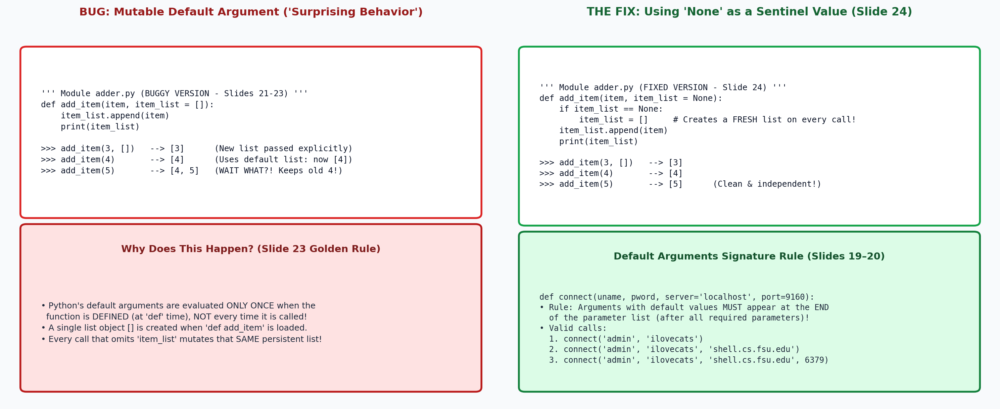
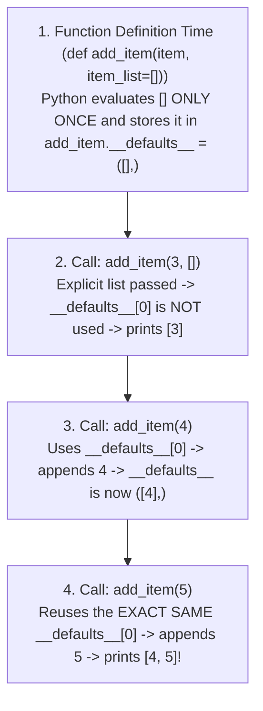

# Lesson 3.3: Function Arguments — Default Values & The Mutable Default Pitfall

**මූලාශ්‍ර දේශන සටහන් (Source Lecture Notes):** `Python 3-2.pdf` (Slides 17–24, Dr. Lochandaka Ranathunga) & `f1.ipynb` (Cells 41–51)

> [!TIP]
> **📚 Prerequisite / Dependency Lesson Series (පූර්ව අවශ්‍යතා පාඩම් මාලාව):**  
> මෙම පාඩමේදී සාකච්ඡා කරන **Mutable Default Argument Bug (`item_list=[]`)** එකට හේතුවන **Call Stack Frames**, **Definition Time vs. Runtime Evaluation**, **`__defaults__` Tuple Binding**, සහ **Mutable vs. Immutable Memory References** ගැඹුරින් තේරුම් ගැනීමට පහත Dependency පාඩම් කියවන්න:
> - [Dep 01.3: Call Stack Frames, Definition Time vs. Runtime Evaluation, and `__defaults__`](../dependencies/Dep_01_Python_Namespaces_LEGB_Scope_and_Call_Stack/03_Call_Stack_Frames_and_Definition_Time_vs_Runtime_Evaluation.md)
> - [Dep 01.2: The LEGB Scope Rule, `global`, and `nonlocal` Keywords](../dependencies/Dep_01_Python_Namespaces_LEGB_Scope_and_Call_Stack/02_The_LEGB_Scope_Rule_global_and_nonlocal_Keywords.md)
> - [Module 2 — Dep 01.2: Mutable vs. Immutable Objects & In-Place Mutation](../dependencies/Dep_01_Computer_Memory_Pointers_and_Object_References/03_Mutability_Aliasing_Shallow_Copy_and_Deep_Copy.md)

---

## හැඳින්වීම (Introduction)

අපි Module 2 හිදී Functions වල මූලික කරුණු ඉගෙන ගත්තෙමු. දැන් Functions පිළිබඳව තවදුරටත් ගැඹුරට යමු! Data Science පුස්තකාල (`Pandas`, `Matplotlib`, `Scikit-learn`) භාවිතා කරන විට ඒවායේ ඇති Functions වලට Parameters 20ක් හෝ 30ක් තිබුණත්, අපි ඒවා කැඳවන්නේ Arguments 1ක් හෝ 2ක් පමණක් ලබා දීමෙනි. එසේ කළ හැකි වන්නේ **Default Argument Values** නිසාය.

මෙම පාඩමෙන් අපි:
1. **Functions සඳහා Default Argument Values ලබා දෙන ආකාරය සහ එහි නීති** (Slides 17–20),
2. **Python හි ඉතාම ප්‍රසිද්ධ "Surprising Behavior" උගුල (Mutable Default Argument Bug)**,
3. **Function Object එකේ `__defaults__` attribute එක පරීක්ෂා කිරීම**, සහ
4. **`None` Sentinel Value එක භාවිතා කර එය නිවැරදි කරන ආකාරය** (Slides 21–24) ඉගෙන ගනිමු.



---

## 1. සාමාන්‍ය Function Signature එකක් සහ එහි අපහසුතාවය (Slides 17–18)

Remote machine එකකට Username සහ Password භාවිතා කර සම්බන්ධ වන පහත `connect` ශ්‍රිතයේ **Function Signature** එක සලකා බලන්න:

```python
def connect(uname, pword, server, port):
    print("Connecting to", server, ":", port, "...")
    # Connecting code here ...
```

මෙහිදී අපි මෙම ශ්‍රිතය කැඳවන සෑම අවස්ථාවකදීම Arguments 4ම නිශ්චිත අනුපිළිවෙළටම (In that exact order!) ලබා දිය යුතුය:
```python
connect('admin', 'ilovecats', 'shell.cs.fsu.edu', 9160)
connect('jdoe', 'r5f0g87g5@y', 'linprog.cs.fsu.edu', 6370)
```

**ගැටලුව (Slide 19):** බොහෝ අවස්ථාවලදී අප සම්බන්ධ වන්නේ එකම `server` එකකට (`'localhost'`) සහ එකම `port` අංකයකට (`9160`) නම්, ශ්‍රිතය කැඳවන සෑම වාරයකදීම ඒවා නැවත නැවත ටයිප් කිරීම ඉතාම කරදරකාරී (Cumbersome) වේ.

---

## 2. Default Argument Values — Parameters සඳහා පෙරනිමි අගයන් ලබා දීම (Slides 19–20)

මෙයට විසඳුම ලෙස, ශ්‍රිතය නිර්මාණය කරන (`def`) පේළියේදීම Parameters එකකට හෝ කිහිපයකට **Default Argument Value (`param = default_value`)** එකක් ලබා දිය හැක:

```python
def connect(uname, pword, server = 'localhost', port = 9160):
    print("Connecting to", server, ":", port, "...")
```

### Default Arguments පිළිබඳ වැදගත්ම නීති 3 (Slide 19):
1. ඕනෑම Parameters ගණනකට Default values ලබා දිය හැක.
2. එමගින් එකම ශ්‍රිතය විවිධ Arguments සංඛ්‍යාවන් (**Variable number of arguments** - මෙහිදී Arguments 2කින්, 3කින් හෝ 4කින්) ලබා දෙමින් කැඳවීමට හැකියාව ලැබේ.
3. **අනිවාර්ය Syntax නීතිය:** **Default values සහිත Parameters සෑමවිටම Parameter ලැයිස්තුවේ අවසානයටම (Must appear at the end of the arguments list!) පැමිණිය යුතුය!** (එසේ නොකළහොත් `SyntaxError: non-default argument follows default argument` ලැබේ).

### Valid Function Calls (Slide 20):
දැන් පහත කැඳවීම් 3ම 100%ක් නිවැරදිය:
```python
# 1. server සහ port දෙකම සඳහා Default අගයන් ('localhost', 9160) ගනී:
connect('admin', 'ilovecats')

# 2. server සඳහා 'shell.cs.fsu.edu' ගන්නා අතර, port සඳහා Default අගය (9160) ගනී:
connect('admin', 'ilovecats', 'shell.cs.fsu.edu')

# 3. server සහ port දෙකම අප ලබා දෙන අගයන්ගෙන් Override වේ:
connect('admin', 'ilovecats', 'shell.cs.fsu.edu', 6379)
```

---

## 3. "Surprising Behavior": Mutable Default Argument උගුල! (Slides 21–24)

දේශන සටහනේ 21 සිට 24 දක්වා Slides මගින් Python ක්‍රමලේඛකයින් බහුලවම වරද්දා ගන්නා සහ සම්මුඛ පරීක්ෂණවලදී (Interviews) හා විභාගවලදී නිතරම අසන ඉතාම වැදගත් හැසිරීමක් පෙන්වා දෙයි.

අපි `adder.py` නමින් මොඩියුලයක් සාදා, එහි `item_list` පරාමිතියට හිස් List එකක් (`[]`) Default value ලෙස ලබා දෙමු (Slides 21–22):

```python
''' Module adder.py '''
def add_item(item, item_list = []):
    item_list.append(item)      # Add item to end of list
    print(item_list)
```

දැන් මෙම ශ්‍රිතය Python Interpreter එක තුළ කැඳවා ලැබෙන Output එක දෙස බලන්න (Slide 23):

```python
$ python
>>> from adder import *
>>> add_item(3, [])
[3]
>>> add_item(4)
[4]
>>> add_item(5)
[4, 5]
```

**මොකක්ද මේ වුණේ?!** `add_item(5)` කැඳවූ විට අපි බලාපොරොත්තු වූයේ `[5]` ලැබේවි කියාය. නමුත් කලින් කැඳවූ `add_item(4)` හි තිබූ `4` ද තවමත් එම List එක ඇතුළේ ඉතිරි වී `[4, 5]` ලෙස ලැබුණේ ඇයි?!

### මෙයට හේතුව (Definition-Time Evaluation & `__defaults__` - Slide 23):
> **"Python's default arguments are evaluated once when the function is defined, not every time the function is called. This means that if you make changes to a mutable default argument, these changes will be reflected in future calls to the function."**

> [!NOTE]
> **🔗 Memory & Call Stack Deep-Dive:** මෙම ක්‍රියාවලිය Call Stack Frames සහ Heap Function Objects මට්ටමින් සිදුවන ආකාරය රූපසටහන් සහිතව ඉගෙනීමට [Dep 01.3: Call Stack Frames & `__defaults__` Binding](../dependencies/Dep_01_Python_Namespaces_LEGB_Scope_and_Call_Stack/03_Call_Stack_Frames_and_Definition_Time_vs_Runtime_Evaluation.md) කියවන්න.



**`__defaults__` මගින් මෙම රහස සජීවීව පරීක්ෂා කිරීම:**
* Python හි `def add_item(item, item_list = []):` පේළිය මුලින්ම කියවන මොහොතේදී (**Definition Time**), Python විසින් `[]` එකම එක වතාවක් සාදා එය `add_item.__defaults__` නමැති Tuple එක තුළ ගබඩා කරයි:
  ```python
  >>> add_item.__defaults__
  ([4, 5],)
  ```
* එබැවින් ඔබ `item_list` එකක් ලබා නොදී `add_item(4)` සහ `add_item(5)` කැඳවන සෑම වාරයකදීම, Python විසින් අලුත් List එකක් සාදනවා වෙනුවට `add_item.__defaults__[0]` හි තිබෙන **එකම List Object එකටම** දිගින් දිගටම අගයන් `.append()` කරයි!

---

## 4. නිවැරදි විසඳුම: `None` Sentinel Value එක භාවිතා කිරීම (The Fix - Slide 24)

List එකක් (`[]`), Dictionary එකක් (`{}`) හෝ Set එකක් (`set()`) වැනි **Mutable Object** එකක් Default argument එකක් ලෙස ලබා දීමට අවශ්‍ය වූ විට, කිසිවිටෙකත් `item_list = []` ලෙස Function Header එකෙහි නොලියන්න. ඒ වෙනුවට **`None`** යන Immutable අගය **Sentinel Default Value (මුර/සංඥා අගයක්)** ලෙස භාවිතා කර, Function Body එක ඇතුළතදී (**Runtime හිදී**) අලුත් List එකක් සාදන්න:

```python
''' Module adder.py (FIXED - Slide 24) '''
def add_item(item, item_list = None):
    if item_list == None:       # (හෝ Pythonic ලෙස: if item_list is None:)
        item_list = []          # Evaluated at RUNTIME on every call!
    item_list.append(item)
    print(item_list)
```

**දැන් ලැබෙන නිවැරදි Output එක (Slide 24):**
```python
$ python
>>> from adder import *
>>> add_item(3, [])
[3]
>>> add_item(4)
[4]
>>> add_item(5)
[5]
```

---

## 🛠️ Practical Task / Hands-On Exercise (ප්‍රායෝගික අභ්‍යාසය)

### Scenario / Goal:
ඔබ රසායනාගාර පරීක්ෂණ දත්ත ලොග් කරන `record_measurement(sensor_id, reading, history=...)` නමින් Function එකක් ලිවිය යුතුය. ආධුනිකයෙකු ලියූ Buggy සංස්කරණයේ `__defaults__` පරීක්ෂා කර, ඉන්පසු `None` Sentinel අගය සහ Default parameters (`unit='Celsius'`, `precision=2`) සහිතව නිවැරදි Function එක ගොඩනගන්න.

### Step-by-Step Tasks:
1. `record_buggy(val, history=[])` ලියා, එය දෙවරක් කැඳවා (`record_buggy(25.4)` සහ `record_buggy(26.1)`), `record_buggy.__defaults__` මුද්‍රණය කර Mutable Default Bug එක පෙන්වන්න.
2. `record_safe(val, unit='Celsius', precision=2, history=None)` නමින් නිවැරදි Function එක ලියන්න (සියලුම Default arguments අවසානයට යොදන්න).
3. `history is None` නම් අලුත් `[]` එකක් සාදා, `(round(val, precision), unit)` යන Tuple එක `history` වෙත `.append()` කර එම `history` ලැයිස්තුව Return කරන්න.
4. `record_safe(25.456)`, `record_safe(26.123, 'Kelvin', 1)` සහ දැනටමත් පවතින ලැයිස්තුවක් ලබා දෙමින් Function එක පරීක්ෂා කරන්න.

### Starter Code:
```python
def record_buggy(val, history=[]):
    history.append(val)
    return history

def record_safe(val, unit='Celsius', precision=2, history=None):
    # TODO: Implement safe mutable default handling using None sentinel
    pass

# Test both functions
```

### Expected Output / Reference Solution:
```python
# 1. Demonstrating the Mutable Default Bug and inspecting __defaults__
def record_buggy(val, history=[]):
    history.append(val)
    return history

record_buggy(25.4)
record_buggy(26.1)
print("Buggy __defaults__ tuple:", record_buggy.__defaults__)

# 2. Safe Implementation using None Sentinel Value
def record_safe(val, unit='Celsius', precision=2, history=None):
    if history is None:
        history = []
    history.append((round(val, precision), unit))
    return history

print("Safe Call 1 (Defaults) :", record_safe(25.456))
print("Safe Call 2 (Fresh list):", record_safe(26.123, 'Kelvin', 1))

existing_log = [(20.0, 'Celsius')]
print("Safe Call 3 (With list):", record_safe(22.5, history=existing_log))
```

**Expected Output:**
```text
Buggy __defaults__ tuple: ([25.4, 26.1],)
Safe Call 1 (Defaults) : [(25.46, 'Celsius')]
Safe Call 2 (Fresh list): [(26.1, 'Kelvin')]
Safe Call 3 (With list): [(20.0, 'Celsius'), (22.5, 'Celsius')]
```

---

## 📝 Summary & Exam Revision Cheat Sheet

| Rule / Concept | Incorrect / Buggy Pattern | Correct / Pythonic Pattern |
| :--- | :--- | :--- |
| **Parameter Ordering** | `def connect(uname='admin', pword):` (`SyntaxError`!) | `def connect(pword, uname='admin'):` (Defaults at the END) |
| **Mutable Default List** | `def add_item(item, item_list=[]):` | `def add_item(item, item_list=None):` + `if item_list is None: item_list = []` |
| **Evaluation Timing** | Default values are evaluated **ONCE at Definition Time** (`def`). | Statements inside the function body run **every time at Call Time**. |
| **Inspecting Defaults** | Hidden state bug across calls | `func.__defaults__` shows the tuple of stored default objects. |

---

**ඊළඟ පාඩම (Next Lesson):** [Lesson 3.4: Keyword Arguments, Packing (`*args`, `**kwargs`) & Unpacking](Lesson_3.4_Keyword_Arguments_Packing_args_kwargs_and_Unpacking.md) — Positional vs. Keyword arguments, `*args` සහ `**kwargs` මගින් Arguments Pack කරන සහ Unpack කරන ආකාරය ඉගෙන ගනිමු.
