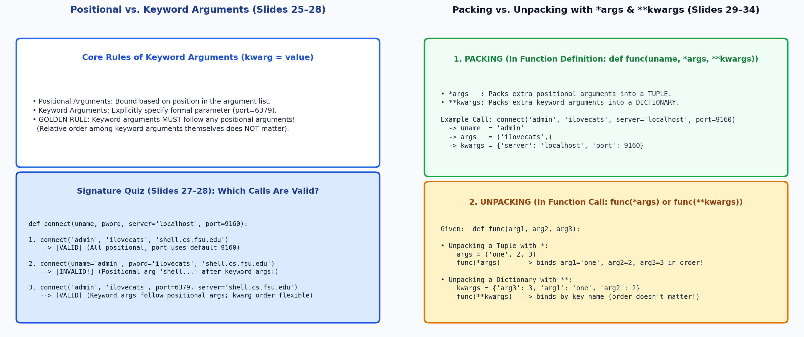
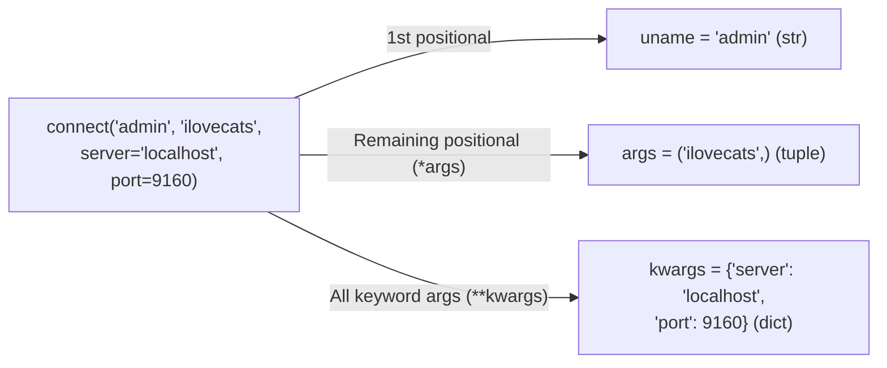

# Lesson 3.4: Keyword Arguments, Packing (`*args`, `**kwargs`) & Unpacking

**මූලාශ්‍ර දේශන සටහන් (Source Lecture Notes):** `Python 3-2.pdf` (Slides 25–34, Dr. Lochandaka Ranathunga)

> [!TIP]
> **📚 Prerequisite / Dependency Lesson Series (පූර්ව අවශ්‍යතා පාඩම් මාලාව):**  
> මෙම පාඩමේදී භාවිතා වන **Local Namespace Dictionary (`locals()`)**, **Call Stack Parameter Binding**, සහ **Iterable Unpacking Protocol** පිළිබඳ මූලික දැනුම සඳහා අපගේ Dependency පාඩම් මාලාව කියවන්න:
> - [Dep 01.1: What is a Namespace? — `globals()`, `locals()`, and `dir()`](../dependencies/Dep_01_Python_Namespaces_LEGB_Scope_and_Call_Stack/01_What_is_a_Namespace_globals_locals_and_dir.md)
> - [Dep 01.3: Call Stack Frames, Definition Time vs. Runtime Evaluation, and `__defaults__`](../dependencies/Dep_01_Python_Namespaces_LEGB_Scope_and_Call_Stack/03_Call_Stack_Frames_and_Definition_Time_vs_Runtime_Evaluation.md)
> - [Dep 02.2: Iterables vs. Iterators and the Iterator Protocol](../dependencies/Dep_02_Functional_Programming_Iterators_and_Generators/02_Iterables_vs_Iterators_and_the_Iterator_Protocol.md)

---

## හැඳින්වීම (Introduction)

`Matplotlib` (`plt.plot(x, y, color='indigo', marker='o', linewidth=5)`) හෝ `Pandas` (`pd.read_csv('file.csv', delimiter=',', header=0)`) වැනි පුස්තකාලවල කේත දෙස බැලූ විට, ශ්‍රිත කැඳවීමේදී සමහර අගයන් කෙලින්මත් (`x, y`), තවත් සමහර අගයන් `parameter_name = value` (`color='indigo'`) ලෙසත් ලබා දෙනු ඔබ දැක ඇත. එමෙන්ම නිල Documentation කියවන විට `def plot(*args, **kwargs):` ලෙස ලියා තිබෙනු නිතරම දක්නට ලැබේ!

මෙම පාඩමෙන් අපි:
1. **Positional Arguments සහ Keyword Arguments අතර වෙනස හා ඒවායේ නීති** (Slides 25–28),
2. **Function Definition එකකදී `*args` සහ `**kwargs` මගින් Variable-Length Arguments Packing කිරීම** (Slides 29–31), සහ
3. **Function Call එකකදී `*args` සහ `**kwargs` මගින් Tuple එකක් හෝ Dictionary එකක් Unpacking කිරීම** (Slides 32–34) ඉතා පැහැදිලිව ඉගෙන ගනිමු.



---

## 1. Positional Arguments vs. Keyword Arguments (Slides 25–26)

අපගේ `connect` ශ්‍රිතය නැවත සලකා බලමු:
```python
def connect(uname, pword, server = 'localhost', port = 9160):
    # connecting code
```

### 1.1 Positional Arguments (ස්ථානීය පරාමිතීන් - Slide 25):
```python
connect('admin', 'ilovecats', 'shell.cs.fsu.edu', 6379)
```
* මෙහිදී අප ලබා දෙන අගයන් කුමන **Formal Parameter** එකට බැඳිය (Bind කළ) යුතුද යන්න Python තීරණය කරන්නේ **ඒවා ලබා දී ඇති ස්ථානයේ අනුපිළිවෙළ (Position in the argument list)** අනුවය (1 වන අගය `uname` ට, 2 වන අගය `pword` ට ආදී ලෙස).

### 1.2 Keyword Arguments (`kwarg = value` - Slide 26):
```python
connect(uname='admin', pword='ilovecats', server='shell.cs.fsu.edu', port=6379)
```
* ශ්‍රිතය කැඳවීමේදී Formal parameter එකේ නම (`kwarg = value`) පැහැදිලිව සඳහන් කර අගය ලබා දීම **Keyword Argument** එකක් ලෙස හැඳින්වේ.
* **Keyword Arguments පිළිබඳ රන් නීති 2 (Slide 26):**
  1. Positional arguments සහ Keyword arguments එකට මිශ්‍ර කර භාවිතා කරන්නේ නම්, **සියලුම Keyword arguments අනිවාර්යයෙන්ම Positional arguments වලට පසුව (Must follow any positional arguments!) පැමිණිය යුතුය!**
  2. Keyword arguments වලදී නම පැහැදිලිව සඳහන් කර ඇති නිසා, **Keyword arguments එකිනෙක අතර අනුපිළිවෙළ වැදගත් නොවේ (Relative order of keyword arguments is unimportant)** (උදා: `server` ට පෙර `port` ලිවිය හැක).

---

## 2. Function Call Validity Quiz (Slides 27–28)

ඉහත `def connect(uname, pword, server = 'localhost', port = 9160):` ශ්‍රිතය සඳහා පහත කැඳවීම් 3න් වලංගු (**VALID**) සහ අවලංගු (**INVALID**) ඒවා මොනවාද?

1. **`connect('admin', 'ilovecats', 'shell.cs.fsu.edu')` $\rightarrow$ VALID**
   * මුල් Parameters 3ට Positional ලෙස අගයන් ලැබෙන අතර, 4 වැන්න (`port`) සඳහා Default අගය (`9160`) භාවිතා වේ.
2. **`connect(uname='admin', pword='ilovecats', 'shell.cs.fsu.edu')` $\rightarrow$ INVALID (`SyntaxError: positional argument follows keyword argument`)**
   * **ඇයි වැරදි?** `uname='admin'` සහ `pword='ilovecats'` යන Keyword arguments දෙකට **පසුව** `'shell.cs.fsu.edu'` නමැති Positional argument එකක් යොදා ඇත! Keyword arguments වලට පසුව කිසිවිටෙකත් Positional argument එකක් පැමිණිය නොහැක.
3. **`connect('admin', 'ilovecats', port=6379, server='shell.cs.fsu.edu')` $\rightarrow$ VALID**
   * මුල් අගයන් දෙක Positional වන අතර, Keyword arguments දෙක ඊට පසුව පැමිණ ඇත. Keyword arguments අතර අනුපිළිවෙළ (`port` පළමුව, `server` දෙවනුව) ගැටලුවක් නොවේ.

---

## 3. Argument Packing: `*args` සහ `**kwargs` මගින් ශ්‍රිත නිර්මාණය කිරීම (Slides 29–31)

ශ්‍රිතයකට කලින් නිශ්චිතව නොදන්නා ඕනෑම Arguments සංඛ්‍යාවක් (**Arbitrary / Variable-Length Arguments**) ලබා ගැනීමට **Argument Packing** භාවිතා වේ:

* **`*param` (සම්මතය ලෙස `*args`):** අමතරව ලබා දෙන ඕනෑම Positional arguments ප්‍රමාණයක් **Tuple (`tuple`) එකක්** තුළට Pack කර ගනී.
* **`**param` (සම්මතය ලෙස `**kwargs`):** අමතරව ලබා දෙන ඕනෑම Keyword arguments ප්‍රමාණයක් **Dictionary (`dict`) එකක්** තුළට Pack කර ගනී.



### දේශන සටහනේ උදාහරණය සහ Output එක (Slides 30–31):
```python
def connect(uname, *args, **kwargs):
    print(uname)
    for arg in args:
        print(arg)
    for key in kwargs.keys():
        print(key, ":", kwargs[key])

connect('admin', 'ilovecats', server='localhost', port=9160)
```

**Output (Slide 31):**
```text
admin
ilovecats
port : 9160
server : localhost
```
*(පැහැදිලි කිරීම: පළමු අගය වන `'admin'` කෙලින්ම `uname` වෙත ලැබේ. ඉතිරි Positional අගය වන `'ilovecats'` එක `args` නමැති Tuple එකට `('ilovecats',)` ලෙස ඇතුළත් වේ. Keyword arguments දෙක වන `server='localhost'` සහ `port=9160` යන දෙක `kwargs` නමැති Dictionary එකට ඇතුළත් වේ).*

> [!IMPORTANT]
> **Gap Analysis — Function Signature එකක Parameters ලිවිය යුතු නිශ්චිත අනුපිළිවෙළ:**  
> ඔබ එකම Function එකක සියලුම වර්ගයේ Parameters භාවිතා කරන්නේ නම්, ඒවා පහත අනුපිළිවෙළින්ම තිබිය යුතුය:  
> `def func(pos_params, default_params=val, *args, **kwargs):`

---

## 4. Argument Unpacking: ශ්‍රිතයක් කැඳවීමේදී `*args` සහ `**kwargs` භාවිතය (Slides 32–34)

`*` සහ `**` භාවිතා කළ හැක්කේ ශ්‍රිතයක් නිර්මාණය කිරීමේදී (`def`) පමණක් නොවේ; **ශ්‍රිතයක් කැඳවීමේදී (Calling a function)** අප සතුව දැනටමත් ඇති Tuple/List එකක් හෝ Dictionary එකක් දිගහැර (**Unpack කර**) ශ්‍රිතයේ Formal parameters වෙත යැවීමටද භාවිතා කළ හැක!

පහත සරල ශ්‍රිතය සලකා බලන්න (Slide 32):
```python
def func(arg1, arg2, arg3):
    print("arg1:", arg1)
    print("arg2:", arg2)
    print("arg3:", arg3)
```

### 4.1 Tuple (හෝ List) එකක් Unpack කිරීම (`func(*args)` - Slide 33):
අප සතුව අගයන් 3ක් අඩංගු Tuple එකක් තිබේ නම්, ශ්‍රිතය කැඳවීමේදී ඊට ඉදිරියෙන් තනි තරුවක් (`*`) යෙදීමෙන් එම අගයන් 3 පිළිවෙළින් `arg1`, `arg2`, `arg3` වෙත Positional arguments ලෙස බැඳේ:

```python
>>> args = ("one", 2, 3)
>>> func(*args)
arg1: one
arg2: 2
arg3: 3
```

### 4.2 Dictionary එකක් Unpack කිරීම (`func(**kwargs)` - Slide 34):
අප සතුව Formal parameters වල නම් Keys ලෙස අඩංගු Dictionary එකක් තිබේ නම්, ශ්‍රිතය කැඳවීමේදී ඊට ඉදිරියෙන් තරු දෙකක් (`**`) යෙදීමෙන් එම අගයන් Keyword arguments ලෙස Unpack වේ (මෙහිදී Dictionary එක තුළ Keys තිබෙන අනුපිළිවෙළ වැදගත් නොවේ!):

```python
>>> kwargs = {"arg3": 3, "arg1": "one", "arg2": 2}
>>> func(**kwargs)
arg1: one
arg2: 2
arg3: 3
```

---

## 🛠️ Practical Task / Hands-On Exercise (ප්‍රායෝගික අභ්‍යාසය)

### Scenario / Goal:
ඔබ Machine Learning Model එකක් පුහුණු කිරීමේදී විවිධ අත්හදා බැලීම්වල ලකුණු (Scores) සහ Hyperparameters (`learning_rate`, `epochs`, `optimizer`) වාර්තා කරන `log_experiment(model_name, *scores, **hyperparams)` නමින් නම්‍යශීලී (Flexible) ශ්‍රිතයක් නිර්මාණය කළ යුතුය.

### Step-by-Step Tasks:
1. `log_experiment(model_name, *scores, **hyperparams)` නමින් ශ්‍රිතයක් ලියන්න.
2. එය තුළදී `scores` Tuple එකෙහි **Arithmetic Mean (සමාන්තර මධ්‍යන්‍යය)** ගණනය කරන්න.
3. `hyperparams` Dictionary එකෙහි ඇති සියලුම Keys සහ Values අකාරාදී පිළිවෙළට (`sorted(hyperparams.keys())`) මුද්‍රණය කරන්න.
4. `test_scores = (0.88, 0.91, 0.94)` නමැති Tuple එක සහ `config = {'epochs': 50, 'lr': 0.001, 'batch_size': 32}` නමැති Dictionary එක `*` සහ `**` මගින් **Unpack කරමින්** `log_experiment("RandomForest", *test_scores, **config)` ලෙස කැඳවන්න.

### Starter Code:
```python
def log_experiment(model_name, *scores, **hyperparams):
    # TODO: Calculate mean of scores and print model_name, mean score, and sorted hyperparams
    pass

test_scores = (0.88, 0.91, 0.94)
config = {'epochs': 50, 'lr': 0.001, 'batch_size': 32}

# TODO: Call log_experiment using * and ** unpacking
```

### Expected Output / Reference Solution:
```python
def log_experiment(model_name, *scores, **hyperparams):
    mean_score = sum(scores) / len(scores) if scores else 0.0
    print(f"Model: {model_name} | Folds: {len(scores)} | Mean Accuracy: {mean_score:.4f}")
    print("Hyperparameters:")
    for k in sorted(hyperparams.keys()):
        print(f"  - {k}: {hyperparams[k]}")

test_scores = (0.88, 0.91, 0.94)
config = {'epochs': 50, 'lr': 0.001, 'batch_size': 32}

# Unpacking tuple (*test_scores) and dictionary (**config) into the function call:
log_experiment("RandomForest", *test_scores, **config)
```

**Expected Output:**
```text
Model: RandomForest | Folds: 3 | Mean Accuracy: 0.9100
Hyperparameters:
  - batch_size: 32
  - epochs: 50
  - lr: 0.001
```

---

## 📝 Summary & Exam Revision Cheat Sheet

| Syntax | Context | Data Type Involved | Behavior / Meaning |
| :--- | :--- | :--- | :--- |
| **`func(a, b)`** | Function Call | Positional Values | Binds arguments by exact position order. |
| **`func(b=2, a=1)`** | Function Call | Keyword Values | Binds arguments by parameter name (order among kwargs doesn't matter; must follow positional args). |
| **`def f(*args):`** | Function Definition (**Packing**) | `tuple` | Packs arbitrary remaining positional arguments into a Tuple named `args`. |
| **`def f(**kwargs):`** | Function Definition (**Packing**) | `dict` | Packs arbitrary keyword arguments into a Dictionary named `kwargs`. |
| **`f(*my_tuple)`** | Function Call (**Unpacking**) | Iterable / `tuple` / `list` | Unpacks elements of sequence as separate positional arguments. |
| **`f(**my_dict)`** | Function Call (**Unpacking**) | `dict` | Unpacks key-value pairs of dictionary as separate keyword arguments. |

---

**ඊළඟ පාඩම (Next Lesson):** [Lesson 3.5: Anonymous `lambda` Functions & List Comprehensions](Lesson_3.5_Anonymous_Lambda_Functions_and_List_Comprehensions.md) — Module 3 හි අවසාන පාඩම ලෙස `lambda` ශ්‍රිත සහ List Comprehensions (Nested සහ Conditional comprehensions ඇතුළුව) ගැඹුරින් ඉගෙන ගනිමු.
