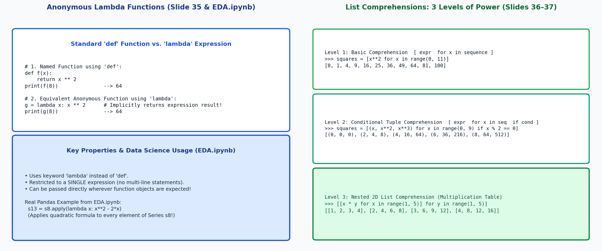
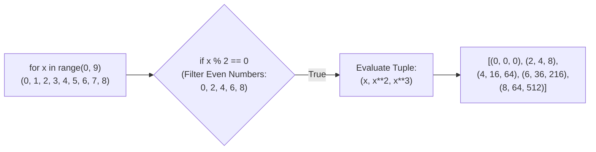

# Lesson 3.5: Anonymous `lambda` Functions & List Comprehensions

**මූලාශ්‍ර දේශන සටහන් (Source Lecture Notes):** `Python 3-2.pdf` (Slides 35–38, Dr. Lochandaka Ranathunga), `f1.ipynb` (Cells 2, 28–29) & `EDA.ipynb`

> [!TIP]
> **📚 Prerequisite / Dependency Lesson Series (පූර්ව අවශ්‍යතා පාඩම් මාලාව):**  
> මෙම පාඩමේදී භාවිතා වන **First-Class Functions**, **Higher-Order Functions (`map`, `filter`, `sorted`)**, **Iterables vs. Iterators (`__iter__`, `__next__`)**, සහ **Lazy Generator Expressions (`yield`)** පිළිබඳ මූලික දැනුම ඔබට නොමැති නම්, පළමුව අපගේ සම්පූර්ණ Zero-to-Hero Dependency පාඩම් මාලාව කියවන්න:
> - [Dep 02.1: First-Class Functions & Higher-Order Functions (`map`, `filter`, `sorted`)](../dependencies/Dep_02_Functional_Programming_Iterators_and_Generators/01_First_Class_Functions_Higher_Order_Functions_map_filter_sorted.md)
> - [Dep 02.2: Iterables vs. Iterators and the Iterator Protocol (`__iter__` & `__next__`)](../dependencies/Dep_02_Functional_Programming_Iterators_and_Generators/02_Iterables_vs_Iterators_and_the_Iterator_Protocol.md)
> - [Dep 02.3: Generator Functions (`yield`) and Generator Expressions](../dependencies/Dep_02_Functional_Programming_Iterators_and_Generators/03_Generator_Functions_yield_and_Generator_Expressions.md)

---

## හැඳින්වීම (Introduction)

Module 3 හි අවසාන පාඩම වන මෙම ලිපියෙන් අපි Python කේත ඉතාම කෙටි, පැහැදිලි සහ Pythonic ආකාරයට ලිවීමට උපකාරී වන ප්‍රබල මෙවලම් දෙකක් ඉගෙන ගනිමු:
1. **`lambda` Functions — Anonymous Functions (නිර්නාමික ශ්‍රිත - Slide 35):** `def` භාවිතා කර නමක් සහිතව දිගු ශ්‍රිතයක් ලියනවා වෙනුවට, ක්ෂණිකව තනි ප්‍රකාශනයකින් (Single expression) ශ්‍රිතයක් සෑදීම.
2. **List Comprehensions (Slides 36–37):** පේළි 4–5ක `for` loop එකක් සහ `.append()` භාවිතා කරනවා වෙනුවට, තනි පේළියකින් (කොන්දේසි සහ Nested loops ඇතුළුව) අලුත් List එකක් ගොඩනැගීම.



---

## 1. Lambda Functions — Anonymous Functions (නිර්නාමික ශ්‍රිත - Slide 35)

සාමාන්‍යයෙන් අපි ශ්‍රිතයක් සාදන්නේ `def` මූලපදය භාවිතා කර නමක් ලබා දීමෙනි. නමුත් ඉතා කුඩා ගණනය කිරීමක් සඳහා (විශේෂයෙන්ම තවත් ශ්‍රිතයකට Argument එකක් ලෙස යැවීමට) **`lambda`** ශ්‍රිත භාවිතා කළ හැක:

```python
lambda arguments: expression
```

### Lambda Functions හි මූලික ලක්ෂණ 4 (Slide 35):
1. `def` වෙනුවට **`lambda`** යන keyword එක භාවිතා කරයි.
2. **First-Class Function Object** එකක් බලාපොරොත්තු වන ඕනෑම තැනක සෘජුවම යෙදිය හැක (*"Can be used wherever function objects are used"*).
3. **තනි ප්‍රකාශනයකට (Restricted to one expression) පමණක් සීමා වේ:** එනම් ඒ තුළ පේළි කිහිපයක statements හෝ loops ලිවිය නොහැක; එම තනි expression එකෙහි ප්‍රතිඵලය `return` ලිවීමකින් තොරවම ස්වයංක්‍රීයව ආපසු ලබා දෙයි!
4. බොහෝවිට **Functional Programming** මෙවලම් (`map()`, `filter()`, `sorted()`, සහ Pandas හි `.apply()`) සමඟ භාවිතා වේ.

> [!NOTE]
> **🔗 Functional Programming Deep-Dive:** `map()`, `filter()`, සහ `sorted(key=...)` සමඟ `lambda` ක්‍රියා කරන ආකාරය පිළිබඳ සම්පූර්ණ විස්තරය සඳහා [Dep 02.1: First-Class Functions & Higher-Order Functions](../dependencies/Dep_02_Functional_Programming_Iterators_and_Generators/01_First_Class_Functions_Higher_Order_Functions_map_filter_sorted.md) කියවන්න.

### දේශන සටහනේ උදාහරණය (Slide 35):
```python
# 1. සාමාන්‍ය def ශ්‍රිතයක් මගින් සංඛ්‍යාවක Square (වර්ගය) සෙවීම:
>>> def f(x):
...     return x**2
...
>>> print(f(8))
64

# 2. එයම lambda ශ්‍රිතයක් මගින් තනි පේළියෙන් ලිවීම:
>>> g = lambda x: x**2
>>> print(g(8))
64
```

### Data Science හි ප්‍රායෝගික භාවිතය (`f1.ipynb` සහ `EDA.ipynb` ඇසුරෙන්):
1. **`f1.ipynb` (Cell 29) — Dictionary Sorting by Value:** රසායනික සංයෝගවල **Molar Mass (මවුලික ස්කන්ධය)** අනුව Dictionary එකක් Sort කිරීමට:
   ```python
   mw = {'CH4': 16.04, 'O2': 32.0, 'CO2': 44.01, 'C8H18': 114.23, 'C6H12': 60.67}
   # Using lambda or mw.get as the key function:
   for species in sorted(mw, key=lambda k: mw[k]):
       print(f" {species:<8s} {mw[species]:>7.2f}")
   ```
2. **`EDA.ipynb` — Pandas `.apply()` Transformation:** Pandas `Series` එකක ඇති සෑම සංඛ්‍යාවකටම $x^2 - 2x$ යන **Quadratic Equation (වර්ගජ සමීකරණය)** යෙදීම සඳහා:
   ```python
   # s8 යනු [1, 2, 3, 4, 5] අඩංගු Pandas Series එකකි
   s13 = s8.apply(lambda x: x**2 - 2*x)
   # Output values: [-1, 0, 3, 8, 15]
   ```

---

## 2. List Comprehensions — තනි පේළියෙන් Lists ගොඩනැගීම (Slides 36–37)

යම් Sequence / Iterable එකක ඇති අගයන් මත ගණිතමය හෝ තාර්කික ක්‍රියාවලියක් සිදු කර අලුත්ම List එකක් සෑදීමට Python ලබා දෙන ඉතාම අලංකාර ක්‍රමය **List Comprehension** වේ.

> [!NOTE]
> **🔗 Iterators & Generators Deep-Dive:** List Comprehension එකක් (`[...]`) සහ මතකය ඉතිරි කරන Generator Expression එකක් (`(...)`) අතර RAM Memory වෙනස ඉගෙනීමට [Dep 02.3: Generator Functions (`yield`) & Generator Expressions](../dependencies/Dep_02_Functional_Programming_Iterators_and_Generators/03_Generator_Functions_yield_and_Generator_Expressions.md) කියවන්න.

### Level 1: Basic Form (Slide 36 & `f1.ipynb` Cell 2)
```python
[expr for x in sequence]
```
මෙහිදී `sequence` එකෙහි ඇති සෑම `x` අගයක් සඳහාම `expr` ගණනය කර අලුත් List එකකට එක් කරයි.

**උදාහරණය (0 සිට 10 දක්වා සංඛ්‍යාවල Squares ලැයිස්තුවක් සෑදීම - Slide 36):**
```python
>>> squares = [x**2 for x in range(0, 11)]
>>> squares
[0, 1, 4, 9, 16, 25, 36, 49, 64, 81, 100]
```
*(අපගේ `f1.ipynb` හි Cell 2 හිදීද `newlist = [x**2 for x in range(0, 6)]` මගින් `[0, 1, 4, 9, 16, 25]` නිර්මාණය කර ඇත).*



### Level 2: List Comprehension with `if` Filtering & Tuples (Slide 37)
මූලික `for` ප්‍රකාශයට පසුව අමතර `for` හෝ `if` ප්‍රකාශ ඕනෑම ගණනක් එක් කළ හැක. පහත උදාහරණයෙන් `0` සිට `8` දක්වා ඇති **Even Numbers (ඉරට්ටේ සංඛ්‍යා - `if x % 2 == 0`) පමණක්** තෝරාගෙන, එක් එක් සංඛ්‍යාව සඳහා `(x, Square (වර්ගය), Cube (ඝනය))` අඩංගු **List of Tuples** එකක් සාදයි:

```python
>>> squares = [(x, x**2, x**3) for x in range(0, 9) if x % 2 == 0]
>>> squares
[(0, 0, 0), (2, 4, 8), (4, 16, 64), (6, 36, 216), (8, 64, 512)]
```

### Level 3: Nested List Comprehension — 2D Matrix Generation (Slide 37)
List Comprehension එකක මුලින්ම ලියන `expr` කොටස ලෙස තවත් List Comprehension එකක් වුවද ලිවිය හැක! එමගින් **2D Matrix (ද්විමාන න්‍යාසයක් / ලැයිස්තු තුළ ලැයිස්තු)** තනි පේළියෙන් සෑදිය හැක:

```python
>>> [[x * y for x in range(1, 5)] for y in range(1, 5)]
[[1, 2, 3, 4], [2, 4, 6, 8], [3, 6, 9, 12], [4, 8, 12, 16]]
```

**මෙය ක්‍රියා කරන ආකාරය (Outer vs. Inner Loop Order):**
* පිටතින් ඇති `for y in range(1, 5)` මගින් `y = 1, 2, 3, 4` යන Rows (පේළි) 4 ජනනය කරයි:
  * `y = 1` වන විට ඇතුළත `[x * 1 for x in range(1, 5)]` $\rightarrow$ `[1, 2, 3, 4]`
  * `y = 2` වන විට ඇතුළත `[x * 2 for x in range(1, 5)]` $\rightarrow$ `[2, 4, 6, 8]`
  * `y = 3` වන විට ඇතුළත `[x * 3 for x in range(1, 5)]` $\rightarrow$ `[3, 6, 9, 12]`
  * `y = 4` වන විට ඇතුළත `[x * 4 for x in range(1, 5)]` $\rightarrow$ `[4, 8, 12, 16]`

*(Gap Analysis Note — Flat Multi-Loop Comprehension vs. Nested Comprehension: ඔබ `[(x, y) for x in [1, 2] for y in ['A', 'B']]` ලෙස එකම කොටු වරහනක් තුළ `for` දෙකක් ලියුවහොත් එයින් **Cartesian Product (කාටිසීය ගුණිතය)** සහිත තනි 1D ලැයිස්තුවක් `[(1, 'A'), (1, 'B'), (2, 'A'), (2, 'B')]` ලැබෙන අතර, `[[... for x ...] for y ...]` ලෙස කොටු වරහන් දෙකක් යෙදූ විට 2D Matrix එකක් ලැබේ! එමෙන්ම Nested Comprehension මගින් **Matrix Transpose (න්‍යාස පෙරළුම)** `[[row[i] for row in matrix] for i in range(cols)]` ලෙස තනි පේළියෙන් ලබා ගත හැක).*

> [!TIP]
> **Data Science හිදී Comprehension භාවිතා වන අවස්ථාවක් (`Visualize.ipynb`):**  
> අපගේ `Visualize.ipynb` Notebook එකෙහි Box Plot එකක් ඇඳීම සඳහා විවිධ **Standard Deviations (සම්මත අපගමනයන් - `std = 1, 2, 3`)** සහිත **Normal Distributions (ප්‍රමත ව්‍යාප්ති)** 3ක් එකවර ජනනය කිරීමට List Comprehension භාවිතා කර ඇත්තේ මෙලෙසිනි:  
> `all_data = [np.random.normal(0, std, size=100) for std in range(1, 4)]`

---

## 🛠️ Practical Task / Hands-On Exercise (ප්‍රායෝගික අභ්‍යාසය)

### Scenario / Goal:
ඔබ Data Analytics කාර්යයක් සඳහා `lambda` functions සහ List Comprehensions (Basic, Conditional, සහ Nested 2D Matrix) භාවිතා කරමින් දත්ත පිරිසිදු කිරීමේ සහ න්‍යාස ගණනය කිරීමේ කේත කිහිපයක් තනි පේළියෙන් (One-liners ලෙස) ලිවිය යුතුය.

### Step-by-Step Tasks:
1. **Task 1 (`lambda` + `sorted`):** `chem_data = [('CO2', 44.01), ('CH4', 16.04), ('C8H18', 114.23), ('O2', 32.0)]` යන Tuple ලැයිස්තුව එහි දෙවන අගය වන **Molar Mass (මවුලික ස්කන්ධය)** අනුව කුඩාම අගයේ සිට වැඩිම අගයට `sorted()` සහ `lambda` භාවිතා කර පෙළගස්වන්න.
2. **Task 2 (Conditional List Comprehension):** `range(1, 16)` හි ඇති `3` න් ඉතිරි නැතිව බෙදෙන (`x % 3 == 0`) සංඛ්‍යා පමණක් තෝරාගෙන, `(x, x**2, x**3)` Tuples ලැයිස්තුවක් තනි List Comprehension එකකින් සාදන්න.
3. **Task 3 (Nested List Comprehension — Matrix Transpose):** `matrix = [[1, 2, 3], [4, 5, 6], [7, 8, 9]]` නමැති $3 \times 3$ න්‍යාසයේ **Matrix Transpose (න්‍යාස පෙරළුම)** (එනම් පේළි තීරු බවට හැරවීම: `[[1, 4, 7], [2, 5, 8], [3, 6, 9]]`) Nested List Comprehension එකකින් ගොඩනගන්න.

### Starter Code:
```python
chem_data = [('CO2', 44.01), ('CH4', 16.04), ('C8H18', 114.23), ('O2', 32.0)]
matrix = [[1, 2, 3], [4, 5, 6], [7, 8, 9]]

# TODO Task 1: Sort chem_data by molar mass using lambda
sorted_chem = None

# TODO Task 2: List of (x, x^2, x^3) for multiples of 3 in range(1, 16)
multiples_of_3_powers = None

# TODO Task 3: Transpose 'matrix' using a nested list comprehension
transposed_matrix = None
```

### Expected Output / Reference Solution:
```python
chem_data = [('CO2', 44.01), ('CH4', 16.04), ('C8H18', 114.23), ('O2', 32.0)]
matrix = [[1, 2, 3], [4, 5, 6], [7, 8, 9]]

# Task 1: Sort tuples by second element (Molar Mass) using lambda
sorted_chem = sorted(chem_data, key=lambda item: item[1])
print("1. Sorted by Molar Mass:", sorted_chem)

# Task 2: Conditional List Comprehension for multiples of 3
multiples_of_3_powers = [(x, x**2, x**3) for x in range(1, 16) if x % 3 == 0]
print("2. Multiples of 3 Powers:", multiples_of_3_powers)

# Task 3: Nested List Comprehension for Matrix Transpose
transposed_matrix = [[row[col_idx] for row in matrix] for col_idx in range(3)]
print("3. Transposed Matrix   :", transposed_matrix)
```

**Expected Output:**
```text
1. Sorted by Molar Mass: [('CH4', 16.04), ('O2', 32.0), ('CO2', 44.01), ('C8H18', 114.23)]
2. Multiples of 3 Powers: [(3, 9, 27), (6, 36, 216), (9, 81, 729), (12, 144, 1728), (15, 225, 3375)]
3. Transposed Matrix   : [[1, 4, 7], [2, 5, 8], [3, 6, 9]]
```

---

## 📝 Summary & Exam Revision Cheat Sheet

| Construct | Syntax Pattern | Equivalent Traditional Code / Meaning |
| :--- | :--- | :--- |
| **Anonymous Function (`lambda`)** | `g = lambda x: x ** 2` | `def g(x): return x ** 2` (Single expression, implicit return) |
| **Basic List Comprehension** | `[x**2 for x in range(11)]` | Loops `x` from `0..10` and appends `x**2` into a new list |
| **Conditional List Comprehension** | `[(x, x**2, x**3) for x in range(9) if x % 2 == 0]` | Filters only even `x` values and builds a list of 3-element tuples |
| **Nested List Comprehension (2D)** | `[[x * y for x in range(1, 5)] for y in range(1, 5)]` | Outer loop `y` builds rows; inner loop `x` builds columns inside each row |
| **Generator Expression (Lazy)** | `(x**2 for x in range(10_000_000))` | Yields items one-by-one on demand using $O(1)$ memory |

---

🎉 **Module 3 සම්පූර්ණයි!**  
දැන් ඔබ `Python 3-2.pdf` සහ `f1.ipynb` හි ඇති සියලුම මධ්‍යම මට්ටමේ Python සංකල්ප (Modules, `sys.path`, Default Arguments, Mutable Default Pitfall, `*args`/`**kwargs`, `lambda`, List Comprehensions, Namespaces/LEGB සහ Iterators/Generators) සම්පූර්ණයෙන්ම ප්‍රගුණ කර ඇත.

**ඊළඟ මොඩියුලය (Next Module):** `Module_04_Mathematics_and_Statistics_for_Data_Science` — `(L) Introduction to Maths and Statistics-converted.pdf` සහ `Maths&stat.ipynb` ඇසුරෙන් Linear Algebra (Vectors, Matrices), Descriptive & Inferential Statistics, `NumPy` සහ `SciPy` ප්‍රායෝගිකව ඉගෙන ගනිමු!
