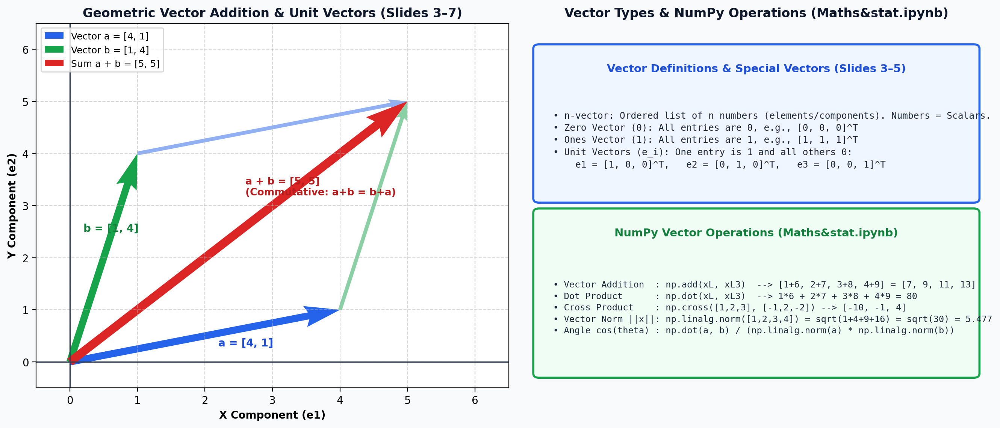
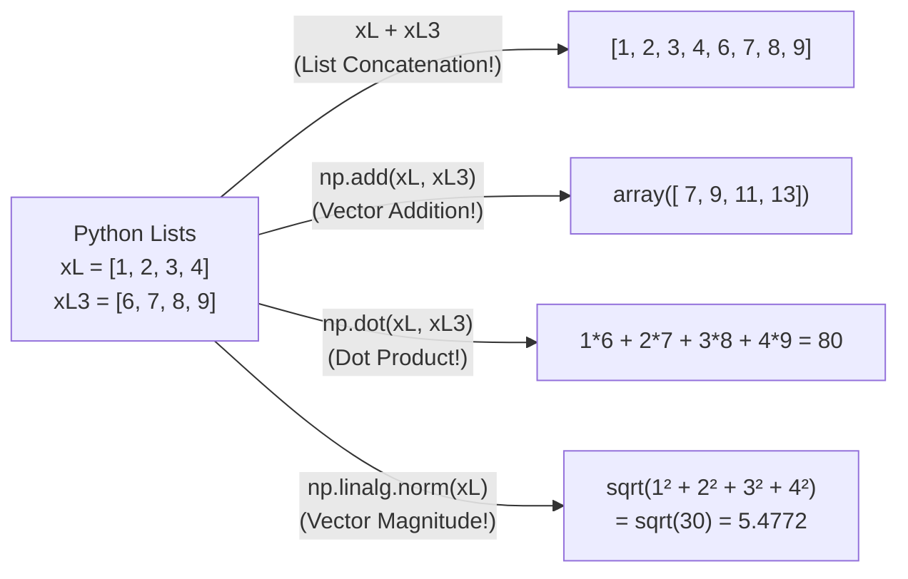

# පාඩම 4.1: මූලික රේඛීය වීජ ගණිතය — දෛශික (Vectors) සහ NumPy දෛශික ක්‍රියාවලි (Linear Algebra Revision — Vectors & Vector Operations)

**මූලාශ්‍ර දේශන සටහන් (Source Lecture Notes):** `(L) Introduction to Maths and Statistics-converted.pdf` (Slides 1–7) & `Maths&stat.ipynb`

---

> [!TIP]
> **📚 Prerequisite / Dependency Lesson Series:**  
> මෙම පාඩමේදී සාකච්ඡා කෙරෙන Vectors, Geometric Norms, Dot Product, Cross Product සහ NumPy Linear Algebra පිළිබඳ ගැඹුරු අවබෝධයක් ලබාගැනීමට:
> - [Dep 01: NumPy Zero-to-Hero (Array Architecture & Slicing)](../dependencies/Dep_01_NumPy_Zero_to_Hero/01_What_is_NumPy_and_ndarrays_Memory_Architecture.md)
> - [Dep 03.1: Geometric Intuition of Vectors, Norm, Dot and Cross Product](../dependencies/Dep_03_Vectors_and_Matrices_Intuition/01_Geometric_Intuition_of_Vectors_Norm_Dot_and_Cross_Product.md)
> - [Dep 01.4: NumPy Linear Algebra (`np.linalg`) and Aggregations](../dependencies/Dep_01_NumPy_Zero_to_Hero/04_NumPy_Linear_Algebra_linalg_and_Statistical_Aggregations.md)

---

## හැඳින්වීම (Introduction)

Module 4 වෙත ඔබව සාදරයෙන් පිළිගනිමු! Data Science සහ Machine Learning ඇල්ගොරිදම ගොඩනැගී ඇති ප්‍රධානතම කුළුණු දෙක වන්නේ **Linear Algebra (රේඛීය වීජ ගණිතය)** සහ **Statistics (සංඛ්‍යානය)** යි. දත්ත කට්ටලයක ඇති එක් පේළියක් (උදා: එක් නිවසක වර්ග ප්‍රමාණය, කාමර ගණන, වයස සහ මිල) ගණිතමය වශයෙන් පරිගණකය තුළ නිරූපණය කරන්නේ **Vector (දෛශිකයක්)** ලෙසිනි!

මෙම පාඩමෙන් අපි:
1. **Vector එකක් සහ Scalar එකක් යනු කුමක්ද** (Slides 3–4),
2. **විශේෂ දෛශික වර්ග 3 (Zero Vector, Ones Vector, Unit Vector)** (Slide 5),
3. **දෛශික එකතු කිරීම සහ එහි ගණිතමය ගුණාංග** (Slides 6–7), සහ
4. **`Maths&stat.ipynb` හි `NumPy` භාවිතා කර සිදු කරන ප්‍රායෝගික ගණනය කිරීම්** (ත්‍රිකෝණමිතික නියතයන්, Vector Addition, Dot Product, Cross Product, Vector Norm/Magnitude සහ දෛශික දෙකක් අතර කෝණය සෙවීම) පියවරෙන් පියවර ඉගෙන ගනිමු.



---

## 1. Vector (දෛශිකයක්) සහ Scalar (අදිශයක්) යනු කුමක්ද? (Slides 3–4)

* **Vector (දෛශිකයක්):** නිශ්චිත අනුපිළිවෙළකට පෙළගැස්වූ සංඛ්‍යා ලැයිස්තුවක් (**An ordered list of numbers**) දෛශිකයක් ලෙස හැඳින්වේ. එය සිරස් තීරුවක් (Column vector) හෝ තිරස් පේළියක් (Row vector) ලෙස ලිවිය හැක:
  $$x = \begin{bmatrix} -1.1 \\ 0.0 \\ 3.6 \\ -7.2 \end{bmatrix} \quad \text{හෝ} \quad x = (-1.1, \; 0.0, \; 3.6, \; -7.2)$$
* **Elements / Entries / Coefficients / Components:** දෛශිකය තුළ ඇති එක් එක් සංඛ්‍යාව එහි අවයව (Elements හෝ Components) ලෙස හැඳින්වේ.
* **Size / Dimension / Length:** දෛශිකය තුළ ඇති මුළු සංඛ්‍යා ගණන එහි විශාලත්වය හෙවත් මානය (**Dimension**) වේ.
  * ඉහත උදාහරණයේ දෛශිකයේ මානය (Dimension) **4** කි; එහි තුන්වන අගය (Third entry) `3.6` වේ.
  * අවයව $n$ ගණනක් ඇති දෛශිකයක් **$n$-vector** එකක් ලෙස හැඳින්වේ.
* **Scalar (අදිශයක්):** දෛශිකයක් නොවන තනි සංඛ්‍යාවක් (උදා: `5`, `-3.2`, $\pi$) **Scalar** එකක් ලෙස හැඳින්වේ.

---

## 2. විශේෂ දෛශික වර්ග 3 (Types of Vectors - Slide 5)

දේශන සටහනේ 5 වන Slide එකෙහි Data Science හි නිතරම හමුවන විශේෂ දෛශික වර්ග 3ක් හඳුන්වා දෙයි:

| දෛශික වර්ගය (Vector Type) | අර්ථ දැක්වීම (Definition) | දිග 3ක් වූ උදාහරණය ($n=3$) | `NumPy` මගින් සාදන ආකාරය |
| :--- | :--- | :--- | :--- |
| **1. Zero Vector (ශූන්‍ය දෛශිකය)** | සියලුම අවයව `0` වූ $n$-vector එකකි ($\mathbf{0}$). | $$\begin{bmatrix} 0 \\ 0 \\ 0 \end{bmatrix}$$ | `np.zeros(3)` |
| **2. Ones Vector (ඒකක අගයන්ගේ දෛශිකය)** | සියලුම අවයව `1` වූ $n$-vector එකකි ($\mathbf{1}$). | $$\begin{bmatrix} 1 \\ 1 \\ 1 \end{bmatrix}$$ | `np.ones(3)` |
| **3. Unit Vector (ඒකක දෛශිකය)** | **එකම එක අවයවයක් පමණක් `1` වී, අනෙක් සියලුම අවයව `0` වූ** දෛශිකයකි ($e_i$). | $$e_1 = \begin{bmatrix} 1 \\ 0 \\ 0 \end{bmatrix}, \; e_2 = \begin{bmatrix} 0 \\ 1 \\ 0 \end{bmatrix}, \; e_3 = \begin{bmatrix} 0 \\ 0 \\ 1 \end{bmatrix}$$ | `np.eye(3)[0]` |

---

## 3. දෛශික එකතු කිරීම සහ එහි ගුණාංග (Vector Addition & Properties - Slides 6–7)

**Vector Addition (දෛශික එකතු කිරීම):** එකම මානයක් (Same dimension $n$) සහිත දෛශික දෙකක් එකතු කිරීමේදී ඒවායේ **අනුරූප අවයව (Corresponding elements)** එකිනෙකට එකතු කරනු ලැබේ:

$$\begin{bmatrix} 0 \\ 7 \\ 3 \end{bmatrix} + \begin{bmatrix} 1 \\ 2 \\ 0 \end{bmatrix} = \begin{bmatrix} 0+1 \\ 7+2 \\ 3+0 \end{bmatrix} = \begin{bmatrix} 1 \\ 9 \\ 3 \end{bmatrix}$$

### දෛශික එකතු කිරීමේ ගණිතමය ගුණාංග (Properties of Vector Addition - Slide 7):
ඕනෑම එකම මානයේ $u, v, w$ දෛශික සඳහා:
1. **න්‍යායාත්මකව මාරු කිරීමේ හැකියාව (Commutative Property):** $u + v = v + u$
2. **සංඝටන න්‍යාය (Associative Property):** $(u + v) + w = u + (v + w)$
3. **ශූන්‍ය දෛශිකය එකතු කිරීම (Additive Identity):** $u + \mathbf{0} = \mathbf{0} + u = u$
4. **ප්‍රතිලෝම දෛශිකය (Additive Inverse):** $u + (-u) = \mathbf{0}$

---

## 4. `Maths&stat.ipynb` ප්‍රායෝගික අභ්‍යාස: `NumPy` සමඟ ගණිතමය හා දෛශික ගණනය කිරීම්

අපගේ ෆෝල්ඩරයේ ඇති `Maths&stat.ipynb` Notebook එකෙහි `NumPy` භාවිතා කරමින් ඉහත දෛශික සංකල්ප ප්‍රායෝගිකව ක්‍රියාත්මක කර ඇති ආකාරය පියවරෙන් පියවර බලමු:



### 1. ගණිතමය නියතයන් ($\pi$, $e$) සහ ත්‍රිකෝණමිතිය (Trigonometry in `NumPy`):
`NumPy` හි `np.sin()` සහ `np.cos()` වලට කෝණය ලබා දිය යුත්තේ **රේඩියනවලින් (Radians)** ය. රේඩියන අංශක (Degrees) බවට හැරවීමට $\text{Degrees} = \frac{\text{Angle in Radians}}{\pi} \times 180$ සූත්‍රය භාවිතා වේ:

```python
import numpy as np

print(np.pi)        # 3.141592653589793 (පයි නියතය)
print(np.e)         # 2.718281828459045 (ස්වභාවික ලඝුගණක පාදය e)

# රේඩියන pi/6 (අංශක 30) අංශකවලට හැරවීම සහ sin/cos සෙවීම:
angle = np.pi / 6
degree_angle = (angle / np.pi) * 180
print(degree_angle)     # 30.0
print(np.sin(angle))    # 0.49999999999999994 (0.5)
print(np.cos(angle))    # 0.8660254037844387  (sqrt(3)/2)
```

### 2. සාමාන්‍ය Python List `+` සහ `NumPy` Vector Addition අතර වෙනස!
* සාමාන්‍ය Python Lists දෙකක් `+` ලකුණෙන් එකතු කළ විට සිදුවන්නේ Lists දෙක **ඈඳීමයි (Concatenation)**.
* දෛශික එකතු කිරීමක් (Element-wise Vector Addition) සිදු කිරීමට **`np.add()`** හෝ NumPy arrays භාවිතා කළ යුතුය:

```python
xL = [1, 2, 3, 4]
xL3 = [6, 7, 8, 9]

# 1. සාමාන්‍ය Python List + (Concatenation):
print(xL + xL3)             # [1, 2, 3, 4, 6, 7, 8, 9]

# 2. NumPy මගින් දෛශිකයක අවයවවල එකතුව (Sum of elements):
sum1 = np.sum(xL)
print(sum1)                 # 1 + 2 + 3 + 4 = 10

# 3. NumPy මගින් දෛශික දෙකක් එකතු කිරීම (Vector Addition):
xLa = np.add(xL, xL3)
print(xLa)                  # array([ 7,  9, 11, 13])
```

### 3. තිත් ගුණිතය (Dot Product) සහ කතිර ගුණිතය (Cross Product):
* **Dot Product ($\mathbf{a} \cdot \mathbf{b} = \sum a_i b_i$):** අනුරූප අවයව ගුණ කර ඒවායේ එකතුව ලබා දෙයි (ප්‍රතිඵලය තනි සංඛ්‍යාවකි / Scalar එකකි).
* **Cross Product ($\mathbf{a} \times \mathbf{b}$):** ත්‍රිමාණ (3D) දෛශික දෙකකට ලම්බක වූ නව ත්‍රිමාණ දෛශිකයක් ලබා දෙයි.

```python
# Dot Product: (1*6) + (2*7) + (3*8) + (4*9) = 6 + 14 + 24 + 36 = 80
print(np.dot(xL, xL3))      # 80

# Cross Product of two 3D vectors:
a1 = np.array([1, 2, 3])
a2 = np.array([-1, 2, -2])
print(np.cross(a1, a2))     # array([-10,  -1,   4])
```

### 4. දෛශිකයක විශාලත්වය (Magnitude / Norm $\|\mathbf{x}\|$) සහ දෛශික දෙකක් අතර කෝණය ($\theta$):
* දෛශිකයක දිග හෙවත් විශාලත්වය (**Euclidean Norm**) යනු එහි අවයවවල වර්ගවල එකතුවේ වර්ගමූලයයි:
  $$\|\mathbf{x}\| = \sqrt{x_1^2 + x_2^2 + \dots + x_n^2}$$
* දෛශික දෙකක් ($\mathbf{a}$ සහ $\mathbf{b}$) අතර කෝණය $\theta$ නම්:
  $$\cos\theta = \frac{\mathbf{a} \cdot \mathbf{b}}{\|\mathbf{a}\| \, \|\mathbf{b}\|}$$

```python
# 1. xL = [1, 2, 3, 4] හි විශාලත්වය (Magnitude / Norm):
# sqrt(1^2 + 2^2 + 3^2 + 4^2) = sqrt(1 + 4 + 9 + 16) = sqrt(30) = 5.477225575
print(np.linalg.norm(xL))   # 5.477225575051661
print(np.sqrt(30))          # 5.477225575051661

# 2. xL = [1, 2, 3, 4] සහ Unit vector e3 = [0, 0, 1, 0] අතර කෝණය සෙවීම:
unit_vec = [0, 0, 1, 0]
cos_theta = np.dot(xL, unit_vec) / (np.linalg.norm(xL) * np.linalg.norm(unit_vec))
print(cos_theta)            # 0.5477225575051661 (රේඩියනවලින් cos අගය)

# arccos මගින් කෝණය රේඩියනවලින් ලබාගෙන අංශකවලට හැරවීම:
angle_deg = (np.arccos(cos_theta) / np.pi) * 180
print(angle_deg)            # 56.78908923910091 degrees
```

---

**ඊළඟ පාඩම (Next Lesson):** [Lesson 4.2: Matrices, Determinants, Transpose & Matrix Terminology](Lesson_4.2_Matrices_Determinants_Transpose_and_Terminology.md) — න්‍යාස (Matrices), නිශ්චායක (Determinants), පෙරළුම් න්‍යාස (Transpose), විශේෂ න්‍යාස වර්ග සහ `NumPy` 2D Matrix ක්‍රියාවලි ගැඹුරින් ඉගෙන ගනිමු.

---

## 🛠️ Practical Task / Hands-On Exercise (ප්‍රායෝගික අභ්‍යාසය)

### Scenario:
Machine Learning Cosine Similarity Model එකක් භාවිතයෙන් Document Vectors දෙකක සමානතාව (Text Similarity) සහ 3D Physics Force Vector එකක Magnitude & Direction NumPy මඟින් ගණනය කිරීම.

### Step-by-Step Tasks:
1. **Task 1 (Vector Creation & Properties):** $u = [3, 4]$ සහ $v = [1, 2]$ ලෙස 2D Vectors දෙකක් NumPy Arrays ලෙස නිර්මාණය කර Magnitude ($L_2$ Norm) ගණනය කරන්න.
2. **Task 2 (Dot Product & Cosine Similarity):** `np.dot(u, v)` භාවිතයෙන් Dot Product එක සහ ඒ මඟින් දෛශික දෙක අතර කෝණය $	heta = rccos\left(rac{u \cdot v}{\|u\| \|v\|}
ight)$ ගණනය කරන්න.
3. **Task 3 (3D Cross Product):** ත්‍රිමාන අවකාශයේ $a = [1, 0, 0]$ සහ $b = [0, 1, 0]$ දෛශික දෙකට ලම්බක Unit Normal Vector එක `np.cross()` මඟින් සොයා තහවුරු කරන්න.

### Reference Solution (පියවරෙන් පියවර විසඳුම):
```python
import numpy as np

# Task 1: Vector Creation & Norm
u = np.array([3, 4], dtype=float)
v = np.array([1, 2], dtype=float)

norm_u = np.linalg.norm(u)
norm_v = np.linalg.norm(v)
print(f"Norm of u: {norm_u:.4f}, Norm of v: {norm_v:.4f}")

# Task 2: Dot Product and Cosine Similarity
dot_prod = np.dot(u, v)
cos_theta = dot_prod / (norm_u * norm_v)
angle_rad = np.arccos(np.clip(cos_theta, -1.0, 1.0))
angle_deg = np.degrees(angle_rad)

print(f"Dot Product (u . v): {dot_prod}")
print(f"Cosine Similarity  : {cos_theta:.4f}")
print(f"Angle between u & v: {angle_deg:.2f} degrees")

# Task 3: 3D Cross Product
a = np.array([1, 0, 0])
b = np.array([0, 1, 0])
cross_prod = np.cross(a, b)
print(f"Cross Product of (i x j): {cross_prod} (Matches z-axis unit vector k)")
```

---
