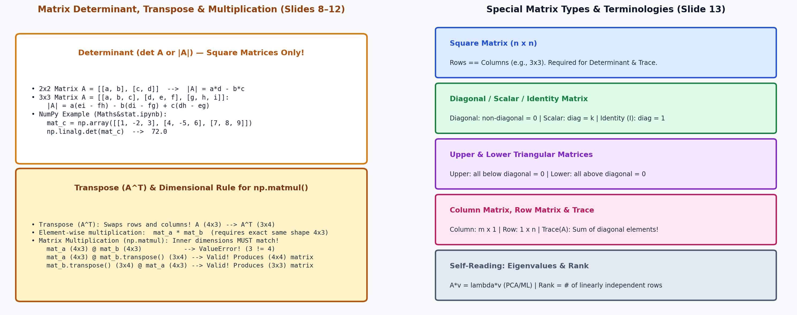
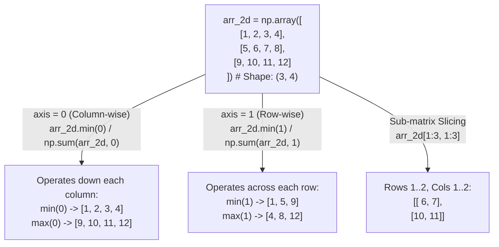

# පාඩම 4.2: න්‍යාස (Matrices), නිශ්චායක (Determinants), Transpose සහ NumPy 2D Matrix ක්‍රියාවලි (Matrices, Determinants, Transpose & Matrix Terminology)

**මූලාශ්‍ර දේශන සටහන් (Source Lecture Notes):** `(L) Introduction to Maths and Statistics-converted.pdf` (Slides 8–16) & `Maths&stat.ipynb`

---

> [!TIP]
> **📚 Prerequisite / Dependency Lesson Series:**  
> Matrix Transformations, Determinants as Area/Volume Scaling, Transpose සහ Matrix Rank පිළිබඳ පූර්ණ දැනුම ලබාගැනීමට:
> - [Dep 03.2: Matrices as Linear Transformations and Determinant Area](../dependencies/Dep_03_Vectors_and_Matrices_Intuition/02_Matrices_as_Linear_Transformations_and_Determinant_Area.md)
> - [Dep 03.3: Eigenvalues, Eigenvectors and Matrix Rank From Scratch](../dependencies/Dep_03_Vectors_and_Matrices_Intuition/03_Eigenvalues_Eigenvectors_and_Matrix_Rank_From_Scratch.md)
> - [Dep 01.4: NumPy Linear Algebra (`np.linalg`)](../dependencies/Dep_01_NumPy_Zero_to_Hero/04_NumPy_Linear_Algebra_linalg_and_Statistical_Aggregations.md)

---

## හැඳින්වීම (Introduction)

එක් පේළියක දත්ත දෛශිකයක් (Vector) ලෙස නිරූපණය කරන්නේ නම්, පේළි (Rows) සහ තීරු (Columns) රාශියකින් සමන්විත සම්පූර්ණ දත්ත වගුවක් හෝ ඡායාරූපයක පික්සල් අගයන් ගණිතමය වශයෙන් නිරූපණය කරන්නේ **Matrix (න්‍යාසයක්)** ලෙසිනි!

මෙම පාඩමෙන් අපි:
1. **න්‍යාසයක් (Matrix) සහ එහි ගණය (Order of a matrix) යනු කුමක්ද** (Slides 8–9, 13),
2. **$2 \times 2$ සහ $3 \times 3$ න්‍යාසවල නිශ්චායකය (Matrix Determinant) ගණනය කරන ආකාරය** (Slide 10),
3. **Matrix Transpose ($A^T$), එකතු කිරීම, අඩු කිරීම, Scalar ගුණ කිරීම සහ න්‍යාස ගුණ කිරීම (`np.matmul`)** (Slides 11–12 & `Maths&stat.ipynb`),
4. **අනිවාර්යයෙන්ම දැනගත යුතු න්‍යාස වර්ග 10 සහ Self-Reading මාතෘකා (Eigenvalues, Eigenvectors, Rank)** (Slides 13–14), සහ
5. **`Maths&stat.ipynb` හි 2D Matrix Indexing, Slicing, Row/Column Aggregations සහ `.npy`/`.txt` ගොනු ලෙස සුරැකීම** සවිස්තරාත්මකව ඉගෙන ගනිමු.



---

## 1. න්‍යාසයක් (Matrix) සහ එහි ගණය (Order of a Matrix - Slides 8–9, 13)

* **Matrix (න්‍යාසයක්):** පේළි (Rows) සහ තීරු (Columns) ලෙස සෘජුකෝණාස්‍රාකාරව සකස් කරන ලද සංඛ්‍යා අරාවක් (Rectangular array of numbers) න්‍යාසයක් ලෙස හැඳින්වේ.
* **Order / Size of a Matrix (න්‍යාසයේ ගණය):** න්‍යාසයක පේළි (Rows) $m$ ගණනක් සහ තීරු (Columns) $n$ ගණනක් තිබේ නම්, එහි ගණය **$m \times n$ ($\text{row} \times \text{column}$)** ලෙස ලියනු ලැබේ.
  * *උදාහරණය (Slide 13):* න්‍යාසයක පේළි 3ක් සහ තීරු 4ක් ඇත්නම් එහි ගණය **$3 \times 4$** වේ.

---

## 2. න්‍යාසයක නිශ්චායකය (Matrix Determinant - Slide 10)

* **අර්ථ දැක්වීම:** සමචතුරස්‍ර න්‍යාසයක (Square matrix - එනම් පේළි ගණන සහ තීරු ගණන සමාන වූ $n \times n$ න්‍යාසයක) අවයව භාවිතා කර නිශ්චිත ගණිතමය ක්‍රියාවලියකින් ලබා ගන්නා, එම න්‍යාසයට ආවේණික වූ **තනි සංඛ්‍යාවක් (Scalar)** එහි **නිශ්චායකය (Determinant)** ලෙස හැඳින්වේ.
* එය **$\det A$** හෝ **$|A|$** ලෙස සංකේතවත් කෙරේ. *(වැදගත්: නිශ්චායක අර්ථ දක්වා ඇත්තේ **Square matrices සඳහා පමණි!**)*.

### 1. $2 \times 2$ න්‍යාසයක නිශ්චායකය:
$$A = \begin{bmatrix} a & b \\ c & d \end{bmatrix} \implies |A| = ad - bc$$

### 2. $3 \times 3$ න්‍යාසයක නිශ්චායකය (Slide 10):
$$A = \begin{bmatrix} a & b & c \\ d & e & f \\ g & h & i \end{bmatrix} \implies |A| = a(ei - fh) - b(di - fg) + c(dh - eg)$$

### `Maths&stat.ipynb` හි `np.linalg.det()` මගින් නිශ්චායකය සෙවීම:
```python
import numpy as np

mat_c = np.array([
    [1, -2, 3],
    [4, -5, 6],
    [7,  8, 9]
])

# අතින් ගණනය කළ විට: 1(-45 - 48) - (-2)(36 - 42) + 3(32 - (-35)) = -93 - 12 + 201 = 72
print(np.linalg.det(mat_c))     # Output: 72.00000000000003 (72.0)
```

---

## 3. Matrix Transpose ($A^T$) සහ මූලික න්‍යාස ක්‍රියාවලි (Slides 11–12 & `Maths&stat.ipynb`)

### 1. Matrix Transpose (පෙරළුම් න්‍යාසය - Slide 11):
න්‍යාසයක පේළි (Rows) තීරු (Columns) බවටත්, තීරු පේළි බවටත් හුවමාරු කිරීමෙන් ලැබෙන න්‍යාසය එහි **Transpose ($A^T$)** ලෙස හැඳින්වේ. $A$ හි ගණය $4 \times 3$ නම්, $A^T$ හි ගණය $3 \times 4$ වේ.

### 2. එකතු කිරීම, අඩු කිරීම, Scalar ගුණ කිරීම සහ න්‍යාස ගුණ කිරීම (`Maths&stat.ipynb`):
```python
# 4 x 3 න්‍යාස දෙකක් නිර්මාණය කිරීම:
mat_a = np.array([[0, 0, 0], [10, 10, 10], [20, 20, 20], [30, 30, 30]])
mat_b = np.array([[0, 1, 2], [3, 4, 5], [6, 7, 8], [9, 10, 11]])

print(mat_a.shape)              # (4, 3) -> පේළි 4, තීරු 3
print(mat_a.size)               # 12     -> මුළු අවයව ගණන (4 * 3)
print(mat_a[2, 1])              # 20     -> 2 වන පේළියේ 1 වන තීරුවේ අගය (0-indexed)

# 1. න්‍යාස එකතු කිරීම (Matrix Addition - එකම shape එක තිබිය යුතුය):
print(mat_a + mat_b)            # හෝ np.add(mat_a, mat_b)

# 2. Scalar එකතු කිරීම සහ ගුණ කිරීම (සෑම අවයවයකටම බලපායි):
print(mat_a + 5)
print(mat_a * 5)

# 3. Element-wise ගුණ කිරීම (අනුරූප අවයව ගුණ වීම):
print(mat_a * mat_b)

# 4. සැබෑ න්‍යාස ගුණ කිරීම (Matrix Multiplication - np.matmul):
# නීතිය: පළමු න්‍යාසයේ තීරු ගණන = දෙවන න්‍යාසයේ පේළි ගණන විය යුතුය!
# mat_a (4x3) සහ mat_b (4x3) කෙලින්ම np.matmul කළ නොහැක! එබැවින් mat_b Transpose (3x4) කරමු:
res_4x4 = np.matmul(mat_a, mat_b.transpose())   # (4x3) @ (3x4) -> (4x4) න්‍යාසයක් ලැබේ!
res_3x3 = np.matmul(mat_b.transpose(), mat_a)   # (3x4) @ (4x3) -> (3x3) න්‍යාසයක් ලැබේ!
```

---

## 4. න්‍යාස පාරිභාෂික ශබ්දකෝෂය (Matrix Terminologies - Slide 13)

දේශන සටහනේ 13 වන Slide එකෙහි දක්වා ඇති අනිවාර්යයෙන්ම දැනගත යුතු නිර්වචන 10 පහත වගුවේ සාරාංශ කර ඇත:

| පදය (Terminology) | නිර්වචනය (Definition) සහ උදාහරණය |
| :--- | :--- |
| **1. Order of matrix** | පේළි ගණන $\times$ තීරු ගණන ($\text{row} \times \text{column}$). පේළි 3ක් සහ තීරු 4ක් ඇත්නම් ගණය $3 \times 4$ වේ. |
| **2. Square matrix** | පේළි ගණන සහ තීරු ගණන සමාන වූ න්‍යාසයකි ($n \times n$, උදා: $3 \times 3$). |
| **3. Diagonal matrix (විකර්ණ න්‍යාසය)** | ප්‍රධාන විකර්ණයෙන් (Main diagonal) පිටත ඇති සියලුම අවයව `0` වූ සමචතුරස්‍ර න්‍යාසයකි: $\begin{bmatrix} 4 & 0 \\ 0 & 9 \end{bmatrix}$. |
| **4. Upper triangular matrix** | ප්‍රධාන විකර්ණයට **පහළින්** ඇති සියලුම අවයව `0` වූ සමචතුරස්‍ර න්‍යාසයකි. |
| **5. Lower triangular matrix** | ප්‍රධාන විකර්ණයට **ඉහළින්** ඇති සියලුම අවයව `0` වූ සමචතුරස්‍ර න්‍යාසයකි. |
| **6. Scalar matrix** | ප්‍රධාන විකර්ණයේ ඇති සියලුම අවයව එකම නියත අගයකට ($k$) සමාන වූ Diagonal න්‍යාසයකි: $\begin{bmatrix} 5 & 0 \\ 0 & 5 \end{bmatrix}$. |
| **7. Identity matrix ($I$ - ඒකක න්‍යාසය)** | ප්‍රධාන විකර්ණයේ සියලුම අවයව **`1`** වූ සහ අනෙක් සියලුම අවයව **`0`** වූ සමචතුරස්‍ර න්‍යාසයකි (`np.eye(n)`). |
| **8. Column matrix** | එකම එක තීරුවක් ($m \times 1$) පමණක් ඇති න්‍යාසයකි (බොහෝවිට දෛශිකයක් නිරූපණය කිරීමට භාවිතා වේ). |
| **9. Row matrix** | එකම එක පේළියක් ($1 \times n$) පමණක් ඇති න්‍යාසයකි. |
| **10. Trace ($\text{Tr}(A)$)** | සමචතුරස්‍ර න්‍යාසයක **ප්‍රධාන විකර්ණයේ ඇති සියලුම අවයවවල එකතුවයි** (`np.trace(A)`). |

### Self-Reading මාතෘකා (Slide 14):
1. **Eigenvalues ($\lambda$) සහ Eigenvectors ($\mathbf{v}$):** $A\mathbf{v} = \lambda\mathbf{v}$ සමීකරණය තෘප්ත කරන දෛශික සහ අදිශ අගයන් වේ. Data Science හි මානයන් අඩු කිරීමේ (**PCA - Principal Component Analysis**) ඇල්ගොරිදමයේ පදනම මෙයයි!
2. **Rank of a Matrix:** න්‍යාසයක ඇති එකිනෙකට ස්වායත්ත (Linearly independent) පේළි හෝ තීරු ගණන එහි Rank එක වේ (`np.linalg.matrix_rank(A)`). දත්ත කට්ටලයක තීරු දෙකක් එකම තොරතුර අනුපිටපත් කරන්නේද (Multicollinearity) යන්න හඳුනා ගැනීමට මෙය භාවිතා වේ.

---

## 5. `Maths&stat.ipynb` හි 2D Array Slicing, Axis Aggregations සහ File I/O

`Maths&stat.ipynb` Notebook එකෙහි 2D Matrix එකක පේළි සහ තීරු ඔස්සේ ගණනය කිරීම් (`axis=0` vs `axis=1`), උප-න්‍යාස (Sub-matrices) තෝරා ගැනීම සහ ගොනු ලෙස සුරැකීම පහත පරිදි සිදු කර ඇත:



```python
arr_2d = np.array([[1, 2, 3, 4], [5, 6, 7, 8], [9, 10, 11, 12]])

# 1. Axis අනුව Min, Max, Sum, Mean, Prod සෙවීම:
# axis = 0 යනු තීරු ඔස්සේ (Column-wise), axis = 1 යනු පේළි ඔස්සේ (Row-wise):
print(arr_2d.min(0))                    # array([1, 2, 3, 4])  - එක් එක් තීරුවේ කුඩාම අගය
print(arr_2d.max(1))                    # array([ 4,  8, 12])  - එක් එක් පේළියේ විශාලම අගය
print(np.where(arr_2d == arr_2d.max())) # (array([2]), array([3])) - උපරිම අගය (12) පිහිටි (row, col)

# 2. තීරුවක් සහ උප-න්‍යාසයක් (Sub-matrix) කපා ගැනීම (Slicing):
col_2 = arr_2d[:, 1]                    # array([ 2,  6, 10])  - සියලුම පේළිවල 1 වන තීරුව
sub_mat = arr_2d[1:3, 1:3]              # array([[ 6,  7], [10, 11]])

# 3. NumPy Array එකක් .npy සහ .txt ගොනු ලෙස සුරැකීම සහ නැවත කියවීම:
np.save('arr1', arr_2d)                 # arr1.npy ලෙස Binary ආකෘතියෙන් සුරකියි
np_load = np.load('arr1.npy')           # නැවත කියවයි (int64 dtype ආරක්ෂා වේ!)

np.savetxt('tmp/arr1.txt', arr_2d)      # Text ගොනුවක් ලෙස සුරකියි
arr_txt = np.loadtxt('tmp/arr1.txt')    # නැවත කියවයි (float64 ලෙස කියවේ)
```

---

**ඊළඟ පාඩම (Next Lesson):** [Lesson 4.3: Introduction to Statistics — Population, Sample & Categories](Lesson_4.3_Introduction_to_Statistics_Population_Sample_Categories.md) — දේශන සටහනේ දෙවන කොටස වන සංඛ්‍යානය (Statistics) ආරම්භ කරමින් Population vs. Sample සහ Descriptive vs. Inferential Statistics ගැන ඉගෙන ගනිමු.

---

## 🛠️ Practical Task / Hands-On Exercise (ප්‍රායෝගික අභ්‍යාසය)

### Scenario:
Data Science Linear Regression සාධක විශ්ලේෂණය සඳහා Normal Equation Matrix Inverse $(X^T X)^{-1}$ ගණනය කිරීමේදී Matrix Singularity සහ Determinant පරීක්ෂා කිරීම.

### Step-by-Step Tasks:
1. **Task 1 (Matrix Multiplication & Transpose):** $3 	imes 2$ Feature Matrix $X$ එකක් නිර්මාණය කර එහි Transpose $X^T$ සහ Gram Matrix $G = X^T X$ Matrix Multiplication (`@`) මඟින් ගණනය කරන්න.
2. **Task 2 (Determinant & Inverse):** $G$ හි Determinant එක $\det(G)$ සහ Inverse Matrix $G^{-1}$ ගණනය කරන්න. $\det(G) 
eq 0$ බව තහවුරු කරගන්න.
3. **Task 3 (Eigenvalues & Trace):** $G$ හි Trace එක සහ Eigenvalues ගණනය කර Trace එක Eigenvalues වල එකතුවට සමාන බව පරීක්ෂා කරන්න.

### Reference Solution (පියවරෙන් පියවර විසඳුම):
```python
import numpy as np

# Task 1: Matrix Transpose and Gram Matrix
X = np.array([[1, 2], [3, 4], [5, 6]], dtype=float)
XT = X.T
G = XT @ X
print("Matrix X (3x2):
", X)
print("Gram Matrix G = X^T @ X (2x2):
", G)

# Task 2: Determinant & Inverse
det_G = np.linalg.det(G)
print(f"Determinant of G: {det_G:.4f}")

if not np.isclose(det_G, 0.0):
    inv_G = np.linalg.inv(G)
    print("Inverse of G:
", inv_G)
    # Verification: G @ inv_G should be Identity Matrix I
    print("Verification (G @ G^-1 ≈ I):
", np.round(G @ inv_G, 4))
else:
    print("Matrix is Singular (No Inverse exists).")

# Task 3: Trace and Eigenvalues
trace_val = np.trace(G)
eigenvals, eigenvecs = np.linalg.eig(G)
print(f"Trace of G: {trace_val}")
print(f"Eigenvalues: {eigenvals}")
print(f"Sum of Eigenvalues: {np.sum(eigenvals):.4f} (Matches Trace!)")
```

---
