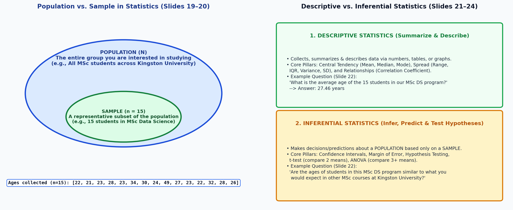
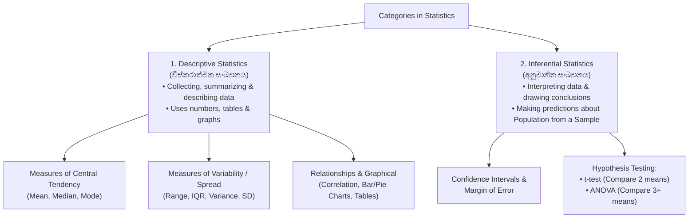

# පාඩම 4.3: සංඛ්‍යානය හැඳින්වීම — සංගහනය, නියැදිය සහ සංඛ්‍යාන වර්ගීකරණය (Introduction to Statistics — Population, Sample & Categories)

**මූලාශ්‍ර දේශන සටහන් (Source Lecture Notes):** `(L) Introduction to Maths and Statistics-converted.pdf` (Slides 17–24)

---

> [!TIP]
> **📚 Prerequisite / Dependency Lesson Series:**  
> Population Parameters ($\mu, \sigma$) සහ Sample Statistics ($ar{x}, s$), Sampling Error සහ Descriptive vs Inferential Statistics පිළිබඳ පදනම සඳහා:
> - [Dep 04.1: Intuition of Variance, Standard Deviation and Bessel's Correction](../dependencies/Dep_04_Standard_Deviation_Normal_Distribution_and_Hypothesis_Testing/01_Intuition_of_Variance_Standard_Deviation_and_Bessels_Correction.md)
> - [Dep 04.3: Sampling Distributions, Standard Error and Confidence Intervals](../dependencies/Dep_04_Standard_Deviation_Normal_Distribution_and_Hypothesis_Testing/03_Sampling_Distributions_Standard_Error_and_Confidence_Intervals.md)

---

## හැඳින්වීම (Introduction)

දේශන සටහනේ දෙවන කොටස (**Part 2: Introduction to Statistics**) වෙත ඔබව සාදරයෙන් පිළිගනිමු! Machine Learning ඇල්ගොරිදමවල ගඩොල් (Building blocks) වන්නේ ගණිතය සහ සංඛ්‍යානයයි. අමු දත්ත (Raw data) දෙස බලා ඒවායේ අර්ථවත් ප්‍රවණතා (Trends) සහ වෙනස්කම් හඳුනා ගැනීමටත්, සංඛ්‍යානමය මොඩල ගොඩනගා අනාවැකි පළ කිරීමටත් සංඛ්‍යානය නැතිවම බැරිය.

මෙම පාඩමෙන් අපි:
1. **සංඛ්‍යානය (Statistics) යනු කුමක්ද සහ එහි වැදගත්කම** (Slides 17–19),
2. **සංගහනය (Population) සහ නියැදිය (Sample) අතර වෙනස** (Slide 20), සහ
3. **සංඛ්‍යානයේ ප්‍රධාන කාණ්ඩ 2: Descriptive Statistics (විස්තරාත්මක සංඛ්‍යානය) සහ Inferential Statistics (අනුමානිත සංඛ්‍යානය)** — MSc Data Science සිසුන් 15 දෙනාගේ වයස් උදාහරණය ඇසුරෙන් (Slides 21–24) ඉතා පැහැදිලිව ඉගෙන ගනිමු.



---

## 1. සංඛ්‍යානය යනු කුමක්ද? (What is Statistics? - Slides 18–19)

* **අර්ථ දැක්වීම:** දත්ත රැස් කිරීම (**Data Collection**), විශ්ලේෂණය කිරීම (**Analysis**), අර්ථකථනය කිරීම (**Interpretation**) සහ ඉදිරිපත් කිරීම (**Presentation**) පිළිබඳ ගණිතමය විද්‍යාව **සංඛ්‍යානය (Statistics)** ලෙස හැඳින්වේ.
* **Data Science හි සංඛ්‍යානයේ කාර්යභාරය:**
  * ඔබට හමුවන විවිධ වර්ගයේ දත්තවල ස්වභාවය තේරුම් ගැනීමට උපකාරී වේ.
  * සැබෑ ලෝකයේ සංකීර්ණ ගැටලු විශ්ලේෂණය කර දත්ත තුළ ඇති අර්ථවත් ප්‍රවණතා (Meaningful trends) හඳුනා ගැනීමට Data Scientists ලාට සහ Analysts ලාට මග පෙන්වයි.
  * කොටස් වෙළඳපොළ (Stock market), ජීව විද්‍යාව (Life sciences), කාලගුණය (Weather), සිල්ලර වෙළඳාම (Retail), රක්ෂණය (Insurance) සහ අධ්‍යාපනය (Education) යන සෑම ක්ෂේත්‍රයකම තීරණ ගැනීම පිටුපස සංඛ්‍යානය පවතී.

---

## 2. මූලික පාරිභාෂික පද: Population (සංගහනය) vs. Sample (නියැදිය) (Slide 20)

ඕනෑම සංඛ්‍යානමය පරීක්ෂණයකදී මුලින්ම හමුවන මූලික පද දෙක වන්නේ **Population** සහ **Sample** ය:

1. **Population (සංගහනය):** ඔබ අධ්‍යයනය කිරීමට උනන්දුවක් දක්වන **සමස්ත කණ්ඩායමම** (*The entire group you are interested in studying*).
   * *උදාහරණය:* ශ්‍රී ලංකාවේ සියලුම විශ්වවිද්‍යාල සිසුන්, හෝ Kingston විශ්වවිද්‍යාලයේ සියලුම MSc පාඨමාලා හදාරන සිසුන්.
2. **Sample (නියැදිය):** එම සංගහනයෙන් (Population එකෙන්) තෝරාගත් **කුඩා උප-කුලකයකි** (*A subset of the population*).
   * *උදාහරණය:* අපගේ MSc in Data Science පන්තියේ සිටින සිසුන් 15 දෙනා.
   * **ඇයි අපි Sample එකක් භාවිතා කරන්නේ?** සැබෑ ලෝකයේදී මුළු Population එකේම (උදා: රටක මිලියන 22ක ජනතාවගේම) දත්ත එකතු කිරීමට අධික කාලයක් හා වියදමක් යන නිසා, නියෝජනාත්මක Sample එකක් ගෙන එය පරීක්ෂා කර මුළු Population එක ගැන නිගමනවලට එළඹේ.

---

## 3. සංඛ්‍යානයේ ප්‍රධාන කාණ්ඩ 2: Descriptive vs. Inferential Statistics (Slides 21–24)

සංඛ්‍යානය ප්‍රධාන කොටස් දෙකකට බෙදේ:



### 1. Descriptive Statistics (විස්තරාත්මක සංඛ්‍යානය):
* **කාර්යය:** දත්ත රැස් කිරීම, සාරාංශගත කිරීම සහ විස්තර කිරීම (**Collecting, summarizing and describing data!!!**).
* සංඛ්‍යාත්මක ගණනය කිරීම් (Numerical calculations), ප්‍රස්තාර (Graphs) හෝ වගු (Tables) මගින් අප සතුව ඇති දත්ත කට්ටලයේ ස්වභාවය විස්තර කරයි.
* **ප්‍රධාන උප-කොටස් (Slides 23–24):**
  * **Graphical:** වගු (Tables), Bar graphs සහ Pie charts මගින් දත්ත සංවිධානය කිරීම.
  * **Measures of Central Tendency (මධ්‍ය ප්‍රවණතාවයේ මිනුම්):** දත්ත කට්ටලයේ මැද (Center) විස්තර කරන තනි සංඛ්‍යාවක් (Mean, Median, Mode).
  * **Measures of Variability / Spread (විසිරීමේ මිනුම්):** දත්ත කොපමණ පරාසයක විසිරී ඇත්දැයි පෙන්වන මිනුම් (Range, Standard Deviation, Inter-Quartile Range, Variance).
  * **Relationships:** විචල්‍ය දෙකක් අතර සම්බන්ධතාවය පෙන්වන සහසම්බන්ධතා සංගුණකය (**Correlation Coefficient**).

### 2. Inferential Statistics (අනුමානිත සංඛ්‍යානය):
* **කාර්යය:** දත්ත අර්ථකථනය කර නිගමනවලට එළඹීම (**Interpret data and draw conclusions**).
* **නියැදියකින් (Sample) ලබාගත් තොරතුරු මත පමණක් පදනම්ව** සමස්ත සංගහනය (Population) පිළිබඳව තීරණ ගැනීම, අනාවැකි පළ කිරීම සහ උපකල්පනවල වලංගුභාවය පරීක්ෂා කිරීම (**Hypothesis testing**) මෙයට ඇතුළත් වේ.
* **ප්‍රධාන මෙවලම් (Slide 23):**
  * **Confidence Interval (විශ්වාසනීය ප්‍රාන්තරය)**
  * **Margin of Error (දෝෂ සීමාව)**
  * **t-test:** නියැදි දෙකක (Two samples) මධ්‍යන්‍යයන් (Means) සංසන්දනය කිරීම.
  * **ANOVA (Analysis of Variance):** නියැදි තුනක හෝ වැඩි ගණනක (Three or more samples) මධ්‍යන්‍යයන් සංසන්දනය කිරීම.

---

## 4. ප්‍රායෝගික උදාහරණය: MSc Data Science සිසුන් 15 දෙනාගේ වයස (Slide 22)

Descriptive සහ Inferential Statistics අතර වෙනස කිසිදා අමතක නොවන ලෙස තේරුම් ගැනීමට දේශන සටහනේ 22 වන Slide එකෙහි දී ඇති උදාහරණය බලන්න:

අපගේ MSc Data Science පාඨමාලාවේ සිසුන් 15 දෙනාගේ වයස් (Ages) එකතු කර ඇතැයි සිතන්න:
$$\text{Ages} = [22, \; 21, \; 23, \; 28, \; 23, \; 34, \; 30, \; 24, \; 49, \; 27, \; 23, \; 22, \; 32, \; 28, \; 26]$$

| විශ්ලේෂණ වර්ගය | අසන ප්‍රශ්නය (The Question Asked) | ඇයි එය එම වර්ගයට අයත් වන්නේ? |
| :--- | :--- | :--- |
| **Descriptive Analysis (විස්තරාත්මක විශ්ලේෂණය)** | *"අපගේ MSc Data Science පාඨමාලාවේ සිටින මෙම සිසුන් 15 දෙනාගේ සාමාන්‍ය වයස (Average age) කීයද?"* $\rightarrow$ **පිළිතුර: අවුරුදු 27.46** | මෙහිදී අප සතුව දැනටමත් ඇති සිසුන් 15 දෙනාගේ දත්ත සාරාංශ කර විස්තර කිරීමක් පමණක් සිදු කරයි (ඉන් පිටත අය ගැන අනුමානයක් නොකරයි). |
| **Inferential Analysis (අනුමානිත විශ්ලේෂණය)** | *"මෙම MSc Data Science පාඨමාලාවේ සිසුන්ගේ වයස්, Kingston විශ්වවිද්‍යාලයේ අනෙකුත් MSc පාඨමාලාවල සිසුන්ගෙන් ඔබ බලාපොරොත්තු වන වයස්වලට සමානද?"* | මෙහිදී අපගේ පන්තියේ සිසුන් 15 දෙනාගේ නියැදිය (Sample) මත පදනම්ව, මුළු විශ්වවිද්‍යාලයේම අනෙකුත් MSc පාඨමාලාවල සංගහනය (Population) පිළිබඳව නිගමනයකට / Hypothesis පරීක්ෂාවකට එළඹේ! |

---

**ඊළඟ පාඩම (Next Lesson):** [Lesson 4.4: Descriptive Statistics I — Measures of Central Tendency](Lesson_4.4_Descriptive_Statistics_I_Measures_of_Central_Tendency.md) — මධ්‍ය ප්‍රවණතාවයේ මිනුම් 3 වන **Mean (මධ්‍යන්‍යය)**, **Median (මධ්‍යස්ථය)** සහ **Mode (මාතය)** ගණනය කරන ආකාරය සහ `NumPy` / `SciPy` කේත උදාහරණ ඉගෙන ගනිමු.

---

## 🛠️ Practical Task / Hands-On Exercise (ප්‍රායෝගික අභ්‍යාසය)

### Scenario:
ශ්‍රී ලංකාවේ විශ්වවිද්‍යාලයක සමස්ත සිසුන් 10,000 කගේ Population Data simulate කර Random Sampling මඟින් නියැදි ලබාගෙන Sample Mean එක Population Mean එක වෙත සමීප වන ආකාරය (Law of Large Numbers) පරීක්ෂා කිරීම.

### Step-by-Step Tasks:
1. **Task 1 (Generate Synthetic Population):** සාමාන්‍ය ලකුණු 65 ක් සහ සම්මත අපගමනය 12 ක් සහිත සිසුන් 10,000 කගේ Population එකක් `np.random.normal()` මඟින් නිර්මාණය කර True Population Mean ($\mu$) සහ True Population Std ($\sigma$) ගණනය කරන්න.
2. **Task 2 (Draw Random Samples):** Population එකෙන් $n=30$ සහ $n=500$ ප්‍රමාණවලින් Sample දෙකක් `np.random.choice()` මඟින් ලබාගන්න.
3. **Task 3 (Compare Descriptive Stats):** නියැදි දෙකෙහි Sample Means ($ar{x}$) සහ Sample Standard Deviations ($s$, with `ddof=1`) ගණනය කර Sampling Error සසඳන්න.

### Reference Solution (පියවරෙන් පියවර විසඳුම):
```python
import numpy as np

# Task 1: Generate Population
np.random.seed(42)
pop_size = 10000
population = np.random.normal(loc=65.0, scale=12.0, size=pop_size)

pop_mean = np.mean(population)
pop_std = np.std(population, ddof=0)
print(f"True Population Mean (μ): {pop_mean:.4f}")
print(f"True Population Std  (σ): {pop_std:.4f}")

# Task 2 & 3: Small vs Large Samples
sample_small = np.random.choice(population, size=30, replace=False)
sample_large = np.random.choice(population, size=500, replace=False)

mean_s = np.mean(sample_small)
std_s = np.std(sample_small, ddof=1)
error_s = abs(pop_mean - mean_s)

mean_l = np.mean(sample_large)
std_l = np.std(sample_large, ddof=1)
error_l = abs(pop_mean - mean_l)

print(f"
Small Sample (n=30) -> Mean: {mean_s:.4f}, Std: {std_s:.4f}, Error: {error_s:.4f}")
print(f"Large Sample (n=500)-> Mean: {mean_l:.4f}, Std: {std_l:.4f}, Error: {error_l:.4f}")
print("Conclusion: Larger sample drastically reduces sampling error!")
```

---
