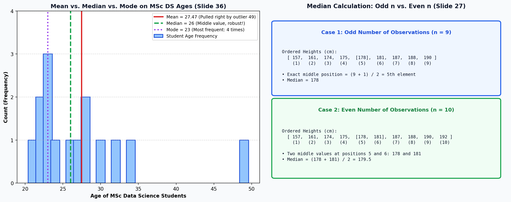
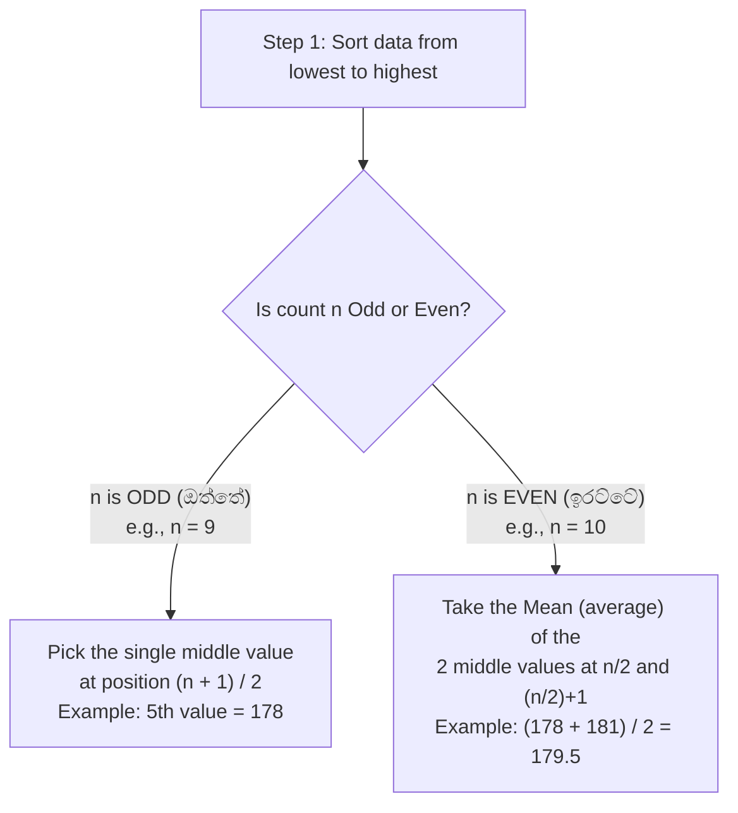

# පාඩම 4.4: විස්තරාත්මක සංඛ්‍යානය I — මධ්‍ය ප්‍රවණතාවයේ මිනුම්: Mean, Median සහ Mode (Descriptive Statistics I — Measures of Central Tendency)

**මූලාශ්‍ර දේශන සටහන් (Source Lecture Notes):** `(L) Introduction to Maths and Statistics-converted.pdf` (Slides 25–28, 36) & `Maths&stat.ipynb`

---

> [!TIP]
> **📚 Prerequisite / Dependency Lesson Series:**  
> Central Tendency (Mean, Median, Mode) හි ගණිතමය ගුණාංග, Outlier Sensitivity සහ SciPy සංඛ්‍යාන මෙවලම් භාවිතය පිළිබඳව:
> - [Dep 02.2: SciPy Stats Distributions, PDF, CDF, PPF and Z-Scores](../dependencies/Dep_02_SciPy_for_Scientific_and_Statistical_Computing/02_SciPy_stats_Distributions_PDF_CDF_PPF_and_Z_Scores.md)
> - [Dep 01.4: NumPy Linear Algebra and Statistical Aggregations](../dependencies/Dep_01_NumPy_Zero_to_Hero/04_NumPy_Linear_Algebra_linalg_and_Statistical_Aggregations.md)

---

## හැඳින්වීම (Introduction)

විශාල දත්ත කට්ටලයක් ලැබුණු විට, එම මුළු දත්ත කට්ටලයම නියෝජනය කළ හැකි "මැද" අගය කුමක්දැයි සෙවීමට **Measures of Central Tendency (මධ්‍ය ප්‍රවණතාවයේ මිනුම්)** භාවිතා වේ. 

මෙම පාඩමෙන් අපි මධ්‍ය ප්‍රවණතාවයේ ප්‍රධාන මිනුම් 3 වන:
1. **Mean (මධ්‍යන්‍යය / සාමාන්‍යය)** (Slide 26),
2. **Median (මධ්‍යස්ථය — ඔත්තේ සහ ඉරට්ටේ දත්ත ගණන් සඳහා)** (Slide 27), සහ
3. **Mode (මාතය — වැඩිම වාර ගණනක් යෙදෙන අගය)** (Slide 28) ගණිතමය සූත්‍ර, දේශන සටහනේ උදාහරණ සහ `Maths&stat.ipynb` හි `NumPy` හා `scipy.stats` කේත සමඟින් ඉගෙන ගනිමු.



---

## 1. Mean (මධ්‍යන්‍යය / Arithmetic Average - Slide 26)

* **අර්ථ දැක්වීම:** දත්ත කට්ටලයක ඇති සියලුම අගයන්ගේ එකතුව, මුළු අගයන් ගණනින් ($n$) බෙදූ විට ලැබෙන සාමාන්‍ය අගය **Mean ($\bar{x}$)** ලෙස හැඳින්වේ.
* නියැදි ගණන අනන්තය කරා ළඟා වන විට ($n \to \infty$) මෙය **"Expected Value" (අපේක්ෂිත අගය $E[X]$)** ලෙසද හැඳින්වේ.

$$\bar{x} = \frac{1}{n} \sum_{i=1}^{n} x_i = \frac{x_1 + x_2 + \dots + x_n}{n}$$

* **දේශන සටහනේ උදාහරණය 1 (Slide 26):**
  අගයන් 6ක්: $15, 12, 18, 29, 10, 5$
  $$\text{Mean} = \frac{15 + 12 + 18 + 29 + 10 + 5}{6} = \frac{89}{6} = 14.83$$
* **දේශන සටහනේ උදාහරණය 2 (MSc DS සිසුන් 15 දෙනාගේ වයස - Slide 36):**
  $$\text{Mean} = \frac{22+21+23+28+23+34+30+24+49+27+23+22+32+28+26}{15} = \frac{412}{15} = 27.4667$$

> [!WARNING]
> **Mean හි දුර්වලතාවය:** දත්ත කට්ටලයේ එකම එක අසාමාන්‍ය ලෙස විශාල හෝ කුඩා අගයක් (**Outlier** - උදා: ඉහත සිසුන් අතර සිටින වයස `49`ක ශිෂ්‍යයා) තිබුණහොත්, Mean අගය එම දෙසට ඇදී යයි!

---

## 2. Median (මධ්‍යස්ථය - Slide 27)

* **අර්ථ දැක්වීම:** දත්ත අගයන් කුඩාම අගයේ සිට විශාලම අගය දක්වා පිළිවෙළට පෙළගැස්වූ විට (**Ordered from lowest to highest**), හරි මැදින්ම පිහිටන අගය **Median (මධ්‍යස්ථය)** ලෙස හැඳින්වේ.
* Outliers නිසා Median අගය වෙනස් නොවන බැවින්, Outliers ඇති දත්ත (උදා: රටක ජනතාවගේ ආදායම හෝ නිවාස මිල ගණන්) සඳහා Mean වලට වඩා Median ඉතාම සුදුසුය.

### Median සොයන පියවර (ඔත්තේ $n$ සහ ඉරට්ටේ $n$ සඳහා - Slide 27):



1. **දත්ත ගණන ඔත්තේ ($n = \text{Odd}$) විට:**
   * දේශන සටහනේ උස (cm) දත්ත 9ක් ($n=9$):
     $$157, \; 161, \; 174, \; 175, \; \mathbf{178}, \; 181, \; 187, \; 188, \; 190$$
   * හරි මැද (5 වන ස්ථානයේ) ඇත්තේ එකම අගයකි $\implies \mathbf{\text{Median} = 178}$.
2. **දත්ත ගණන ඉරට්ටේ ($n = \text{Even}$) විට:**
   * අගට `192` එක් වී දත්ත 10ක් ($n=10$) වූ විට:
     $$157, \; 161, \; 174, \; 175, \; \mathbf{178, \; 181}, \; 187, \; 188, \; 190, \; 192$$
   * මැද අගයන් දෙකක් (`178` සහ `181`) පවතී. එබැවින් එම අගයන් දෙකෙහි සාමාන්‍යය ගනී:
     $$\mathbf{\text{Median}} = \frac{178 + 181}{2} = \mathbf{179.5}$$

---

## 3. Mode (මාතය - Slide 28)

* **අර්ථ දැක්වීම:** දත්ත කට්ටලයක් තුළ **වැඩිම වාර ගණනක් යෙදී ඇති (Most common / frequent value)** අගය **Mode (මාතය)** ලෙස හැඳින්වේ.
* **විශේෂ ලක්ෂණ:**
  * සංඛ්‍යාත්මක නොවන දත්ත (**Non-numerical / Categorical data** - උදා: වැඩියෙන්ම අලෙවි වූ වාහන වර්ණය `"White"`) සඳහාද Mode භාවිතා කළ හැක!
  * නමුත් එයින් දත්ත කට්ටලයේ ඉතිරි අගයන් පිළිබඳ පැහැදිලි චිත්‍රයක් නොලැබෙන නිසා Mean සහ Median සමඟ එක්ව භාවිතා කිරීම වඩාත් ප්‍රයෝජනවත් වේ.
* **දේශන සටහනේ උදාහරණය (Slide 28):**
  * දත්ත: $3, 7, 5, 13, 20, 23, 39, 23, 40, 23, 14, 12, 56, 23, 29$
  * පිළිවෙළට සැකසූ විට (Ordered):
    $$3, \; 5, \; 7, \; 12, \; 13, \; 14, \; 20, \; \mathbf{23, \; 23, \; 23, \; 23}, \; 29, \; 39, \; 40, \; 56$$
  * වැඩිම වාර ගණනක් (4 වතාවක්) යෙදී ඇත්තේ `23` බැවින් $\implies \mathbf{\text{Mode} = 23}$.

---

## 4. `Maths&stat.ipynb` ප්‍රායෝගික කේත: `NumPy` සහ `SciPy` මගින් Mean, Median, Mode සෙවීම

`NumPy` හි `.mean()` සහ `np.median()` ඇති නමුත්, **Mode** සෙවීම සඳහා `Maths&stat.ipynb` හි භාවිතා කරන්නේ **`scipy.stats.mode()`** ශ්‍රිතයයි! එය 1D දෛශික සඳහා මෙන්ම 2D න්‍යාස (Matrices) සඳහාද (`axis=0`, `axis=1`, `axis=None`) භාවිතා කරන ආකාරය බලන්න:

```python
import numpy as np
import scipy.stats as stat

# MSc DS සිසුන් 15 දෙනාගේ වයස්:
st_ages = np.array([22, 21, 23, 28, 23, 34, 30, 24, 49, 27, 23, 22, 32, 28, 26])

# 1. Mean සහ Median (NumPy මගින්):
print("Mean:", st_ages.mean())          # 27.466666666666665
print("Median:", np.median(st_ages))    # 26.0
print("Sorted:", np.sort(st_ages))      # [21 22 22 23 23 23 23 24 26 27 28 28 30 32 34 49]

# 2. Mode සහ එය යෙදුණු වාර ගණන (scipy.stats.mode මගින්):
m_res = stat.mode(st_ages)
print("Mode value:", m_res.mode)        # 23
print("Occurrences:", m_res.count)      # 4  (23 යන්න 4 වතාවක් යෙදී ඇත)

# 3. 2D Matrix එකක Mode සෙවීම (Maths&stat.ipynb):
mat_1 = np.array([
    [1, 5, 6, 7],
    [3, 2, 5, 6],
    [6, 5, 3, 4]
])

# තීරු ඔස්සේ (Column-wise, default axis=0):
# සමාන වාර ගණනක් ඇති විට කුඩාම අගය තෝරා ගනී!
print(stat.mode(mat_1, axis=0))         # mode: [1, 5, 3, 4], count: [1, 2, 1, 1]

# පේළි ඔස්සේ (Row-wise, axis=1):
print(stat.mode(mat_1, axis=1))         # mode: [1, 2, 3], count: [1, 1, 1]

# මුළු න්‍යාසයම එකක් ලෙස සලකා (axis=None):
print(stat.mode(mat_1, axis=None))      # mode: 5 (හෝ 6 - 3 වතාවක් යෙදී ඇත), count: 3
```

---

**ඊළඟ පාඩම (Next Lesson):** [Lesson 4.5: Descriptive Statistics II — Measures of Spread (Variability) & Correlation](Lesson_4.5_Descriptive_Statistics_II_Measures_of_Spread_and_Correlation.md) — දත්තවල විසිරීම මනින **Range, IQR, Variance, Standard Deviation** සහ විචල්‍ය දෙකක් අතර සම්බන්ධතාවය මනින **Correlation** ගැන ඉගෙන ගනිමු.

---

## 🛠️ Practical Task / Hands-On Exercise (ප්‍රායෝගික අභ්‍යාසය)

### Scenario:
Software සමාගමක සේවක වැටුප් දත්ත විශ්ලේෂණයේදී Extreme Outlier (CEO ගේ වැටුප) මඟින් Mean එක සහ Median එක වෙනස් වන ආකාරය නිරීක්ෂණය කිරීම.

### Step-by-Step Tasks:
1. **Task 1 (Calculate Center for Normal Salaries):** සාමාන්‍ය සේවකයන් 10 දෙනෙකුගේ වැටුප් ලැයිස්තුවක් (`[50, 55, 60, 62, 65, 65, 70, 72, 75, 80]` දහස් වලින්) සඳහා Mean, Median සහ Mode ගණනය කරන්න.
2. **Task 2 (Introduce Massive Outlier):** CEO ගේ වැටුප වන `1,500` ලැයිස්තුවට එක්කර නැවත Mean, Median, Mode ගණනය කරන්න.
3. **Task 3 (Analyze Robustness):** Outlier හමුවේ Mean එකට සහ Median එකට සිදුවූ ප්‍රතිශත වෙනස ගණනය කර වඩාත් සුදුසු Measure of Center එක තෝරාගන්න.

### Reference Solution (පියවරෙන් පියවර විසඳුම):
```python
import numpy as np
from scipy import stats

salaries = [50, 55, 60, 62, 65, 65, 70, 72, 75, 80]

def print_stats(data, label):
    mean_v = np.mean(data)
    median_v = np.median(data)
    mode_v = stats.mode(data, keepdims=False).mode
    print(f"--- {label} ---")
    print(f"Mean   : ${mean_v:.2f}k")
    print(f"Median : ${median_v:.2f}k")
    print(f"Mode   : ${mode_v:.2f}k")
    return mean_v, median_v

m1, med1 = print_stats(salaries, "Without Outlier")

# Add CEO salary
salaries_with_outlier = salaries + [1500]
m2, med2 = print_stats(salaries_with_outlier, "With CEO Outlier ($1,500k)")

print(f"
Mean shifted by   : {((m2 - m1) / m1) * 100:.1f}%")
print(f"Median shifted by : {((med2 - med1) / med1) * 100:.1f}%")
print("Insight: Median is robust to extreme outliers, while Mean is heavily distorted!")
```

---
