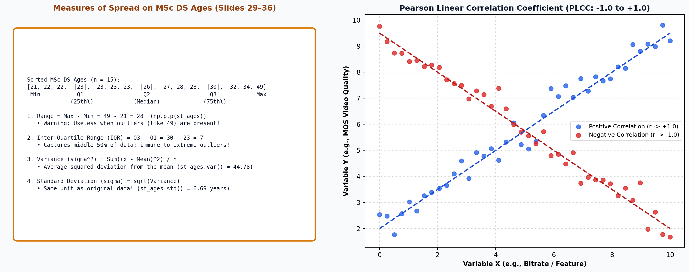

# පාඩම 4.5: විස්තරාත්මක සංඛ්‍යානය II — විසිරීමේ මිනුම් (Spread) සහ සහසම්බන්ධතාවය (Correlation) (Measures of Spread & Correlation)

**මූලාශ්‍ර දේශන සටහන් (Source Lecture Notes):** `(L) Introduction to Maths and Statistics-converted.pdf` (Slides 29–36) & `Maths&stat.ipynb`

---

> [!TIP]
> **📚 Prerequisite / Dependency Lesson Series:**  
> Variance, Standard Deviation, Bessel's Correction ($n-1$) සහ Pearson Correlation Coefficient ($r$) පිළිබඳ ගැඹුරු ගණිතමය සාධනය සඳහා:
> - [Dep 04.1: Intuition of Variance, Standard Deviation and Bessel's Correction](../dependencies/Dep_04_Standard_Deviation_Normal_Distribution_and_Hypothesis_Testing/01_Intuition_of_Variance_Standard_Deviation_and_Bessels_Correction.md)
> - [Dep 02.3: Statistical Tests in SciPy (`ttest`, `ANOVA`, `pearsonr`)](../dependencies/Dep_02_SciPy_for_Scientific_and_Statistical_Computing/03_Statistical_Tests_in_SciPy_ttest_ANOVA_and_Correlation.md)

---

## හැඳින්වීම (Introduction)

දත්ත කට්ටල දෙකකට හරියටම එකම මධ්‍යන්‍යයක් (Mean) තිබුණත්, එක් දත්ත කට්ටලයක අගයන් මධ්‍යන්‍යය අසලම පොකුරු ගැසී තිබිය හැකි අතර (`[25, 26, 26, 27]`), අනෙක් දත්ත කට්ටලයේ අගයන් ඉතා පුළුල් පරාසයක විසිරී තිබිය හැක (`[2, 10, 40, 52]`). එබැවින් දත්තවල **විසිරීම (Spread / Variability / Dispersion)** මැනීම ඉතාම වැදගත් වේ.

මෙම පාඩමෙන් අපි:
1. **Range (පරාසය)** (Slide 30),
2. **Quartiles ($Q_1, Q_2, Q_3$) සහ Inter-Quartile Range ($\text{IQR}$ - අන්තර්-චතුර්ථක පරාසය)** (Slide 31),
3. **Variance (විචලතාව - $\sigma^2$)** සහ **Standard Deviation (සම්මත අපගමනය - $\sigma$)** (Slides 32–34, 36),
4. **Correlation (සහසම්බන්ධතාවය - Pearson Correlation Coefficient)** (Slide 35), සහ
5. **`Maths&stat.ipynb` හි `NumPy` සහ `scipy.stats.describe()` ප්‍රායෝගික කේත** ඉගෙන ගනිමු.



---

## 1. Range (පරාසය - Slide 30)

* **අර්ථ දැක්වීම:** දත්ත කට්ටලයක ඇති විශාලතම අගය (Maximum) සහ කුඩාම අගය (Minimum) අතර වෙනස **Range** ලෙස හැඳින්වේ:
  $$\text{Range} = \text{Max} - \text{Min}$$
* **දේශන සටහනේ උදාහරණය 1 (උස දත්ත - Slide 30):**
  * $[157, 161, 174, 175, 178, 181, 187, 188, 190, 192] \implies \text{Range} = 192 - 157 = \mathbf{35}$.
* **දේශන සටහනේ උදාහරණය 2 (MSc DS සිසුන්ගේ වයස - Slide 36):**
  * $\text{Min} = 21, \; \text{Max} = 49 \implies \text{Range} = 49 - 21 = \mathbf{28}$.
* **ප්‍රධාන දුර්වලතාවය (Slide 30):** *"Useless in case there is/are outliers in the data!!!"* — දත්ත කට්ටලයේ එකම එක Outlier අගයක් තිබුණත් Range අගය මුළුමනින්ම විකෘති වන බැවින් Outliers ඇති විට එය ප්‍රයෝජනවත් නොවේ!

---

## 2. Quartiles සහ Inter-Quartile Range ($\text{IQR}$ - Slide 31)

Outliers වල බලපෑම මඟහරවා දත්තවල මැද 50%ක කොටසේ විසිරීම මැනීම සඳහා **Inter-Quartile Range (IQR)** භාවිතා වේ.

* **Quartiles (චතුර්ථක):** පිළිවෙළට සැකසූ දත්ත කට්ටලයක් සමාන කොටස් 4කට (25% බැගින්) බෙදන ලක්ෂ්‍ය තුන:
  * **$Q_1$ (25th Percentile / Lower Quartile):** දත්තවලින් පහළම 25% වෙන් කරන අගය (පළමු භාගයේ Median අගය).
  * **$Q_2$ (50th Percentile / Median):** දත්ත කට්ටලයේ හරි මැද අගය (50%).
  * **$Q_3$ (75th Percentile / Upper Quartile):** දත්තවලින් 75%ක් වෙන් කරන අගය (දෙවන භාගයේ Median අගය).
* **$\text{IQR}$ සූත්‍රය:**
  $$\text{IQR} = Q_3 \; (\text{75th percentile}) - Q_1 \; (\text{25th percentile})$$

### දේශන සටහනේ උදාහරණ දෙක (Slides 31 & 36):
1. **උස දත්ත 10 ($[157, 161, 174, 175, 178, 181, 187, 188, 190, 192]$ - Slide 31):**
   * පළමු අගයන් 5හි මැද ($Q_1$) = `174`
   * අවසාන අගයන් 5හි මැද ($Q_3$) = `188`
   * $\text{IQR} = 188 - 174 = \mathbf{14}$
2. **MSc DS සිසුන් 15 දෙනාගේ වයස (Slide 36):**
   * පිළිවෙළට සැකසූ විට: $[21, 22, 22, \mathbf{23}, 23, 23, 23, \mathbf{26}, 27, 28, 28, \mathbf{30}, 32, 34, 49]$
   * $Q_1 \to \mathbf{23}, \quad Q_2 (\text{Median}) \to \mathbf{26}, \quad Q_3 \to \mathbf{30}$
   * $\mathbf{\text{IQR}} = Q_3 - Q_1 = 30 - 23 = \mathbf{7}$

---

## 3. Variance (විචලතාව) සහ Standard Deviation (සම්මත අපගමනය) (Slides 32–34)

සෑම දත්ත ලක්ෂ්‍යයක්ම මධ්‍යන්‍යයේ (Mean - $\mu$) සිට කොපමණ දුරකින් පිහිටා ඇත්දැයි ගණනය කරන ප්‍රබලතම මිනුම් දෙක වන්නේ **Variance** සහ **Standard Deviation** ය:

### 1. Variance (විචලතාව - Slide 32):
* සෑම දත්ත අගයකින්ම Mean අගය අඩු කර ($x_i - \mu$), එම වෙනස වර්ග කර ($(x_i - \mu)^2$ - සෘණ ලකුණු ඉවත් කිරීමට), ඒ සියල්ලේ එකතුව දත්ත ගණනින් ($n$) බෙදූ විට **Variance ($\sigma^2$)** ලැබේ:
  $$\text{Variance } (\sigma^2) = \frac{\sum_{i=1}^{n} (x_i - \mu)^2}{n}$$
* **දේශන සටහනේ උස දත්ත 10 සඳහා Variance (Slide 32):**
  $$\text{Mean } (\mu) = 178.3$$
  $$\text{Variance} = \frac{(157-178.3)^2 + (161-178.3)^2 + \dots + (192-178.3)^2}{10} = \frac{1192.1}{10} = \mathbf{119.21}$$

### 2. Standard Deviation (සම්මත අපගමනය - Slide 33):
* Variance ගණනය කිරීමේදී අගයන් වර්ග කළ නිසා එහි ඒකකයද වර්ග වී ඇත (උදා: $\text{cm}^2$ හෝ $\text{years}^2$). එය නැවත මුල් දත්තවල ඒකකයටම ගෙන ඒමට **Variance හි වර්ගමූලය (Square root)** ගනු ලැබේ. එය **Standard Deviation ($\sigma$)** ලෙස හැඳින්වේ:
  $$\text{Standard Deviation } (\sigma) = \sqrt{\text{Variance}} = \sqrt{\frac{\sum_{i=1}^{n} (x_i - \mu)^2}{n}}$$
* ඉහත උස දත්ත සඳහා: $\text{Standard Deviation} = \sqrt{119.21} = \mathbf{10.92\text{ cm}}$.
* **අර්ථකථනය:**
  * **අඩු Standard Deviation අගයක් (Lower SD):** දත්ත සියල්ලම Mean අගයට ඉතා ආසන්නව පොකුරු ගැසී පවතී.
  * **වැඩි Standard Deviation අගයක් (Higher SD):** දත්ත Mean අගයෙන් ඈතට විශාල පරාසයක විසිරී පවතී.

---

## 4. Correlation (සහසම්බන්ධතාවය - Slide 35)

* **අර්ථ දැක්වීම:** විචල්‍ය යුගලයක් (Pairs of variables - උදා: උස සහ බර, හෝ වීඩියෝවක Bitrate එක සහ වීඩියෝ ගුණාත්මකභාවය MOS) එකිනෙකට සම්බන්ධ වී ඇත්ද සහ **කොපමණ ප්‍රබලව සම්බන්ධ වී ඇත්ද** යන්න පෙන්වන සංඛ්‍යානමය මිනුම **Correlation** ලෙස හැඳින්වේ.
* **Pearson Linear Correlation Coefficient (PLCC - $r$) හි පරාසය:**
  * සහසම්බන්ධතා සංගුණකයේ අගය සෑමවිටම **$-1.0$ සිට $+1.0$ දක්වා** පරාසය තුළ පවතී:
    * **$r = +1.0$ (Perfect Positive Correlation):** එක් විචල්‍යයක් වැඩි වන විට අනෙක් විචල්‍යයද රේඛීයව 100%ක්ම වැඩි වේ.
    * **$r = -1.0$ (Perfect Negative Correlation):** එක් විචල්‍යයක් වැඩි වන විට අනෙක් විචල්‍යය රේඛීයව 100%ක්ම අඩු වේ.
    * **$r = 0.0$ (No Linear Correlation):** විචල්‍ය දෙක අතර රේඛීය සම්බන්ධතාවයක් නොමැත.

---

## 5. `Maths&stat.ipynb` ප්‍රායෝගික කේත: `NumPy` සහ `SciPy` මගින් Spread ගණනය කිරීම

```python
import numpy as np
import scipy.stats as stat

st_ages = np.array([22, 21, 23, 28, 23, 34, 30, 24, 49, 27, 23, 22, 32, 28, 26])

# 1. Min, Max, Sum, Mean, Variance, Standard Deviation:
print("Min:", st_ages.min())            # 21
print("Max:", st_ages.max())            # 49
print("Range (ptp):", np.ptp(st_ages))  # 28  (Peak-to-Peak = Max - Min!)
print("Mean:", st_ages.mean())          # 27.4667
print("Variance:", st_ages.var())       # 44.7822
print("Std Dev:", st_ages.std())        # 6.69195

# 2. Quartiles (Q1, Q3) සහ IQR (np.percentile මගින්):
q1, q3 = np.percentile(st_ages, [25, 75])
iqr = q3 - q1
print("Q1:", q1, "| Q3:", q3, "| IQR:", iqr)

# 3. scipy.stats.describe() මගින් සියලුම සංඛ්‍යානමය සාරාංශ එකවර ලබා ගැනීම:
# (nobs, minmax, mean, variance, skewness, kurtosis ලබා දෙයි)
mat_1 = np.array([[1, 5, 6, 7], [3, 2, 5, 6], [6, 5, 3, 4]])
print(stat.describe(mat_1, axis=0))     # තීරු ඔස්සේ (Column-wise)
print(stat.describe(mat_1, axis=1))     # පේළි ඔස්සේ (Row-wise)
print(stat.describe(mat_1, axis=None))  # මුළු න්‍යාසයටම (All elements)
```

---

**ඊළඟ පාඩම (Next Lesson):** [Lesson 4.6: The Normal (Gaussian) Distribution](Lesson_4.6_The_Normal_Gaussian_Distribution.md) — සංඛ්‍යානයේ වැදගත්ම සම්භාවිතා ව්‍යාප්තිය වන **Normal Distribution (සීනු හැඩැති වක්‍රය)**, එහි PDF සූත්‍රය සහ Z-Score ගණනය කිරීම ඉගෙන ගනිමු.

---

## 🛠️ Practical Task / Hands-On Exercise (ප්‍රායෝගික අභ්‍යාසය)

### Scenario:
විභාගය සඳහා පාඩම් කළ පැය ගණන (Study Hours) සහ ලබාගත් ලකුණු (Exam Score) අතර Linear Correlation සහ Dispersion Measures (IQR, Variance, Std) ගණනය කිරීම.

### Step-by-Step Tasks:
1. **Task 1 (Spread Calculations):** ලකුණු දත්ත සඳහා Range, Quartiles ($Q_1, Q_3$), සහ Interquartile Range ($	ext{IQR}$) ගණනය කරන්න.
2. **Task 2 (Bessel's Correction Verification):** Population Variance (`ddof=0`) සහ Sample Variance (`ddof=1`) ගණනය කර වෙනස නිරීක්ෂණය කරන්න.
3. **Task 3 (Pearson Correlation):** Study Hours සහ Exam Score අතර Pearson Correlation Coefficient $r$ සහ $p$-value එක `scipy.stats.pearsonr()` මඟින් ගණනය කර සම්බන්ධතාවයේ ප්‍රබලතාවය තීරණය කරන්න.

### Reference Solution (පියවරෙන් පියවර විසඳුම):
```python
import numpy as np
from scipy import stats

hours = np.array([2, 3, 4, 5, 6, 7, 8, 9, 10, 12])
scores = np.array([45, 50, 58, 65, 68, 75, 82, 85, 90, 95])

# Task 1: Range & IQR
q1 = np.percentile(scores, 25)
q3 = np.percentile(scores, 75)
iqr = q3 - q1
data_range = np.ptp(scores)
print(f"Score Range: {data_range}, Q1: {q1}, Q3: {q3}, IQR: {iqr}")

# Task 2: Variance & Standard Deviation
var_pop = np.var(scores, ddof=0)
var_sample = np.var(scores, ddof=1)
std_sample = np.std(scores, ddof=1)
print(f"Sample Variance (s^2 with n-1): {var_sample:.4f}")
print(f"Sample Std Dev (s)           : {std_sample:.4f}")

# Task 3: Pearson Correlation
r_val, p_val = stats.pearsonr(hours, scores)
print(f"Pearson Correlation (r) : {r_val:.4f}")
print(f"p-value                 : {p_val:.4e}")
print("Conclusion: Extremely strong positive linear relationship (r > 0.99)!")
```

---
