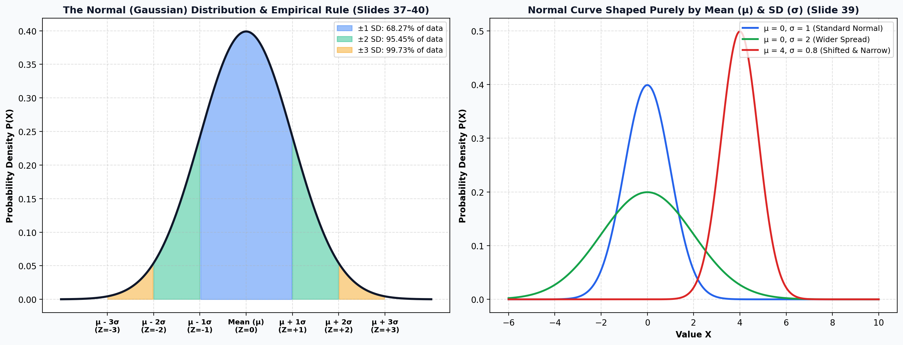
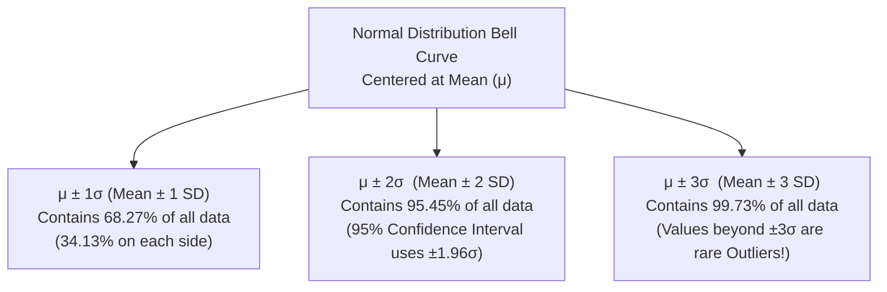

# පාඩම 4.6: ප්‍රමත ව්‍යාප්තිය — The Normal (Gaussian) Distribution සහ Z-Score (The Normal Distribution & Z-Score)

**මූලාශ්‍ර දේශන සටහන් (Source Lecture Notes):** `(L) Introduction to Maths and Statistics-converted.pdf` (Slides 37–40) & `Maths&stat.ipynb`

---

> [!TIP]
> **📚 Prerequisite / Dependency Lesson Series:**  
> Normal Distribution Bell Curve, Probability Density Function (PDF), $Z$-Scores සහ Central Limit Theorem සඳහා:
> - [Dep 04.2: Probability Distributions, Central Limit Theorem and Normal Distribution](../dependencies/Dep_04_Standard_Deviation_Normal_Distribution_and_Hypothesis_Testing/02_Probability_Distributions_Central_Limit_Theorem_and_Normal_Distribution.md)
> - [Dep 02.2: SciPy Stats Distributions, PDF, CDF, PPF and Z-Scores](../dependencies/Dep_02_SciPy_for_Scientific_and_Statistical_Computing/02_SciPy_stats_Distributions_PDF_CDF_PPF_and_Z_Scores.md)

---

## හැඳින්වීම (Introduction)

සංඛ්‍යානයේ සහ Machine Learning වලදී වැඩියෙන්ම භාවිතා වන සහ ස්වභාවධර්මයේ බහුලවම දක්නට ලැබෙන සම්භාවිතා ව්‍යාප්තිය වන්නේ **Normal Distribution (ප්‍රමත ව්‍යාප්තිය / Gaussian Distribution / Bell Curve)** ය. මිනිසුන්ගේ උස, බර, රුධිර පීඩනය, IQ ලකුණු සහ මිනුම් දෝෂ වැනි ස්වභාවික සංසිද්ධීන් රාශියක් මෙම සීනුවක හැඩැති (Bell-shaped) ව්‍යාප්තිය අනුගමනය කරයි.

මෙම පාඩමෙන් අපි:
1. **Normal Distribution හි සම්භාවිතා ඝනත්ව ශ්‍රිතය (Probability Density Function - PDF)** (Slide 37),
2. **Normal Distribution එකක ඇති සුවිශේෂීත්වය කුමක්ද — Mean ($\mu$) සහ Standard Deviation ($\sigma$) මගින් පමණක් මුළු ව්‍යාප්තියම විස්තර කළ හැකි වීම** (Slides 38–39),
3. **68.27% – 95.45% – 99.73% ආනුභවික නියමය (Empirical Rule)** (Slide 40), සහ
4. **`Maths&stat.ipynb` හි `scipy.stats.zscore()` මගින් Z-Score ගණනය කරන ආකාරය** ඉගෙන ගනිමු.



---

## 1. Normal Distribution සහ එහි සම්භාවිතා ඝනත්ව ශ්‍රිතය (PDF - Slide 37)

මධ්‍යන්‍යය (Mean) $\mu$ සහ සම්මත අපගමනය (Standard Deviation) $\sigma$ (හෙවත් විචලතාව Variance $\sigma^2$) වූ Normal Distribution එකක සම්භාවිතා ඝනත්ව ශ්‍රිතය (**Probability Density Function - PDF**) පහත සූත්‍රයෙන් දෙනු ලැබේ:

$$f(x) = \frac{1}{\sqrt{2\pi\sigma^2}} \, e^{-\frac{(x - \mu)^2}{2\sigma^2}}$$

* මෙහි:
  * $\mu$ = ව්‍යාප්තියේ මධ්‍යන්‍යය (Mean — වක්‍රයේ මැද උසම ලක්ෂ්‍යය පිහිටන ස්ථානය).
  * $\sigma$ = සම්මත අපගමනය (Standard Deviation — වක්‍රයේ පළල තීරණය කරන අගය).
  * $\sigma^2$ = විචලතාව (Variance).
  * $\pi \approx 3.14159$ සහ $e \approx 2.71828$.

---

## 2. Normal Distribution එකෙහි ඇති සුවිශේෂීත්වය කුමක්ද? (Slides 38–39)

දේශන සටහනේ 38 වන Slide එකෙහි අසා ඇති වැදගත්ම ප්‍රශ්නය මෙයයි:
> **What is so special about it?**  
> **"The Mean and Standard Deviation (or Variance) are enough to describe the whole distribution!"**

**සරල සිංහලෙන්:**
* ඔබ සතුව දත්ත මිලියනයක් තිබුණත්, එම දත්ත Normal Distribution එකකට අනුකූල නම්, එම දත්ත මිලියනයේම හැසිරීම 100%ක්ම විස්තර කිරීමට ඔබට අවශ්‍ය වන්නේ **සංඛ්‍යා දෙකක් පමණි: Mean ($\mu$) සහ Standard Deviation ($\sigma$)!**
* **Mean ($\mu$) වෙනස් වන විට:** සීනු හැඩැති වක්‍රයේ හැඩය වෙනස් නොවී X-අක්ෂය දිගේ වමට හෝ දකුණට විස්ථාපනය (Shift) වේ.
* **Standard Deviation ($\sigma$) වෙනස් වන විට (Slide 39):**
  * $\sigma$ කුඩා වන විට වක්‍රය පටු සහ උස (Narrow and tall) වේ.
  * $\sigma$ විශාල වන විට වක්‍රය පැතලි සහ පළල් (Flat and wide) වේ.
* එමෙන්ම Normal Distribution එකක හරි මැද සමමිතික වන නිසා එහි **$\text{Mean} = \text{Median} = \text{Mode}$** වේ!

---

## 3. $68\% - 95\% - 99.7\%$ නියමය (Empirical Rule - Slide 40)

ඕනෑම Normal Distribution එකක මධ්‍යන්‍යයේ ($\mu$) සිට සම්මත අපගමන ($\sigma$) කිහිපයක් දෙපසට ගිය විට ඒ තුළ අඩංගු වන දත්ත ප්‍රතිශතය සෑමවිටම නියත වේ (Slide 40):



| පරාසය (Interval around Mean $\mu$) | එක් පසෙක ඇති ප්‍රතිශතය | මුළු ප්‍රතිශතය (Total Data Covered) | ප්‍රායෝගික වැදගත්කම |
| :--- | :---: | :---: | :--- |
| **$\mu - 1\sigma$ සිට $\mu + 1\sigma$ දක්වා** | $34.13\%$ බැගින් | **$68.27\%$** ($\approx 68\%$) | සාමාන්‍ය දත්තවලින් තුනෙන් දෙකකට ආසන්න ප්‍රමාණයක් $\pm 1\sigma$ තුළ පවතී. |
| **$\mu - 2\sigma$ සිට $\mu + 2\sigma$ දක්වා** | $34.13\% + 13.59\%$ | **$95.45\%$** ($\approx 95\%$) | දත්තවලින් 95%ක්ම $\pm 1.96\sigma$ (ආසන්නව $\pm 2\sigma$) තුළ පවතී. |
| **$\mu - 3\sigma$ සිට $\mu + 3\sigma$ දක්වා** | $49.865\%$ බැගින් | **$99.73\%$** ($\approx 99.7\%$) | සියලුම දත්ත පාහේ $\pm 3\sigma$ තුළ පවතී. $\pm 3\sigma$ න් පිටත පවතින්නේ $0.27\%$ක් පමණක් වන අතර ඒවා **Outliers** ලෙස හඳුනාගත හැක! |

---

## 4. `Maths&stat.ipynb` ප්‍රායෝගික කේත: Z-Score ගණනය කිරීම (`scipy.stats.zscore`)

**Z-Score (Standard Score)** යනු යම් දත්ත අගයක් ($x$) මධ්‍යන්‍යයේ ($\mu$) සිට සම්මත අපගමන ($\sigma$) කීයක් දුරින් පිහිටා ඇත්දැයි පෙන්වන අගයයි:

$$Z = \frac{x - \mu}{\sigma}$$

* $Z = 0$ නම් එම අගය හරියටම Mean අගයට සමානය.
* $Z > 0$ (ධන) නම් Mean අගයට වඩා වැඩිය; $Z < 0$ (සෘණ) නම් Mean අගයට වඩා අඩුය.
* $|Z| > 3$ නම් එය Outlier එකක් ලෙස සැලකේ!

අපගේ `Maths&stat.ipynb` Notebook එකෙහි `stat.zscore()` සහ `np.partition()` භාවිතා කර වැඩිම Z-score සහිත සිසුන් 5 දෙනා සොයා ගන්නා ආකාරය බලන්න:

```python
import numpy as np
import scipy.stats as stat

st_ages = np.array([22, 21, 23, 28, 23, 34, 30, 24, 49, 27, 23, 22, 32, 28, 26])

# 1. සෑම ශිෂ්‍යයෙකුගේම වයසට අදාළ Z-score එක ගණනය කිරීම:
z_scores = stat.zscore(st_ages)
print(z_scores)
# වයස 49 ශිෂ්‍යයාගේ Z-score එක +3.217 කි! (එනම් Mean එකට වඩා 3.2 SD ඉහළින් ඇති පැහැදිලි Outlier එකකි!)

# 2. ඉහළම Z-score 5 වෙන් කර ගැනීම (np.partition මගින්):
top_5_z = np.partition(z_scores, -5)[-5:]
print("Top 5 highest Z-scores:", top_5_z)

# 3. එම ඉහළම Z-scores වලට අදාළ මුල් වයස් සහ Index ස්ථාන සෙවීම:
for z_val in top_5_z:
    ind1 = np.where(z_scores == z_val)
    print("Index:", ind1, "| Age:", [st_ages[j] for j in ind1])
```

---

**ඊළඟ පාඩම (Next Lesson):** [Lesson 4.7: Inferential Statistics — Confidence Intervals & Hypothesis Testing](Lesson_4.7_Inferential_Statistics_Confidence_Intervals_and_Hypothesis_Testing.md) — Module 4 හි අවසාන පාඩම ලෙස **Confidence Intervals (95% CI)**, **Hypothesis Testing ($H_0$ vs $H_1$)**, සහ `SciPy` මගින් **Independent T-Test** හා සමීකරණ විසඳීම් (`root`) ඉගෙන ගනිමු.

---

## 🛠️ Practical Task / Hands-On Exercise (ප්‍රායෝගික අභ්‍යාසය)

### Scenario:
විභාග ලකුණු $\mu = 70$ සහ $\sigma = 10$ වන Normal Distribution එකක් සඳහා $Z$-Scores සහ සම්භාවිතාවන් (Probabilities) `scipy.stats.norm` මඟින් සෙවීම.

### Step-by-Step Tasks:
1. **Task 1 ($Z$-Score Calculation):** ලකුණු 85 ක් ලබාගත් ශිෂ්‍යයෙකුගේ $Z$-Score එක ගණනය කරන්න ($Z = rac{X - \mu}{\sigma}$).
2. **Task 2 (Probability Queries via CDF):** 
   - විභාග ලකුණු 85 ට වඩා අඩු වීමේ සම්භාවිතාව ($P(X \le 85)$).
   - විභාග ලකුණු 60 ත් 80 ත් අතර පිහිටීමේ සම්භාවිතාව ($P(60 \le X \le 80)$).
3. **Task 3 (Empirical Rule Verification):** $1\sigma, 2\sigma, 3\sigma$ ප්‍රාන්තර වල අගයන් CDF මඟින් ගණනය කර Empirical Rule ($68.27\%, 95.45\%, 99.73\%$) තහවුරු කරන්න.

### Reference Solution (පියවරෙන් පියවර විසඳුම):
```python
from scipy import stats

mu = 70.0
sigma = 10.0
dist = stats.norm(loc=mu, scale=sigma)

# Task 1: Z-Score
score = 85.0
z_score = (score - mu) / sigma
print(f"Z-Score for mark {score}: {z_score:.2f}")

# Task 2: CDF Probabilities
p_less_85 = dist.cdf(85)
p_between_60_80 = dist.cdf(80) - dist.cdf(60)
print(f"P(X <= 85)       : {p_less_85:.4f} ({p_less_85*100:.2f}%)")
print(f"P(60 <= X <= 80) : {p_between_60_80:.4f} ({p_between_60_80*100:.2f}%)")

# Task 3: Empirical Rule Verification
p_1sigma = dist.cdf(mu + sigma) - dist.cdf(mu - sigma)
p_2sigma = dist.cdf(mu + 2*sigma) - dist.cdf(mu - 2*sigma)
p_3sigma = dist.cdf(mu + 3*sigma) - dist.cdf(mu - 3*sigma)

print(f"
Empirical Rule Verification:")
print(f"Within 1 Sigma (μ ± 1σ): {p_1sigma*100:.2f}% (Expected ~68.27%)")
print(f"Within 2 Sigma (μ ± 2σ): {p_2sigma*100:.2f}% (Expected ~95.45%)")
print(f"Within 3 Sigma (μ ± 3σ): {p_3sigma*100:.2f}% (Expected ~99.73%)")
```

---
