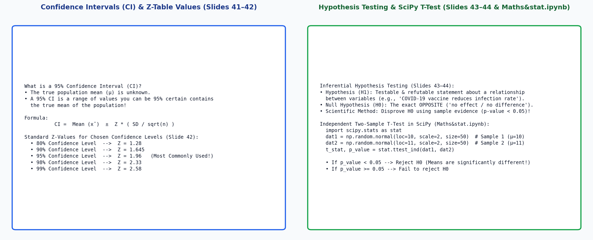
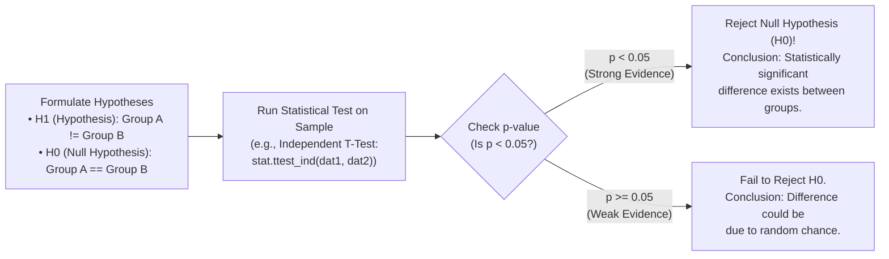

# පාඩම 4.7: අනුමානිත සංඛ්‍යානය — Confidence Intervals, Hypothesis Testing සහ SciPy T-Test (Inferential Statistics — Confidence Intervals & Hypothesis Testing)

**මූලාශ්‍ර දේශන සටහන් (Source Lecture Notes):** `(L) Introduction to Maths and Statistics-converted.pdf` (Slides 41–45) & `Maths&stat.ipynb`

---

> [!TIP]
> **📚 Prerequisite / Dependency Lesson Series:**  
> Confidence Intervals, Standard Error, Null Hypothesis ($H_0$), Two-Sample $t$-test සහ ANOVA පිළිබඳ සවිස්තරාත්මක අධ්‍යයනය සඳහා:
> - [Dep 04.3: Sampling Distributions, Standard Error and Confidence Intervals](../dependencies/Dep_04_Standard_Deviation_Normal_Distribution_and_Hypothesis_Testing/03_Sampling_Distributions_Standard_Error_and_Confidence_Intervals.md)
> - [Dep 04.4: Complete Guide to Hypothesis Testing (`p-values`, `t-test`, `ANOVA`)](../dependencies/Dep_04_Standard_Deviation_Normal_Distribution_and_Hypothesis_Testing/04_Complete_Guide_to_Hypothesis_Testing_p_values_t_test_and_ANOVA.md)
> - [Dep 02.3: Statistical Tests in SciPy (`ttest_ind`, `f_oneway`)](../dependencies/Dep_02_SciPy_for_Scientific_and_Statistical_Computing/03_Statistical_Tests_in_SciPy_ttest_ANOVA_and_Correlation.md)

---

## හැඳින්වීම (Introduction)

Module 4 හි අවසාන පාඩම වන මෙම ලිපියෙන් අපි නියැදියක (Sample) දත්ත මත පදනම්ව සමස්ත සංගහනය (Population) පිළිබඳව විද්‍යාත්මකව තීරණ ගන්නා **Inferential Statistics (අනුමානිත සංඛ්‍යානය)** පිළිබඳව ඉගෙන ගනිමු.

මෙහිදී අපි:
1. **Confidence Intervals (විශ්වාසනීය ප්‍රාන්තර - 95% CI)** සහ Z-අගයන් භාවිතයෙන් Upper හා Lower සීමාවන් ගණනය කරන ආකාරය (Slides 41–42),
2. **Hypothesis Testing (කල්පිත පරීක්ෂාව)** — COVID-19 එන්නත් උදාහරණය සහ Null Hypothesis ($H_0$) ප්‍රතික්ෂේප කිරීමේ විද්‍යාත්මක ක්‍රමවේදය (Slides 43–44), සහ
3. **`Maths&stat.ipynb` හි `SciPy` පුස්තකාලය (`scipy.constants`, `scipy.optimize.root`, සහ `scipy.stats.ttest_ind` Independent T-Test)** ප්‍රායෝගිකව භාවිතා කරන ආකාරය ඉගෙන ගනිමු.



---

## 1. Confidence Interval (විශ්වාසනීය ප්‍රාන්තරය - Slides 41–42)

* **ගැටලුව:** සමස්ත සංගහනයේ (Population) සැබෑ මධ්‍යන්‍යය (True mean $\mu$) අප දන්නේ නැත. අප දන්නේ නියැදියේ (Sample) මධ්‍යන්‍යය ($\bar{x}$) පමණි.
* **95% Confidence Interval (CI) යනු කුමක්ද?** සංගහනයේ සැබෑ මධ්‍යන්‍යය (True population mean) අඩංගු වී ඇති බවට අපට **95%ක්ම විශ්වාස කළ හැකි අගයන් පරාසයකි (A range of values)**!

### Confidence Interval සූත්‍රය (Slide 41):
$$\text{CI} = \bar{x} \pm Z \times \frac{\text{SD}}{\sqrt{n}}$$

මෙහි:
* $\bar{x}$ = නියැදියේ මධ්‍යන්‍යය (Sample Mean)
* $Z$ = තෝරාගත් විශ්වාසනීය මට්ටමට (Confidence level) අදාළ **Z-value** එක (95% සඳහා $Z = 1.96$)
* $\text{SD}$ = සම්මත අපගමනය (Standard Deviation)
* $n$ = නියැදියේ විශාලත්වය (Sample size)
* $Z \times \frac{\text{SD}}{\sqrt{n}}$ යන කොටස **Margin of Error (දෝෂ සීමාව)** ලෙස හැඳින්වේ.

### විශ්වාසනීය මට්ටම්වලට අදාළ සම්මත Z-අගයන් වගුව (Slide 42):

| විශ්වාසනීය මට්ටම (Confidence Level) | අදාළ Z-අගය ($Z$-value) |
| :---: | :---: |
| **80%** | `1.28` |
| **90%** | `1.645` |
| **95%** *(වැඩියෙන්ම භාවිතා වන සම්මතය)* | **`1.96`** |
| **98%** | `2.33` |
| **99%** | `2.58` |

### දේශන සටහනේ ගණනය කිරීමේ උදාහරණය (Slide 42):
* දත්ත: Sample size $n = 10$, Sample Mean $\bar{x} = 240.3$, Standard Deviation $\text{SD} = 51.49$, සහ 95% Confidence Level ($Z = 1.96$).
* **Margin of Error:**
  $$1.96 \times \frac{51.49}{\sqrt{10}} = 1.96 \times \frac{51.49}{3.162} \approx 31.91$$
* **Upper Score (ඉහළ සීමාව):** $240.3 + 31.91 = \mathbf{272.21}$
* **Lower Score (පහළ සීමාව):** $240.3 - 31.91 = \mathbf{208.39}$
* **නිගමනය:** සංගහනයේ සැබෑ මධ්‍යන්‍යය `208.39` සහ `272.21` අතර පවතින බවට අපට 95%ක් සහතික විය හැක! *(ඉදිරි Module 5 හිදී Bar plots මත Error bars ලෙස අඳින්නේ මෙම 95% Confidence Interval එකයි!).*

---

## 2. Inferential Statistics සහ Hypothesis Testing (කල්පිත පරීක්ෂාව - Slides 43–44)

### 1. COVID-19 එන්නත් උදාහරණය (Slide 43):
* *"If it works on a sample population — we can apply it to the rest of the population."*
* COVID-19 එන්නතක් මුලින්ම ලෝකයේ බිලියන 8ක ජනතාවටම ලබා දිය නොහැක. එබැවින් පුද්ගලයින් කිහිප දහසක නියැදියක් (Sample population) මත එය පරීක්ෂා කරයි. එම නියැදිය මත එන්නත සාර්ථකව ක්‍රියා කරන බව සංඛ්‍යානමය වශයෙන් තහවුරු වුවහොත්, එය සමස්ත ජනගහනයටම (Rest of the population) ලබා දිය හැකිය!

### 2. Hypothesis ($H_1$) සහ Null Hypothesis ($H_0$) (Slide 44):
* **Hypothesis (කල්පිතය - $H_1$):** විචල්‍ය දෙකක් හෝ වැඩි ගණනක් අතර පවතින සම්බන්ධතාවයක් පිළිබඳ ප්‍රකාශයකි. එය **පරීක්ෂා කළ හැකි (Testable)** සහ **වැරදි යැයි ඔප්පු කළ හැකි (Refutable)** එකක් විය යුතුය.
* **Null Hypothesis (ශූන්‍ය කල්පිතය - $H_0$):** අපගේ කල්පිතයට **සම්පූර්ණයෙන්ම ප්‍රතිවිරුද්ධ ප්‍රකාශයයි** (එනම් විචල්‍ය දෙක අතර කිසිදු සම්බන්ධයක් හෝ වෙනසක් නැත යන ප්‍රකාශය).
* **ඇයි අපි $H_0$ වැරදි යැයි ඔප්පු කරන්නේ? (Slide 44):**
  * විද්‍යාවේදී යම් කල්පිතයක් 100%ක් සත්‍ය යැයි සෘජුව ඔප්පු කිරීමට වඩා, එහි ප්‍රතිවිරුද්ධය (**Null Hypothesis - $H_0$**) දත්ත සාක්ෂි හමුවේ විය නොහැක්කක් බව පෙන්වා **$H_0$ ප්‍රතික්ෂේප කිරීම (Disprove / Reject $H_0$)** සම්මත ක්‍රමවේදයයි!



---

## 3. `Maths&stat.ipynb` ප්‍රායෝගික කේත: `SciPy` Constants, Root Finding සහ T-Test

අපගේ `Maths&stat.ipynb` Notebook එකෙහි අවසාන කොටසේ `SciPy` පුස්තකාලයේ ප්‍රධාන භාවිතයන් 3ක් පෙන්වා දී ඇත:

### 1. විද්‍යාත්මක නියතයන් (`scipy.constants`):
```python
from scipy import constants

print(constants.liter)      # 0.001 (ලීටරයක් යනු ඝන මීටර් 0.001 කි)
print(constants.pi)         # 3.141592653589793
print(constants.Avogadro)   # 6.02214076e+23 (ඇවගාඩ්‍රෝ නියතය)
```

### 2. රේඛීය නොවන සමීකරණයක මූලයන් සෙවීම (`scipy.optimize.root`):
$x + \cos(x) = 0$ යන සමීකරණය තෘප්ත කරන $x$ අගය (Root) සෙවීම:
```python
from scipy.optimize import root
from math import cos
import numpy as np

def eqn(x):
    return x + cos(x)       # x රේඩියනවලින්

myroot = root(eqn, 0)       # ආරම්භක අනුමානය 0 ලෙස ලබා දීම
print(myroot.x)             # array([-0.73908513]) radians

# රේඩියන අගය අංශකවලට හැරවීම:
deg = (-0.7390851332151607 / np.pi) * 180
print(deg)                  # -42.34645873294579 degrees
```

### 3. Hypothesis Testing: Independent Two-Sample T-Test (`scipy.stats.ttest_ind`):
සංගහන දෙකකින් ගත් ස්වායත්ත නියැදි දෙකක (`dat1` සහ `dat2`) මධ්‍යන්‍යයන් අතර සංඛ්‍යානමය වශයෙන් සැලකිය යුතු වෙනසක් තිබේදැයි පරීක්ෂා කිරීමට **Independent T-Test** භාවිතා වේ:

```python
import numpy as np
import scipy.stats as stat

# නියැදි 1: Mean = 10, Std Dev = 2, Sample size = 50
dat1 = np.random.normal(loc=10, scale=2, size=50)

# නියැදි 2: Mean = 11, Std Dev = 2, Sample size = 50
dat2 = np.random.normal(loc=11, scale=2, size=50)

# Independent T-Test ක්‍රියාත්මක කිරීම:
t_stat, p_value = stat.ttest_ind(dat1, dat2)
print("T-stat:", t_stat)
print("P-value:", p_value)
```
* **ප්‍රතිඵලය අර්ථකථනය කිරීම:**
  * `p_value < 0.05` නම්: නියැදි දෙකෙහි මධ්‍යන්‍යයන් සමාන යැයි කියන **Null Hypothesis ($H_0$) අපි ප්‍රතික්ෂේප කරමු** (එනම් කණ්ඩායම් දෙක අතර සැබෑ වෙනසක් ඇත!).
  * `p_value >= 0.05` නම්: $H_0$ ප්‍රතික්ෂේප කිරීමට ප්‍රමාණවත් සාක්ෂි නොමැත.

---

🎉 **Module 4 සම්පූර්ණයි!**  
දැන් ඔබ `(L) Introduction to Maths and Statistics-converted.pdf` සහ `Maths&stat.ipynb` හි ඇති සියලුම Linear Algebra, Statistics, `NumPy` සහ `SciPy` කොටස් 100%ක් ආවරණය කර ඇත.

**ඊළඟ මොඩියුලය (Next Module):** `Module_05_Data_Visualization_Principles_and_Techniques` — `Intro-to-Visualization.pdf` සහ `Visualize.ipynb` ඇසුරෙන් Data Visualization න්‍යායන්, Tufte ගේ නියමයන්, විවිධ ප්‍රස්තාර වර්ග සහ `Matplotlib` කේතකරණය ඉගෙන ගනිමු!

---

## 🛠️ Practical Task / Hands-On Exercise (ප්‍රායෝගික අභ්‍යාසය)

### Scenario:
නව Web UI Design එකක් මඟින් User Conversion Rate එක සාර්ථකව වැඩි වී ඇත්දැයි බැලීමට A/B Testing ක්‍රමවේදයක් යටතේ 95% Confidence Interval එකක් සහ Independent Two-Sample $t$-test එකක් සිදුකිරීම.

### Step-by-Step Tasks:
1. **Task 1 (95% Confidence Interval):** පැරණි Version එකේ පරිශීලක Session Times නියැදියක් සඳහා Sample Mean ($ar{x}$), Standard Error ($	ext{SEM} = rac{s}{\sqrt{n}}$), සහ $95\%$ Confidence Interval එක ගණනය කරන්න.
2. **Task 2 (Two-Sample $t$-test):** Group A (Control) සහ Group B (Variant) අතර ලකුණු වෙනස අහම්බයක්ද නැතහොත් Statistical Significance ද යන්න පරීක්ෂා කිරීමට $H_0: \mu_A = \mu_B$ යටතේ `scipy.stats.ttest_ind()` ධාවනය කරන්න.
3. **Task 3 (Decision Making):** ලබාගත් $p$-value එක $lpha = 0.05$ සමඟ සසඳා ශූන්‍ය කල්පිතය ($H_0$) ප්‍රතික්ෂේප කරන්නේද යන්න තීරණය කරන්න.

### Reference Solution (පියවරෙන් පියවර විසඳුම):
```python
import numpy as np
from scipy import stats

# Task 1: 95% Confidence Interval for Group A
group_a = np.array([45, 48, 52, 50, 47, 51, 49, 53, 46, 50])
n = len(group_a)
mean_a = np.mean(group_a)
sem_a = stats.sem(group_a)

# Using t-distribution critical value
ci_95 = stats.t.interval(0.95, df=n-1, loc=mean_a, scale=sem_a)
print(f"Group A Mean: {mean_a:.2f}")
print(f"Group A 95% Confidence Interval: [{ci_95[0]:.2f}, {ci_95[1]:.2f}]")

# Task 2: Two-Sample Independent t-test
# Group B with updated UI design
group_b = np.array([55, 58, 62, 57, 54, 60, 59, 63, 56, 58])
mean_b = np.mean(group_b)

t_stat, p_val = stats.ttest_ind(group_a, group_b)
print(f"
Group B Mean: {mean_b:.2f}")
print(f"t-statistic : {t_stat:.4f}")
print(f"p-value     : {p_val:.6e}")

# Task 3: Decision
alpha = 0.05
if p_val < alpha:
    print(f"Decision: Reject H0 (p < {alpha}). The new UI significantly improved session time!")
else:
    print("Decision: Fail to reject H0. No statistically significant difference.")
```

---
