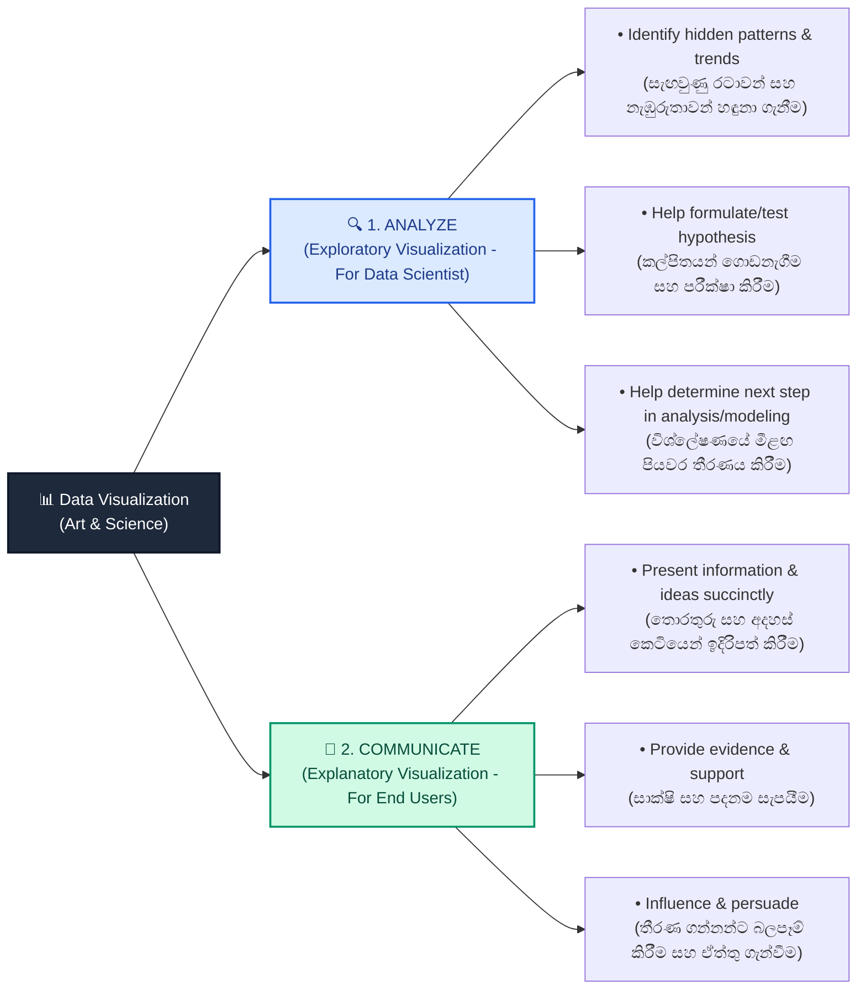
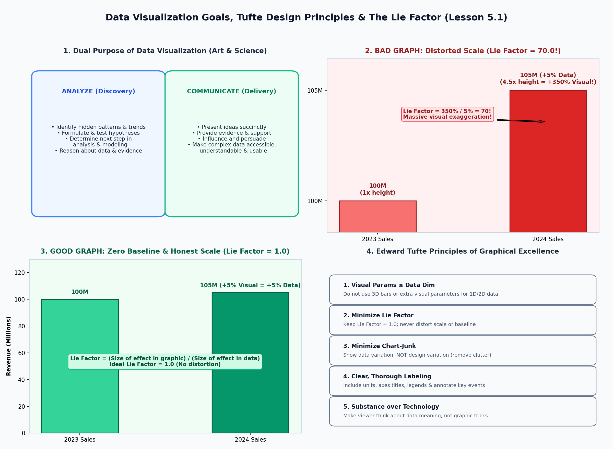

# Lesson 5.1: Purpose of Data Visualization & Edward Tufte's Design Principles (දත්ත දෘශ්‍යකරණයේ අරමුණ සහ සැලසුම් මූලධර්ම)

**Source Lecture Notes:** `Intro-to-Visualization.pdf` (Slides 1 – 9) & `Visualize.ipynb` (Cells 0 – 16)  
**Module:** CI7340 - Applied Data Programming (Dr. Lochandaka Ranathunga)

> [!TIP]
> **📚 Prerequisite / Dependency Lesson Series:**
> මෙම පාඩමේදී භාවිතා වන **Matplotlib** පුස්තකාලය (`Figure`, `Axes`, `plt.plot`, `plt.subplots`) සහ ප්‍රස්තාර හැඩගැන්වීම පිළිබඳ මූලික දැනුම ඔබට නොමැති නම්, පළමුව අපගේ Zero-to-Hero Dependency පාඩම් මාලාව කියවන්න:
> - [Dep 01 - Lesson 01: Matplotlib Anatomy — Figure, Axes & Pyplot vs. OO API](../dependencies/Dep_01_Matplotlib_Zero_to_Hero/01_Matplotlib_Anatomy_Figure_Axes_and_Pyplot_vs_OO_API.md)
> - [Dep 01 - Lesson 02: Customizing Plots — Colors, Markers, Labels, Legends & Spines](../dependencies/Dep_01_Matplotlib_Zero_to_Hero/02_Customizing_Plots_Colors_Markers_Labels_Legends_and_Spines.md)
> - [Dep 01 - Lesson 03: Subplots, GridSpec, Annotations & Saving Publication Figures](../dependencies/Dep_01_Matplotlib_Zero_to_Hero/03_Subplots_GridSpec_Annotations_and_Saving_Publication_Figures.md)
> - [Dep 02 - Lesson 01: Introduction to Seaborn Themes & DataFrame Integration](../dependencies/Dep_02_Seaborn_and_Statistical_Visualization/01_Introduction_to_Seaborn_Themes_and_DataFrame_Integration.md)

---

## 1. Introduction: What is Data Visualization? (Slide 3)

අපි පසුගිය Modules වලදී Python Programming සහ **Mathematics & Statistics (ගණිතමය සහ සංඛ්‍යානමය)** මූලධර්ම ගැන ගැඹුරින් ඉගෙන ගත්තා. නමුත් සැබෑ ලෝකයේ Data Science ව්‍යාපෘතියකදී දත්ත පේළි දහස් ගණනක් හෝ මිලියන ගණනක් (Raw Numbers / Tables) දෙස නිකම්ම බලා සිටීමෙන් එහි සැඟවී ඇති **Patterns (රටාවන්)** තේරුම් ගැනීම මිනිස් මොළයට ඉතාම අපහසුයි.

**Data Visualization (දත්ත දෘශ්‍යකරණය)** යනු දත්ත හෝ තොරතුරු (Data or Information) ප්‍රස්තාරයක් (Graphic) තුළ ඇති **Points (ලක්ෂ්‍ය), Lines (රේඛා), හෝ Bars (තීරු)** වැනි **Visual Objects (දෘශ්‍ය වස්තූන්)** බවට පත් කරමින් (**Visual Encoding**) සන්නිවේදනය කිරීමේ තාක්ෂණයයි.

### Core Characteristics of Data Visualization (Slide 3):
1. **Both an Art and a Science (කලාවක් සහ විද්‍යාවක්):**
   - එය **Science (විද්‍යාවක්)** වන්නේ **Mathematical Scales (ගණිතමය පරිමාණයන්)**, **Statistical Accuracy (සංඛ්‍යානමය නිරවද්‍යතාවය)** සහ මිනිස් ඇසේ **Visual Perception Rules (දෘශ්‍ය සංජානන නීති)** මත පදනම් වන නිසාය.
   - එය **Art (කලාවක්)** වන්නේ Color Harmony, Layout සහ පරිශීලකයාගේ අවධානය ඇදගන්නා ලෙස අලංකාරව හා සරලව නිර්මාණය කළ යුතු නිසාය.
2. **Analyze and Reason about Data and Evidence:**
   - ඵලදායී දෘශ්‍යකරණයක් මඟින් පරිශීලකයින්ට දත්ත සහ සාක්ෂි (Data and Evidence) විශ්ලේෂණය කිරීමට සහ ඒවා මත පදනම්ව තර්කානුකූල තීරණ ගැනීමට උපකාරී වේ.
3. **Makes Complex Data Accessible, Understandable, and Usable:**
   - ඉතාම සංකීර්ණ දත්ත කට්ටල (Complex Datasets) වඩාත් පහසුවෙන් ප්‍රවේශ විය හැකි (Accessible), තේරුම් ගත හැකි (Understandable) සහ ප්‍රායෝගිකව භාවිතයට ගත හැකි (Usable) තත්ත්වයට පත් කරයි.
4. **Primary Goal:**
   - End Users (අවසාන පරිශීලකයින්) වෙත තොරතුරු **Clearly (පැහැදිලිව)** සහ **Efficiently (කාර්යක්ෂමව)** සන්නිවේදනය කිරීමයි.

---

## 2. Dual Goals of Visualization: Analyze vs. Communicate (Slide 4)

දේශන සටහන්වලට (Slide 4) අනුව, අපි Visualization එකක් නිර්මාණය කරන්නේ ප්‍රධාන අරමුණු දෙකක් ඉටු කර ගැනීමටයි:



### A. Analyze (Exploratory Data Visualization)
Data Scientist කෙනෙකුට Dataset එකක් ලැබුණු විගස එහි ස්වභාවය තේරුම් ගැනීමට මෙය භාවිතා කරයි:
- **Identify hidden patterns and trends:** සංඛ්‍යා වගුවකින් නොපෙනෙන සැඟවුණු රටා, **Outliers (අසාමාන්‍ය අගයන්)** සහ **Temporal Trends (කාලීන නැඹුරුතාවන්)** හඳුනා ගැනීම.
- **Help formulate/test hypothesis:** අලුත් **Hypotheses (කල්පිතයන්)** ගොඩනැගීමට සහ ඒවා සත්‍ය දැයි පරීක්ෂා කිරීමට.
- **Help determine the next step in analysis/modeling:** මීළඟට කුමන **Feature Transformation (ලක්ෂණ පරිවර්තනයක්)** කළ යුතුද, කුමන Machine Learning Model එකක් (උදා: **Linear Regression (රේඛීය ප්‍රතිගමනය)** ද නැතිනම් **Non-linear Model (රේඛීය-නොවන ආකෘතියක්)** ද) තෝරා ගත යුතුද යන්න තීරණය කිරීමට.

### B. Communicate (Explanatory Data Visualization)
ඔබ සොයාගත් ප්‍රතිඵල ව්‍යාපාරික ප්‍රධානීන්ට (Stakeholders / Management), Clients ලාට හෝ Research Paper එකක පාඨකයින්ට පෙන්වීමට භාවිතා කරයි:
- **Present information and ideas succinctly:** පිටු ගණනක් ලිවිය යුතු අදහසක් එක ප්‍රස්තාරයකින් ඉතා කෙටියෙන් හා නිරවද්‍යව පෙන්වීම.
- **Provide evidence and support:** ඔබේ නිගමනයන්ට ප්‍රබල දෘශ්‍ය සාක්ෂි සැපයීම.
- **Influence and persuade:** නිවැරදි දත්ත මත පදනම්ව තීරණ ගන්නන්ව ඒත්තු ගැන්වීම (Persuade).

---

## 3. Proper Data Visualization Principles (Slides 5 & 6)

නූතන Data Visualization විෂයයේ පියා ලෙස සැලකෙන **Edward R. Tufte** විසින් ඔහුගේ සුප්‍රසිද්ධ *"The Visual Display of Quantitative Information"* ග්‍රන්ථයේ ඉදිරිපත් කළ මූලික නීති දේශන සටහන්වල (Slides 5–9) සාරාංශ කර ඇත:

> **"Excellence in statistical graphics consists of complex ideas communicated with: clarity, precision, and efficiency."**  
> *(සංඛ්‍යානමය ප්‍රස්තාරවල විශිෂ්ටත්වය යනු සංකීර්ණ අදහස් **Clarity (පැහැදිලිකම)**, **Precision (නිරවද්‍යතාවය)** සහ **Efficiency (කාර්යක්ෂමතාවය)** සහිතව සන්නිවේදනය කිරීමයි.)* — Slide 6

### Proper Data Visualization Should (Slide 5):
1. **Show the data:** ප්‍රස්තාරයේ ප්‍රධානම අවධානය දත්ත වෙත යොමු විය යුතුය.
2. **Make the viewer think about the substance (not the methods / design / technology):** ප්‍රස්තාරය බලන කෙනා සිතිය යුත්තේ *"මේ දත්තවලින් කියවෙන හරය (Substance) කුමක්ද?"* යන්න ගැන මිස *"මේ 3D ප්‍රස්තාරය ඇන්දේ කුමන Software එකෙන්ද?"* යන්න ගැන නොවේ.
3. **Avoid distorting the data:** දත්තවල සැබෑ අගයන් විකෘති වන ලෙස (වැරදි Scales හෝ 3D Perspective Distortion මඟින්) ප්‍රස්තාර නොඇඳිය යුතුය.
4. **Encourage the eye to compare different pieces of data:** එකම ප්‍රස්තාරය තුළ විවිධ දත්ත කාණ්ඩ පහසුවෙන් සංසන්දනය කිරීමට (Comparison) මිනිස් ඇසට උදව් කළ යුතුය.
5. **Reveal data structure at different levels:** පුළුල් දැක්මේ (Broad Overview) සිට සියුම් විස්තර (Fine Structure) දක්වා විවිධ මට්ටම්වලින් දත්තවල ව්‍යුහය හෙළිදරව් කළ යුතුය.
6. **Serve a clear purpose:** **Description (විස්තර කිරීම)**, **Exploration (ගවේෂණය)**, **Tabulation (වගුගත කිරීම)** හෝ **Decoration (අලංකරණය)** යන පැහැදිලි අරමුණකට සේවය කළ යුතුය.

---

## 4. Edward Tufte's 4 Core Design Principles (Slides 7, 8, 9)



### Principle 1: Visual Parameters vs. Data Dimensions (Slides 7 & 8)
> **"The number of visual parameters should not exceed the dimension of the data."**

- **මෙහි තේරුම කුමක්ද?**  
  ඔබ ළඟ ඇත්තේ **1D Data (එක් මානයක දත්තයක් — උදා: විවිධ වසරවල ආදායම)** පමණක් නම්, එය පෙන්වීමට 2D තීරුවක **Height (උස)** නමැති එක් Visual Parameter එකක් පමණක් ප්‍රමාණවත් වේ.
- නමුත් සමහර අය 1D අගයක් පෙන්වීමට **3D Cylinders / 3D Cones** හෝ තීරුවේ උස සහ පළල යන දෙකම (**2D Area**) එකවර වැඩි කරයි.
- එවිට සැබෑ දත්තය දෙගුණයක් ($2\times$) වූ විට, රූපයේ උසත් දෙගුණ වී පළලත් දෙගුණ වීම නිසා **Surface Area (මතුපිට වර්ගඵලය)** හතර ගුණයකින් ($2^2 = 4\times$) හෝ **3D Volume (පරිමාව)** අට ගුණයකින් ($2^3 = 8\times$) විශාල වී පෙනේ! මෙය බරපතල දෘශ්‍ය රැවටීමකි.

---

### Principle 2: Don't Lie with Scale — Minimize the Lie Factor (Slide 9)
> **"Don't lie with scale: minimize (Lie Factor)"**

ප්‍රස්තාරයක් මඟින් සැබෑ දත්ත කොපමණ ප්‍රමාණයකින් විකෘති කර පෙන්වනවාද යන්න ගණිතමයව මැනීමට Edward Tufte විසින් **Lie Factor (මුසා සාධකය)** නමැති සූත්‍රය හඳුන්වා දෙන ලදී:

$$\text{Lie Factor} = \frac{\text{Size of effect shown in graphic}}{\text{Size of effect in data}}$$

එනම්:
$$\text{Lie Factor} = \frac{\frac{\text{Graphic End} - \text{Graphic Start}}{\text{Graphic Start}}}{\frac{\text{Data End} - \text{Data Start}}{\text{Data Start}}} = \frac{\text{Relative Change in Graphic (\%)}}{\text{Relative Change in Actual Data (\%)}}$$

#### Worked Calculation (නිදසුන් ගණනය කිරීම):
ඉහත රූපසටහනේ (Panel 2 සහ Panel 3) දැක්වෙන උදාහරණය සලකා බලමු:
- **Actual Data (සැබෑ දත්තය):** 2023 දී ආදායම රු. මිලියන $100$ කි. 2024 දී ආදායම රු. මිලියන $105$ කි.
  $$\text{Size of effect in data} = \frac{105 - 100}{100} = \frac{5}{100} = 0.05 \quad (5\%)$$
- **Distorted Graph (Truncated Y-Axis):** Y-අක්ෂය $0$ වෙනුවට $99$ න් ආරම්භ කිරීම නිසා, $100\text{M}$ තීරුවේ උස ඒකක $10$ ක් ලෙසත්, $105\text{M}$ තීරුවේ උස ඒකක $45$ ක් ලෙසත් ඇඳ ඇත.
  $$\text{Size of effect shown in graphic} = \frac{45 - 10}{10} = \frac{35}{10} = 3.50 \quad (350\%)$$
  $$\text{Lie Factor} = \frac{3.50}{0.05} = \frac{350\%}{5\%} = \mathbf{70.0}$$
- **Interpretation (අර්ථකථනය):**
  - **අවංක සහ නිවැරදි ප්‍රස්තාරයක $\text{Lie Factor} = 1.0$ විය යුතුය** (ප්‍රායෝගිකව $[0.95, 1.05]$ පරාසය තුළ පිළිගත හැකිය).
  - $\text{Lie Factor} > 1.05$ නම් එය දත්ත අතිශයෝක්තියෙන් (**Overstating / Exaggerating**) පෙන්වයි.
  - $\text{Lie Factor} < 0.95$ නම් එය දත්තවල වෙනස අඩුවෙන් (**Understating**) පෙන්වයි.

---

### Principle 3: Minimize Chart-Junk (Slide 9)
> **"Minimize chart-junk: show data variation, not design variation"**

- **Chart-Junk යනු මොනවාද?**  
  ප්‍රස්තාරයක තොරතුරු තේරුම් ගැනීමට කිසිදු උදව්වක් නොකරන, නමුත් ප්‍රස්තාරය "ලස්සන කිරීමට" යැයි සිතා එකතු කරන අනවශ්‍ය සැරසිලි වේ.
  - උදාහරණ: Unnecessary 3D Effects, Background Clip-art, Heavy Gridlines, Drop Shadows, සහ තේරුමක් නැති Rainbow Colors.
- **Data-Ink Ratio (දත්ත-තීන්ත අනුපාතය):**
  $$\text{Data-Ink Ratio} = \frac{\text{Data-Ink (දත්ත පෙන්වීමට වැය කළ තීන්ත)}}{\text{Total Ink used to print the graphic (මුළු තීන්ත ප්‍රමාණය)}}$$
  Tufte පවසන්නේ **Data-Ink Ratio** එක $1.0$ ට ආසන්න වන ලෙස උපරිම කළ යුතු බවත්, දත්ත නොවන අනවශ්‍ය සැරසිලි (Non-data ink / Chart-junk) ඉවත් කළ යුතු බවත්ය.

---

### Principle 4: Clear, Detailed, and Thorough Labeling (Slide 9)
> **"Clear, detailed and thorough labeling (including important events)"**

ප්‍රස්තාරයක් බලන පුද්ගලයෙකුට වෙනත් ලිපියක් නොකියවා ප්‍රස්තාරය දෙස බැලූ පමණින් සියල්ල වැටහිය යුතුය:
- **Title:** ප්‍රස්තාරයෙන් කියවෙන්නේ කුමක්ද යන්න පැහැදිලි මාතෘකාවකින් දැක්වීම.
- **X-axis & Y-axis Labels with Units:** අක්ෂ දෙකෙන් නිරූපණය වන **Variables (විචල්‍යයන්)** සහ ඒවායේ ඒකක (උදා: `Time (seconds)`, `Voltage (mV)`, `Population (Millions)`) අනිවාර්යයෙන් සඳහන් කිරීම.
- **Legend:** රේඛා හෝ කාණ්ඩ කිහිපයක් ඇත්නම් ඒවා හඳුනා ගැනීමට `plt.legend()` යෙදීම.
- **Annotating Important Events:** ප්‍රස්තාරයේ යම් විශේෂ ඉහළ යාමක් හෝ පහළ වැටීමක් (Spike or Drop) ඇත්නම්, එම ස්ථානයේම ඊතලයක් හෝ ලේබලයක් (`plt.annotate()`) මඟින් එයට හේතුව සඳහන් කිරීම.

---

## 5. Introduction to Matplotlib in Python (`Visualize.ipynb` - Cells 0–16)

> [!TIP]
> **📚 Deep-Dive Dependency Guide:** Matplotlib හි `Figure`, `Axes`, `Axis` ව්‍යුහය සහ Object-Oriented API එක පිළිබඳ සම්පූර්ණ Zero-to-Hero පැහැදිලි කිරීම සඳහා කියවන්න:
> - [Dep 01 - Lesson 01: Matplotlib Anatomy — Figure, Axes & Pyplot vs. OO API](../dependencies/Dep_01_Matplotlib_Zero_to_Hero/01_Matplotlib_Anatomy_Figure_Axes_and_Pyplot_vs_OO_API.md)

දේශන ප්‍රායෝගික නෝට්බුක් එක (`Visualize.ipynb`) මඟින් අපට Python හි ප්‍රධානතම Visualization පුස්තකාලය වන **Matplotlib** හඳුන්වා දෙයි:
- **MATLAB-style Graphics:** Matplotlib යනු MATLAB මෘදුකාංගයේ මෙන් ඉතා පහසුවෙන් Plots, Histograms, Power Spectra, Bar Charts, සහ Scatterplots නිර්මාණය කිරීමට අවශ්‍ය Classes සහ Functions අඩංගු Module එකකි.
- **NumPy Dependency:** Matplotlib භාවිතා කිරීමට අනිවාර්යයෙන්ම **NumPy** තිබිය යුතුය (`**NumPy has to be available to use Matplotlib**`).
- **`pyplot` Submodule:** අපි ප්‍රධාන වශයෙන්ම භාවිතා කරන්නේ `matplotlib.pyplot` නමැති උප-මොඩියුලය වන අතර, එය කෙටියෙන් `plt` ලෙස Import කරගනී.

```python
# Visualize.ipynb Cell 1: Importing NumPy and Matplotlib
# !pip install matplotlib
import numpy as np
import matplotlib.pyplot as plt
```

### Figure and Axes Creation (`plt.figure` and `plt.subplots` - Cells 14–16):
1. **`Figure` (`fig`):** ඔබේ ප්‍රස්තාර එකක් හෝ කිහිපයක් අඩංගු වන සම්පූර්ණ කැන්වසය හෝ කවුළුවයි.
2. **`Axes` (`ax`):** X සහ Y අක්ෂ සහිතව දත්ත ලකුණු කරන තනි ප්‍රස්තාර කොටුවයි (Subplot).

```python
# 1. Axes කිසිවක් නැති හිස් Figure එකක් සෑදීම (Cell 14)
fig = plt.figure()  # empty figure with no axes

# 2. එක් ප්‍රස්තාරයක් (Single Axes) සහිත Figure එකක් සෑදීම (Cell 15)
fig, ax = plt.subplots()

# 3. 2x2 Grid එකක් ලෙස Subplots 4ක් සහිත Figure එකක් සෑදීම (Cell 16)
fig, ax = plt.subplots(2, 2)
```

### Labeling and Saving a Figure to Disk (`Visualize.ipynb` Cells 12 & 13):
Tufte ගේ 4 වන නීතියට අනුව Title, X-label, Y-label යොදා ප්‍රස්තාරයක් `.png` ගොනුවක් ලෙස Save කර, `!dir` (හෝ Linux හි `!ls`) මඟින් එය Save වී ඇත්දැයි පරීක්ෂා කරන ආකාරය:

```python
xVal = [1, 2, 3, 4, 5]
yVal = [1, 4, 6, 4, 9]

plt.title('Sample Title Here', fontsize=18)
plt.xlabel('Label of X-axis', fontsize=14)
plt.ylabel('Label of Y-axis', fontsize=14)

# marker='D' මඟින් Diamond හැඩැති ලක්ෂ්‍ය යොදයි
plt.plot(xVal, yVal, marker='D', markersize=10)

# වත්මන් Folder එක තුළ PNG රූපයක් ලෙස Save කිරීම (Cell 12)
plt.savefig('My_c_fig1.png')
plt.show()

# ගොනුව වත්මන් Directory එකෙහි නිර්මාණය වී ඇත්දැයි පරීක්ෂා කිරීම (Cell 13)
# !dir   (Windows Jupyter Notebook)
```

---

## 🛠️ 6. Practical Task / Hands-On Exercise (ප්‍රායෝගික අභ්‍යාසය)

### Scenario / Goal:
සමාගමක 2023 වසරේ Cloud Server පිරිවැය `$200,000` ක් වූ අතර 2024 වසරේදී එය `$220,000` දක්වා ඉහළ ගියේය. නමුත් මූල්‍ය වාර්තාවක පළ කළ ප්‍රස්තාරයක Y-අක්ෂය `$195,000` සිට ආරම්භ කිරීම නිසා, 2023 තීරුවේ උස `5 mm` ලෙසත්, 2024 තීරුවේ උස `25 mm` ලෙසත් මුද්‍රණය වී ඇත.
ඔබේ කාර්යය වන්නේ Python මඟින් මෙම වැරදි ප්‍රස්තාරයේ **Lie Factor (මුසා සාධකය)** ගණනය කිරීම සහ `plt.subplots(1, 2)` භාවිතා කර **Distorted Graph (Truncated Y-axis)** හා **Honest Tufte Graph (Zero-baseline Y-axis, $\text{Lie Factor} = 1.0$)** යන දෙක එක පෙළට ඇඳ සංසන්දනය කිරීමයි.

### Step-by-Step Tasks:
1. සැබෑ දත්තවල ප්‍රතිශත වෙනස (**Relative Change in Data**) සහ මුද්‍රිත ප්‍රස්තාරයේ ප්‍රතිශත වෙනස (**Relative Change in Graphic**) ගණනය කර **Lie Factor** අගය Print කරන්න.
2. `fig, (ax1, ax2) = plt.subplots(1, 2, figsize=(10, 4.5))` නිර්මාණය කරන්න.
3. `ax1` මත `ylim=(195, 225)` සහිතව නොමඟ යවන ප්‍රස්තාරය ඇඳ, `ax2` මත `ylim=(0, 250)` සහිතව අවංක ප්‍රස්තාරය අඳින්න.
4. Tufte මූලධර්මය අනුව ඉහළ සහ දකුණු `spines` ඉවත් කර, සෑම තීරුවක් මතම අගය `bar_label` මඟින් පෙන්වන්න.

### Starter Code:
```python
import matplotlib.pyplot as plt

years = ['2023', '2024']
costs_k = [200, 220]          # in $ Thousands
graphic_heights_mm = [5, 25]  # heights shown in misleading chart

# 1. TODO: Calculate effect_in_data, effect_in_graphic, and lie_factor
# 2. TODO: Create 1x2 subplots comparing Misleading vs Honest Bar Plots
```

### Expected Output / Reference Solution:
```python
import matplotlib.pyplot as plt

years = ['2023', '2024']
costs_k = [200, 220]          # $200k to $220k
graphic_heights_mm = [5, 25]  # 5mm to 25mm due to truncated y-axis at 195k

# 1. Lie Factor ගණනය කිරීම
effect_in_data = (costs_k[1] - costs_k[0]) / costs_k[0]                         # (220 - 200)/200 = 0.10 (10%)
effect_in_graphic = (graphic_heights_mm[1] - graphic_heights_mm[0]) / graphic_heights_mm[0]  # (25 - 5)/5 = 4.00 (400%)
lie_factor = effect_in_graphic / effect_in_data                                 # 4.00 / 0.10 = 40.0

print(f"Size of effect in data    : {effect_in_data*100:.1f}%")
print(f"Size of effect in graphic : {effect_in_graphic*100:.1f}%")
print(f"Tufte Lie Factor          : {lie_factor:.1f} (Severely Distorted!)")

# 2. Misleading vs. Honest Graph සංසන්දනය
fig, (ax1, ax2) = plt.subplots(1, 2, figsize=(10, 4.5))

# Panel 1: Misleading Graph (Truncated Y-axis)
b1 = ax1.bar(years, costs_k, width=0.45, color='#ef4444', edgecolor='black')
ax1.set_ylim(195, 225)
ax1.set_title(f'Misleading Plot (Truncated Axis)\nLie Factor = {lie_factor:.1f}', fontweight='bold', color='#991b1b')
ax1.set_ylabel('Cloud Server Cost ($ Thousands)')
ax1.bar_label(b1, padding=3, fmt='$%dk')

# Panel 2: Honest Tufte-Compliant Graph (Zero Baseline)
b2 = ax2.bar(years, costs_k, width=0.45, color='#10b981', edgecolor='black')
ax2.set_ylim(0, 250)
ax2.set_title('Honest Tufte Plot (Zero Baseline)\nLie Factor = 1.0', fontweight='bold', color='#065f46')
ax2.set_ylabel('Cloud Server Cost ($ Thousands)')
ax2.bar_label(b2, padding=3, fmt='$%dk')

for ax in (ax1, ax2):
    ax.spines['top'].set_visible(False)
    ax.spines['right'].set_visible(False)
    ax.yaxis.grid(True, linestyle=':', alpha=0.6)

plt.tight_layout()
plt.show()
```

---

## 7. Summary Cheat Sheet (සාරාංශය)

| Concept | Core Principle & Rule |
| :--- | :--- |
| **Data Visualization** | දත්ත Visual Objects (Points, Lines, Bars) ලෙස Encode කර පැහැදිලිව හා කාර්යක්ෂමව සන්නිවේදනය කිරීමේ කලාව සහ විද්‍යාවයි. |
| **Analyze vs. Communicate** | **Analyze:** රටා සෙවීමට, **Hypotheses (කල්පිත)** පරීක්ෂාවට සහ මීළඟ පියවර තීරණයට. **Communicate:** තොරතුරු කෙටියෙන් පෙන්වා තීරණ ගන්නන්ට සාක්ෂි සැපයීමට. |
| **Visual Parameters $\le$ Data Dim** | දත්තවල මානයන් ගණනට වඩා වැඩි Visual Parameters (උදා: 1D දත්ත සඳහා 3D Bars) කිසිවිටෙක භාවිතා නොකරන්න. |
| **Lie Factor (මුසා සාධකය)** | $\frac{\text{Size of effect in graphic}}{\text{Size of effect in data}}$. මෙය සැමවිටම **$1.0$** ට ආසන්නව තබා ගත යුතුය. |
| **Chart-Junk** | **Data Variation (දත්තවල විචලනය)** මිස **Design Variation (නිර්මාණයේ විචලනය)** නොපෙන්වන්න; අනවශ්‍ය සැරසිලි ඉවත් කරන්න. |
| **Thorough Labeling** | Title, X/Y Axis Labels (ඒකක සමඟ), Legends සහ Important Events (`annotate`) පැහැදිලිව ලේබල් කරන්න. |
