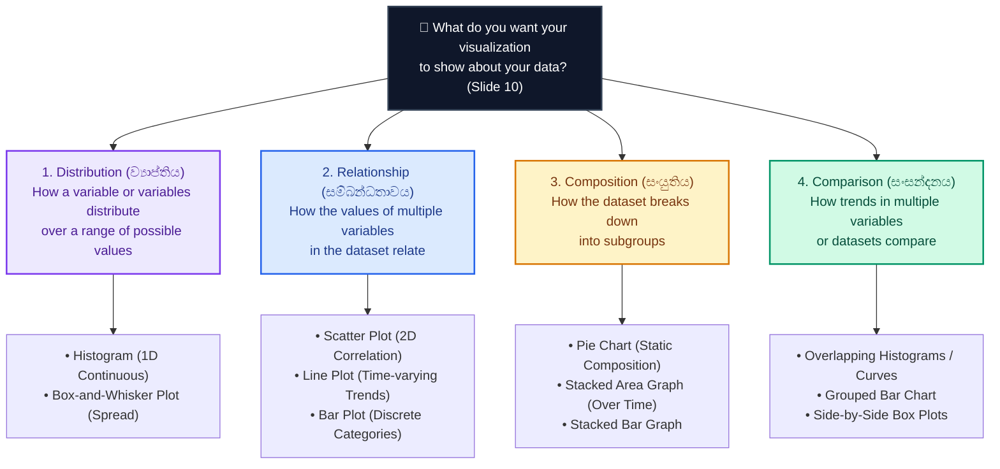
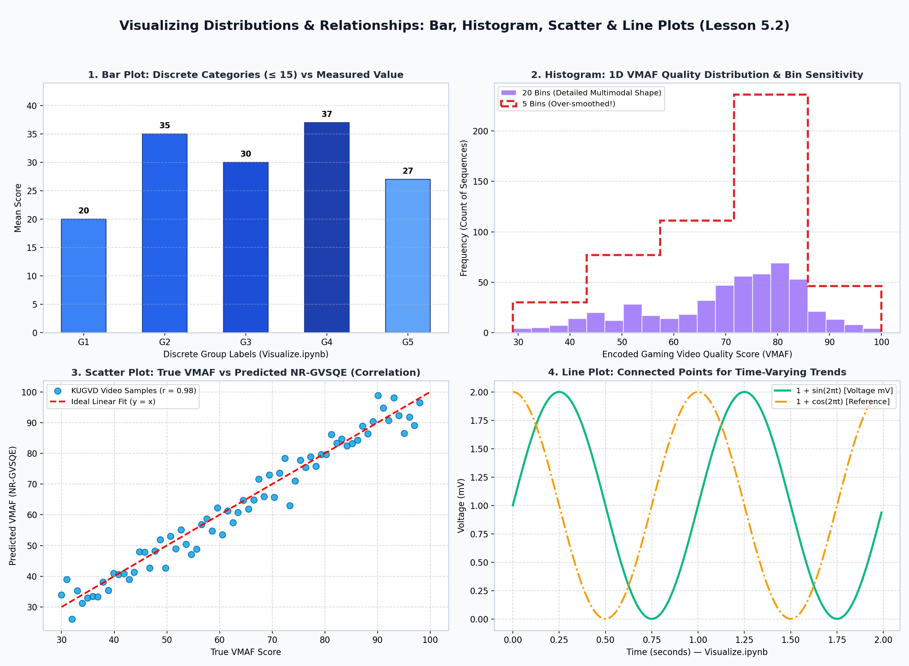

# Lesson 5.2: Choosing the Right Visualization — Distributions & Relationships (Bar, Histogram, Scatter & Line Plots)

**Source Lecture Notes:** `Intro-to-Visualization.pdf` (Slides 10 – 15) & `Visualize.ipynb` (Cells 2 – 20, 24)  
**Module:** CI7340 - Applied Data Programming (Dr. Lochandaka Ranathunga)

> [!TIP]
> **📚 Prerequisite / Dependency Lesson Series:**
> මෙම පාඩමේදී භාවිතා වන **Matplotlib Line/Scatter/Bar/Histogram** කේත, **Seaborn Distribution & Relational Plots**, සහ **Pearson Correlation (පියර්සන් සහසම්බන්ධතාවය)** පිළිබඳ මූලික දැනුම සඳහා පහත Dependency පාඩම් මාලාවන් කියවන්න:
> - [Dep 01 - Lesson 01: Matplotlib Anatomy — Figure, Axes & Pyplot vs. OO API](../dependencies/Dep_01_Matplotlib_Zero_to_Hero/01_Matplotlib_Anatomy_Figure_Axes_and_Pyplot_vs_OO_API.md)
> - [Dep 01 - Lesson 02: Customizing Plots — Colors, Markers, Labels, Legends & Spines](../dependencies/Dep_01_Matplotlib_Zero_to_Hero/02_Customizing_Plots_Colors_Markers_Labels_Legends_and_Spines.md)
> - [Dep 01 - Lesson 04: Statistical Charts in Matplotlib — Histograms, Boxplots & Error Bars](../dependencies/Dep_01_Matplotlib_Zero_to_Hero/04_Statistical_Charts_in_Matplotlib_Histograms_Boxplots_ErrorBars_Heatmaps.md)
> - [Dep 02 - Lesson 02: Distribution, Categorical & Relational Plots in Seaborn](../dependencies/Dep_02_Seaborn_and_Statistical_Visualization/02_Distribution_Categorical_and_Relational_Plots_in_Seaborn.md)
> - [Module 4 - Dep 04: Standard Deviation, Normal Distribution & Hypothesis Testing](../Module_04_Mathematics_and_Statistics_for_Data_Science/dependencies/Dep_04_Standard_Deviation_Normal_Distribution_and_Hypothesis_Testing/)

---

## 1. Introduction: What Do You Want Your Visualization to Show? (Slide 10)

ඔබ ප්‍රස්තාරයක් ඇඳීමට පෙර ඔබෙන්ම ඇසිය යුතු වැදගත්ම ප්‍රශ්නය වන්නේ: **"What do you want your visualization to show about your data?"** (මගේ දත්ත ගැන මට පෙන්වීමට අවශ්‍ය කුමන ලක්ෂණයද?) යන්නයි.

දේශන සටහන්වලට (Slide 10) අනුව සියලුම Data Visualizations ප්‍රධාන කාණ්ඩ 4 කට බෙදේ:



මෙම පාඩමෙන් අපි **Bar Plot**, **Histogram**, **Scatter Plot**, සහ **Line Plot** යන ප්‍රධාන ප්‍රස්තාර වර්ග 4 පිළිබඳව සිද්ධාන්ත සහ `Visualize.ipynb` හි ප්‍රායෝගික Python කේත සමඟ ගැඹුරින් ඉගෙන ගනිමු.



---

## 2. Bar Plot (තීරු ප්‍රස්තාරය - Slide 11 & `Visualize.ipynb` Cell 24)

### When to Use a Bar Plot (Slide 11):
- **Showing the relation between two or more variables:** එක් අක්ෂයක **Discrete Categories (විවික්ත කාණ්ඩ)** සහ අනෙක් අක්ෂයේ **Measured Value (මනින ලද සංඛ්‍යාත්මක අගය)** නිරූපණය කරයි.
- **Good when we deal with a small number of categories ($\le 15$):**  
  > **Golden Rule (Slide 11):** කාණ්ඩ ගණන **15 කට හෝ ඊට අඩු වන විට ($\le 15$)** Bar Plot එකක් ඉතාම සුදුසු වේ. (කාණ්ඩ 50ක් හෝ 100ක් තිබේ නම් තීරු ඉතා සිහින් වී ලේබල් එක මත එක වැටී කියවීමට නොහැකි වේ).
- දත්ත ලේබල් කිහිපයකට (**Few Labels**) ගොනු කළ හැකි විට සහ X-අක්ෂයේ **Discrete Data (විවික්ත දත්ත)** ඇති විට වඩාත් යෝග්‍ය වේ.

### Python Implementation (`Visualize.ipynb` - Cell 24):
කණ්ඩායම් 5ක (`G1` සිට `G5` දක්වා) පිරිමි පුද්ගලයින්ගේ **Sample Mean (සාම්පල මධ්‍යන්‍ය ලකුණු)** (`men_mean`) Bar Plot එකකින් ඇඳීම:

```python
import matplotlib.pyplot as plt

labels = ['G1', 'G2', 'G3', 'G4', 'G5']
men_mean = [20, 35, 30, 37, 27]

plt.bar(labels, men_mean)
plt.title('Mean Values')
plt.xlabel('Groups')
plt.ylabel('Mean Score')
plt.show()
```

---

## 3. Histogram (හිස්ටෝග්‍රෑමය - Slide 12)

බොහෝ ආධුනිකයින් **Bar Plot** සහ **Histogram** එකම දෙයක් යැයි වරදවා වටහා ගනී. නමුත් මේ දෙක අතර මූලික සංඛ්‍යානමය වෙනසක් ඇත!

### What is a Histogram? (Slide 12):
- **1D Data Distribution (එක්-මාන දත්තවල ව්‍යාප්තිය):** එක් **Continuous Variable (සන්තතික විචල්‍යයක්)** අගය පරාසයන් (**Bins / Class Intervals**) හරහා බෙදී පවතින ආකාරය (**Frequency Distribution (සංඛ්‍යාත ව්‍යාප්තිය)**) පෙන්වයි.
- **Research Case Study — Gaming Video VMAF Distribution (Slide 12):**  
  Dr. Ranathunga ගේ පර්යේෂණවලදී Machine Learning Model එකක් පුහුණු කිරීමට ගත් Gaming Video Sequences වල වීඩියෝ ගුණාත්මකභාවය (**VMAF - Video Multi-Method Assessment Fusion** ලකුණු $0$ සිට $100$ දක්වා) බෙදී පවතින ආකාරය පෙන්වීමට Histogram භාවිතා කර ඇත. එමඟින් වැඩිම වීඩියෝ ප්‍රමාණයක් පවතින්නේ කුමන VMAF පරාසයේද යන්නත්, දත්තවල **Skewness (කුටිකතාවය)** කෙබඳුද යන්නත් ක්ෂණිකව පෙනේ.

### ⚠️ Critical Warning: Bin Sensitivity (Slide 12):
> **"Note: Trends in histograms are sensitive to the number of bins."**

- Histogram එකකින් පෙනෙන හැඩය ඔබ තෝරා ගන්නා **Number of Bins (පන්ති ප්‍රාන්තර ගණන)** මත දැඩිව රඳා පවතී (ඉහත රූපයේ Panel 2 බලන්න):
  - **Too Few Bins (උදා: `bins=5`):** දත්තවල ඇති සැබෑ මුදුන් දෙකක් (**Bimodal Peaks**) එකට වැසී ගොස් සාවද්‍ය සුමට හැඩයක් (**Over-smoothed**) පෙන්වයි.
  - **Too Many Bins (උදා: `bins=200`):** සෑම කුඩා අහඹු වෙනස්වීමක්ම (**Random Sampling Noise**) උස් පහත් වීම් ලෙස පෙනෙන නිසා සමස්ත ව්‍යාප්තිය තේරුම් ගත නොහැක (**Under-smoothed**).
  - **Topic Gap Analysis Tip:** මෙම Bin Sensitivity ගැටලුව මඟහරවා ගැනීමට Seaborn හි `sns.histplot(kde=True)` මඟින් සුමට **Kernel Density Estimate - KDE (කර්නල් ඝනත්ව ඇස්තමේන්තුව)** වක්‍රයක් Histogram එක මතින් ඇඳීම වඩාත් සාර්ථක වේ ([Dep 02 - Lesson 02](../dependencies/Dep_02_Seaborn_and_Statistical_Visualization/02_Distribution_Categorical_and_Relational_Plots_in_Seaborn.md) බලන්න).

### Bar Plot vs. Histogram Comparison:

| Feature | Bar Plot (`plt.bar`) | Histogram (`plt.hist`) |
| :--- | :--- | :--- |
| **Data Type** | **Discrete / Categorical Data (විවික්ත කාණ්ඩ)** — උදා: `G1, G2, G3` | **Continuous Quantitative 1D Data (සන්තතික සංඛ්‍යාත්මක දත්ත)** — උදා: `VMAF`, උස, වයස |
| **Gaps Between Bars** | තීරු අතර පැහැදිලි පරතරයක් ඇත (වෙනම කාණ්ඩ නිසා). | තීරු එකට යා වී පවතී (අඛණ්ඩ සංඛ්‍යා පරාසයක් නිසා). |
| **X-Axis Ordering** | කාණ්ඩවල අනුපිළිවෙල මාරු කළ හැක. | සංඛ්‍යා රේඛාවක් නිසා අනුපිළිවෙල මාරු කළ නොහැක. |

---

## 4. Scatter Plot (විසිරුම් ප්‍රස්තාරය - Slides 13 – 14)

### When to Use a Scatter Plot (Slide 13):
**Multi-dimensional data (බහු-මාන දත්ත)** කට්ටලයක විචල්‍යයන් දෙකක් ($X$ සහ $Y$) අතර පවතින **Relationship (සම්බන්ධතාවය)** දෘශ්‍යමාන කිරීමට හොඳම ක්‍රමය Scatter Plot එකයි:
1. **Positive or Negative Relation (ධන හෝ සෘණ සම්බන්ධතාවය):**
   - $X$ වැඩි වන විට $Y$ වැඩි වේ නම් $\rightarrow$ **Positive Correlation (ධන සහසම්බන්ධතාවය)**.
   - $X$ වැඩි වන විට $Y$ අඩු වේ නම් $\rightarrow$ **Negative Correlation (සෘණ සහසම්බන්ධතාවය)**.
2. **Linear or Non-linear Relation (රේඛීය හෝ රේඛීය-නොවන සම්බන්ධතාවය):**
   - ලක්ෂ්‍ය සියල්ල සරල රේඛාවක් වටා පෙළගැසී ඇත්ද (**Linear**) නැතිනම් වක්‍රාකාර හැඩයක් (**Non-linear / Quadratic / Exponential**) ගනීද යන්න පෙන්වයි.
3. **Visual Representation of Pearson Correlation ($r$):**
   - අපි Module 4 හි ඉගෙන ගත් **Pearson Correlation Coefficient (පියර්සන් සහසම්බන්ධතා සංගුණකය $r \in [-1, +1]$)** හි සැබෑ හැසිරීම ඇසින් බලා ගැනීමට Scatter Plot එක භාවිතා කරයි.

> [!TIP]
> **📚 Cross-Module Prerequisite:** **Pearson Correlation ($r$)** සහ **Covariance (සහවිචලතාවය)** ගණනය කරන ආකාරය නැවත මතක් කර ගැනීමට කියවන්න:
> - [Module 4 - Lesson 4.5: Measures of Spread and Correlation](../Module_04_Mathematics_and_Statistics_for_Data_Science/Lesson_4.5_Descriptive_Statistics_II_Measures_of_Spread_and_Correlation.md)

### Research Case Study: KUGVD Dataset (Slide 14):
- Slide 14 හි පෙන්වා ඇත්තේ **KUGVD (Kingston University Gaming Video Dataset)** දත්ත කට්ටලය සඳහා සැබෑ **True VMAF** අගයන් (X-අක්ෂය) සහ AI මොඩලයෙන් පුරෝකථනය කළ **NR-GVSQE (Predicted VMAF)** ලකුණු (Y-අක්ෂය) අතර Scatter Plot එකයි (ඉහත රූපයේ Panel 3 බලන්න).
- ලක්ෂ්‍ය සියල්ල $y = x$ විකර්ණ රේඛාව වටා තදින් එක්රැස් වී තිබීමෙන් පෙනී යන්නේ Predicted VMAF සහ True VMAF අතර ඉතා ප්‍රබල **Positive Linear Correlation (ධන රේඛීය සහසම්බන්ධතාවයක්)** පවතින බවයි!

---

## 5. Line Plot (රේඛීය ප්‍රස්තාරය - Slide 15 & `Visualize.ipynb` Cells 2 – 20)

### What is a Line Plot? (Slide 15):
- **Connected Points:** Scatter Plot එකක මෙන් ලක්ෂ්‍ය ලකුණු කර, ඒවා අනුපිළිවෙලින් රේඛාවකින් යා කිරීමෙන් සාදනු ලබයි.
- **Useful to see for trends:** එක් විචල්‍යයක් අනෙක් විචල්‍යය මත අඛණ්ඩව රඳා පවතින විට—විශේෂයෙන්ම **Time-varying data (කාලය සමඟ වෙනස් වන දත්ත / Time Series)** සඳහා—වඩාත්ම ගැලපේ.
- **Examples (Slide 15):**
  - **Distance vs. Time (කාලය සමඟ දුර වෙනස් වීම)**
  - **Change of Voltage over Time (කාලය සමඟ වෝල්ටීයතාවය වෙනස් වීම)**

---

## 6. Complete Walkthrough of `Visualize.ipynb` Line Plot Code (Cells 3 – 20)

දේශන නෝට්බුක් එකෙහි (`Visualize.ipynb`) `plt.plot()` භාවිතා කරන විවිධ ආකාර සියල්ල පහත දැක්වේ:

### A. Implicit X-Indexes (`Visualize.ipynb` Cell 3):
ඔබ `plt.plot()` වෙත එක් ලැයිස්තුවක් පමණක් ලබා දුන් විට, Matplotlib විසින් එම අගයන් **Y-අක්ෂය** ලෙස ගන්නා අතර, ඒවායේ Index අගයන් (`0, 1, 2, 3, 4, 5`) ස්වයංක්‍රීයව **X-අක්ෂය** ලෙස යොදා ගනී:

```python
# Indexes [0, 1, 2, 3, 4, 5] are implicit X values!
plt.plot([1, 2, 3, 4, 7, 5])
plt.show()
```

### B. Explicit X and Y Axes & Swapping Axes (Cells 4, 5, 6):
```python
# X සහ Y අගයන් දෙකම ලබා දීම (Cell 4)
plt.plot([1, 2, 3, 4, 5, 6], [1, 4, 6, 8, 9, 4])

# X සහ Y අක්ෂ මාරු කිරීම (Change axes values - Cell 5)
plt.plot([1, 4, 6, 8, 9, 4], [1, 2, 3, 4, 5, 6])

# Variables භාවිතා කර ඇඳීම (Cell 6)
xVal = [1, 2, 3, 4, 5]
yVal = [1, 4, 6, 4, 9]
plt.plot(xVal, yVal)
print(type(xVal))  # <class 'list'>
```

### C. Changing Linewidth, Colors & Markers (Cells 8, 9, 10):
```python
# 1. රේඛාවේ ගණකම වැඩි කිරීම (linewidth=5 - Cell 8)
plt.plot(xVal, yVal, linewidth=5)

# 2. රේඛාවක් නැතිව රතු පැහැති '+' ලකුණු පමණක් යෙදීම ('r+' format string - Cell 9)
plt.plot(xVal, yVal, 'r+')

# 3. වර්ණය 'indigo' ලෙසත්, රවුම් ලක්ෂ්‍ය (marker='o') විශාලවත් යෙදීම (Cell 10)
plt.plot(xVal, yVal, color='indigo', marker='o', markersize=12)
```

### D. Multi-Panel `plt.subplot(221)` with `plt.tight_layout()` (Cell 17):
`plt.subplot(nrows, ncols, index)` (හෝ `221` ලෙස කෙටියෙන්) භාවිතා කර **Sine** සහ **Cosine** තරංග 4ක් එකම කවුළුවක ඇඳීම:

```python
import numpy as np
import matplotlib.pyplot as plt

t = np.arange(0.0, 2, 0.01)   # 0 සිට 2 දක්වා 0.01 පියවර වලින් Time interval range
s1 = np.sin(2 * np.pi * t)    # Sine values
s2 = np.cos(2 * np.pi * t)    # Cosine values

plt.figure(1)

# 2x2 Grid එකේ 1 වන කොටුව (221)
plt.subplot(221)
plt.plot(t, s1)
plt.title('Sin Function')

# 2x2 Grid එකේ 2 වන කොටුව (222)
plt.subplot(222)
plt.plot(t, s2)
plt.title('Cos Function')

# 2x2 Grid එකේ 3 වන කොටුව (223) - Sin vs Cos (වෘත්තයක් ලැබේ!)
plt.subplot(223)
plt.plot(s1, s2)
plt.title('Sin vs Cos')

# 2x2 Grid එකේ 4 වන කොටුව (224) - තරංග දෙකේ එකතුව
plt.subplot(224)
plt.plot(t, s1 + s2)
plt.title('Sin + Cos Function')

# ප්‍රස්තාර 4 එක මත එක වැටීම වැළැක්වීමට පරතරය සකසයි
plt.tight_layout()
plt.show()
```

### E. `plt.rcParams.update()` and Object-Oriented `ax.set()` (Cell 18):
Slide 15 හි සඳහන් **Voltage over Time** ප්‍රස්තාරය Object-Oriented ක්‍රමයට (`fig1, ax = plt.subplots()`) අඳින ආකාරය:

```python
fig1, ax = plt.subplots()
ax.plot(t, 1 + s1)

# ගෝලීය වශයෙන් (Globally) අකුරුවල ප්‍රමාණය වෙනස් කිරීම
parameters = {'axes.labelsize': 20, 'axes.titlesize': 30}
plt.rcParams.update(parameters)

ax.set(xlabel='time (seconds)')
ax.set(ylabel='Voltage (mv)')
ax.set(title='Sine Function')
plt.tight_layout()
plt.show()
```

### F. Multiple Plots within One Graph & Legends (Cell 20):
**Square Root (වර්ගමූලය $2\sqrt{x}$)** සහ **Cubic Root (ඝනමූලය $2\sqrt[3]{x}$)** එකම ප්‍රස්තාරයක ඇඳ සංසන්දනය කිරීම:

```python
x1 = np.arange(1, 100.5, 0.5)   # X අක්ෂය: 1 සිට 100 දක්වා
y1 = 2.0 * np.sqrt(x1)          # Square Root Function
y2 = 2.0 * x1**(1.0 / 3.0)      # Cubic Root Function

plt.plot(x1, y1, label='y1')    # Legend of y1
plt.plot(x1, y2, label='y2')    # Legend of y2
plt.legend()                    # Ask to include the legends

plt.title('SQRT vs Cubic Root', fontsize=20)
plt.xlabel('X Parameter', fontsize=14)
plt.ylabel('Value Parameter', fontsize=14)
plt.tight_layout()
plt.show()
```

---

## 🛠️ 7. Practical Task / Hands-On Exercise (ප්‍රායෝගික අභ්‍යාසය)

### Scenario / Goal:
ඔබ KUGVD Gaming Video පර්යේෂණාගාරයේ වීඩියෝ සාම්පල 150ක **True VMAF** සහ **Predicted VMAF (NR-GVSQE)** ලකුණු විශ්ලේෂණය කරයි. ඔබට `1x3` Subplots පැනලයක් නිර්මාණය කර:
1. පළමු ප්‍රස්තාරයෙන් `bins=5` (Over-smoothed) සහ `bins=20` (Optimal) අතර **Histogram Bin Sensitivity** පෙන්වීම,
2. දෙවන ප්‍රස්තාරයෙන් True VMAF vs. Predicted VMAF **Scatter Plot** එක සහ **Pearson Correlation ($r$)** අගය පෙන්වීම,
3. තුන්වන ප්‍රස්තාරයෙන් තත්පර 2ක කාලයක් තුළ වීඩියෝ රාමුවල **Bitrate over Time** **Line Plot** එක පෙන්වීම
සිදු කළ යුතුය.

### Step-by-Step Tasks:
1. පහත Starter Code හි දත්ත භාවිතා කර `np.corrcoef(true_vmaf, pred_vmaf)[0, 1]` මඟින් **Pearson Correlation ($r$)** ගණනය කරන්න.
2. `fig, axes = plt.subplots(1, 3, figsize=(15, 4.5))` සාදන්න.
3. `axes[0]` මත `true_vmaf` සඳහා `bins=20` සහ `bins=5` Histograms දෙක `alpha=0.6` සහිතව අඳින්න.
4. `axes[1]` මත `true_vmaf` vs `pred_vmaf` Scatter Plot එක සහ $y=x$ සමුද්දේශ රේඛාව ඇඳ, මාතෘකාවේ $r$ අගය පෙන්වන්න.
5. `axes[2]` මත කාලය (`t_sec`) සමඟ වෙනස් වන `bitrate_trace` Line Plot එක අඳින්න.

### Starter Code:
```python
import numpy as np
import matplotlib.pyplot as plt

np.random.seed(101)
true_vmaf = np.clip(np.random.normal(72, 12, 150), 20, 100)
pred_vmaf = np.clip(true_vmaf + np.random.normal(0, 4.5, 150), 20, 100)

t_sec = np.linspace(0, 2, 50)
bitrate_trace = 3500 + 800 * np.sin(2 * np.pi * t_sec) + np.random.normal(0, 120, 50)

# TODO: Compute Pearson r and create 1x3 subplots (Histogram, Scatter Plot, Line Plot)
```

### Expected Output / Reference Solution:
```python
import numpy as np
import matplotlib.pyplot as plt

np.random.seed(101)
true_vmaf = np.clip(np.random.normal(72, 12, 150), 20, 100)
pred_vmaf = np.clip(true_vmaf + np.random.normal(0, 4.5, 150), 20, 100)

t_sec = np.linspace(0, 2, 50)
bitrate_trace = 3500 + 800 * np.sin(2 * np.pi * t_sec) + np.random.normal(0, 120, 50)

# 1. Pearson Correlation Coefficient (r) ගණනය කිරීම
r_val = np.corrcoef(true_vmaf, pred_vmaf)[0, 1]

fig, axes = plt.subplots(1, 3, figsize=(15, 4.5))

# Panel 1: Histogram & Bin Sensitivity
axes[0].hist(true_vmaf, bins=20, color='#3b82f6', edgecolor='black', alpha=0.75, label='bins=20 (Detailed)')
axes[0].hist(true_vmaf, bins=5,  color='#f59e0b', edgecolor='black', alpha=0.40, label='bins=5 (Coarse)')
axes[0].set_title('1. Histogram: True VMAF Distribution', fontweight='bold')
axes[0].set_xlabel('True VMAF Score')
axes[0].set_ylabel('Frequency')
axes[0].legend()

# Panel 2: Scatter Plot & Pearson Correlation
axes[1].scatter(true_vmaf, pred_vmaf, color='#10b981', edgecolor='black', alpha=0.75, label='Video Samples')
axes[1].plot([20, 100], [20, 100], 'r--', lw=2, label='Ideal y = x Line')
axes[1].set_title(f'2. Scatter Plot (Pearson r = {r_val:.3f})', fontweight='bold')
axes[1].set_xlabel('True VMAF Score')
axes[1].set_ylabel('Predicted VMAF (NR-GVSQE)')
axes[1].legend()

# Panel 3: Time-Varying Line Plot
axes[2].plot(t_sec, bitrate_trace, color='#7c3aed', marker='o', markersize=4, lw=2, label='Bitrate Trace')
axes[2].set_title('3. Line Plot: Bitrate Over Time', fontweight='bold')
axes[2].set_xlabel('Time (seconds)')
axes[2].set_ylabel('Instantaneous Bitrate (kbps)')
axes[2].grid(True, linestyle=':', alpha=0.6)
axes[2].legend()

plt.tight_layout()
plt.show()
```

---

## 8. Summary Cheat Sheet (සාරාංශය)

| Plot Type | Primary Role | Key Lecture Rules & Limitations |
| :--- | :--- | :--- |
| **Bar Plot (`plt.bar`)** | **Discrete Categories (විවික්ත කාණ්ඩ)** සහ සංඛ්‍යාත්මක අගයන් අතර සම්බන්ධය | කාණ්ඩ ගණන **$\le 15$** වන විට වඩාත් සුදුසුය. |
| **Histogram (`plt.hist`)** | 1D සන්තතික දත්තවල **Probability / Frequency Distribution (ව්‍යාප්තිය)** පෙන්වීම | **Sensitive to number of bins** (Bins ගණනට ඉතා සංවේදී වේ). |
| **Scatter Plot (`plt.scatter`)** | විචල්‍යයන් දෙකක් අතර සම්බන්ධතාවය (Positive/Negative, Linear/Non-linear) | **Pearson Correlation ($r$)** ඇසින් බලා ගැනීමට හොඳම ක්‍රමයයි. |
| **Line Plot (`plt.plot`)** | අනුපිළිවෙලින් යා කළ ලක්ෂ්‍ය මඟින් **Trends (නැඹුරුතා)** පෙන්වීම | **Time-varying data (කාලය සමඟ වෙනස් වන දත්ත)** සඳහා වඩාත්ම සුදුසුය. |
