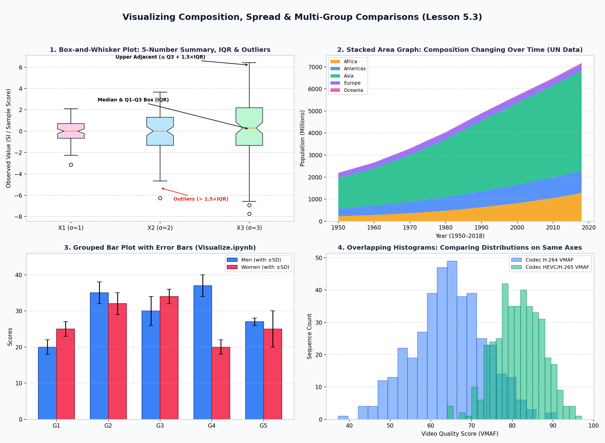
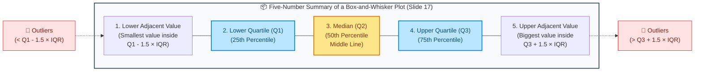

# Lesson 5.3: Visualizing Composition, Spread & Comparisons (Pie Chart, Box-and-Whisker Plot, Stacked Area & Multi-Bars)

**Source Lecture Notes:** `Intro-to-Visualization.pdf` (Slides 16 – 20) & `Visualize.ipynb` (Cells 25 – 33)  
**Module:** CI7340 - Applied Data Programming (Dr. Lochandaka Ranathunga)

> [!TIP]
> **📚 Prerequisite / Dependency Lesson Series:**
> මෙම පාඩමේදී භාවිතා වන **Median (මධ්‍යස්ථය)**, **Quartiles (චතුර්ථක)**, **Interquartile Range - IQR (අන්තර්-චතුර්ථක පරාසය)**, **Standard Deviation (සම්මත අපගමනය)** සහ **Matplotlib / Seaborn Boxplot & Barplot** කේත පිළිබඳ ගැඹුරු අවබෝධය සඳහා කියවන්න:
> - [Dep 01 - Lesson 04: Statistical Charts in Matplotlib — Histograms, Boxplots, Error Bars & Heatmaps](../dependencies/Dep_01_Matplotlib_Zero_to_Hero/04_Statistical_Charts_in_Matplotlib_Histograms_Boxplots_ErrorBars_Heatmaps.md)
> - [Dep 02 - Lesson 02: Distribution, Categorical & Relational Plots in Seaborn (`boxplot` vs `violinplot`)](../dependencies/Dep_02_Seaborn_and_Statistical_Visualization/02_Distribution_Categorical_and_Relational_Plots_in_Seaborn.md)
> - [Module 4 - Dep 04: Standard Deviation, Normal Distribution & Hypothesis Testing](../Module_04_Mathematics_and_Statistics_for_Data_Science/dependencies/Dep_04_Standard_Deviation_Normal_Distribution_and_Hypothesis_Testing/)

---

## 1. Introduction

පසුගිය පාඩමෙන් අපි මූලික ව්‍යාප්ති (Histogram) සහ විචල්‍යයන් දෙකක් අතර සම්බන්ධතා (Scatter, Line, Bar) ගැන ඉගෙන ගත්තා. මෙම පාඩමෙන් අපි ඉගෙන ගන්නේ:
1. කණ්ඩායමක **Composition (සංයුතිය)** — එනම් සමස්තය උප-කාණ්ඩවලට බෙදී යන ආකාරය (Static සහ Time-varying) පෙන්වන්නේ කෙසේද?
2. දත්ත කට්ටලයක **Spread (විසිරීම)**, **Skewness (කුටිකතාවය)** සහ **Outliers (අසාමාන්‍ය අගයන්)** **Five-Number Summary (සංඛ්‍යා 5ක සාරාංශය)** මඟින් පෙන්වන්නේ කෙසේද?
3. දත්ත කාණ්ඩ කිහිපයක් එකම අක්ෂය මත **Comparisons (සංසන්දනය)** කරන්නේ කෙසේද? යන්නයි.



---

## 2. Pie Chart (වෘත්ත ප්‍රස්තාරය - Slide 16)

> **"A Pie Chart is a way to visualize the static composition of a group."** — Slide 16

- **Static Composition (ස්ථිතික සංයුතිය):** යම් නිශ්චිත එක් අවස්ථාවකදී (Static point in time) සමස්ත කණ්ඩායමක් ($100\%$) උප-කාණ්ඩවලට බෙදී ඇති ආකාරය පෙන්වීමට Pie Chart භාවිතා කරයි.
- **Limitations (සීමාවන්):**
  - කාණ්ඩ ගණන ඉතා අඩු වන විට (උදා: කාණ්ඩ 2–4 ක්) සහ එක් කොටසක් අනෙක් ඒවාට වඩා පැහැදිලිවම විශාල වන විට පමණක් Pie Chart සුදුසු වේ.
  - කාලයත් සමඟ සංයුතිය වෙනස් වන ආකාරය පෙන්වීමට හෝ කාණ්ඩ රාශියක **Frequencies (සංඛ්‍යාත)** සංසන්දනය කිරීමට Pie Chart කිසිසේත්ම සුදුසු නැත (මේ ගැන Lesson 5.5 හිදී තවදුරටත් විද්‍යාත්මකව සාකච්ඡා කෙරේ).

---

## 3. Box-and-Whisker Plot (කොටු සහ රැවුල් ප්‍රස්තාරය - Slides 17 – 18 & `Visualize.ipynb` Cell 27)

සංඛ්‍යාන විද්‍යාවේදී සහ Exploratory Data Analysis (EDA) වලදී දත්ත කට්ටලයක **Spread of data (දත්තවල විසිරීම)** පෙන්වීමට භාවිතා කරන ප්‍රබලතම මෙවලම **Box-and-Whisker Plot (Box Plot)** එකයි.

### Five-Number Summary of a Box Plot (Slide 17):
Box Plot එකක් මඟින් ඕනෑම දත්ත කට්ටලයක් ප්‍රධාන සංඛ්‍යා 5 කින් නිරූපණය කරයි:



1. **Median (මධ්‍යස්ථය - $Q_2$):** කොටුව මැද ඇති තිරස් රේඛාවෙන් දත්තවල **50th Percentile (50 වන ශතකය)** වන මැද අගය පෙන්වයි.
2. **Lower Quartile - $Q_1$ (පහළ චතුර්ථකය):** කොටුවේ පහළ දාරය (**25th Percentile**).
3. **Upper Quartile - $Q_3$ (ඉහළ චතුර්ථකය):** කොටුවේ ඉහළ දාරය (**75th Percentile**).
   - **Interquartile Range - IQR (අන්තර්-චතුර්ථක පරාසය):**
     $$\text{IQR} = \text{Upper Quartile } (Q_3) - \text{Lower Quartile } (Q_1)$$
     (එනම් දත්තවල මැද $50\%$ පැතිරී ඇති කොටුවේ උසයි).
4. **Lower Adjacent Value (පහළ යාබද අගය / Lower Whisker):**  
   $Q_1 - 1.5 \times \text{IQR}$ සීමාව ඇතුළත පවතින කුඩාම සැබෑ දත්ත අගයයි (`smallest value still inside 1.5 × interquartile range`).
5. **Upper Adjacent Value (ඉහළ යාබද අගය / Upper Whisker):**  
   $Q_3 + 1.5 \times \text{IQR}$ සීමාව ඇතුළත පවතින විශාලතම සැබෑ දත්ත අගයයි (`biggest value still inside 1.5 × interquartile range`).
- **Outliers (අසාමාන්‍ය අගයන්):** $[Q_1 - 1.5 \times \text{IQR},\; Q_3 + 1.5 \times \text{IQR}]$ සීමාවෙන් පිටත පවතින ඕනෑම අගයක් වෙනම ලක්ෂ්‍ය/රවුම් (`o` හෝ `+`) ලෙස Whiskers වලින් පිටත ලකුණු කරයි.

### Strengths & Limitations of Box Plots (Slides 17 & 18):
- **Limitation:** Histogram එකකට සාපේක්ෂව දත්ත ව්‍යාප්තියේ සවිස්තරාත්මක හැඩය (උදා: මුදුන් කීයක් තිබේද යන්න - **Bimodal / Multimodal Distribution**) පෙන්වීමට Box Plot සුදුසු නැත (`Not good to show the data distribution compared to histograms`). *(Topic Gap Note: මේ සඳහා Seaborn හි **Violin Plot** භාවිතා කළ හැක).*
- **Strengths (When Box Plots Excel):**
  1. **Skewness (කුටිකතාවය) හඳුනා ගැනීමට:** Median රේඛාව කොටුවේ මැද නොමැතිව එක් පැත්තකට බර වී ඇත්නම් හෝ එක් Whisker එකක් අනෙකට වඩා දිග නම් ව්‍යාප්තිය **Skewed (කුටික)** බව පෙන්වයි.
  2. **Outlier Detection:** අසාමාන්‍ය නිරීක්ෂණ (**Potential unusual observations / Outliers**) ක්ෂණිකව හඳුනා ගැනීමට ඉතාම හොඳය.
  3. **Comparing Two or More Datasets:** දත්ත කට්ටල කිහිපයක් (උදා: Slide 18 හි දැක්වෙන විවිධ Gaming Video Sequences 12ක **SI - Spatial Information** අගයන්) එක පෙළට තබා සංසන්දනය කිරීමට ඉතාම විශිෂ්ටයි.

### Python Implementation: Rectangular vs. Notch Box Plot (`Visualize.ipynb` - Cell 27):
`Visualize.ipynb` හි **Standard Deviation (සම්මත අපගමනය)** $\sigma = 1, 2, 3$ වන **Normal Distributions (ප්‍රමත ව්‍යාප්තීන්)** තුනක් (`X1`, `X2`, `X3`) සඳහා සාමාන්‍ය **Rectangular Box Plot** එකක් සහ **Median (මධ්‍යස්ථය)** වටා ඇති **Confidence Interval (විශ්වාසනීය ප්‍රාන්තරය)** පෙන්වන **Notch Box Plot** එකක් අඳින කේතය:

```python
import numpy as np
import matplotlib.pyplot as plt

np.random.seed(19680801)
# std = 1, 2, 3 සඳහා සාම්පල 100 බැගින් වූ Normal Distributions 3ක් සෑදීම
all_data = [np.random.normal(0, std, size=100) for std in range(1, 4)]
labels1 = ['X1', 'X2', 'X3']

fig4, (ax4, ax5) = plt.subplots(nrows=1, ncols=2, figsize=(9, 5))

# 1. Rectangular Box Plot
bplot1 = ax4.boxplot(all_data,
                     vert=True,          # Vertical box plot alignment
                     patch_artist=True,  # Fill with color
                     labels=labels1)     # X-axis labels
ax4.set_title('Rectangular Box Plot', size=15)

# 2. Notch Shape Box Plot
bplot2 = ax5.boxplot(all_data,
                     vert=True,
                     notch=True,         # Confidence interval notch around median
                     patch_artist=True,
                     labels=labels1)
ax5.set_title('Notch Box Plot', size=15)

# කොටු තුනට වර්ණ 3ක් ලබා දීම
colors = ['pink', 'lightblue', 'lightgreen']
for bplot in (bplot1, bplot2):
    for patch, color in zip(bplot['boxes'], colors):
        patch.set_facecolor(color)

# Horizontal grid lines සහ Axis labels එකතු කිරීම
for ax in [ax4, ax5]:
    ax.yaxis.grid(True)
    ax.set_xlabel('Three seperate samples', size=12)
    ax.set_ylabel('Value', size=12)

plt.tight_layout()
plt.show()
```

---

## 4. Composition Over Time: Stacked Area Graph (Slide 19 & `Visualize.ipynb` Cells 31–33)

> **"A stacked area graph is a way to visualize the composition of a group as it changes over time."** — Slide 19

- Pie Chart එකකින් පෙන්විය හැක්කේ එක් නිශ්චිත කාලයක ස්ථිතික සංයුතිය පමණි. නමුත් **Over time (කාලය ගත වන විට)** සමස්ත එකතුවත්, එහි උප-කාණ්ඩවල දායකත්වයත් වෙනස් වන ආකාරය පෙන්වීමට **Stacked Area Graph (`ax.stackplot`)** භාවිතා කරයි.

### Python Implementation: World Population 1950–2018 (`Visualize.ipynb` - Cells 31–33):
එක්සත් ජාතීන්ගේ (UN World Population Prospects) දත්තවලට අනුව මහාද්වීප 5ක ජනගහනය 1950 සිට 2018 දක්වා වෙනස් වූ ආකාරය ඇඳ `population.png` ලෙස Save කිරීම:

```python
import matplotlib.pyplot as plt

# 1950 සිට 2018 දක්වා වර්ෂයන් (Cell 31)
year = [1950, 1960, 1970, 1980, 1990, 2000, 2010, 2018]

# එක් එක් මහාද්වීපයේ ජනගහනය (මිලියන වලින්) - Dictionary එකක් ලෙස
population_by_continent = {
    'africa':   [228, 284, 365, 477, 631, 814, 1044, 1275],
    'americas': [340, 425, 519, 619, 727, 840, 943, 1006],
    'asia':     [1394, 1686, 2120, 2625, 3202, 3714, 4169, 4560],
    'europe':   [220, 253, 276, 295, 310, 303, 294, 293],
    'oceania':  [12, 15, 19, 22, 26, 31, 36, 39]
}

# Cell 32: Plotting and Saving Stacked Area Graph
fig7, ax7 = plt.subplots()

ax7.stackplot(year,
              population_by_continent.values(),
              labels=population_by_continent.keys(),
              alpha=0.8)

ax7.legend(loc='upper left')
ax7.set_title('World Population (1950-2018)', size=20)
ax7.set_xlabel('Year', size=12)
ax7.set_ylabel('Number of People (Millions)', size=12)

fig7.savefig('population.png')
plt.show()

# Cell 33: Verify saved file in directory
# !dir
```

---

## 5. Multi-Variable Comparisons: Overlapping Histograms, Stacked Bars & Grouped Bars (Slide 20 & `Visualize.ipynb` Cells 25, 29)

### A. Overlapping Histograms / Curves (Slide 20):
> **"Plotting multiple histograms or curves on the same axes is a way to visualize how different variables compare."**

- විවිධ කාණ්ඩ දෙකක හෝ විචල්‍යයන් දෙකක **Distributions (ව්‍යාප්තීන්)** සංසන්දනය කිරීමට ඒවා **එකම X සහ Y අක්ෂ මත (Same axes)** විනිවිද පෙනෙන වර්ණ (`alpha=0.5`) භාවිතා කර එක මත එක ඇඳිය හැක (ඉහත රූපයේ Panel 4 බලන්න).

### B. Stacked Bar Graph with Error Bars (`Visualize.ipynb` - Cell 25):
පිරිමි (`men_mean`) සහ කාන්තා (`women_mean`) ලකුණු එකම තීරුවක එකක් මත එකක් (`bottom=men_mean`) තබා, ඒවායේ **Standard Deviation (සම්මත අපගමනය)** (`yerr=men_std`) Error Bars ලෙස පෙන්වීම:

```python
labels = ['G1', 'G2', 'G3', 'G4', 'G5']
men_mean = [20, 35, 30, 37, 27]
women_mean = [25, 32, 34, 20, 25]
men_std = [2, 3, 4, 3, 1]
women_std = [2, 3, 2, 2, 5]
width = 0.5  # Width of the bars

fig3, ax2 = plt.subplots()

# පහළ තීරුව: Men
ax2.bar(labels, men_mean, width, yerr=men_std, label='Men')

# ඉහළ තීරුව: Women (bottom=men_mean නිසා Men තීරුව මත ඇඳේ)
ax2.bar(labels, women_mean, width, yerr=women_std, bottom=men_mean, label='Women')

ax2.set_ylabel('Scores')
ax2.set_title('Scores by group and gender (Stacked)')
ax2.legend()
plt.show()
```

### C. Grouped / Multiple Side-by-Side Bars (`Visualize.ipynb` - Cell 29):
එකක් මත එකක් තැබූ විට ඉහළ තීරුවේ (`Women`) පාදම සමතලා නොවන නිසා කාණ්ඩ දෙක සෘජුවම සංසන්දනය කිරීමට වඩාත්ම සුදුසු වන්නේ තීරු දෙක දෙපැත්තෙන් (`x5 - width1/2` සහ `x5 + width1/2`) තබා අඳින **Grouped Bar Chart** එකයි:

```python
import numpy as np
import matplotlib.pyplot as plt

x5 = np.arange(len(labels))  # locations for labels: [0, 1, 2, 3, 4]
width1 = 0.25                # Width of the bars

fig6, ax6 = plt.subplots()

rect1 = ax6.bar(x5 - width1/2, men_mean, width1, label='Men')
rect2 = ax6.bar(x5 + width1/2, women_mean, width1, label='Women')

ax6.set_title('Scores by group and gender', size=20)
ax6.set_ylabel('Scores', size=12)
ax6.set_xticks(x5)
ax6.set_xticklabels(labels)
ax6.legend()

# සෑම තීරුවක් මුදුනේම එහි අගය ස්වයංක්‍රීයව ලියා පෙන්වීම (bar_label)
ax6.bar_label(rect1, padding=0)
ax6.bar_label(rect2, padding=0)

fig6.tight_layout()
plt.show()
```

---

## 🛠️ 6. Practical Task / Hands-On Exercise (ප්‍රායෝගික අභ්‍යාසය)

### Scenario / Goal:
ඔබ Slide 18 හි දැක්වෙන පරිදි කෙටි කාලීන Gaming Video Sequences දෙකක (`CSGO` සහ `Fortnite`) **Spatial Information (SI)** අගයන් පරීක්ෂා කරයි.
1. `CSGO` දත්ත සඳහා **Five-Number Summary** එක (**Median, $Q_1, Q_3$, $\text{IQR}$, Lower/Upper Adjacent Values**) සහ **Outliers (අසාමාන්‍ය අගයන්)** NumPy මඟින් ගණනය කර Print කරන්න.
2. `1x2` Subplots සාදා වම් පසින් ක්‍රීඩා දෙකේ **Notch Box Plot** එකත්, දකුණු පසින් එකම අක්ෂය මත **Overlapping Histograms (`alpha=0.55`)** දෙකත් ඇඳ සංසන්දනය කරන්න.

### Step-by-Step Tasks:
1. `np.percentile(si_csgo, [25, 50, 75])` මඟින් $Q_1, \text{Median}, Q_3$ සහ $\text{IQR} = Q_3 - Q_1$ ගණනය කරන්න.
2. $1.5 \times \text{IQR}$ නීතිය භාවිතා කර Lower/Upper Adjacent Values සහ Outliers සොයා Print කරන්න.
3. `ax1.boxplot([si_csgo, si_fortnite], notch=True, patch_artist=True, ...)` අඳින්න.
4. `ax2.hist()` මඟින් ක්‍රීඩා දෙකේ Overlapping Histograms ඇඳ පෙන්වන්න.

### Starter Code:
```python
import numpy as np
import matplotlib.pyplot as plt

np.random.seed(7)
si_csgo = np.append(np.random.normal(52, 6, 80), [24.0, 78.5, 81.0]) # Includes outliers
si_fortnite = np.random.normal(64, 7, 83)

# 1. TODO: Compute Q1, Median, Q3, IQR, Adjacent Values, and Outliers for si_csgo
# 2. TODO: Create 1x2 subplots with Notch Box Plot and Overlapping Histograms
```

### Expected Output / Reference Solution:
```python
import numpy as np
import matplotlib.pyplot as plt

np.random.seed(7)
si_csgo = np.append(np.random.normal(52, 6, 80), [24.0, 78.5, 81.0])
si_fortnite = np.random.normal(64, 7, 83)

# 1. Five-Number Summary සහ Outliers ගණනය කිරීම
q1, median, q3 = np.percentile(si_csgo, [25, 50, 75])
iqr = q3 - q1
lower_fence = q1 - 1.5 * iqr
upper_fence = q3 + 1.5 * iqr

inside_vals = si_csgo[(si_csgo >= lower_fence) & (si_csgo <= upper_fence)]
lower_adjacent = np.min(inside_vals)
upper_adjacent = np.max(inside_vals)
outliers = si_csgo[(si_csgo < lower_fence) | (si_csgo > upper_fence)]

print(f"CSGO 5-Number Summary:")
print(f"  Lower Adjacent : {lower_adjacent:.2f}")
print(f"  Q1 (25%)       : {q1:.2f}")
print(f"  Median (50%)   : {median:.2f}")
print(f"  Q3 (75%)       : {q3:.2f}  (IQR = {iqr:.2f})")
print(f"  Upper Adjacent : {upper_adjacent:.2f}")
print(f"  Detected Outliers: { np.round(outliers, 2) }")

# 2. Subplots: Notch Box Plot vs Overlapping Histograms
fig, (ax1, ax2) = plt.subplots(1, 2, figsize=(11, 4.5))

bp = ax1.boxplot([si_csgo, si_fortnite], notch=True, patch_artist=True, labels=['CSGO', 'Fortnite'])
for patch, col in zip(bp['boxes'], ['#93c5fd', '#86efac']):
    patch.set_facecolor(col)
ax1.set_title('1. Spread & Outliers: Notch Box Plot', fontweight='bold')
ax1.set_ylabel('Spatial Information (SI)')
ax1.yaxis.grid(True, linestyle=':', alpha=0.6)

ax2.hist(si_csgo, bins=15, alpha=0.6, color='#2563eb', edgecolor='black', label='CSGO')
ax2.hist(si_fortnite, bins=15, alpha=0.6, color='#16a34a', edgecolor='black', label='Fortnite')
ax2.set_title('2. Comparison: Overlapping Histograms', fontweight='bold')
ax2.set_xlabel('Spatial Information (SI)')
ax2.set_ylabel('Frequency')
ax2.legend()
ax2.yaxis.grid(True, linestyle=':', alpha=0.6)

plt.tight_layout()
plt.show()
```

---

## 7. Summary Cheat Sheet (සාරාංශය)

1. **Pie Chart:** එක් නිශ්චිත මොහොතක පවතින **Static Composition (ස්ථිතික සංයුතිය)** පෙන්වීමට පමණක් භාවිතා කරයි.
2. **Box-and-Whisker Plot:** දත්තවල **Spread (විසිරීම)** සංඛ්‍යා 5 කින් (**Median (මධ්‍යස්ථය), $Q_1, Q_3$, Lower/Upper Adjacent Values within $1.5 \times \text{IQR}$**) පෙන්වයි. **Skewness (කුටිකතාවය)** සහ **Outliers (අසාමාන්‍ය අගයන්)** හඳුනා ගැනීමටත්, කාණ්ඩ කිහිපයක් සැසඳීමටත් ඉතාම ප්‍රබල වේ.
3. **Stacked Area Graph (`stackplot`):** කාලයත් සමඟ (**Over Time**) කණ්ඩායමක සංයුතිය වෙනස් වන ආකාරය පෙන්වයි.
4. **Comparisons:** එකම අක්ෂය මත **Overlapping Histograms/Curves** ඇඳීමෙන් හෝ **Grouped Bar Charts (`x - w/2`, `x + w/2`)** භාවිතා කිරීමෙන් විචල්‍යයන් කිහිපයක් පැහැදිලිව සංසන්දනය කළ හැක.
