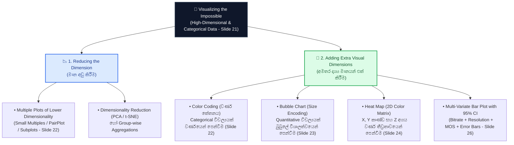
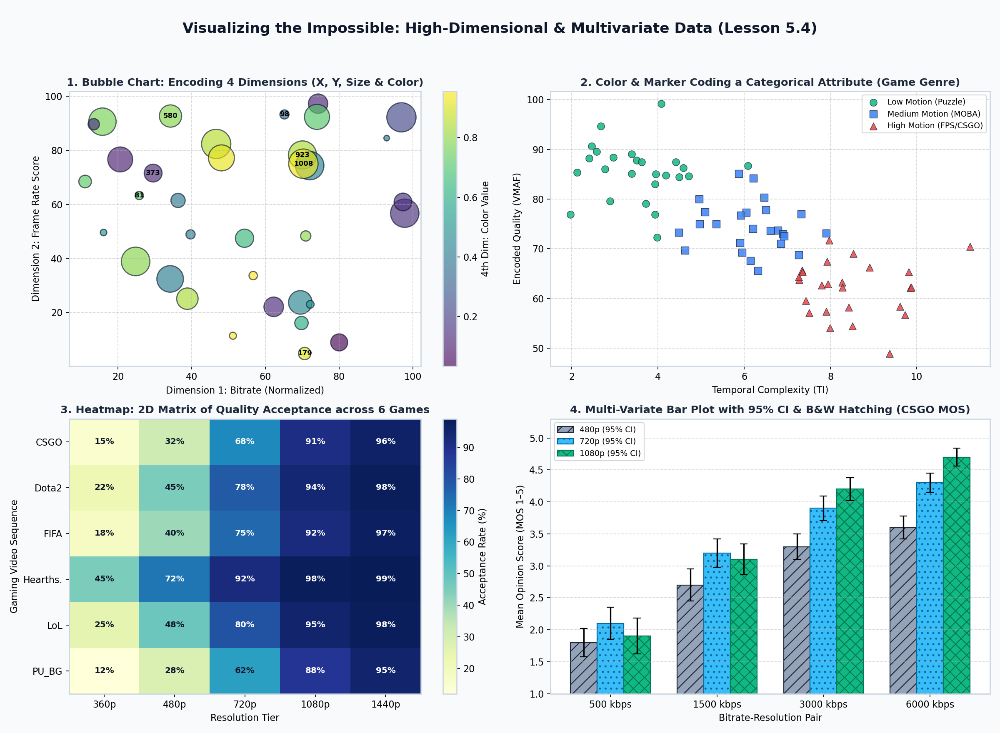

# Lesson 5.4: Visualizing the Impossible — High-Dimensional & Multivariate Data (අධි-මාන සහ බහු-විචල්‍ය දත්ත දෘශ්‍යකරණය)

**Source Lecture Notes:** `Intro-to-Visualization.pdf` (Slides 21 – 26) & `Visualize.ipynb` (Cells 21 – 22, 25)  
**Module:** CI7340 - Applied Data Programming (Dr. Lochandaka Ranathunga)

> [!TIP]
> **📚 Prerequisite / Dependency Lesson Series:**
> මෙම පාඩමේදී භාවිතා වන **Multivariate Visualization (`PairPlot`, `FacetGrid`, `Heatmap`)**, **Matplotlib Subplots & Annotations**, සහ **95% Confidence Interval (95% විශ්වාසනීය ප්‍රාන්තරය)** පිළිබඳ මූලික දැනුම සඳහා කියවන්න:
> - [Dep 01 - Lesson 03: Subplots, GridSpec, Annotations & Saving Publication Figures](../dependencies/Dep_01_Matplotlib_Zero_to_Hero/03_Subplots_GridSpec_Annotations_and_Saving_Publication_Figures.md)
> - [Dep 01 - Lesson 04: Statistical Charts in Matplotlib — Histograms, Boxplots, Error Bars & Heatmaps](../dependencies/Dep_01_Matplotlib_Zero_to_Hero/04_Statistical_Charts_in_Matplotlib_Histograms_Boxplots_ErrorBars_Heatmaps.md)
> - [Dep 02 - Lesson 03: Multivariate Visualization — PairPlot, FacetGrid & Heatmaps in Seaborn](../dependencies/Dep_02_Seaborn_and_Statistical_Visualization/03_Multivariate_Visualization_PairPlot_FacetGrid_and_Heatmaps.md)
> - [Module 4 - Dep 04: Standard Deviation, Normal Distribution & Hypothesis Testing (Confidence Intervals)](../Module_04_Mathematics_and_Statistics_for_Data_Science/dependencies/Dep_04_Standard_Deviation_Normal_Distribution_and_Hypothesis_Testing/)

---

## 1. Introduction: Why Do Some Datasets Seem "Impossible" to Visualize? (Slide 21)

අපේ පරිගණක තිරය හෝ කඩදාසි පිටුව **Two-Dimensional (2D — ද්වි-මාන: X අක්ෂය සහ Y අක්ෂය පමණක් ඇති)** පෘෂ්ඨයකි. එබැවින් විචල්‍යයන් 1ක් හෝ 2ක් ඇති දත්ත ඇඳීම ඉතා පහසුය. නමුත් සැබෑ ලෝකයේ Data Science ගැටලුවලදී අපට බරපතල අභියෝග දෙකකට මුහුණ දීමට සිදුවේ (Slide 21):

1. **Data is too high dimensional (දත්තවල මානයන් ගණන ඉතා වැඩිය):**  
   විචල්‍යයන් (Variables / Features) 10ක්, 50ක් හෝ 100ක් ඇති Dataset එකක් එකම අක්ෂ යුගලයක් (`Same set of axes`) මත අඳින්නේ කෙසේද?
2. **Some variables are categorical (සමහර විචල්‍යයන් කාණ්ඩාත්මක වේ):**  
   සංඛ්‍යා නොවන `"Cat"`, `"Dog"` හෝ `"Yes"`, `"No"` වැනි **Categorical Values (කාණ්ඩාත්මක අගයන්)** ගණිතමය අක්ෂයක් මත ලකුණු කරන්නේ කෙසේද?

මෙම අභියෝග ජය ගැනීමට දේශන සටහන්වල (Slides 21–26) ප්‍රධාන උපායමාර්ග දෙකක් ඉදිරිපත් කරයි:
- **Strategy A: Reducing the Dimension (මාන අඩු කිරීම)**
- **Strategy B: Adding Extra Visual Dimensions (අමතර දෘශ්‍ය මානයන් එකතු කිරීම)**





---

## 2. Strategy 1: Reducing the Dimension (Slides 21 & 22)

> **"Possible Solution: Reduce the dimension!!! Relationships may be easier to spot by producing multiple plots of lower dimensionality."** — Slides 21–22

- එකම ප්‍රස්තාරයක විචල්‍යයන් 10ක් පටලවා අඳිනවාට වඩා, විචල්‍යයන් 2 බැගින් ගෙන **Multiple plots of lower dimensionality (අඩු මානයන් සහිත කුඩා ප්‍රස්තාර කිහිපයක් — Small Multiples / PairPlots / Subplots)** ඇඳීමෙන් විචල්‍යයන් අතර සම්බන්ධතා ඉතා පහසුවෙන් හඳුනා ගත හැක.
- අපි `Visualize.ipynb` (Cells 16 සහ 17) හිදී `plt.subplots(2, 2)` භාවිතා කර එකම `Figure` එක තුළ වෙනම කුඩා ප්‍රස්තාර 4ක් ඇන්දේත්, Seaborn හි `sns.pairplot()` සහ `sns.FacetGrid()` භාවිතා කරන්නේත් මෙම මූලධර්මය අනුවයි.

---

## 3. Adding Extra Dimensions 1: Color Coding a Categorical Attribute (Slide 22)

> **"Adding extra dimensions: Color coding a categorical attribute can be effective."** — Slide 22

- ඔබ ළඟ **Quantitative Variables (සංඛ්‍යාත්මක විචල්‍යයන්)** 2ක් ($X$ සහ $Y$) සහ **Categorical Variable (කාණ්ඩාත්මක විචල්‍යයක්)** (උදා: ක්‍රීඩා වර්ගය `Low Motion`, `Medium Motion`, `High Motion` හෝ සත්ත්ව වර්ගය `Cat`, `Dog`) ඇතැයි සිතන්න.
- එවිට $X$ සහ $Y$ සාමාන්‍ය Scatter Plot එකක අක්ෂ දෙකේ ලකුණු කර, **3 වන Categorical විචල්‍යය එක් එක් ලක්ෂ්‍යයේ වර්ණයෙන් (Color Hue) සහ හැඩයෙන් (Marker Shape)** නිරූපණය කළ හැක (ඉහත රූපයේ Panel 2 බලන්න).
- එවිට එක් එක් කාණ්ඩය (**Cluster / Group**) ප්‍රස්තාරයේ කුමන කලාපයේ පිහිටන්නේද යන්න ඇසට ක්ෂණිකව පෙනේ!

---

## 4. Adding Extra Dimensions 2: Bubble Chart — Encoding Size (Slide 23 & `Visualize.ipynb` Cell 22)

> **"Adding extra dimensions: A quantitative attribute can be encoded by size in a bubble chart."** — Slide 23

- 3 වන විචල්‍යය Categorical නොවී **Quantitative Attribute (සංඛ්‍යාත්මක විචල්‍යයක්)** නම්, අපට Scatter Plot එකේ ලක්ෂ්‍යයන්ගේ **Size / Area (බුබුලේ විශාලත්වය / වර්ගඵලය)** මඟින් එම 3 වන මානය නිරූපණය කළ හැක.
- **Research Case Study — Telemedicine Quality Metrics (Slide 23):**  
  Slide 23 හි පෙන්වා ඇත්තේ Telemedicine යෙදුම් පිළිබඳ පර්යේෂණ පත්‍රිකා 50 ක් (**Literature Review of 50 studies**) සලකා බැලීමේදී, එක් එක් Video Quality Metric එක (`PSNR`, `SSIM`, `VQM`, `MOS` ආදිය) කොපමණ අධ්‍යයන සංඛ්‍යාවක භාවිතා කර ඇත්ද යන්න පෙන්වන **Bubble Chart** එකකි. වැඩිම වාර ගණනක් භාවිතා වූ Metric එක විශාලතම බුබුලෙන් (Largest Bubble) සහ එහි සංඛ්‍යාවෙන් ක්ෂණිකව කැපී පෙනේ.

### Python Implementation: 4D Scatter Bubble Plot (`Visualize.ipynb` - Cell 22):
`Visualize.ipynb` හි Cell 22 මඟින් එකම 2D ප්‍රස්තාරයක් තුළ **4 Dimensions (මානයන් 4ක්)** එකවර පෙන්වන ආකාරය:
1. **Dimension 1:** `x3` (X-axis Position)
2. **Dimension 2:** `y3` (Y-axis Position)
3. **Dimension 3:** `s=area` (Bubble Area / Size)
4. **Dimension 4:** `c=colors` (Bubble Color Intensity)

```python
import numpy as np
import matplotlib.pyplot as plt

np.random.seed(19680801)
N = 50

x3 = np.random.rand(N)                  # Dimension 1 (X)
y3 = np.random.rand(N)                  # Dimension 2 (Y)
colors = np.random.rand(N)              # Dimension 4 (Color)
area = (30 * np.random.rand(N))**2      # Dimension 3 (Bubble Size / Area)

# alpha=0.5 මඟින් බුබුළු එක මත එක වැටුණු විට පිටුපස ඇති බුබුළු ද පෙනීමට සලස්වයි
plt.scatter(x3, y3, s=area, c=colors, alpha=0.5)

# සෑම බුබුලක් මතම එහි වර්ගඵල අගය (Area value) Text එකක් ලෙස ලිවීම (Annotate)
for i, txt in enumerate(np.round(area)):
    plt.annotate(txt, (x3[i], y3[i]))

plt.title('Scatter Bubble Plot with Annotations')
plt.show()
```

---

## 5. Adding Extra Dimensions 3: Heat Map (තාප සිතියම - Slide 24)

විචල්‍යයන් දෙකක (X සහ Y) සංයෝජනයන් හරහා 3 වන සංඛ්‍යාත්මක විචල්‍යයක් වෙනස් වන ආකාරය **Color Intensity (වර්ණ තීව්‍රතාවයෙන්)** පෙන්වන 2D න්‍යාසයකට **Heat Map** එකක් යැයි කියනු ලැබේ.

### Two Research Case Studies in Slide 24:
1. **Gaming Video Quality Acceptance Rate Heatmap:**  
   විවිධ Gaming Video Sequences 6 ක් (Y-අක්ෂය) සහ විවිධ Video Quality මට්ටම් 5 ක් (X-අක්ෂය) සඳහා පරිශීලකයින් එම වීඩියෝව පිළිගත් ප්‍රතිශතය (**Acceptance Rate %**) වර්ණ මඟින් පෙන්වයි (ඉහත රූපයේ Panel 3 බලන්න).
2. **Dota2 PPSNR (dB) Heatmap:**  
   `Dota2` ක්‍රීඩා වීඩියෝව සඳහා විවිධ Encoding පරාමිතීන් යටතේ ලැබුණු **PPSNR (dB)** අගයන් Heatmap එකක් මඟින් නිරූපණය කරයි. ඉහළම ගුණාත්මකභාවය ඇති කලාප තද වර්ණයෙන් ක්ෂණිකව හඳුනාගත හැක.

---

## 6. Adding Extra Dimensions 4: Multi-Variate Bar Plot with Confidence Interval (Slide 26)

Slide 26 හි පෙන්වා ඇත්තේ ඉතාම වැදගත් පර්යේෂණ ප්‍රස්තාරයකි:
> **"MOS (with 95% confidence interval) for the CSGO video sequence at different resolution-bitrate pairs."**

### Multivariate Encoding in Slide 26:
1. **X-Axis Primary Groups:** විවිධ **Bitrate** අගයන් (උදා: `300 kbps`, `600 kbps`, `1500 kbps`, `3000 kbps`, `6000 kbps`).
2. **Grouped Sub-Bars (Color / Hatching):** එක් එක් Bitrate එක යටතේ විවිධ **Resolutions** (උදා: `480p`, `720p`, `1080p`).
3. **Y-Axis (Bar Height):** පරිශීලකයින් ලබා දුන් සාමාන්‍ය ලකුණු — **MOS - Mean Opinion Score (මධ්‍යන්‍ය මත ලකුණු, 1 සිට 5 දක්වා)**.
4. **Error Bars (`I`-shaped Whiskers on top of bars):** **95% Confidence Interval (95% විශ්වාසනීය ප්‍රාන්තරය)**:
   $$\text{CI}_{95\%} = \bar{x} \pm 1.96 \times \frac{s}{\sqrt{n}}$$

### Why Are 95% Confidence Intervals Essential Here?
- අපි Module 4 (Lesson 4.7) හිදී ඉගෙන ගත් පරිදි, **Sample Mean (සාම්පල මධ්‍යන්‍යය - MOS)** පමණක් පෙන්වූ විට දත්තවල **Uncertainty / Variance (අවිනිශ්චිතතාවය / විචලතාවය)** පෙනෙන්නේ නැත.
- උදාහරණයක් ලෙස `1500 kbps` වලදී `720p` තීරුවේ MOS අගය $3.2$ ක් සහ `1080p` තීරුවේ MOS අගය $3.1$ ක් වුවත්, ඒ දෙකේ **95% Confidence Interval Error Bars එකිනෙක මත වැටේ නම් (Overlap වේ නම්)**, එම Resolutions දෙක අතර **Statistically Significant Difference (සංඛ්‍යානමය වශයෙන් සැලකිය යුතු වෙනසක්)** නොමැති බව පර්යේෂකයාට ක්ෂණිකව වටහා ගත හැක!

---

## 🛠️ 7. Practical Task / Hands-On Exercise (ප්‍රායෝගික අභ්‍යාසය)

### Scenario / Goal:
ඔබ Telemedicine සහ Gaming Video පර්යේෂණ දෙකක් සඳහා `1x2` Dashboard එකක් නිර්මාණය කරයි:
1. **Left Panel (Slide 23 Bubble Chart):** Telemedicine Literature Review එකක පත්‍රිකා 50ක් තුළ Quality Metrics 6ක් (`PSNR`, `SSIM`, `VMAF`, `MOS`, `VQM`, `MS-SSIM`) භාවිතා වූ වාර ගණන බුබුලේ විශාලත්වයෙන් (`s`) සහ `annotate()` මඟින් පෙන්වන **Bubble Chart** එකක් අඳින්න.
2. **Right Panel (Slide 24 Heatmap):** `Dota2` වීඩියෝව සඳහා Resolutions 3ක් සහ Bitrates 4ක් හරහා ලැබුණු **PPSNR (dB)** න්‍යාසය කොටු තුළ අගයන් සහිත **Annotated Heatmap** එකක් ලෙස අඳින්න.

### Step-by-Step Tasks:
1. `fig, (ax1, ax2) = plt.subplots(1, 2, figsize=(12, 4.8))` නිර්මාණය කරන්න.
2. `ax1.scatter()` මඟින් Metrics 6 හි බුබුළු (`s = study_counts * 25`) ඇඳ, `for` loop එකකින් Metric නාමය සහ අධ්‍යයන ගණන එක් එක් බුබුල මත `ax1.annotate()` කරන්න.
3. `ax2.imshow(ppsnr_matrix, cmap='YlGnBu')` මඟින් Heatmap එක ඇඳ, කොටු තුළ dB අගයන් `ax2.text()` මඟින් ලියා `fig.colorbar()` එකතු කරන්න.

### Starter Code:
```python
import numpy as np
import matplotlib.pyplot as plt

metrics = ['PSNR', 'SSIM', 'MOS', 'VMAF', 'VQM', 'MS-SSIM']
x_pos   = [1.2, 2.5, 3.8, 1.8, 3.2, 4.5]
y_pos   = [3.0, 3.5, 2.8, 1.5, 1.6, 1.8]
studies = np.array([42, 35, 28, 19, 12, 9]) # Out of 50 studies

resolutions = ['1080p', '720p', '480p']
bitrates    = ['1 Mbps', '2 Mbps', '4 Mbps', '8 Mbps']
ppsnr_dota2 = np.array([
    [32.5, 36.8, 41.2, 44.9],
    [34.1, 38.0, 40.5, 42.1],
    [33.0, 35.2, 36.8, 37.5]
])

# TODO: Create 1x2 subplots for Telemedicine Bubble Chart and Dota2 PPSNR Heatmap
```

### Expected Output / Reference Solution:
```python
import numpy as np
import matplotlib.pyplot as plt

metrics = ['PSNR', 'SSIM', 'MOS', 'VMAF', 'VQM', 'MS-SSIM']
x_pos   = [1.2, 2.5, 3.8, 1.8, 3.2, 4.5]
y_pos   = [3.0, 3.5, 2.8, 1.5, 1.6, 1.8]
studies = np.array([42, 35, 28, 19, 12, 9])

resolutions = ['1080p', '720p', '480p']
bitrates    = ['1 Mbps', '2 Mbps', '4 Mbps', '8 Mbps']
ppsnr_dota2 = np.array([
    [32.5, 36.8, 41.2, 44.9],
    [34.1, 38.0, 40.5, 42.1],
    [33.0, 35.2, 36.8, 37.5]
])

fig, (ax1, ax2) = plt.subplots(1, 2, figsize=(12.5, 4.8))

# Panel 1: Telemedicine Metrics Bubble Chart (Slide 23)
scatter = ax1.scatter(x_pos, y_pos, s=studies * 35, c=studies, cmap='viridis', alpha=0.65, edgecolors='black', linewidth=1.5)
for i in range(len(metrics)):
    ax1.annotate(f"{metrics[i]}\n({studies[i]}/50)", (x_pos[i], y_pos[i]),
                 ha='center', va='center', fontweight='bold', fontsize=9.5)
ax1.set_xlim(0.3, 5.3)
ax1.set_ylim(0.8, 4.4)
ax1.set_title('1. Bubble Chart: Quality Metrics in 50 Telemedicine Studies', fontweight='bold')
ax1.set_xlabel('Computational Complexity Index')
ax1.set_ylabel('Perceptual Alignment Score')
ax1.grid(True, linestyle=':', alpha=0.5)

# Panel 2: Dota2 PPSNR Heatmap (Slide 24)
im = ax2.imshow(ppsnr_dota2, cmap='YlGnBu', aspect='auto')
ax2.set_xticks(range(len(bitrates)))
ax2.set_xticklabels(bitrates)
ax2.set_yticks(range(len(resolutions)))
ax2.set_yticklabels(resolutions)
ax2.set_title('2. Heatmap: Dota2 Sequence PPSNR (dB)', fontweight='bold')
ax2.set_xlabel('Encoding Bitrate')
ax2.set_ylabel('Video Resolution')

for r in range(len(resolutions)):
    for c in range(len(bitrates)):
        val = ppsnr_dota2[r, c]
        ax2.text(c, r, f"{val:.1f} dB", ha='center', va='center',
                 color='white' if val > 39 else 'black', fontweight='bold')

fig.colorbar(im, ax=ax2, label='PPSNR (dB)')
plt.tight_layout()
plt.show()
```

---

## 8. Summary Cheat Sheet (සාරාංශය)

| Technique | Encoded Dimensions | Matplotlib / Seaborn Implementation |
| :--- | :--- | :--- |
| **Small Multiples / PairPlot** | විචල්‍යයන් යුගල බැගින් වෙනම කුඩා ප්‍රස්තාරවල ඇඳීම (**Dimensionality Reduction**) | `plt.subplots(nrows, ncols)` / `sns.pairplot(df)` |
| **Color-Coded Scatter** | X (Num) + Y (Num) + **Color Hue (Categorical)** | `sns.scatterplot(data=df, x, y, hue='Cat')` |
| **Bubble Chart** | X (Num) + Y (Num) + **Size (Num)** + **Color (Num/Cat)** | `plt.scatter(x, y, s=area, c=colors, alpha=0.5)` |
| **Heat Map** | Row Category + Col Category + **Color Intensity (Num)** | `plt.imshow(mat)` / `sns.heatmap(df, annot=True)` |
| **Multi-Variate Bar + 95% CI** | Bitrate (X) + Resolution (Group) + MOS (Y) + **95% Confidence Interval** | `ax.bar(x, mean, yerr=ci_95)` / `sns.barplot(errorbar=('ci', 95))` |
