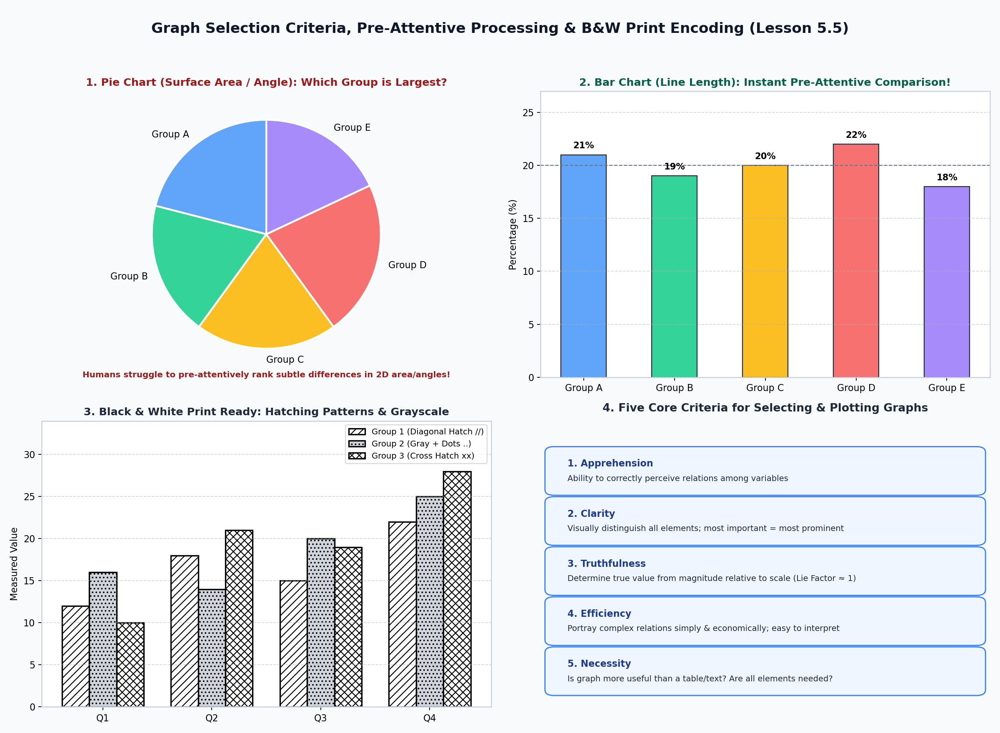
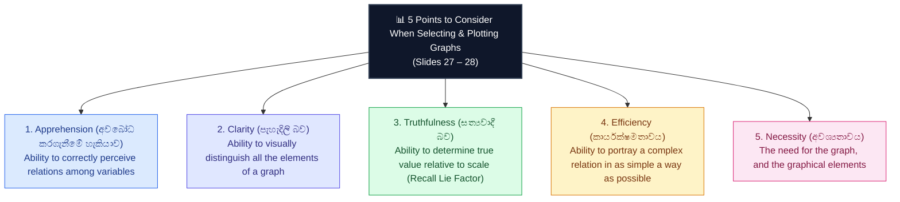

# Lesson 5.5: Graph Selection Criteria, Lecture Questions & Human Visual Perception (ප්‍රස්තාර තෝරා ගැනීමේ නිර්ණායක සහ මිනිස් දෘශ්‍ය සංජානනය)

**Source Lecture Notes:** `Intro-to-Visualization.pdf` (Slides 25, 27 – 30)  
**Module:** CI7340 - Applied Data Programming (Dr. Lochandaka Ranathunga)

> [!TIP]
> **📚 Prerequisite / Dependency Lesson Series:**
> මෙම පාඩමේදී සාකච්ඡා වන **Black & White Print Styling (Hatching, LineStyles, Markers)**, **Box Plots & 95% Confidence Intervals**, සහ **Seaborn Themes & Palettes** පිළිබඳ ප්‍රායෝගික කේත සඳහා කියවන්න:
> - [Dep 01 - Lesson 02: Customizing Plots — Colors, Markers, LineStyles, Legends & Spines](../dependencies/Dep_01_Matplotlib_Zero_to_Hero/02_Customizing_Plots_Colors_Markers_Labels_Legends_and_Spines.md)
> - [Dep 01 - Lesson 04: Statistical Charts in Matplotlib — Histograms, Boxplots, Error Bars & Heatmaps](../dependencies/Dep_01_Matplotlib_Zero_to_Hero/04_Statistical_Charts_in_Matplotlib_Histograms_Boxplots_ErrorBars_Heatmaps.md)
> - [Dep 02 - Lesson 01: Introduction to Seaborn Themes & Color Palettes](../dependencies/Dep_02_Seaborn_and_Statistical_Visualization/01_Introduction_to_Seaborn_Themes_and_DataFrame_Integration.md)
> - [Module 4 - Dep 04: Standard Deviation, Normal Distribution & Hypothesis Testing](../Module_04_Mathematics_and_Statistics_for_Data_Science/dependencies/Dep_04_Standard_Deviation_Normal_Distribution_and_Hypothesis_Testing/)

---

## 1. Introduction

Module 5 හි අවසාන පාඩම වන මෙහිදී අපි ඉතාම වැදගත් කොටස් තුනක් සාකච්ඡා කරමු:
1. දේශන සටහනේ **Slide 25 හි අසා ඇති විභාග මට්ටමේ ප්‍රශ්න 4 ට (4 Lecture Discussion Questions)** සම්පූර්ණ, තර්කානුකූල පිළිතුරු.
2. ප්‍රස්තාරයක් තෝරා ගැනීමේදී සහ ඇඳීමේදී සලකා බැලිය යුතු **මූලික නිර්ණායක 5 (Five Points to Consider When Selecting and Plotting Graphs - Slides 27–28)**.
3. මිනිස් මොළයේ **Pre-attentive Processing (පූර්ව-අවධාන සැකසුම)** ක්‍රියා කරන ආකාරය සහ Pie Chart එකකට වඩා Bar Chart එකක් විද්‍යාත්මකව වඩාත් සාර්ථක වන්නේ ඇයිද යන්න (Slide 29).



---

## 2. Slide 25 Lecture Questions & Complete Model Answers

දේශන සටහනේ 25 වන Slide එකෙහි Dr. Ranathunga විසින් සිසුන්ගෙන් ප්‍රශ්න 4 ක් අසා ඇත. ඒවා එකින් එක විමසා බලමු:

---

### ❓ Question 1: Why are pie charts not ideal to express frequencies of multiple groups?
*(කාණ්ඩ කිහිපයක **Frequencies (සංඛ්‍යාත)** ප්‍රකාශ කිරීමට Pie Charts සුදුසු නොවන්නේ ඇයි?)*

**✅ Model Answer:**
1. **Human Visual Perception Limit on Surface Area & Angles (වර්ගඵලය සහ කෝණ සැසඳීමේ අපහසුතාවය):**  
   Pie Chart එකක අගයන් නිරූපණය කරන්නේ වෘත්ත කලාවල **Angle (කෝණයෙන්)** සහ **Surface Area (මතුපිට වර්ගඵලයෙන්)** ය. Slide 29 හි පෙන්වා දී ඇති පරිදි, මිනිස් ඇසට **Line Length (රේඛාවල දිග — Bar Charts)** අතර වෙනස ඉතා නිවැරදිව හඳුනාගත හැකි වුවත්, විවිධ දිශාවන්ට හැරී ඇති වෘත්ත කලාවල **Surface Area (මතුපිට වර්ගඵලය)** හෝ කෝණ අතර කුඩා වෙනස්කම් (උදා: $19\%, 20\%, 21\%, 22\%$ - ඉහත රූපයේ Panel 1 සහ Panel 2 සසඳන්න) ඇසින් සංසන්දනය කිරීම ඉතා අපහසුය.
2. **Relative Proportions vs. Absolute Frequencies:**  
   Pie Chart එකක් මඟින් පෙන්වන්නේ සමස්තයෙන් කොටසක් (**Relative Proportion / Percentage** summing to $100\%$) පමණි. කණ්ඩායම් කිහිපයක (**Multiple Groups**) සැබෑ **Absolute Frequencies (නිරපේක්ෂ සංඛ්‍යාත / Counts)** සංසන්දනය කිරීමට Pie Charts කිහිපයක් ඇන්දත්, එක් එක් කණ්ඩායමේ මුළු සාම්පල ගණන ($N$) වෙනස් නම් Pie Charts දෙකක් එකිනෙක සැසඳීමෙන් සම්පූර්ණයෙන්ම වැරදි නිගමනවලට එළඹේ.
3. **Visual Clutter with Many Categories:**  
   කාණ්ඩ 5–6 කට වඩා වැඩි වූ විට Pie Slices ඉතා සිහින් වී ලේබල් එක මත එක වැටේ.

---

### ❓ Question 2: What are box plots often used for?
*(Box Plots බොහෝ විට භාවිතා කරන්නේ කුමක් සඳහාද?)*

**✅ Model Answer (Slide 17 ඇසුරින්):**
1. **Visualizing the Spread of Data (දත්තවල විසිරීම පෙන්වීමට):** **Five-Number Summary** එක — එනම් **Median (මධ්‍යස්ථය)**, **Lower Quartile ($Q_1$)**, **Upper Quartile ($Q_3$)**, සහ $1.5 \times \text{IQR}$ ඇතුළත පවතින **Lower & Upper Adjacent Values** — එකවර පෙන්වීමට.
2. **Detecting Skewness (කුටිකතාවය හඳුනා ගැනීමට):** දත්ත ව්‍යාප්තිය **Symmetric (සමමිතික)** ද නැතිනම් එක් පැත්තකට බර වී (**Positively / Negatively Skewed**) ඇත්දැයි පරීක්ෂා කිරීමට.
3. **Outlier Detection (අසාමාන්‍ය අගයන් හඳුනා ගැනීමට):** $[Q_1 - 1.5 \times \text{IQR},\; Q_3 + 1.5 \times \text{IQR}]$ සීමාවෙන් පිටත පවතින **Unusual Observations / Outliers (අසාමාන්‍ය නිරීක්ෂණ)** ක්ෂණිකව හඳුනා ගැනීමට.
4. **Comparing Two or More Datasets (දත්ත කට්ටල කිහිපයක් සංසන්දනය කිරීමට):** නිරීක්ෂණ රාශියක් සහිත කාණ්ඩ දෙකක් හෝ කිහිපයක් එකම පරිමාණයක් මත පැත්තෙන් පැත්ත තබා සැසඳීමට.

---

### ❓ Question 3: Why are confidence intervals so important for bar plots?
*(Bar Plots සඳහා **Confidence Intervals (විශ්වාසනීය ප්‍රාන්තර / Error Bars)** මෙතරම් වැදගත් වන්නේ ඇයි?)*

**✅ Model Answer:**
1. **Sample Mean Alone Hides Data Variability:**  
   සාමාන්‍ය Bar Plot එකක තීරුවේ උසින් පෙන්වන්නේ **Sample Mean (සාම්පල මධ්‍යන්‍යය $\bar{x}$)** නමැති **Point Estimate (ලක්ෂ්‍ය ඇස්තමේන්තුව)** පමණි. එම මධ්‍යන්‍යය ගණනය කළ දත්ත එකම අගය වටා ළඟින් පිහිටියාද (**Low Variance / Low Standard Deviation**) නැතිනම් විශාල පරාසයක විසිරී තිබුණාද (**High Variance**) යන්න හුදු තීරුවකින් පෙනෙන්නේ නැත.
2. **Quantifying Uncertainty & Precision of the Estimate:**  
   **95% Confidence Interval (95% විශ්වාසනීය ප්‍රාන්තරය)** Error Bar එකක් මඟින් සැබෑ **Population Mean (ගහන මධ්‍යන්‍යය $\mu$)** 95% ක විශ්වාසයකින් පවතින පරාසය පෙන්වයි. Error Bar එක පටු නම් ඇස්තමේන්තුව ඉතා නිරවද්‍ය වේ; Error Bar එක පළල් නම් දත්තවල **Uncertainty (අවිනිශ්චිතතාවය)** ඉහළ බව පෙන්වයි.
3. **Visualizing Statistical Significance Across Groups:**  
   තීරු දෙකක උස වෙනස් වුවත් ඒවායේ Confidence Intervals විශාල ලෙස එක මත එක වැටේ නම් (**Overlap**), එම කාණ්ඩ දෙක අතර වෙනස **Statistically Significant (සංඛ්‍යානමය වශයෙන් සැලකිය යුතු)** නොවිය හැකි බව පෙන්වයි.

---

### ❓ Question 4: How can you present data of multiple groups for a black and white only print?
*(කළු-සුදු පමණක් මුද්‍රණය කරන (**Black & White Print**) ලේඛනයක් සඳහා කාණ්ඩ කිහිපයක දත්ත ඉදිරිපත් කරන්නේ කෙසේද?)*

**✅ Model Answer (ඉහත රූපයේ Panel 3 බලන්න):**
බොහෝ විද්‍යාත්මක පර්යේෂණ පත්‍රිකා (IEEE / ACM / Springer Research Papers) සහ විභාග ප්‍රශ්න පත්‍ර මුද්‍රණය කරන්නේ කළු-සුදු (Black & White / Grayscale) මාධ්‍යයෙනි. එවිට රතු, කොළ, නිල් වැනි වර්ණ (**Color Hue**) මත පමණක් රඳා පැවතුණහොත් මුද්‍රණය කළ පසු සියලුම කාණ්ඩ එකම අළු පැහැයකින් පෙනී ප්‍රස්තාරය කියවිය නොහැකි වේ. එයට විසඳුම්:
1. **For Bar Plots / Histograms / Area Plots:**
   - **Hatching Patterns (ජ්‍යාමිතික හැචින් රටා):** Matplotlib හි `hatch='//'`, `hatch='\\\\'`, `hatch='..'`, `hatch='xx'`, `hatch='--'`, `hatch='++'` වැනි විවිධ ඉරි සහ තිත් රටා තීරු ඇතුළත යෙදීම.
   - **Varying Grayscale Luminance / Shading:** සුදු (`white`), ලා අළු (`lightgray`), මැදි අළු (`gray`), තද අළු (`dimgray`), සහ කළු (`black`) වැනි පැහැදිලිව වෙන්කර හඳුනාගත හැකි දීප්ති මට්ටම් භාවිතා කිරීම.
2. **For Line Plots & Scatter Plots:**
   - **Distinct Line Styles:** Solid (`linestyle='-'`), Dashed (`'--'`), Dotted (`':'`), සහ Dash-Dot (`'-.'`).
   - **Distinct Marker Shapes:** Circle (`marker='o'`), Square (`'s'`), Triangle (`'^'`), Diamond (`'D'`), සහ Cross (`'x'` / `'+'`).
   - **Direct Data Labeling:** රේඛාවල හෝ තීරුවල කෙළවර කෙලින්ම කාණ්ඩයේ නම Text Label එකක් ලෙස ලිවීම.

---

## 3. Five Points to Consider When Selecting & Plotting Graphs (Slides 27 – 28)

ඔබ ඕනෑම ප්‍රස්තාරයක් තෝරා ගැනීමේදී සහ සැලසුම් කිරීමේදී පහත සඳහන් **මූලික නිර්ණායක 5 (Apprehension, Clarity, Truthfulness, Efficiency, Necessity)** තෘප්තිමත් වේදැයි පරීක්ෂා කළ යුතුය:



### Detailed Breakdown of the 5 Criteria (Slides 27–28):

1. **Apprehension (සම්බන්ධතා නිවැරදිව වටහා ගැනීමේ හැකියාව):**
   - *Definition:* Ability to correctly perceive relations among variables.
   - *Checklist Question:* Does the graph maximize apprehension of the relations among variables? (මෙම ප්‍රස්තාරය මඟින් විචල්‍යයන් අතර සම්බන්ධතාවය තේරුම් ගැනීමේ හැකියාව උපරිම කරනවාද?)
2. **Clarity (පැහැදිලි බව):**
   - *Definition:* Ability to visually distinguish all the elements of a graph.
   - *Checklist Question:* Are the most important elements or relations visually most prominent? (ප්‍රස්තාරයේ වැදගත්ම අංග හෝ සම්බන්ධතා දෘශ්‍යමය වශයෙන් වඩාත්ම කැපී පෙනෙන ලෙස තබා තිබේද?)
3. **Truthfulness (සත්‍යවාදී බව):**
   - *Definition:* Ability to determine the true value represented by any graphical element by its magnitude relative to the implicit or explicit scale (**Recall Lie Factor!**).
   - *Checklist Question:* Are the graph elements accurately positioned and scaled? (ප්‍රස්තාරයේ සියලුම අංග නිවැරදිව ස්ථානගත කර සහ පරිමාණ ගත කර තිබේද?)
4. **Efficiency (කාර්යක්ෂමතාවය):**
   - *Definition:* Ability to portray a possibly complex relation in as simple a way as possible.
   - *Checklist Questions:* Are the elements of the graph economically used? Is the graph easy to interpret? (ප්‍රස්තාරයේ අංග පිරිමැසුම්දායක ලෙස භාවිතා කර තිබේද? ප්‍රස්තාරය තේරුම් ගැනීමට පහසුද?)
5. **Necessity (අවශ්‍යතාවය):**
   - *Definition:* The need for the graph, and the graphical elements.
   - *Checklist Questions:* Is the graph a more useful way to represent the data than alternatives (table, text)? Are all the graph elements necessary to convey the relations? (වගුවක් හෝ වාක්‍යයක් වැනි විකල්ප ක්‍රමවලට වඩා මෙම ප්‍රස්තාරය ඇත්තටම වඩාත් ප්‍රයෝජනවත්ද? එහි සියලුම අංග අත්‍යවශ්‍යද?)

---

## 4. Pre-Attentive Processing & Human Visual Perception (Slide 29)

> **"Effective graphics take advantage of pre-attentive processing and attributes and the relative strength of these attributes."** — Slide 29

### What is Pre-Attentive Processing (පූර්ව-අවධාන සැකසුම)?
- ඔබ රූපයක් දෙස බැලූ විට, ඔබේ මොළය සවිඥානිකව කල්පනා කිරීමට පෙර **මිලි-තත්පර 200–250 කටත් අඩු කාලයකදී** ඇසේ සහ Visual Cortex හි ස්වයංක්‍රීයව සිදුවන ක්ෂණික හඳුනාගැනීම **Pre-attentive Processing** ලෙස හැඳින්වේ.
- නමුත් සියලුම **Visual Attributes (දෘශ්‍ය ලක්ෂණ)** මිනිස් මොළයට එක හා සමානව නිරවද්‍යතාවයකින් සැකසිය නොහැක!

### Relative Strength of Visual Attributes (Slide 29):
Cleveland & McGill සහ Edward Tufte ගේ පර්යේෂණවලට අනුව මිනිස් ඇසට ප්‍රමාණාත්මක අගයන් සංසන්දනය කිරීමේ හැකියාව (ඉහළම නිරවද්‍යතාවයේ සිට පහළට):
1. **🥇 Position along a common scale & Line Length (පොදු පරිමාණයක් මත පිහිටීම සහ රේඛාවක දිග):**  
   මිනිස් ඇසට **Differences in line length (රේඛාවල දිග අතර වෙනස)** ඉතාම වේගයෙන් සහ ඉහළම නිරවද්‍යතාවයකින් හඳුනාගත හැක. **Bar Chart** එකක් මෙම ප්‍රබලතාවය භාවිතා කරයි!
2. **🥈 2D Surface Area & Angles (මතුපිට වර්ගඵලය සහ කෝණ):**  
   **Surface Area (මතුපිට වර්ගඵලයන්)** අතර වෙනස හඳුනා ගැනීමට මිනිස් ඇසට ඇත්තේ දුර්වල හැකියාවකි. **Pie Chart** සහ **Bubble Chart** වර්ගඵලය මත රඳා පවතී.
3. **🥉 3D Volume & Color Saturation (3D පරිමාව සහ වර්ණ තීව්‍රතාවය):**  
   නිවැරදි සංඛ්‍යාත්මක අගයන් සංසන්දනය කිරීමට ඉතාම අපහසුම දෘශ්‍ය ලක්ෂණයයි.

> **Slide 29 Conclusion:**  
> *"Since humans can more easily process differences in line length than surface area, it may be more effective to use a bar chart (which takes advantage of line length to show comparison) rather than pie charts (which use surface area to show comparison)."*

---

## 🛠️ 5. Practical Task / Hands-On Exercise (ප්‍රායෝගික අභ්‍යාසය)

### Scenario / Goal:
ඔබ Slide 25 හි **Question 4** (*"How can you present data of multiple groups for a black and white only print?"*) සහ **Question 3** (*Confidence Intervals on Bar Plots*) යන දෙකම ප්‍රායෝගිකව විසඳීමට යයි.
කළු-සුදු මුද්‍රණය කරන IEEE පත්‍රිකාවක් සඳහා Bitrates 4කදී (`['500k', '1500k', '3000k', '6000k']`) Resolutions 3ක (`480p`, `720p`, `1080p`) **MOS (Mean Opinion Score)** සහ **95% Confidence Interval** පෙන්වන **Black & White Grouped Bar Plot** එකක් නිර්මාණය කරන්න. වර්ණ වෙනුවට **Grayscale Shades** සහ **Hatching Patterns (`'//'`, `'..'`, `'xx'`)** භාවිතා කරන්න!

### Step-by-Step Tasks:
1. `fig, ax = plt.subplots(figsize=(9, 5))` සාදා `x = np.arange(4)` සහ `w = 0.25` ලෙස ගන්න.
2. Resolutions 3 සඳහා `x - w`, `x`, සහ `x + w` ස්ථානවල තීරු 3 බැගින් අඳින්න.
3. වර්ණ වෙනුවට `facecolor=('white', 'lightgray', 'dimgray')` සහ `hatch=('//', '..', 'xx')` සමඟ `edgecolor='black'` සහ `yerr=ci_...` (`capsize=4`) ලබා දෙන්න.
4. Tufte සහ Slide 27–28 නිර්ණායකවලට අනුව ඉහළ සහ දකුණු `spines` ඉවත් කර, Title, Axis Labels සහ Legend එකතු කරන්න.

### Starter Code:
```python
import numpy as np
import matplotlib.pyplot as plt

bitrates = ['500 kbps', '1500 kbps', '3000 kbps', '6000 kbps']
mos_480p,  ci_480p  = [2.3, 2.9, 3.2, 3.4], [0.20, 0.18, 0.15, 0.14]
mos_720p,  ci_720p  = [2.1, 3.3, 3.9, 4.2], [0.24, 0.20, 0.17, 0.15]
mos_1080p, ci_1080p = [1.8, 3.4, 4.3, 4.7], [0.28, 0.22, 0.16, 0.12]

# TODO: Create B&W print-ready grouped bar plot with hatching patterns and 95% CI error bars
```

### Expected Output / Reference Solution:
```python
import numpy as np
import matplotlib.pyplot as plt

bitrates = ['500 kbps', '1500 kbps', '3000 kbps', '6000 kbps']
mos_480p,  ci_480p  = [2.3, 2.9, 3.2, 3.4], [0.20, 0.18, 0.15, 0.14]
mos_720p,  ci_720p  = [2.1, 3.3, 3.9, 4.2], [0.24, 0.20, 0.17, 0.15]
mos_1080p, ci_1080p = [1.8, 3.4, 4.3, 4.7], [0.28, 0.22, 0.16, 0.12]

x = np.arange(len(bitrates))
w = 0.25

fig, ax = plt.subplots(figsize=(9, 5))

# Black & White Print Ready: Grayscale Luminance + Distinct Hatching Patterns + 95% CI
ax.bar(x - w, mos_480p,  w, yerr=ci_480p,  capsize=4, facecolor='white',     edgecolor='black', hatch='//', label='480p (SD)')
ax.bar(x,     mos_720p,  w, yerr=ci_720p,  capsize=4, facecolor='lightgray', edgecolor='black', hatch='..', label='720p (HD)')
ax.bar(x + w, mos_1080p, w, yerr=ci_1080p, capsize=4, facecolor='dimgray',   edgecolor='black', hatch='xx', label='1080p (Full HD)')

ax.spines['top'].set_visible(False)
ax.spines['right'].set_visible(False)

ax.set_title('CSGO Video Quality: MOS with 95% CI (Black & White Print Ready)', fontsize=13.5, fontweight='bold')
ax.set_xlabel('Encoding Bitrate', fontsize=12)
ax.set_ylabel('Mean Opinion Score — MOS (1 to 5)', fontsize=12)
ax.set_xticks(x)
ax.set_xticklabels(bitrates)
ax.set_ylim(1.0, 5.2)

ax.yaxis.grid(True, linestyle=':', color='black', alpha=0.4)
ax.legend(title='Resolution', frameon=True, edgecolor='black', facecolor='white')

plt.tight_layout()
plt.show()
```

---

## 6. Module 5 Complete Summary & References (Slide 30)

- **5 Graph Selection Criteria (Slides 27–28):** **Apprehension**, **Clarity**, **Truthfulness** ($\text{Lie Factor} \approx 1$), **Efficiency**, and **Necessity**.
- **Pre-attentive Processing (Slide 29):** මිනිස් ඇසට **Surface Area** (Pie Charts) වලට වඩා **Line Length** (Bar Charts) අතර වෙනස්කම් ඉතා පහසුවෙන් සහ නිවැරදිව ග්‍රහණය කරගත හැක.
- **Harvard Data Science Course Reference:** CS 109A, STAT 121A, AC 209A (*Exploratory Data Analysis* by Weiwei Pan, Pavlos Protopapas, Kevin Rader, Harvard University).
- **Classic Textbook:** Edward R. Tufte, *"The Visual Display of Quantitative Information"*.
- **Matplotlib Official Gallery:** [https://matplotlib.org/gallery/index.html](https://matplotlib.org/gallery/index.html)
