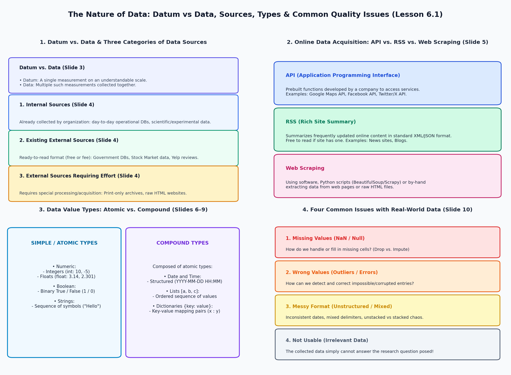
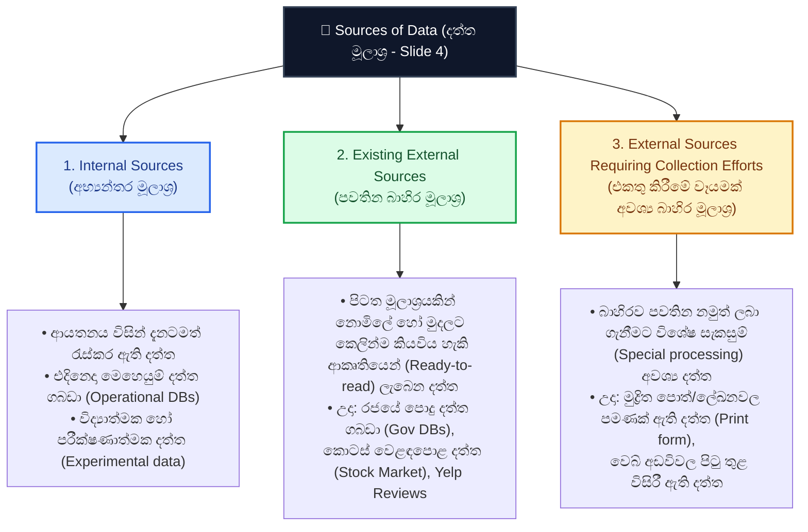

# පාඩම 6.1: දත්තවල ස්වභාවය, මූලාශ්‍ර, වර්ග සහ ගුණාත්මක ගැටලු (The Nature of Data: Sources, Types & Common Quality Issues)

**මූලාශ්‍රය (Source Lecture Notes):** `Introduction to Exploratory Data nalysis.pdf` (Slides 1 – 10)  
**විෂය (Module):** CI7340 - Applied Data Programming (Dr. Lochandaka Ranathunga)

---

> [!TIP]
> **📚 Prerequisite / Dependency Lesson Series:**  
> Data Sources, File Formats (CSV/TSV/JSON/Excel), Web APIs සහ Scraping පිළිබඳ තාක්ෂණික මඟපෙන්වීම සඳහා:
> - [Dep 02.1: Tabular and Hierarchical File Formats (CSV, TSV, Excel, JSON)](../dependencies/Dep_02_Data_Formats_CSV_JSON_Excel_APIs_and_Web_Scraping/01_Tabular_and_Hierarchical_File_Formats_CSV_TSV_Excel_and_JSON.md)
> - [Dep 02.2: Fetching External Data (REST APIs, HTTP Requests, RSS Feeds)](../dependencies/Dep_02_Data_Formats_CSV_JSON_Excel_APIs_and_Web_Scraping/02_Fetching_External_Data_REST_APIs_HTTP_Requests_and_RSS_Feeds.md)
> - [Dep 02.3: Web Scraping Fundamentals (HTML DOM and BeautifulSoup to DataFrame)](../dependencies/Dep_02_Data_Formats_CSV_JSON_Excel_APIs_and_Web_Scraping/03_Web_Scraping_Fundamentals_HTML_DOM_and_BeautifulSoup_to_DataFrame.md)

---

## 1. හැඳින්වීම: Datum සහ Data අතර වෙනස කුමක්ද? (Slides 1 – 3)

අපි Exploratory Data Analysis (EDA) ආරම්භ කිරීමට පෙර **"Data" (දත්ත)** යනු කුමක්දැයි විද්‍යාත්මකව නිර්වචනය කරගත යුතුය. බොහෝ දෙනා `Data` යන වචනය ඒකවචනයක් ලෙස භාවිතා කළත්, සංඛ්‍යාන විද්‍යාවේදී එහි ඒකවචනය වන්නේ **Datum** යන්නයි:

> **“A datum is a single measurement of something on a scale that is understandable to both the recorder and the reader. Data is multiple such measurements.”** — Slide 3

- **Datum (තනි දත්ත අගයක්):** යම් දෙයක් පිළිබඳව **වාර්තා කරන්නාට (Recorder)** සහ **කියවන්නාට (Reader)** යන දෙදෙනාටම තේරුම් ගත හැකි පරිමාණයක් (Scale) මත ලබාගත් **තනි මිනුමකි (Single measurement)**.
  - *උදාහරණය:* අද කොළඹ උෂ්ණත්වය $31.5^\circ\text{C}$ කි (මෙය එක් මිනුමක් හෙවත් *Datum* එකකි).
- **Data (දත්ත):** එවැනි තනි මිනුම් රාශියක එකතුවකි (*Multiple such measurements*).
  - *උදාහරණය:* පසුගිය දින 365 පුරාම කොළඹ උෂ්ණත්ව මිනුම් 365 හි එකතුව *Data* වේ.



---

## 2. දත්ත මූලාශ්‍ර වර්ගීකරණය (Sources of Data - Slide 4)

Data Science ව්‍යාපෘතියකට දත්ත ලබා ගත හැකි ප්‍රධාන මූලාශ්‍ර කාණ්ඩ 3 ක් ඇත (Slide 4):



---

## 3. අන්තර්ජාලය හරහා දත්ත ලබා ගන්නා ක්‍රම 3 (Online Data Sources - Slide 5)

අන්තර්ජාලයේ ජනනය වන, ප්‍රකාශයට පත් කරන හෝ Host කර ඇති දත්ත (Data generated, published or hosted online) අපේ Python වැඩසටහනකට ලබා ගැනීමට ප්‍රධාන තාක්ෂණික ක්‍රම 3 ක් භාවිතා කරයි (Slide 5):

### 1. API (Application Programming Interface):
- යම් සමාගමක් විසින් ඔවුන්ගේ සේවාවන්ට සහ දත්තවලට ආරක්ෂිතව ප්‍රවේශ වීම සඳහා පෙර-නිර්මිතව ලබා දෙන ශ්‍රිත කට්ටලයකි (*Using a prebuilt set of functions developed by a company to access their services*).
- **උදාහරණ:** Google Maps API, Facebook Graph API, Twitter (X) API, OpenWeatherMap API.
- **වාසිය:** දත්ත ඉතාම පිරිසිදු **JSON** හෝ **XML** ව්‍යුහගත ආකෘතියෙන් කෙලින්ම ලැබේ.

### 2. RSS (Rich Site Summary):
- නිතර යාවත්කාලීන වන අන්තර්ජාල අන්තර්ගතයන් (Frequently updated online content) සම්මත XML ආකෘතියකින් සාරාංශ කර ලබා දෙන ක්‍රමයකි.
- අදාළ වෙබ් අඩවියේ RSS Feed එකක් තිබේ නම් එය නොමිලේ කියවිය හැක.
- **උදාහරණ:** ප්‍රවෘත්ති වෙබ් අඩවි (News-related sites), බ්ලොග් අඩවි (Blogs).

### 3. Web Scraping (වෙබ් පිටු සූරා දත්ත ලබා ගැනීම):
- API එකක් හෝ RSS එකක් නොමැති වෙබ් අඩවියක, වෙබ් පිටුවේ පෙන්වන දේ හෝ එහි **HTML ගොනුව (HTML file)** තුළ අඩංගු දත්ත මෘදුකාංග, Python Scripts (උදා: `BeautifulSoup`, `Scrapy`, `Selenium`) හෝ අතින් (By-hand) උපුටා ගැනීමේ ක්‍රියාවලියයි.

---

## 4. දත්ත වර්ගීකරණය: Atomic vs. Compound Data Types (Slides 6 – 9)

සංඛ්‍යානමය වශයෙන් දත්ත **Qualitative (ගුණාත්මක/කාණ්ඩාත්මක)** සහ **Quantitative (ප්‍රමාණාත්මක/සංඛ්‍යාත්මක)** ලෙස බෙදෙන බව අපි Module 4 හිදී ඉගෙන ගත්තා (Slide 6).  
නමුත් **Data Programming (පරිගණක ක්‍රමලේඛනය)** ඇසින් බලන විට ඔබේ දත්ත කට්ටලයේ අඩංගු අගයන් ප්‍රධාන කාණ්ඩ 2 කට බෙදේ (Slides 7–9):

### A. Simple or Atomic Data Types (සරල හෝ පරමාණුක දත්ත වර්ග - Slide 8):
තවදුරටත් කුඩා කොටස්වලට බෙදිය නොහැකි මූලික දත්ත ඒකක වේ:
1. **Numeric (සංඛ්‍යාත්මක):**
   - **Integers (`int`):** පූර්ණ සංඛ්‍යා (උදා: `10`, `-45`, `2025`).
   - **Floats (`float`):** දශම සංඛ්‍යා (උදා: `3.14159`, `2.30143`).
2. **Boolean (`bool`):**
   - ද්විමය හෝ සත්‍ය/අසත්‍ය අගයන් (*Binary or True/False values*: `True` / `False`, `1` / `0`).
3. **Strings (`str`):**
   - සංකේත හෝ අක්ෂර මාලාවක් (*Sequence of symbols*: උදා: `"Colombo"`, `"CI7340"`). (සටහන: තනි ඒකකයක් ලෙස භාවිතා වන Text අගයක් Atomic ලෙස සැලකේ).

### B. Compound Data Types (සංයුක්ත දත්ත වර්ග - Slide 9):
ඉහත Atomic දත්ත වර්ග කිහිපයක් එකතු වී සෑදුණු සංකීර්ණ ව්‍යුහයන් (*Composed of a bunch of atomic types*) වේ:
1. **Date and Time (`datetime`):**
   - නිශ්චිත ව්‍යුහයක් සහිත සංයුක්ත අගයකි (වසර, මාසය, දිනය, පැය, මිනිත්තු, තත්පර යන Atomic integers කිහිපයක එකතුවකි: උදා `2025-11-22 14:30:00`).
2. **Lists (`list`):**
   - අගයන් කිහිපයක අනුපිළිවෙලක් සහිත එකතුවකි (*A sequence of values*: උදා `[10, 20, 30, "Apple"]`).
3. **Dictionaries (`dict`):**
   - `x : y` ආකාරයේ **Key-Value Pairs (යතුරු-අගය යුගල)** එකතුවකි. මෙහි `x` යනු සාමාන්‍යයෙන් අගයේ "නම" නිරූපණය කරන String එකක් (Key) වන අතර, `y` යනු ඕනෑම වර්ගයක අගයක් (Value) විය හැක (උදා: `{"name": "Saman", "age": 24}`).

---

## 5. සැබෑ ලෝකයේ දත්තවල දක්නට ලැබෙන පොදු ගැටලු 4 (Common Issues with Data - Slide 10)

සැබෑ ලෝකයෙන් ලබාගන්නා දත්ත කිසිවිටෙකත් 100% ක් පිරිසිදු නැත. Data Scientist කෙනෙකුට නිතරම හමුවන ප්‍රධාන ගැටලු 4 ක් Slide 10 හි දක්වා ඇත:

| ගැටලුව (Data Issue) | විස්තරය සහ Data Scientist මුහුණ දෙන ප්‍රශ්නය | Python / Pandas විසඳුම |
| :--- | :--- | :--- |
| **1. Missing Values**<br>*(අස්ථානගත අගයන් - `NaN`)* | සමහර කොටු හිස්ව පවතී. *"How do we fill in?"* (අපි මේවා පුරවන්නේ කෙසේද? නැතිනම් එම පේළි ඉවත් කරනවාද?) | `df.isna()`, `df.dropna()`, `df.fillna()` (මධ්‍යන්‍යයෙන් හෝ මධ්‍යස්ථයෙන් පිරවීම). |
| **2. Wrong Values**<br>*(වැරදි / දෝෂ සහිත අගයන්)* | මිනිස් වයසකට `-5` හෝ `999` ලෙස සටහන් වී තිබීම. *"How can we detect and correct?"* (හඳුනාගෙන නිවැරදි කරන්නේ කෙසේද?) | Box plots, Histograms, Z-score Outlier detection සහ Range Filtering මඟින් හඳුනාගෙන නිවැරදි කිරීම. |
| **3. Messy Format**<br>*(අවුල් සහගත ආකෘතිය)* | එකම තීරුවේ දින ආකෘති කිහිපයක් (`12/05/24`, `May 12, 2024`), අනවශ්‍ය හිස්තැන්, හෝ Stacked/Unstacked ව්‍යුහයන් පැටලී තිබීම. | String cleaning, `pd.to_datetime()`, `.pivot()`, `.melt()`, `.stack()`, `.unstack()`. |
| **4. Not Usable**<br>*(භාවිතයට ගත නොහැකි දත්ත)* | **“The data cannot answer the question posed.”** ඔබ අසන පර්යේෂණ ප්‍රශ්නයට පිළිතුරු දීමට අවශ්‍ය විචල්‍යයන් එම දත්ත කට්ටලයේ නොමැති වීම! | Module 1 හි *Motor Failure Trap* එක මෙන්, නැවත Problem Framing වෙත ගොස් නිවැරදි දත්ත එකතු කිරීම. |

---

## 6. සාරාංශය (Key Takeaways)

1. **Datum vs. Data:** තනි මිනුමක් *Datum* වන අතර, එවැනි මිනුම් රාශියක එකතුව *Data* වේ.
2. **Data Sources:** Internal Sources, Existing External Sources, සහ External Sources Requiring Collection Efforts (API, RSS, Web Scraping).
3. **Atomic vs. Compound:** `int`, `float`, `bool`, `str` යනු Atomic වර්ග වන අතර `datetime`, `list`, `dict` යනු Compound වර්ග වේ.
4. **4 Data Issues:** Missing values, Wrong values, Messy format, සහ Not usable data යන ගැටලු 4 හඳුනාගෙන විසඳීම EDA හි පළමු පියවරයි.

---

## 🛠️ Practical Task / Hands-On Exercise (ප්‍රායෝගික අභ්‍යාසය)

### Scenario:
විවිධ Data Sources (Local CSV සහ JSON API Payload) මඟින් ලැබෙන අපිරිසිදු (Messy) දත්ත වල Missing Values, Invalid Data Types සහ Duplicates හඳුනාගෙන Clean කිරීම.

### Step-by-Step Tasks:
1. **Task 1 (Audit Dirty Raw Data):** අපිරිසිදු දත්ත ශබ්දකෝෂයක් (`raw_records`) Pandas DataFrame එකක් බවට පත් කර `.info()` සහ `.isna().sum()` මඟින් දත්ත ගුණාත්මක ගැටළු පරීක්ෂා කරන්න.
2. **Task 2 (Handle Missing & Wrong Values):** වයස (Age) සඳහා Missing අගයන් Median එකෙන් Fill කරන්න, වැරදි ඍණ අගයන් (`-10`) නිවැරදි කරන්න.
3. **Task 3 (Deduplication):** නැවත නැවත පැමිණි Student Records `drop_duplicates()` මඟින් ඉවත් කරන්න.

### Reference Solution (පියවරෙන් පියවර විසඳුම):
```python
import pandas as pd
import numpy as np

# Task 1: Create Dirty Data
raw_records = {
    "student_id": [101, 102, 103, 104, 102, 105],
    "name": ["Amara", "Kamal", "Nimal", "Sunil", "Kamal", "Ruwan"],
    "age": [21, np.nan, 23, -5, np.nan, 22],
    "gpa": [3.4, 3.8, np.nan, 2.9, 3.8, 3.1]
}

df = pd.DataFrame(raw_records)
print("--- Raw Dirty Data ---")
print(df)
print("
Missing Values Count:
", df.isna().sum())

# Task 2: Clean Age & GPA
# Fix negative age
df.loc[df['age'] < 0, 'age'] = np.nan
# Impute with median
median_age = df['age'].median()
df['age'] = df['age'].fillna(median_age)
df['gpa'] = df['gpa'].fillna(df['gpa'].mean())

# Task 3: Drop duplicates
df_cleaned = df.drop_duplicates(subset=['student_id']).reset_index(drop=True)
print("
--- Cleaned & Validated DataFrame ---")
print(df_cleaned)
```

---
