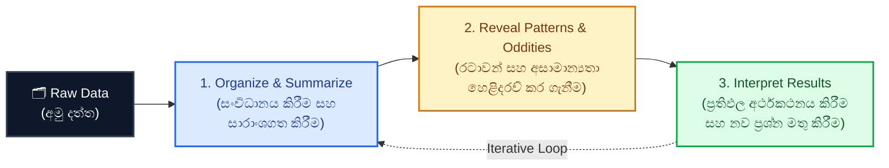
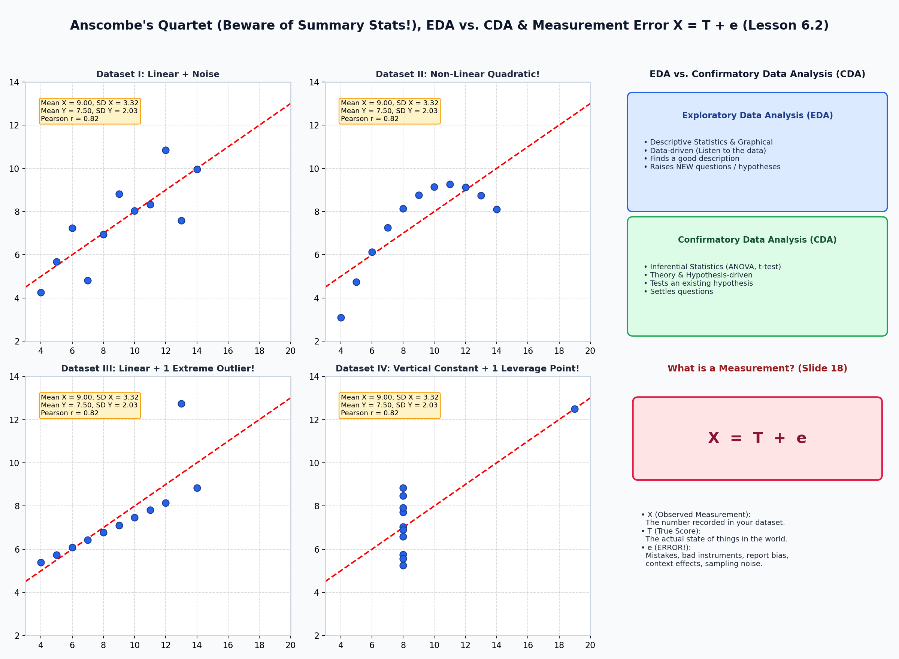

# පාඩම 6.2: ගවේෂණාත්මක දත්ත විශ්ලේෂණයේ (EDA) පදනම, CDA සමඟ සංසන්දනය සහ Anscombe's Quartet (Foundations of EDA vs. Confirmatory Data Analysis)

**මූලාශ්‍රය (Source Lecture Notes):** `Introduction to Exploratory Data nalysis.pdf` (Slides 11 – 18, 31)  
**විෂය (Module):** CI7340 - Applied Data Programming (Dr. Lochandaka Ranathunga)

---

> [!TIP]
> **📚 Prerequisite / Dependency Lesson Series:**  
> Anscombe's Quartet හි සාරාංශ සංඛ්‍යාන (Mean, Std, Correlation) සහ Classical Measurement Theory ($X = T + e$) ගණිතය තේරුම් ගැනීමට:
> - [Dep 04.1: Intuition of Variance, Standard Deviation and Bessel's Correction](../dependencies/Dep_04_Standard_Deviation_Normal_Distribution_and_Hypothesis_Testing/01_Intuition_of_Variance_Standard_Deviation_and_Bessels_Correction.md)
> - [Dep 01.1: Pandas Core Architecture (Index, Series and DataFrame Internals)](../dependencies/Dep_01_Pandas_Zero_to_Hero/01_Pandas_Core_Architecture_Index_Series_and_DataFrame_Internals.md)

---

## 1. හැඳින්වීම: Exploratory Data Analysis (EDA) යනු කුමක්ද? (Slides 11 – 14)

**John W. Tukey (1977)** විසින් ලොවට හඳුන්වා දුන් **Exploratory Data Analysis (EDA - ගවේෂණාත්මක දත්ත විශ්ලේෂණය)** යනු දත්ත කට්ටලයක් මත කිසිදු පූර්ව උපකල්පනයක් හෝ සංඛ්‍යානමය ආකෘතියක් (Statistical Model) බලෙන් පැටවීමට පෙර, විවෘත මනසකින් යුතුව දත්ත දෙස බලා **"දත්තවලට කතා කිරීමට ඉඩ දීමේ" (Listening to the data)** විද්‍යාත්මක ක්‍රියාවලියයි.

### EDA හි මූලික චක්‍රීය කුළුණු 3 (Slides 11 – 12):



### EDA ප්‍රයෝජනවත් වන්නේ කුමක් සඳහාද? (EDA is useful for - Slide 13):
1. **Describe Distributions:** එක් එක් විචල්‍යයේ ව්‍යාප්තිය (හැඩය, මැද අගය, විසිරීම) විස්තර කිරීමට.
2. **Investigate Relationships:**
   - පැහැදිලි කිරීමේ විචල්‍යයන් (Explanatory / Independent variables - $X_1, X_2$) එකිනෙක අතර පවතින සම්බන්ධතා තීරණය කිරීමට.
   - පැහැදිලි කිරීමේ විචල්‍යයන් ($X$) සහ ප්‍රතිඵල විචල්‍යය (Outcome / Target variable - $Y$) අතර සම්බන්ධතා තීරණය කිරීමට.
3. **Check for Data Errors / Noise:** දත්තවල ඇති වැරදි, දෝෂ සහ ඝෝෂාව (Noise) හඳුනා ගැනීමට.
4. **Investigate Assumptions:** සංඛ්‍යානමය පරීක්ෂණවලට පෙර ඒවායේ උපකල්පන (උදා: Normality, Homoscedasticity) සත්‍ය දැයි පරීක්ෂා කිරීමට.
5. **Selecting Data Models:** දත්තවලට වඩාත්ම ගැලපෙන ගණිතමය හෝ Machine Learning ආකෘතිය තෝරා ගැනීමට.

### EDA හිදී භාවිතා කරන ප්‍රධාන ශිල්පීය ක්‍රම 3 (Techniques - Slide 14):
1. **Look at the raw data (අමු දත්ත දෙස කෙලින්ම බැලීම):**
   - විචල්‍යයන් ගන්නේ කුමන අගයන්ද? (*What values the variables take?*)
   - කොපමණ වාර ගණනක් එම අගයන් ගන්නවාද? (*How often variables take those values?*)
2. **Compute summary statistics (සාරාංශ සංඛ්‍යාන ගණනය කිරීම):**
   - දත්තවල ඉහළම සහ පහළම කොටස් පරීක්ෂා කිරීම (*Look at the top and bottom of your data* - `.head()`, `.tail()`).
   - කොපමණ අස්ථානගත දත්ත (Missing data) තිබේද?
   - දත්ත කොපමණ ඝෝෂාකාරීද (Noisy)?
3. **Visualize (දෘශ්‍යකරණය කිරීම):**
   - සංසන්දනයන් පෙන්වන්න (*Show comparisons*), ව්‍යුහය පෙන්වන්න (*Show structure*), බහු-විචල්‍ය දත්ත පෙන්වන්න (*Show multivariate data*).

---

## 2. EDA vs. CDA (Confirmatory Data Analysis) සංසන්දනය (Slides 15 & 31)

දත්ත විශ්ලේෂණයේ ප්‍රධාන අදියර දෙක වන්නේ **Exploratory Data Analysis (EDA)** සහ **Confirmatory Data Analysis (CDA - තහවුරු කිරීමේ දත්ත විශ්ලේෂණය)** යි:

| ලක්ෂණය (Aspect) | Exploratory Data Analysis (EDA) | Confirmatory Data Analysis (CDA) |
| :--- | :--- | :--- |
| **සංඛ්‍යාන වර්ගය** | **Descriptive Statistics** (විස්තරාත්මක සංඛ්‍යානය) සහ **Graphical** (ප්‍රස්තාරික ක්‍රම) | **Inferential Statistics** (අනුමාන සංඛ්‍යානය - $t$-test, ANOVA, $p$-values) |
| **මෙහෙයවනු ලබන්නේ** | **Data-driven** (දත්ත මඟින්ම මෙහෙයවනු ලබයි) | **EDA and Theory-driven** (න්‍යායන් සහ කල්පිතයන් මඟින් මෙහෙයවනු ලබයි) |
| **කල්පිතයන් (Hypotheses)** | නව කල්පිතයන් සහ ප්‍රශ්න **මතු කරයි** (*Finds a good description, raises new questions*) | පවතින කල්පිතයක් **පරීක්ෂා කරයි**, ප්‍රශ්නවලට අවසන් තීන්දුවක් දෙයි (*Tests a hypothesis, settles questions*) |
| **උපමාව (Analogy)** | අපරාධ ස්ථානයක හෝඩුවාවන් සොයන **රහස් පරීක්ෂකයෙකු (Detective)** වැනිය. | උසාවියේදී සාක්ෂි මත වරදකරු/නිවැරදිකරු තීරණය කරන **විනිසුරුවරයෙකු (Judge)** වැනිය. |

---

## 3. සාරාංශ සංඛ්‍යානවලින් පමණක් රැවටෙන්න එපා! — Anscombe's Quartet (Slide 16)

> **“Beware of summary stats: While different in appearance, each dataset has the same summary statistics (mean, standard deviation, and Pearson's correlation) to two decimal places.”** — Slide 16

1973 දී සංඛ්‍යානඥ **Francis Anscombe** විසින් නිර්මාණය කළ **Anscombe's Quartet** නමැති දත්ත කට්ටල 4 මඟින්, ප්‍රස්තාර නොඇඳ (EDA නොකර) හුදෙක් Mean, Standard Deviation සහ Correlation වැනි Summary Statistics දෙස පමණක් බලා තීරණ ගැනීම කොතරම් භයානකද යන්න ඔප්පු කර පෙන්වීය!



### දත්ත කට්ටල 4 හිම සමාන සංඛ්‍යානමය අගයන් (Identical Summary Stats):
ඉහත රූපයේ දැක්වෙන Dataset I, Dataset II, Dataset III, සහ Dataset IV යන හතරෙහිම:
- $X$ හි මධ්‍යන්‍යය ($\bar{X}$) $= \mathbf{9.00}$ සහ සම්මත අපගමනය ($SD_X$) $= \mathbf{3.32}$
- $Y$ හි මධ්‍යන්‍යය ($\bar{Y}$) $= \mathbf{7.50}$ සහ සම්මත අපගමනය ($SD_Y$) $= \mathbf{2.03}$
- Pearson Correlation අගය ($r$) $= \mathbf{0.82}$
- Linear Regression රේඛාව $= \mathbf{y = 3.00 + 0.50x}$

### නමුත් ප්‍රස්තාර ඇඳ බැලූ විට (Visualizing with Scatter Plots):
1. **Dataset I (ඉහළ වම):** සාමාන්‍ය රේඛීය සම්බන්ධතාවයක් (Linear relationship with normal noise) පෙන්වයි.
2. **Dataset II (ඉහළ මැද):** පැහැදිලිවම **වක්‍රාකාර (Quadratic / Non-linear)** සම්බන්ධතාවයකි! මෙයට Linear Regression දැමීම සම්පූර්ණයෙන්ම වැරදිය.
3. **Dataset III (පහළ වම):** ඉතාම නිවැරදි සරල රේඛාවක් ඇති නමුත්, **එකම එක දරුණු Outlier අගයක්** ($x=13, y=12.74$) නිසා මුළු Regression රේඛාවම ඇල වී Correlation අගය $1.0$ සිට $0.82$ දක්වා අඩු වී ඇත!
4. **Dataset IV (පහළ මැද):** $X$ අගයන් සියල්ලම $x=8$ හි සිරස්ව පවතින අතර (කිසිදු සම්බන්ධතාවයක් නැත!), ඈතින් පිහිටි **එකම එක Leverage ලක්ෂ්‍යයක්** ($x=19, y=12.50$) නිසා බොරු $r = 0.82$ සහසම්බන්ධතාවයක් පෙන්වයි!

---

## 4. විශ්ලේෂණයට පෙර සියලුම විචල්‍යයන් පරීක්ෂා කළ යුත්තේ ඇයි? සහ මිනුම් න්‍යාය ($X = T + e$) (Slides 17 – 18)

### දත්තවලට ඇහුම්කන් දිය යුත්තේ ඇයි? (Why Examine All Variables First? - Slide 17):
> **"Before you begin your analyses, it is imperative that you examine all your variables. Why? To listen to the data:"**
- **To catch mistakes:** දත්ත ඇතුළත් කිරීමේ හෝ මැනීමේ වැරදි අල්ලා ගැනීමට.
- **To see patterns in the data:** දත්තවල සැබෑ රටාවන් දැක ගැනීමට.
- **To find violations of statistical assumptions:** සංඛ්‍යානමය උපකල්පන (Normality, Linearity) කඩවීම් සොයා ගැනීමට.
- **...and because if you don't, you will have trouble later!** (ඔබ මුලින්ම එය නොකළහොත් පසුව මොඩල් හදන විට බරපතල කරදරවල වැටෙනු ඇත!).

---

### මිනුමක් යනු කුමක්ද? (What is a Measurement? - Slide 18):
සැබෑ ලෝකයේ අපි මනින ඕනෑම අගයක් ($X$) කොටස් දෙකකින් සමන්විත වේ:

$$X = T + e$$

1. **$X$ (Observed Measurement / නිරීක්ෂිත මිනුම):** ඔබේ දත්ත ගොනුවේ (Spreadsheet / DataFrame) සටහන් වී ඇති අගය.
2. **$T$ (The True Score / සැබෑ ලකුණ):** බාහිර ලෝකයේ පවතින සැබෑ තත්ත්වය (*The actual state of things in the world*).
3. **$e$ (ERROR! / දෝෂය):** වැරදි (Mistakes), දුර්වල මිනුම් උපකරණ (Bad measurement), වාර්තා කිරීමේ පක්ෂග්‍රාහීත්වය (Report bias), සහ අවට පරිසරයේ බලපෑම් (Context effects) නිසා එකතු වන දෝෂයයි.

> **EDA හි ප්‍රධාන ඉලක්කයක් වන්නේ:** නිරීක්ෂිත දත්තය ($X$) තුළ සැඟවී ඇති දෝෂය ($e$) හඳුනාගෙන අවම කරමින්, සැබෑ සත්‍යය ($T$) මතු කර ගැනීමයි!

---

## 🛠️ Practical Task / Hands-On Exercise (ප්‍රාyogika Abhyasaya)

### Scenario:
Anscombe's Quartet වැනි දත්ත කාණ්ඩ 2 ක් සඳහා Summary Statistics සමාන වුවද, Scatter Plot එකක් මඟින් ඒවා සම්පූර්ණයෙන්ම වෙනස් හැසිරීම් දක්වන බව ඔප්පු කිරීම.

### Step-by-Step Tasks:
1. **Task 1 (Calculate Summary Stats):** Data Series යුගල දෙකක් සඳහා Mean, Std Dev, සහ Pearson Correlation ගණනය කරන්න.
2. **Task 2 (Plot and Compare):** දෙකෙහිම ප්‍රස්තාර ඇඳ Outlier එකක් මඟින් රේඛීය සම්බන්ධතාවය විකෘති වී ඇති ආකාරය පැහැදිලි කරන්න.

### Reference Solution (පියවරෙන් පියවර විසඳුම):
```python
import numpy as np
import pandas as pd
from scipy import stats

# Dataset 1: Linear relationship
x1 = np.array([10, 8, 13, 9, 11, 14, 6, 4, 12, 7, 5])
y1 = np.array([8.04, 6.95, 7.58, 8.81, 8.33, 9.96, 7.24, 4.26, 10.84, 4.82, 5.68])

# Dataset 2: Vertical line with a single extreme leverage outlier
x2 = np.array([8, 8, 8, 8, 8, 8, 8, 8, 8, 8, 19])
y2 = np.array([6.58, 5.76, 7.71, 8.84, 8.47, 7.04, 5.25, 5.56, 7.91, 6.89, 12.50])

print(f"Set 1 -> Mean X: {np.mean(x1):.2f}, Mean Y: {np.mean(y1):.2f}, r: {stats.pearsonr(x1, y1)[0]:.2f}")
print(f"Set 2 -> Mean X: {np.mean(x2):.2f}, Mean Y: {np.mean(y2):.2f}, r: {stats.pearsonr(x2, y2)[0]:.2f}")
print("Lesson: Never trust summary stats alone without visualization!")
```

---
