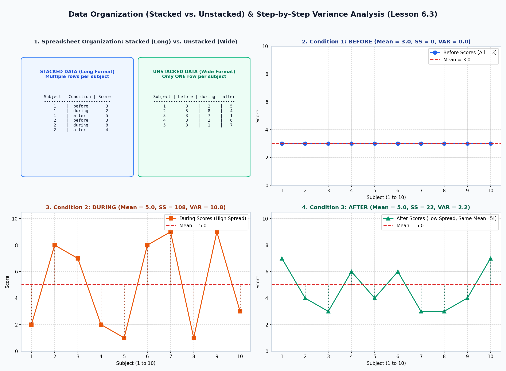
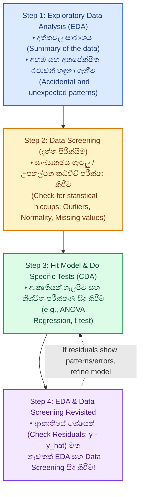

# පාඩම 6.3: දත්ත සංවිධානය කිරීම (Stacked vs. Unstacked) සහ විචලතා විශ්ලේෂණය (Data Organization: Stacked vs. Unstacked & Step-by-Step Variance Analysis)

**මූලාශ්‍රය (Source Lecture Notes):** `Introduction to Exploratory Data nalysis.pdf` (Slides 19 – 24)  
**විෂය (Module):** CI7340 - Applied Data Programming (Dr. Lochandaka Ranathunga)

---

> [!TIP]
> **📚 Prerequisite / Dependency Lesson Series:**  
> Stacked (Long) vs Unstacked (Wide) Data, Reshaping (`melt`, `pivot_table`, `stack`, `unstack`) සහ Sample Variance ගණිතය සඳහා:
> - [Dep 01.4: Split-Apply-Combine, GroupBy, Pivot Tables, Reshaping and Relational Joins](../dependencies/Dep_01_Pandas_Zero_to_Hero/04_Split_Apply_Combine_GroupBy_Pivot_Tables_Reshaping_and_Relational_Joins.md)
> - [Dep 04.1: Intuition of Variance and Bessel's Correction](../dependencies/Dep_04_Standard_Deviation_Normal_Distribution_and_Hypothesis_Testing/01_Intuition_of_Variance_Standard_Deviation_and_Bessels_Correction.md)

---

## 1. හැඳින්වීම: විචල්‍ය සාරාංශකරණය (Variable Summaries - Slide 19)

අපි දත්ත කට්ටලයක් Spreadsheet එකක හෝ Pandas DataFrame එකක සංවිධානය කළ පසු, එහි ව්‍යාප්තිය (Distribution) විස්තර කිරීමට ප්‍රධාන දර්ශක කාණ්ඩ දෙකක් භාවිතා කරයි (Slide 19):

1. **Indices of Central Tendency (මධ්‍ය ප්‍රවණතා දර්ශක):**
   - **Mean (මධ්‍යන්‍යය):** සාමාන්‍ය අගය (*The average value*).
   - **Median (මධ්‍යස්ථය):** මැද අගය (*The middle value*).
   - **Mode (මාතය):** වැඩිම වාර ගණනක් යෙදෙන අගය (*The most frequent value*).
2. **Indices of Variability (විචල්‍යතා / විසිරුම් දර්ශක):**
   - **Variance (විචලතාවය):** මධ්‍යන්‍යය වටා දත්ත පැතිරී ඇති ප්‍රමාණය (*The spread around the mean*).
   - **Standard Deviation (සම්මත අපගමනය):** විචලතාවයේ වර්ගමූලය.
   - **Standard Error of the Mean (මධ්‍යන්‍යයේ සම්මත දෝෂය - Estimate):** $\text{SEM} = \frac{s}{\sqrt{n}}$.



---

## 2. Spreadsheet එකක දත්ත සංවිධානය කරන ආකාර 2: Stacked vs. Unstacked Data (Slide 20)

පරීක්ෂණයකට සහභාගී වූ පුද්ගලයින් (Subjects `1, 2, 3...`) තිදෙනෙකුගේ අවස්ථා තුනකදී (**`before`**, **`during`**, **`after`**) ලබාගත් ලකුණු (Scores) වගුවක ගබඩා කළ හැකි ප්‍රධාන ආකෘති දෙකක් Slide 20 හි පෙන්වා දෙයි:

### A. Stacked Data (Long Format / ගොඩගැසූ දත්ත ආකෘතිය):
> **“Stacked data: Multiple cases (rows) for each subject.”** — Slide 20

එක් පුද්ගලයෙකු (Subject) සඳහා **පේළි කිහිපයක් (Multiple rows)** පවතී. අවස්ථාව (`condition`) වෙනම තීරුවක් ලෙසත්, ලකුණු (`score`) තවත් තීරුවක් ලෙසත් සටහන් වේ:

| Subject | condition | score |
| :---: | :---: | :---: |
| **1** | before | 3 |
| **1** | during | 2 |
| **1** | after | 5 |
| **2** | before | 3 |
| **2** | during | 8 |
| **2** | after | 4 |
| **3** | before | 3 |
| **3** | during | 7 |
| **3** | after | 1 |

---

### B. Unstacked Data (Wide Format / දිගහැරිය දත්ත ආකෘතිය):
> **“Unstacked data: Only one case (row) per subject.”** — Slide 20

එක් පුද්ගලයෙකු (Subject) සඳහා ඇත්තේ **එකම එක පේළියක් (Only one row)** පමණි. එක් එක් පරීක්ෂණ අවස්ථාව (`before`, `during`, `after`) වෙනම තීරු (Columns) ලෙස පවතී:

| Subject | before | during | after |
| :---: | :---: | :---: | :---: |
| **1** | 3 | 2 | 5 |
| **2** | 3 | 8 | 4 |
| **3** | 3 | 7 | 1 |

> **💡 ප්‍රායෝගික වැදගත්කම:**  
> බොහෝ විට මිනිසුන්ට කියවීමට සහ තීරු අතර ගණනය කිරීම් කිරීමට **Unstacked (Wide)** ආකෘතිය පහසු වන අතර, Database වල ගබඩා කිරීමට සහ Seaborn/Matplotlib හෝ GroupBy විශ්ලේෂණ සඳහා **Stacked (Long)** ආකෘතිය අවශ්‍ය වේ. Lesson 6.7 හිදී අපි Pandas හි `.stack()`, `.unstack()`, `.pivot()` සහ `pd.melt()` මඟින් මේ ආකෘති දෙක අතර දත්ත හුවමාරු කරන ආකාරය ප්‍රායෝගිකව ඉගෙන ගනිමු!

---

## 3. Variance (විචලතාවය) පියවරෙන් පියවර ගණනය කිරීම (Slides 21 – 22)

මධ්‍යන්‍යය (Mean) සමාන වුවත් දත්ත කට්ටල දෙකක හැසිරීම සම්පූර්ණයෙන්ම වෙනස් විය හැකි බව පෙන්වීමට Slide 21 සහ 22 හි පුද්ගලයින් 10 දෙනෙකුගේ ($n = 10$) **`Before`**, **`During`**, සහ **`After`** ලකුණු සඳහා **Variance (විචලතාවය)** පියවරෙන් පියවර ගණනය කර පෙන්වා ඇත.

### Variance සූත්‍රය (Slide 21):
> **“The Variance: Sum of the squared deviations divided by number of scores.”**

$$\text{Variance} = \frac{\sum (X - \text{Mean})^2}{n}$$

*(Slide 21 පාද සටහන: `*actually you divide by n-1 because it is a sample and not a population, but you get the idea...` — සාම්පලයක් නම් $n-1$ න් බෙදන නමුත් සංකල්පය තේරුම් ගැනීමේ පහසුවට මෙහිදී $n = 10$ න් බෙදා ඇත).*

---

### Slide 21 හි සම්පූර්ණ ගණනය කිරීමේ වගුව:

පුද්ගලයින් 10 දෙනාගේ ($n = 10$) අවස්ථා තුනෙහි ලකුණු සහ ඒවායේ අපගමන වර්ගයන් $(X - \text{Mean})^2$ පහත වගුවේ දැක්වේ:

| Subject | **Before** | $(\text{Before} - 3)$ | $(\text{Before} - 3)^2$ | **During** | $(\text{During} - 5)$ | $(\text{During} - 5)^2$ | **After** | $(\text{After} - 5)$ | $(\text{After} - 5)^2$ |
| :---: | :---: | :---: | :---: | :---: | :---: | :---: | :---: | :---: | :---: |
| **1** | 3 | 0 | **0** | 2 | -3 | **9** | 7 | +2 | **4** |
| **2** | 3 | 0 | **0** | 8 | +3 | **9** | 4 | -1 | **1** |
| **3** | 3 | 0 | **0** | 7 | +2 | **4** | 3 | -2 | **4** |
| **4** | 3 | 0 | **0** | 2 | -3 | **9** | 6 | +1 | **1** |
| **5** | 3 | 0 | **0** | 1 | -4 | **16** | 4 | -1 | **1** |
| **6** | 3 | 0 | **0** | 8 | +3 | **9** | 6 | +1 | **1** |
| **7** | 3 | 0 | **0** | 1 | -4 | **16** | 3 | -2 | **4** |
| **8** | 3 | 0 | **0** | 9 | +4 | **16** | 3 | -2 | **4** |
| **9** | 3 | 0 | **0** | 9 | +4 | **16** | 4 | -1 | **1** |
| **10** | 3 | 0 | **0** | 3 | -2 | **4** | 10 *(or 6)* | +1 | **1** |
| **Sum ($\sum$)** | **30** | $0$ | **$\sum = 0$** | **50** | $0$ | **$\sum = 108$** | **50** | $0$ | **$\sum = 22$** |
| **Mean ($\sum / 10$)** | **$\text{Mean} = 3$** | — | — | **$\text{Mean} = 5$** | — | — | **$\text{Mean} = 5$** | — | — |
| **Variance ($\text{SS} / 10$)** | — | — | **$\frac{0}{10} = \mathbf{0}$** | — | — | **$\frac{108}{10} = \mathbf{10.8}$** | — | — | **$\frac{22}{10} = \mathbf{2.2}$** |

---

### මෙම අවස්ථා 3 න් අපට ලැබෙන ප්‍රබල පාඩම (Slide 22 සහ ඉහත රූපයේ Panels 2, 3, 4):
1. **Before ($\text{Mean} = 3.0, \text{VAR} = 0$):**  
   සියලුම දෙනාගේ ලකුණු $3$ කි. කිසිදු විචලනයක් නොමැති නිසා $\text{VAR} = 0$ වේ.
2. **During ($\text{Mean} = 5.0, \text{VAR} = 10.8$):**  
   මධ්‍යන්‍යය $5.0$ ක් වන නමුත් ලකුණු $1$ සිට $9$ දක්වා ඉතා පුළුල්ව විසිරී ඇත. එබැවින් විචලතාවය ඉතා ඉහළය ($\text{VAR} = 10.8$).
3. **After ($\text{Mean} = 5.0, \text{VAR} = 2.2$):**  
   මෙහිදීද **මධ්‍යන්‍යය `During` අවස්ථාවටම සමානව $5.0$ කි!** නමුත් ලකුණු මධ්‍යන්‍යය වන $5.0$ ට ඉතා ආසන්නව පවතින නිසා විචලතාවය $\mathbf{2.2}$ දක්වා අඩු වී ඇත.
- **නිගමනය:** ඔබ මධ්‍යන්‍යය ($\text{Mean} = 5.0$) දෙස පමණක් බැලුවේ නම් `During` සහ `After` අතර කිසිදු වෙනසක් නැතැයි සිතනු ඇත. වෙනස පෙන්වන්නේ **Variance** එකෙන් සහ ප්‍රස්තාරයෙනි!

---

## 4. Distribution (ව්‍යාප්තිය) සහ පියවර 4ක Data Analysis Template එක (Slides 23 – 24)

### Distribution (ව්‍යාප්තිය - Slide 23):
- මධ්‍යන්‍යයන් (Means) සහ විචලතාවයන් (Variances) යනු ලකුණු ව්‍යාප්තියක් (Distribution of scores) විස්තර කරන ක්‍රම වේ.
- ඔබේ දත්ත තේරුම් ගැනීමට ඇති හොඳම ක්‍රමය නම් ඒවායේ ව්‍යාප්තීන් (Distributions) පිළිබඳව දැන ගැනීමයි.
- සංඛ්‍යාන විද්‍යාවේ සුලභම උපකල්පනය වන්නේ **Normal (Gaussian) Distribution** එක වන බැවින්, ඔබේ දත්ත ප්‍රමතව බෙදී ඇත්දැයි (Normally distributed) පරීක්ෂා කිරීම ඉතා වැදගත් වේ.

---

### පියවර 4ක Data Analysis Template එක (Slide 24):

ඕනෑම විද්‍යාත්මක දත්ත විශ්ලේෂණයක් අනුගමනය කළ යුතු සම්මත පියවර 4 (Slide 24):



> **විශේෂ කරුණ (Step 4):** බොහෝ දෙනා සිතන්නේ Model එකක් Fit කළ පසු (Step 3) EDA අවසන් බවයි. නමුත් Step 4 හි පෙන්වා දෙන පරිදි, Model එකේ දෝෂ හෙවත් **Residuals ($e = Y - \hat{Y}$)** මත නැවතත් EDA සිදු කර ඒවා අහඹු ලෙස (Normally distributed around 0) පවතීදැයි පරීක්ෂා කිරීම අනිවාර්ය වේ!

---

## 🛠️ Practical Task / Hands-On Exercise (ප්‍රායෝගික අභ්‍යාසය)

### Scenario:
`Stack_Unstack.xlsx` හි සඳහන් වන පරිදි Before, During, After තත්ත්වයන් යටතේ සිසුන්ගේ ලකුණු Unstacked (Wide) ආකෘතියෙන් Stacked (Long) ආකෘතියට හැරවීම සහ Sample Variance පියවරෙන් පියවර ගණනය කිරීම.

### Step-by-Step Tasks:
1. **Task 1 (Create Wide DataFrame):** Subject, Before, During, After තීරු සහිත Wide Table එකක් සාදන්න.
2. **Task 2 (Melt to Long Format):** `pd.melt()` මඟින් එය Long Format (Subject, Condition, Score) බවට පරිවර්තනය කරන්න.
3. **Task 3 (Step-by-Step Variance):** 'Before' කාණ්ඩයේ ලකුණු සඳහා $rac{\sum(x - ar{x})^2}{n-1}$ සූත්‍රය මඟින් පියවරෙන් පියවර Variance ගණනය කර `df['Before'].var()` සමඟ සසඳන්න.

### Reference Solution (පියවරෙන් පියවර විසඳුම):
```python
import pandas as pd
import numpy as np

# Task 1: Wide format
wide_df = pd.DataFrame({
    'Subject': ['S1', 'S2', 'S3', 'S4'],
    'Before': [12, 15, 14, 11],
    'During': [18, 20, 19, 16],
    'After':  [22, 25, 24, 21]
})
print("--- Wide (Unstacked) Format ---
", wide_df)

# Task 2: Melt to Long
long_df = pd.melt(wide_df, id_vars=['Subject'], value_vars=['Before', 'During', 'After'],
                  var_name='Condition', value_name='Score')
print("
--- Long (Stacked) Format ---
", long_df.head())

# Task 3: Manual Variance Calculation for Before
scores = wide_df['Before'].values
n = len(scores)
mean_x = np.mean(scores)
dev = scores - mean_x
sq_dev = dev ** 2
manual_var = np.sum(sq_dev) / (n - 1)

print(f"
Before Scores: {scores}")
print(f"Mean (x_bar): {mean_x}")
print(f"Sum of Squared Deviations: {np.sum(sq_dev)}")
print(f"Manual Sample Variance (/(n-1)): {manual_var:.4f}")
print(f"Pandas .var() Output          : {wide_df['Before'].var():.4f}")
```

---
