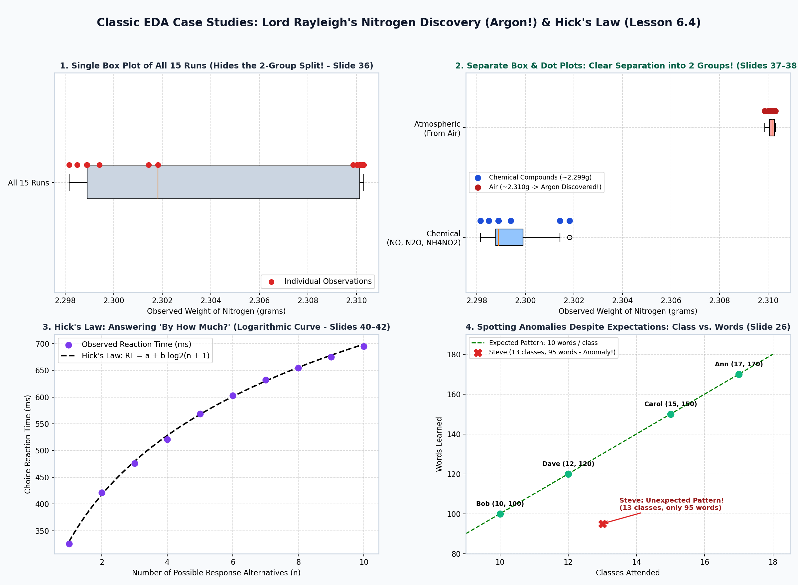
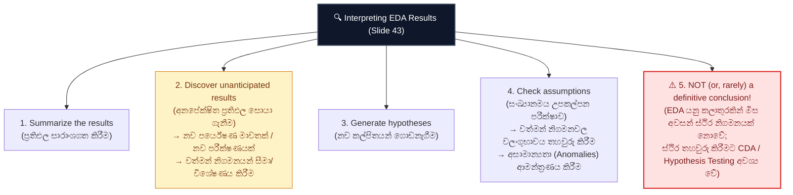

# පාඩම 6.4: රටා හඳුනා ගැනීම සහ සම්භාව්‍ය EDA සිද්ධි අධ්‍යයනයන් (Pattern Recognition & Classic EDA Case Studies: Lord Rayleigh, Hick's Law & NameVoyager)

**මූලාශ්‍රය (Source Lecture Notes):** `Introduction to Exploratory Data nalysis.pdf` (Slides 25 – 43)  
**විෂය (Module):** CI7340 - Applied Data Programming (Dr. Lochandaka Ranathunga)

---

> [!TIP]
> **📚 Prerequisite / Dependency Lesson Series:**  
> EDA Visual Pattern Recognition, Outlier Detection via Box Plots, සහ Hick's Law Logarithmic Transformations සඳහා:
> - [Dep 01.3: Data Cleaning, Missing Values, String and Datetime Methods](../dependencies/Dep_01_Pandas_Zero_to_Hero/03_Data_Cleaning_Missing_Values_Duplicates_String_and_Datetime_Methods.md)
> - [Module 5 Dep 01: Matplotlib Zero-to-Hero](../dependencies/Dep_01_Matplotlib_Zero_to_Hero/04_Statistical_Charts_in_Matplotlib_Histograms_Boxplots_ErrorBars_Heatmaps.md)

---

## 1. හැඳින්වීම: අපේ බලාපොරොත්තුවලට පටහැනිව වුවද දත්තවලට කතා කිරීමට ඉඩ දීම (Slides 25 – 29)

EDA හි ප්‍රධානතම කාර්යභාරය කුමක්ද? (Slide 25):
- දත්ත ජනනය කළ සිදුවීම් (Events that generated the data) තේරුම් ගැනීමට උපකාරී වීම.
- **සමහර විට අපේ පූර්ව බලාපොරොත්තුවලට පටහැනිව වුවද (Sometimes in spite of your expectations)** සැබෑවටම සිදු වූයේ කුමක්දැයි දැක ගැනීමට උදව් කිරීම.

### සරල උදාහරණය: පන්ති පැමිණීම සහ භාෂා ඉගෙනීම (Class Attendance & Language Learning - Slide 26):
සිසුන් 5 දෙනෙකු භාෂා පන්තියකට සහභාගී වූ දින ගණන සහ ඔවුන් ඉගෙන ගත් වචන ගණන දෙස බලන්න:
- **Bob:** පන්ති 10 $\rightarrow$ වචන 100 (පන්තියකට වචන 10 යි)
- **Carol:** පන්ති 15 $\rightarrow$ වචන 150 (පන්තියකට වචන 10 යි)
- **Dave:** පන්ති 12 $\rightarrow$ වචන 120 (පන්තියකට වචන 10 යි)
- **Ann:** පන්ති 17 $\rightarrow$ වචන 170 (පන්තියකට වචන 10 යි)
- **Steve:** **පන්ති 13 $\rightarrow$ වචන 95 (!)**

මෙම දත්ත Scatter Plot එකක ලකුණු කළ විගස (පහත රූපයේ Panel 4 බලන්න), Bob, Dave, Carol සහ Ann යන සිව්දෙනාම $\text{Words} = 10 \times \text{Classes}$ යන සරල රේඛාව මත පිහිටන බවත්, **Steve පමණක් එම රටාවෙන් බැහැරව සිටින Anomaly/Outlier කෙනෙකු** බවත් ක්ෂණිකව පෙනේ!



---

## 2. මිනිස් මොළය සහ නිර්මාණශීලී දත්ත විශ්ලේෂණය (Slides 27 – 30)

### ලොව බලගතුම Pattern Recognition උපකරණය (Slides 27 – 28):
> **“EDA supplies statistical techniques (ways to tabulate, summarise, display, reduce data) that work in combination with a very powerful pattern recognition device… THE HUMAN BRAIN & VISUAL SYSTEM!”** — Slides 27–28

- දත්ත විශ්ලේෂණය (Data Analysis) යාන්ත්‍රිකව (Mechanically) කළ නොහැක; ඒ සඳහා **නිර්මාණශීලීත්වයක් ("Creative" element)** අවශ්‍ය වේ (Slide 29).
- පරමාදර්ශී විද්‍යාගාර පරීක්ෂණ (Ideal experimentation) සහ සැබෑ ලෝකයේ වලංගුභාවය (Ecological validity) අතර සමබරතාවයක් පවත්වා ගත යුතුය.

### NameVoyager උදාහරණය: විචල්‍යයන් 6ක් එකවර දෘශ්‍යකරණය කිරීම (Slide 30):
ළදරුවන්ට තබන නම්වල ජනප්‍රියතාවය කාලය සමඟ වෙනස් වන ආකාරය පෙන්වන **NameVoyager** අන්තර්ක්‍රියාකාරී ප්‍රස්තාරය මඟින් විචල්‍යයන් 6ක් දෘශ්‍ය ලක්ෂණ 6කට (Visual Encodings) පරිවර්තනය කර ඇති ආකාරය Slide 30 හි පෙන්වා දෙයි:

| විචල්‍යය (Variable) | නිරූපණය කිරීමට භාවිතා කළ ක්‍රමය (Method Used to Represent) |
| :--- | :--- |
| **1. Time (කාලය / දශකය)** | තිරස් අක්ෂය (**Horizontal axis - X**) |
| **2. No. / billion babies (ජනප්‍රියතාවය)** | සිරස් අක්ෂය / තීරුවේ උස (**Vertical axis - Y**) |
| **3. Sex (ස්ත්‍රී/පුරුෂ භාවය)** | වර්ණ ප්‍රභේදය (**Colour hue**: නිල් = පිරිමි, රෝස = ගැහැණු) |
| **4. Rank in 2007 (වත්මන් ශ්‍රේණිය)** | වර්ණ තීව්‍රතාවය (**Colour saturation**: තද වර්ණය = ඉහළ ශ්‍රේණිය) |
| **5. Name (නම)** | තීරුව මත ඇති පෙළ ලේබලය (**Label**) |
| **6. Detail (සවිස්තරාත්මක දත්ත)** | Mouse එක ගෙන ගිය විට හෝ Click කළ විට පෙන්වීම (**Pop-up, click thru**) |

---

## 3. Data Reduction සහ සරල විස්තරවල බලය (Slide 32 & 33)

> **“Anything that looks below the previously described surface makes the description more effective.” — John Tukey (1977)** (Slide 33)

දත්ත අඩු ඉලක්කම් ගණනකට සාරාංශ කර (Data Reduction - fewer numbers) නැවත ඉදිරිපත් කිරීමෙන් (Re-presenting) රටාවන් වඩාත් පැහැදිලි වේ (Slide 32):
1. **Summarise Proportion (අනුපාත සාරාංශ කිරීම):**
   - *අමු දත්තය:* A පන්තියේ ළමුන් 48 න් 27 ක් පිරිමි ළමුන්ය. B පන්තියේ ළමුන් 23 න් 16 ක් පිරිමි ළමුන්ය. (48 න් 27 සහ 23 න් 16 ක්ෂණිකව සැසඳීම අපහසුය!).
   - *Re-presented (ප්‍රතිශත ලෙස):* A පන්තියෙන් **56%** ක් සහ B පන්තියෙන් **69%** ක් පිරිමි ළමුන්ය. (දැන් එක බැල්මකින් සැසඳිය හැක!).
2. **Summarise Change (වෙනස්වීම සාරාංශ කිරීම):**
   - *අමු දත්තය:* `Before: 112, 134, 121, 97` සහ `After: 116, 132, 140, 108`.
   - *Re-presented (වෙනස පමණක් ගැනීම):* `Change: +4, -2, +19, +11`.

---

## 4. සම්භාව්‍ය සිද්ධි අධ්‍යයනය 1: Lord Rayleigh ගේ නයිට්‍රජන් බර පරීක්ෂණය සහ Argon වායුව සොයා ගැනීම! (Slides 34 – 39)

අමු දත්ත (Raw Data) දෙස නිකම්ම බැලීමෙන් නොපෙනෙන ලෝක මට්ටමේ විද්‍යාත්මක සොයාගැනීමක් (නොබෙල් ත්‍යාගය පවා හිමි වූ **Argon** නිষ্ක්‍රීය වායුව සොයාගැනීම!) EDA මඟින් හෙළිදරව් වූ ආකාරය Slides 34–39 හි දැක්වේ.

### පරීක්ෂණයේ පසුබිම (Slide 34):
භෞතික විද්‍යාඥ **Lord Rayleigh** විසින් නියත පරිමාවක ඇති නයිට්‍රජන් වායුවේ බර (Weight of nitrogen) මැනීමේ පරීක්ෂණය **15 වතාවක්** සිදු කරන ලදී. ඔහු නයිට්‍රජන් ලබා ගැනීමට විවිධ ප්‍රභවයන් (`Air` - සාමාන්‍ය වාතය සහ `NO`, `N2O`, `NH4NO2` යන රසායනික සංයෝග) භාවිතා කළේය.

### Slide 35 හි දැක්වෙන අමු දත්ත වගුව (15 Observations):

| Date | Source Compound (ප්‍රභවය) | Extraction Method | Weight Observed (grams) |
| :---: | :---: | :---: | :---: |
| 29.11.93 | **NO** (Chemical) | hot iron | `2.30143` |
| 5.12.93 | **NO** (Chemical) | hot iron | `2.29816` |
| 6.12.93 | **NO** (Chemical) | hot iron | `2.30182` |
| 8.12.93 | **NO** (Chemical) | hot iron | `2.29890` |
| 12.12.93 | **Air** (වාතය) | hot iron | **`2.31017`** |
| 14.12.93 | **Air** (වාතය) | hot iron | **`2.30986`** |
| 19.12.93 | **Air** (වාතය) | hot iron | **`2.31010`** |
| 22.12.93 | **Air** (වාතය) | hot iron | **`2.31001`** |
| 26.12.93 | **N2O** (Chemical) | hot iron | `2.29889` |
| 28.12.93 | **N2O** (Chemical) | hot iron | `2.29940` |
| 9.1.94 | **NH4NO2** (Chemical) | hot iron | `2.29849` |
| 13.1.94 | **NH4NO2** (Chemical) | hot iron | `2.29889` |
| 27.1.94 | **Air** (වාතය) | ferrous hydrate | **`2.31024`** |
| 30.1.94 | **Air** (වාතය) | ferrous hydrate | **`2.31030`** |
| 1.2.94 | **Air** (වාතය) | ferrous hydrate | **`2.31028`** |

### EDA පියවර (Slides 36 – 39 සහ ඉහත රූපයේ Panel 1 & Panel 2):
1. **තනි Box Plot එකක් ඇඳීම (Slide 36):** මුලින්ම මිනුම් 15 ම එකම Box & Whisker Plot එකක ඇන්ද විට, දත්ත $2.298\text{g}$ සිට $2.310\text{g}$ දක්වා විසිරී ඇති බව පමණක් පෙනෙන අතර කාණ්ඩ බෙදීමක් පැහැදිලිව නොපෙනේ.
2. **Source Compound අනුව වෙනම Box Plots දෙකක් සහ Dot Plot එකක් ඇඳීම (Slides 37 – 38):**  
   `Air` (වාතයෙන් ගත් නයිට්‍රජන්) සහ `Not Air` (රසායනික සංයෝගවලින් ගත් නයිට්‍රජන්) ලෙස වෙනම Box Plots දෙකක් හෝ Dot Plot එකක් ඇන්ද විගස විශ්මිත සත්‍යයක් හෙළි විය:
   - රසායනික සංයෝගවලින් ලබාගත් නයිට්‍රජන් බර සියල්ලම **`~2.299g`** වටා පොකුරු ගැසී ඇත.
   - වාතයෙන් ලබාගත් නයිට්‍රජන් බර සියල්ලම (Extraction method එක කුමක් වුවත්!) **`~2.310g`** වටා පොකුරු ගැසී ඇත!
   - මේ කාණ්ඩ දෙක අතර කිසිදු Overlap එකක් නැත! වාතයෙන් ගත් නයිට්‍රජන් තුළ ඊට වඩා බරින් වැඩි වෙනත් නොදන්නා වායුවක් (**Argon**) මිශ්‍ර වී තිබීම ඊට හේතුව විය!

---

## 5. සම්භාව්‍ය සිද්ධි අධ්‍යයනය 2: Hick's Law — "කොපමණ ප්‍රමාණයකින්ද?" යන්නට පිළිතුරු දීම (Slides 40 – 42)

> **“Most of the key questions in our world sooner or later demand answers to ‘by how much?’ rather than merely to ‘in which direction?’” — John Tukey (1977)** (Slide 40)

- විචල්‍යයක් වැඩි වන විට අනෙක වැඩි වෙනවාද අඩු වෙනවාද (*"In which direction?"*) යන්න පමණක් ප්‍රමාණවත් නැත; එය **කොපමණ ප්‍රමාණයකින් / කුමන ගණිතමය නීතියකට අනුව (*"By how much?"*)** වෙනස් වන්නේද යන්න නිවැරදිව (Precise descriptions) සෙවිය යුතුය.
- **Hick's Law (Choice Reaction Time Experiment - Slides 40–42):**  
  මනෝවිද්‍යා පරීක්ෂණයකදී පුද්ගලයෙකුට තෝරා ගැනීමට ඇති විකල්ප ගණන ($n$ - Number of possible response alternatives) වැඩි වන විට, තීරණයක් ගැනීමට ගතවන ප්‍රතිචාර කාලය (**RT - Reaction Time**) වැඩි වේ.
- EDA මඟින් එම දත්ත ප්‍රස්තාරගත කළ විට (ඉහත රූපයේ Panel 3), එය සරල රේඛාවකින් නොව **ලඝුගණක වක්‍රයකින් (Logarithmic curve: $\text{RT} = a + b \log_2(n + 1)$)** ඉතාම නිරවද්‍යව විස්තර වන බව හඳුනා ගන්නා ලදී!

---

## 6. EDA ප්‍රතිඵල අර්ථකථනය කිරීම (Interpreting EDA - Slide 43)

Slide 43 හි පෙන්වා දෙන පරිදි EDA මඟින් අපට ලැබෙන ප්‍රතිඵල ප්‍රධාන ආකාර 5 කින් භාවිතා වේ:



---

## 🛠️ Practical Task / Hands-On Exercise (ප්‍රායෝගික අභ්‍යාසය)

### Scenario:
Lord Rayleigh ගේ Nitrogen පරීක්ෂණ දත්ත ඇසුරෙන් Atmospheric Nitrogen සහ Chemical Nitrogen අතර ඝනත්ව වෙනස Box Plot සහ Group Statistics මඟින් පරීක්ෂා කිරීම.

### Step-by-Step Tasks:
1. **Task 1 (Create Rayleigh Dataset):** Source ('Atmospheric' vs 'Chemical') සහ Weight (ග්‍රෑම්) සහිත DataFrame එකක් සාදන්න.
2. **Task 2 (Calculate Group Summaries):** `.groupby('Source')['Weight'].agg(['mean', 'std', 'count'])` මඟින් කාණ්ඩ දෙකේ වෙනස සංඛ්‍යාත්මකව මනින්න.
3. **Task 3 (Log Transformation on Reaction Times):** Hick's Law ආශ්‍රිතව Choices ගණන $N$ වැඩිවන විට Reaction Time $	ext{RT} = a + b \log_2(N)$ වන ආකාරය `np.log2()` මඟින් ගණනය කරන්න.

### Reference Solution (පියවරෙන් පියවර විසඳුම):
```python
import pandas as pd
import numpy as np

# Task 1 & 2: Rayleigh Experiment Data
rayleigh_data = {
    'Source': ['Atmospheric']*5 + ['Chemical']*5,
    'Weight': [2.3101, 2.3102, 2.3100, 2.3103, 2.3101,
               2.2990, 2.2992, 2.2989, 2.2991, 2.2990]
}
df_rayleigh = pd.DataFrame(rayleigh_data)
summary = df_rayleigh.groupby('Source')['Weight'].agg(['count', 'mean', 'std'])
print("--- Rayleigh Nitrogen Summary ---")
print(summary)
diff = summary.loc['Atmospheric', 'mean'] - summary.loc['Chemical', 'mean']
print(f"Discrepancy observed: {diff:.4f} g (Led to Argon discovery!)")

# Task 3: Hick's Law Logarithmic modeling
choices = np.array([1, 2, 4, 8, 16])
a, b = 0.2, 0.15 # Reaction parameters
reaction_times = a + b * np.log2(choices)
for c, rt in zip(choices, reaction_times):
    print(f"Choices: {c:2d} -> Predicted Reaction Time: {rt:.3f} s")
```

---
