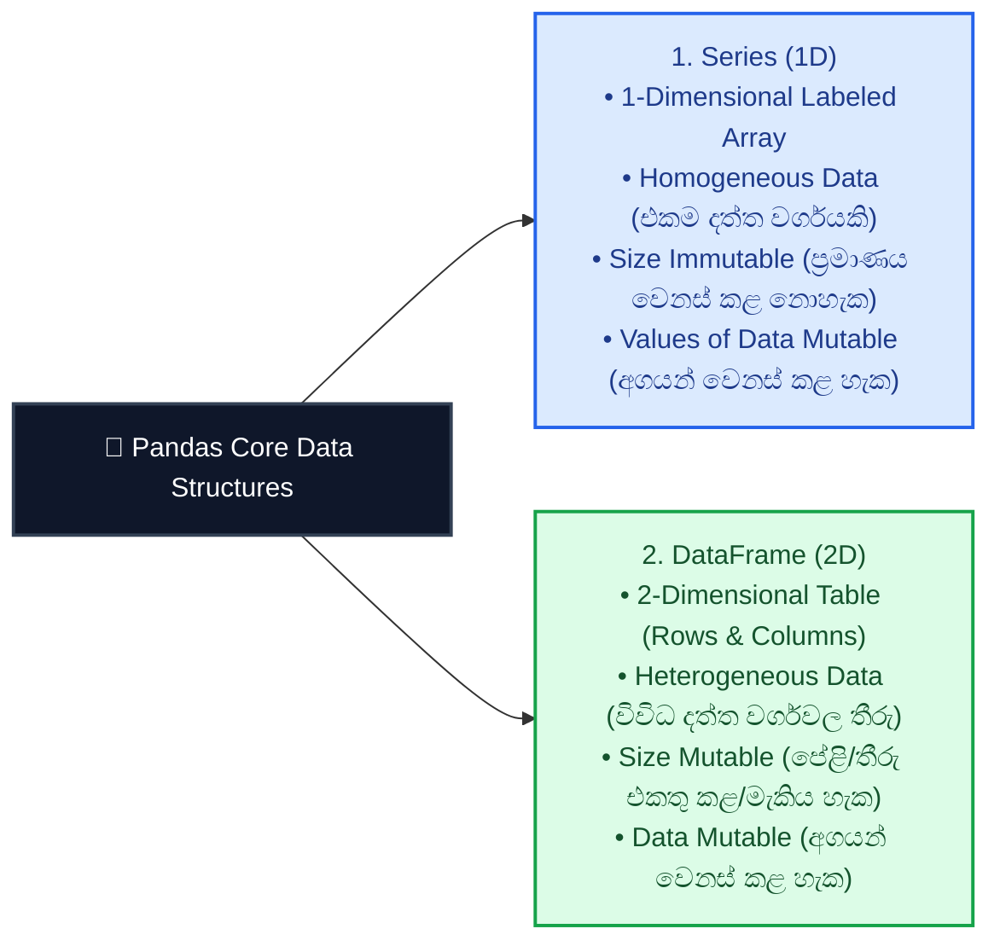
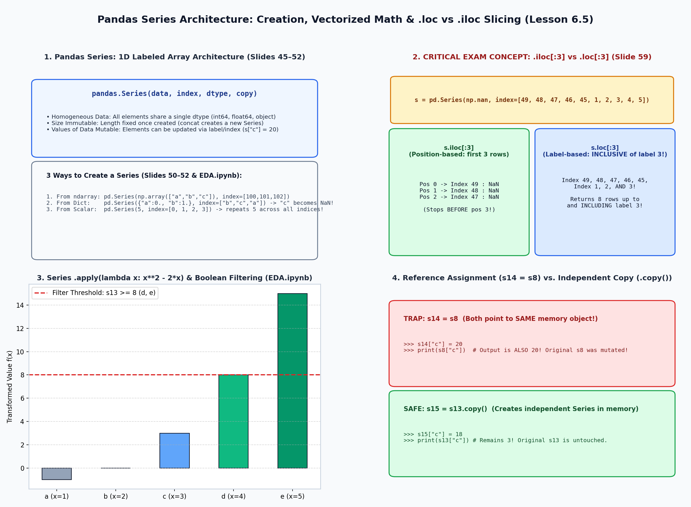

# පාඩම 6.5: Python Pandas පුස්තකාලය හඳුන්වා දීම සහ `Series` දත්ත ව්‍යුහය ප්‍රගුණ කිරීම (Introduction to Pandas & Mastering `Series`)

**මූලාශ්‍රය (Source Lecture Notes):** `Introduction to Exploratory Data nalysis.pdf` (Slides 44 – 59) & `EDA.ipynb` (Cells 0 – 35)  
**විෂය (Module):** CI7340 - Applied Data Programming (Dr. Lochandaka Ranathunga)

---

> [!TIP]
> **📚 Prerequisite / Dependency Lesson Series:**  
> Pandas Series Internal Architecture, Index Alignment, සහ Vectorized Operations පිළිබඳ පූර්ණ විස්තර සඳහා:
> - [Dep 01.1: Pandas Core Architecture (Index, Series and DataFrame Internals)](../dependencies/Dep_01_Pandas_Zero_to_Hero/01_Pandas_Core_Architecture_Index_Series_and_DataFrame_Internals.md)
> - [Dep 01.2: Mastering `loc`, `iloc`, Boolean Masking and `SettingWithCopyWarning`](../dependencies/Dep_01_Pandas_Zero_to_Hero/02_Mastering_loc_iloc_Boolean_Masking_and_SettingWithCopyWarning.md)

---

## 1. හැඳින්වීම: Python Pandas පුස්තකාලය යනු කුමක්ද? (Slides 44 – 46)

**Pandas** යනු Data Science සඳහා Python හි ඇති ජනප්‍රියතම සහ බලගතුම පුස්තකාලයයි. එය **NumPy** (වේගවත් ගණනය කිරීම් සඳහා) සහ **Matplotlib** (දෘශ්‍යකරණය සඳහා) යන පුස්තකාල මත ගොඩනගා ඇති අතර, දත්ත ආනයනය කිරීම (Importing), පිරිසිදු කිරීම (Cleaning), විශ්ලේෂණය කිරීම (Analyzing) සහ හැසිරවීම (Manipulation) එකම තැනකින් ඉතා පහසුවෙන් සිදු කිරීමට අවස්ථාව සලසයි (Slide 44).

### Pandas භාවිතා කිරීමේ ප්‍රධාන වාසි 9 (Data Handling using Pandas - Slide 46):
1. `DataFrame` වස්තුව මඟින් අපේ දත්ත පිළිවෙලකට තබා ගැනීමට (Keeping track of data) විශාල උදව්වක් ලබා දෙයි.
2. එකම `DataFrame` එකක් තුළ විවිධ දත්ත වර්ග (`float`, `int`, `string`, `datetime`, ආදිය) එකවර ගබඩා කළ හැක.
3. දත්ත කාණ්ඩ කිරීම (**Easy grouping**), දත්ත වගු එකතු කිරීම (**Easy joins**), සහ **Rolling windows** සඳහා තිළැති (Built-in) පහසුකම් ඇත.
4. **විශිෂ්ට I/O (Input/Output) හැකියාවන්:** MySQL වැනි දත්ත ගබඩාවකින් කෙලින්ම `DataFrame` එකකට දත්ත ලබා ගත හැක.
5. **Patsy** පුස්තකාලය සමඟ එක්ව R-භාෂාවේ ආකාරයට (R-style syntax) Regressions සිදු කළ හැක.
6. විවිධ ගොනු ආකෘතිවලින් (CSV, TXT, Excel, JSON, SQL) මතකය තුළ ඇති දත්ත වස්තූන් වෙත (In-memory data objects) දත්ත Load කළ හැක.
7. ස්වයංක්‍රීය දත්ත පෙළගැස්වීම (**Data alignment**) සහ අස්ථානගත දත්ත (**Missing data**) හැසිරවීමේ ඒකාබද්ධ පහසුකම් ඇත.
8. දත්ත කට්ටල නැවත හැඩගැන්වීම (**Reshaping**) සහ **Pivoting** පහසුකම් ඇත.
9. විශාල දත්ත කට්ටලවල ලේබල් මත පදනම් වූ කැබලි කිරීම (**Label-based slicing, indexing and subsetting**) කළ හැක.

---

## 2. Pandas හි මූලික දත්ත ව්‍යුහයන් 2: `Series` සහ `DataFrame` (Slides 45, 47, 48)





### `Pandas Series` හි මූලික ලක්ෂණ 3 (Slide 45):
1. **Homogeneous data:** එක් `Series` එකක් තුළ ඇති සියලුම අවයව එකම දත්ත වර්ගයකට (`int64`, `float64`, හෝ `object`) අයත් වේ.
2. **Size Immutable:** `Series` එකක් සෑදූ පසු එහි දිග (Size) ස්ථාවර වේ (අලුත් අවයව එකතු කිරීමේදී `pd.concat` මඟින් අලුත් `Series` එකක් සෑදේ).
3. **Values of Data Mutable:** එහි ගබඩා කර ඇති දත්ත අගයන් Index එක භාවිතා කර ඕනෑම විටක වෙනස් කළ හැක (`s['c'] = 20`).

### `Series` Constructor Syntax (Slide 48):
```python
pandas.Series(data, index, dtype, copy)
```
`Series` එකක් ප්‍රධාන ක්‍රම 4 කින් සෑදිය හැක:
1. හිස් Series එකක් ලෙස (`Empty Series`)
2. NumPy `ndarray` එකකින් (`Array`)
3. Python `dict` (Dictionary) එකකින්
4. තනි නියත අගයකින් (`Scalar value or constant`)

---

## 3. `Series` නිර්මාණය කරන සියලුම ක්‍රම (Slides 49 – 52 & `EDA.ipynb` Cells 1 – 14)

### 1. Empty Series (හිස් Series එකක් සෑදීම - Slide 49 & Cell 2):
```python
import numpy as np
import pandas as pnd

s1 = pnd.Series()
print(s1)
# Output: Series([], dtype: object)  (හෝ පැරණි සංස්කරණවල dtype: float64)
```

### 2. NumPy `ndarray` එකකින් Series එකක් සෑදීම (Slide 50 & Cells 4 – 8):
Default වශයෙන් Index එක `0` සිට ආරම්භ වේ (`0, 1, 2, 3`). නමුත් `index=` පරාමිතිය මඟින් අපට කැමති Index ලේබල් ලබා දිය හැක:

```python
data1 = np.array(['a', 'b', 'c', 'd'])

# A. Default Index (0, 1, 2, 3) සමඟ (Cell 4)
s2 = pnd.Series(data1)
print(s2)
# 0    a
# 1    b
# 2    c
# 3    d
# dtype: object

print(s2[1])     # 'b' (Index එකෙන් දත්ත ලබා ගැනීම)

# B. Custom Index ([100, 105, 107, 110]) ලබා දීම (Slide 50 & Cell 7)
s3 = pnd.Series(data1, index=[100, 105, 107, 110])
print(s3)
# 100    a
# 105    b
# 107    c
# 110    d
# dtype: object

print(s3[105])   # 'b'
```

### 3. Dictionary (`dict`) එකකින් Series එකක් සෑදීම (Slide 52 & Cells 10 – 11):
- Dictionary එකක් ලබා දුන් විට එහි **Keys ස්වයංක්‍රීයව Series එකේ Index බවට** පත් වේ!
- ඔබ වෙනම `index=['b', 'c', 'd', 'a']` ලබා දුනහොත්, Dictionary එකේ ඇති Keys එම අනුපිළිවෙලට පෙළගැසෙන අතර, Dictionary එකේ නොමැති `'d'` යතුර සඳහා **`NaN` (Not a Number - Missing Value)** යෙදේ (Slide 52 Eg.2)!

```python
# Eg.1: Index ලබා නොදී (EDA.ipynb Cell 10)
datadic1 = {'a': 0, 'b': 6, 'c': 23}
s4 = pnd.Series(datadic1)
print(s4)
# a     0
# b     6
# c    23
# dtype: int64
print(s4['b'])   # 6

# Eg.2: Custom Index ලබා දීමෙන් පෙළගැස්වීම සහ NaN ඇති වීම (Slide 52)
data = {'a': 0., 'b': 1., 'c': 2.}
s_dict = pnd.Series(data, index=['b', 'c', 'd', 'a'])
print(s_dict)
# b    1.0
# c    2.0
# d    NaN   <-- 'd' Dictionary එකේ නොමැති නිසා NaN ලැබේ!
# a    0.0
# dtype: float64
```

### 4. Scalar Value (තනි නියත අගයකින්) Series එකක් සෑදීම (Slide 51 & Cell 12):
තනි සංඛ්‍යාවක් (`5`) ලබා දී `index` ලැයිස්තුවක් ලබා දුන් විට, එම `index` හි ඇති අවයව ගණනට සමාන වාර ගණනක් එම නියත අගය නැවත නැවත (Repeat) යෙදේ:

```python
# Slide 51: index 4ක් නිසා 5 හතර වතාවක් යෙදේ
s = pnd.Series(5, index=[0, 1, 2, 3])

# EDA.ipynb Cell 12:
s5 = pnd.Series(5, index=[1, 2, 3])
print(s5)
# 1    5
# 2    5
# 3    5
# dtype: int64
```

---

## 4. `Series` මත ගණිතමය ක්‍රියාකාරකම් සහ `.set_axis()` (Slide 53 & `EDA.ipynb` Cells 14 – 16)

Series දෙකක් එකතු කිරීම (`+`) හෝ ගුණ කිරීම (`*`) සිදු කරන විට අනුරූප Index අනුව අවයවයෙන් අවයවය (Element-wise) ගණනය වේ:

```python
# EDA.ipynb Cells 14-16
s6 = pnd.Series([5, 7, 9])
s7 = pnd.Series([6, 3, 5])

u = s6 + s7
print(u)
# 0    11
# 1    10
# 2    14
# dtype: int64

u1 = s6 * s7
print(u1)
# 0    30
# 1    21
# 2    45
# dtype: int64

# set_axis() මඟින් Series එකේ Index ලේබල් වෙනස් කිරීම (Cell 16)
ind_v = ['n1', 'n2', 'n3']
u1_renamed = u1.set_axis(ind_v)
print(u1_renamed)
# n1    30
# n2    21
# n3    45
# dtype: int64
```

---

## 5. `Series` එකකින් දත්ත තේරීම: `.head()`, `.tail()`, Slicing සහ `.loc` vs `.iloc` (Slides 54 – 59 & `EDA.ipynb` Cells 18 – 25)

### A. `.head()`, `.tail()` සහ Slicing (Slides 54 – 57 & Cells 18 – 22):
```python
s8 = pnd.Series([1, 2, 3, 4, 5], index=['a', 'b', 'c', 'd', 'e'])

print(s8.head(3))      # මුල් අවයව 3 ('a', 'b', 'c') ලබා දෙයි (Slide 54)
print(s8.tail(2))      # අවසාන අවයව 2 ('d', 'e') ලබා දෙයි (Slide 56)

print(s8[:3])          # මුල් අවයව 3 (Index 0, 1, 2)
print(s8[-2:])         # අවසාන අවයව 2 ('d', 'e')
print(s8[2:])          # 2 වන ස්ථානයේ ('c') සිට අවසානය දක්වා
print(s8[['b', 'e']])  # ලේබල් ලැයිස්තුවක් දී තෝරා ගැනීම: 'b' (2) සහ 'e' (5) (Slide 57)
```

---

### B. ⚠️ විභාගයට ඉතාම වැදගත්: `.loc` vs. `.iloc` vs. `.ix` (Slides 58 – 59 & Cells 23 – 25):

දත්ත තේරීම (Selection) සඳහා Pandas හි ක්‍රම 3ක් සඳහන් වේ (Slide 58):
1. **`.loc` (Label-based indexing):** Index එකේ ඇති **ලේබලයේ නම (Label)** භාවිතා කර දත්ත තෝරයි.  
   - **විශේෂත්වය:** `.loc[start:stop]` හිදී අවසාන ලේබලය (`stop`) ද **ඇතුළත් වේ (Inclusive)!**
2. **`.iloc` (Integer position-based indexing):** Index ලේබලය කුමක් වුවත්, `0, 1, 2...` යන **ස්ථානීය පූර්ණ සංඛ්‍යාව (Integer position)** පමණක් භාවිතා කරයි.  
   - **විශේෂත්වය:** Python සාමාන්‍ය Slicing මෙන් `.iloc[start:stop]` හිදී `stop` ස්ථානය **ඇතුළත් නොවේ (Exclusive)!**
3. **`.ix` (Deprecated):** මුලින් `.loc` මෙන් ක්‍රියා කිරීමට උත්සාහ කර, ලේබලය හමු නොවුණහොත් `.iloc` මෙන් ක්‍රියා කළ පැරණි ක්‍රමයකි. ව්‍යාකූලත්වය නිසා **`.ix` දැන් භාවිතයෙන් ඉවත් කර ඇත (Deprecated)**; ඒ වෙනුවට `.loc` සහ `.iloc` පමණක් භාවිතා කළ යුතුය.

#### Slide 59 හි සුප්‍රසිද්ධ උදාහරණය (ඉහත රූපයේ Panel 2 බලන්න):
```python
s = pnd.Series(np.nan, index=[49, 48, 47, 46, 45, 1, 2, 3, 4, 5])

# 1. s.iloc[:3] -> මුල් පේළි 3 (Positions 0, 1, 2) පමණක් කපා ගනී!
print(s.iloc[:3])
# 49   NaN
# 48   NaN
# 47   NaN

# 2. s.loc[:3] -> '3' නමැති ලේබලය හමුවන තෙක් (3 ද ඇතුළුව!) පේළි 8 ම කපා ගනී!
print(s.loc[:3])
# 49   NaN
# 48   NaN
# 47   NaN
# 46   NaN
# 45   NaN
# 1    NaN
# 2    NaN
# 3    NaN
```

#### `EDA.ipynb` (Cells 23 – 25) හි Series Concatenation සහ `.loc` / `.iloc` භාවිතය:
```python
s8 = pnd.Series([1, 2, 3, 4, 5], index=['a', 'b', 'c', 'd', 'e'])
s9 = pnd.Series(np.nan, index=[45, 67, 89, 34, 1, 4, 6])

# Series දෙකක් එකට ඇමිණීම (Concatenation)
s10 = pnd.concat([s8, s9])

print(s10.iloc[:-2])     # අවසාන පේළි 2 හැර ඉතිරි සියල්ල (Position අනුව)
print(s10.loc['c':1])    # 'c' ලේබලයේ සිට 1 ලේබලය දක්වා (1 ද ඇතුළුව!)
```

---

## 6. `EDA.ipynb` හි උසස් Series ක්‍රියාකාරකම්: `.compare()`, `.apply(lambda)` සහ `.copy()` (Cells 26 – 35)

### 1. Series දෙකක් සංසන්දනය කිරීම (`.compare()` සහ `!=` - Cells 26 – 28):
```python
s11 = pnd.Series(['a', 'b', 'c', 'd', 'e'])
s12 = pnd.Series(['a', 'a', 'c', 'b', 'e'])

# වෙනස්කම් ඇති ස්ථාන පමණක් DataFrame එකක් ලෙස පෙන්වයි (self vs other)
print(s11.compare(s12))
#   self other
# 1    b     a
# 3    d     b

# Boolean Series එකක් ලෙස අසමාන ස්ථාන පරීක්ෂා කිරීම
print(s11 != s12)
# 0    False
# 1     True
# 2    False
# 3     True
# 4    False
# dtype: bool
```

### 2. Lambda ශ්‍රිතයක් `.apply()` මඟින් යෙදීම සහ කොන්දේසි සහිතව Index සෙවීම (Cells 29 – 30):
```python
# s8 හි සෑම x අගයකටම f(x) = x^2 - 2x යෙදීම
s13 = s8.apply(lambda x: x**2 - 2*x)
print(s13)
# a   -1   (1^2 - 2*1)
# b    0   (2^2 - 2*2)
# c    3   (3^2 - 2*3)
# d    8   (4^2 - 2*4)
# e   15   (5^2 - 2*5)
# dtype: int64

# s13 >= 8 වන අවයවවල Index ලේබල් පමණක් උපුටා ගැනීම (Cell 30)
high_idx = (s13 >= 8).loc[(s13 >= 8) == True].index
print(high_idx)  # Index(['d', 'e'], dtype='object')
```

### 3. Reference Assignment (`s14 = s8`) vs. ස්වාධීන පිටපතක් සෑදීම (`s15 = s13.copy()`) (Cells 31 – 35):
අපි Module 2 හිදී Python Lists සඳහා ඉගෙන ගත් Reference Semantics නීතිය Pandas Series සඳහා ද එලෙසම අදාළ වේ (ඉහත රූපයේ Panel 4 බලන්න):

```python
# ⚠️ 1. සෘජු පැවරීම (s14 = s8) -> දෙකම එකම Memory Object එකට යොමු වේ!
s14 = s8
s14['c'] = 20
print(s8['c'])   # 20! (මුල් s8 ද වෙනස් වී ඇත!)

# ✅ 2. ස්වාධීන පිටපතක් (.copy()) -> වෙනම Memory Object එකක් සාදයි!
s15 = s13.copy()
s15['c'] = 18
print(s13['c'])  # 3 (මුල් s13 කිසිදු වෙනසක් නොවී ආරක්ෂිතව පවතී!)
print(s15['c'])  # 18
```

---

## 🛠️ Practical Task / Hands-On Exercise (ප්‍රායෝගික අභ්‍යාසය)

### Scenario:
මාසික විකුණුම් ආදායම් දත්ත සහිත Pandas Series දෙකක් නිර්මාණය කර Automatic Index Alignment සහ Vectorized Operations ප්‍රායෝගිකව අත්හදා බැලීම.

### Step-by-Step Tasks:
1. **Task 1 (Series Creation with Custom Index):** Q1 සහ Q2 සඳහා මාසික ආදායම් Series සාදන්න.
2. **Task 2 (Index Alignment & NaN Handling):** Series දෙක එකතු කිරීමේදී නොගැලපෙන Labels සඳහා `NaN` ඇතිවීම සහ `.add(fill_value=0)` මඟින් එය විසඳන ආකාරය පෙන්වන්න.
3. **Task 3 (Indexing via `.loc` and `.iloc`):** Label-based `.loc['Feb']` සහ Integer-based `.iloc[1]` භාවිතයෙන් අගයන් ලබාගන්න.

### Reference Solution (පියවරෙන් පියවර විසඳුම):
```python
import pandas as pd
import numpy as np

# Task 1: Store Sales Series
store_a = pd.Series([150, 200, 250], index=['Jan', 'Feb', 'Mar'], name='Store A')
store_b = pd.Series([180, 210, 300], index=['Feb', 'Mar', 'Apr'], name='Store B')

print("Store A:
", store_a)
print("Store B:
", store_b)

# Task 2: Arithmetic Alignment
direct_sum = store_a + store_b
print("
Direct Sum (+) with NaN on non-overlapping keys:
", direct_sum)

clean_sum = store_a.add(store_b, fill_value=0)
print("
Clean Sum with .add(fill_value=0):
", clean_sum)

# Task 3: .loc vs .iloc
print(f"
Store A Sales in Feb (.loc['Feb']) : {store_a.loc['Feb']}")
print(f"Store A Sales 2nd Month (.iloc[1]) : {store_a.iloc[1]}")
```

---
