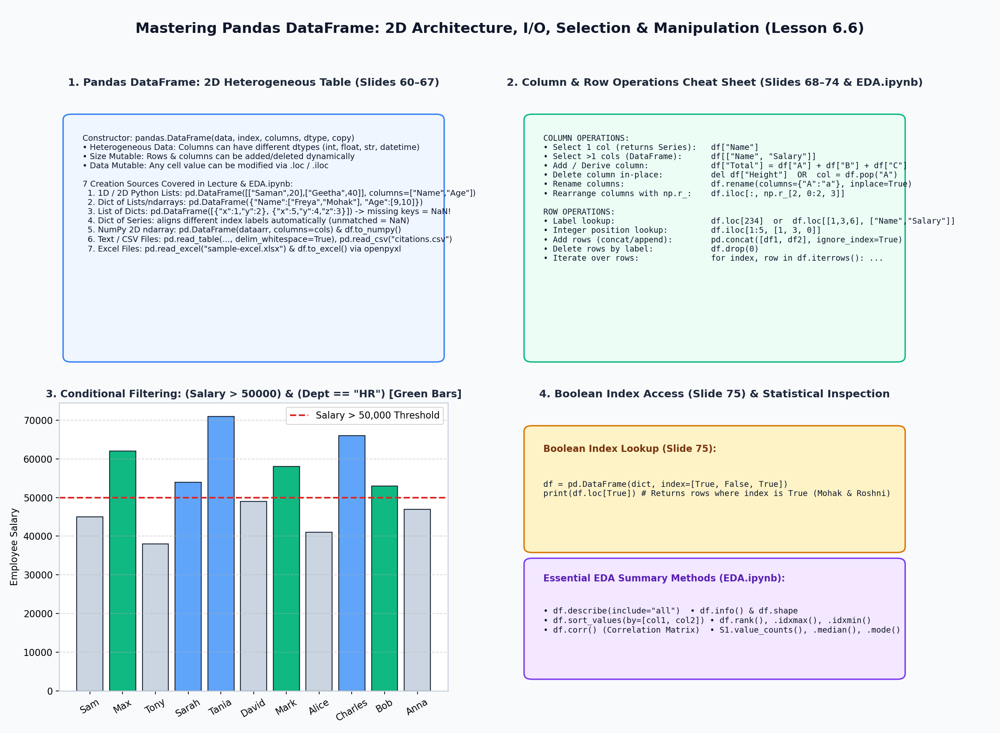

# පාඩම 6.6: Pandas `DataFrame` ප්‍රගුණ කිරීම — නිර්මාණය, ගොනු හුවමාරුව (I/O) සහ දත්ත හැසිරවීම (Mastering Pandas `DataFrame`: Creation, I/O & Manipulation)

**මූලාශ්‍රය (Source Lecture Notes):** `Introduction to Exploratory Data nalysis.pdf` (Slides 60 – 75, 81) & `EDA.ipynb` (Cells 36 – 192)  
**විෂය (Module):** CI7340 - Applied Data Programming (Dr. Lochandaka Ranathunga)

---

> [!TIP]
> **📚 Prerequisite / Dependency Lesson Series:**  
> Pandas DataFrame Structural Manipulation, Boolean Indexing, සහ `SettingWithCopyWarning` ගැටළු නිරාකරණයට:
> - [Dep 01.2: Mastering `loc`, `iloc`, Boolean Masking and `SettingWithCopyWarning`](../dependencies/Dep_01_Pandas_Zero_to_Hero/02_Mastering_loc_iloc_Boolean_Masking_and_SettingWithCopyWarning.md)
> - [Dep 01.3: Data Cleaning, Missing Values, String and Datetime Methods](../dependencies/Dep_01_Pandas_Zero_to_Hero/03_Data_Cleaning_Missing_Values_Duplicates_String_and_Datetime_Methods.md)

---

## 1. හැඳින්වීම: Pandas `DataFrame` යනු කුමක්ද? (Slides 47 & 60 – 61)

**Pandas DataFrame** යනු පේළි (Rows) සහ තීරු (Columns) සහිත Excel Spreadsheet එකකට හෝ SQL Database Table එකකට සමාන **ද්වි-මාන (Two-dimensional)** දත්ත ව්‍යුහයකි.

### `DataFrame` එකක මූලික ලක්ෂණ 4 (Slides 47 & 60):
1. **Heterogeneous Data (විෂමජාතීය දත්ත):** විවිධ තීරුවලට විවිධ දත්ත වර්ග (`int64`, `float64`, `object`/string, `datetime`, `bool`) තිබිය හැක. (උදා: Slide 47 හි ශිෂ්‍ය වගුවේ `Admn No`, `Student Name`, `Class`, `Section`, `Gender`, `Date Of Birth`).
2. **Size Mutable (ප්‍රමාණය වෙනස් කළ හැක):** DataFrame එකක් සෑදූ පසු ඊට අලුත් තීරු (Columns) සහ පේළි (Rows) එකතු කිරීම හෝ මකා දැමීම කළ හැක.
3. **Data Mutable (දත්ත වෙනස් කළ හැක):** එහි ඕනෑම කොටුවක (Cell) අගයක් වෙනස් කළ හැක.
4. **Labeled Axes & Arithmetic Operations:** පේළි (`index`) සහ තීරු (`columns`) යන අක්ෂ දෙකටම ලේබල් ඇති අතර, පේළි සහ තීරු දිගේ ගණිතමය ක්‍රියාකාරකම් සිදු කළ හැක.

### Constructor Syntax (Slide 60):
```python
pandas.DataFrame(data, index, columns, dtype, copy)
```



---

## 2. `DataFrame` එකක් නිර්මාණය කරන ක්‍රම 7 (Slides 61 – 67 & `EDA.ipynb` Cells 37 – 90)

### 1. හිස් DataFrame එකක් සෑදීම (Empty DataFrame - Slide 61 & Cell 37):
```python
import numpy as np
import pandas as pnd

df1 = pnd.DataFrame()
print(df1)
# Empty DataFrame
# Columns: []
# Index: []
```

### 2. Python List (1D සහ 2D Nested Lists) මඟින් සෑදීම (Slide 62 & Cells 39 – 50):
```python
# A. තනි 1D List එකකින් (Cell 39) -> තීරුවේ නම Default ලෙස 0 වේ
d1 = [1, 2, 3, 4, 5]
df2 = pnd.DataFrame(d1)
print(df2.columns)          # RangeIndex(start=0, stop=1, step=1)
print(type(df2[0]))         # <class 'pandas.core.series.Series'> (තනි තීරුවක් යනු Series එකකි!)

# තීරුවේ නම 0 සිට 'List' ලෙස වෙනස් කිරීම (Cell 44)
df_cp = df2.rename(columns={0: 'List'}, inplace=False)

# B. 2D Multi-dimensional List එකකින් (Slide 62 Eg.2 & Cell 47)
d2 = [['Saman', 20], ['Geetha', 40], ['Seetha', 31], ['Kamal', 14]]
df3 = pnd.DataFrame(d2, columns=['Name', 'Age'])
print(df3)
#      Name  Age
# 0   Saman   20
# 1  Geetha   40
# 2  Seetha   31
# 3   Kamal   14
```

### 3. Dictionary of Lists / ndarrays මඟින් සෑදීම (Slide 63 & Cells 52 – 55):
Dictionary එකේ **Keys තීරු නාම (Column Names)** බවට පත් වන අතර, එහි Lists තීරුවල දත්ත බවට පත් වේ:

```python
dic2 = {'Name': ['Saman', 'Gamini', 'Teena'], 'Age': [24, 45, 17]}
df4 = pnd.DataFrame(dic2, index=[12, 56, 52])  # Custom row indexes ලබා දීම
print(df4)
#       Name  Age
# 12   Saman   24
# 56  Gamini   45
# 52   Teena   17
```

### 4. List of Dictionaries මඟින් සෑදීම (Slide 64 & Cells 56 – 63):
සෑම Dictionary එකක්ම **එක් පේළියක් (Row)** නිරූපණය කරයි. යම් Dictionary එකක යතුරක් (Key) අඩුවෙන් තිබේ නම් එම කොටුවට ස්වයංක්‍රීයව **`NaN`** ලැබේ:

```python
l_dic = [
    {'x': 1, 'y': 2},              # මෙහි 'z' සහ 'm' නැත -> NaN වේ!
    {'x': 5, 'y': 4, 'z': 3},      # මෙහි 'm' නැත -> NaN වේ!
    {'x': 7, 'z': 3, 'm': 12}      # මෙහි 'y' නැත -> NaN වේ!
]
df5 = pnd.DataFrame(l_dic, index=['first', 'second', 'third'])
print(df5)
#         x    y    z     m
# first   1  2.0  NaN   NaN
# second  5  4.0  3.0   NaN
# third   7  NaN  3.0  12.0

# තනි තීරුවක් තේරීම -> Series එකක් ලැබේ (Cell 58)
print(type(df5['m']))          # <class 'pandas.core.series.Series'>

# තීරු කිහිපයක් තේරීම (List of column names) -> DataFrame එකක් ලැබේ! (Cell 60)
print(type(df5[['x', 'z']]))   # <class 'pandas.core.frame.DataFrame'>
```

### 5. Dictionary of Series මඟින් සෑදීම (Slide 65 & Cells 65 – 67):
විවිධ දිගින් යුත් Series දෙකක් එකතු කළ විට Index ලේබල් ස්වයංක්‍රීයව පෙළගැසෙන (Data Alignment) අතර නොගැලපෙන තැන්වලට `NaN` යෙදේ:

```python
dic3 = {
    'one': pnd.Series([1, 2, 3], index=['a', 'b', 'c']),
    'two': pnd.Series([1, 2, 3, 4], index=['a', 'b', 'c', 'd'])
}
df6 = pnd.DataFrame(dic3)
print(df6)
#    one  two
# a  1.0    1
# b  2.0    2
# c  3.0    3
# d  NaN    4   <-- 'one' හි 'd' නොමැති නිසා NaN වී dtype float64 බවට පත් වේ!
```

### 6. NumPy 2D `ndarray` එකකින් සෑදීම සහ `.dtypes` පරීක්ෂාව (Cells 76 – 85):
```python
cols = ['col1', 'col2', 'col3']
dataarr = np.array([[1, 2, 3], [4, 5, 6], [5, 6, 8]])

df_ar = pnd.DataFrame(dataarr, columns=cols)
df_ar.index = [234, 67, 890]   # Index වෙනස් කිරීම
print(df_ar.dtypes)            # එක් එක් තීරුවේ දත්ත වර්ගය පරීක්ෂා කිරීම
```

### 7. බාහිර ගොනුවලින් (`.txt`, `.csv`, `.xlsx`) DataFrame සෑදීම සහ Export කිරීම (Slides 66, 67, 81 & Cells 86 – 91, 184 – 187):
```python
# A. Space-delimited Text (.txt) ගොනුවක් කියවීම (Slide 66 & Cell 86)
IM_df1 = pnd.read_table('tmp/arr1.txt', delim_whitespace=True, names=('A', 'B', 'C'))

# B. CSV (.csv) ගොනුවක් කියවීම සහ පෙරහන් කිරීම (Slide 67 & Cells 89-90)
IM_dfcsv = pnd.read_csv('citations.csv', delimiter=',')
print(IM_dfcsv.head())
# 2017 ට පසු ප්‍රකාශිත පත්‍රිකාවල මාතෘකා (Title) පමණක් තේරීම:
print(IM_dfcsv['Title'][IM_dfcsv['Year'] > 2017])

# C. DataFrame එකක් CSV හෝ TXT ගොනුවකට ලිවීම (Slide 81 & Cells 119-120)
# index=False මඟින් 0, 1, 2 පේළි අංක ගොනුවේ පළමු තීරුව ලෙස ලිවීම වළක්වයි!
df.to_csv('out_df1.csv', index=False, header=True)

# D. Excel (.xlsx) ගොනුවකට ලිවීම සහ කියවීම (openPyXL පුස්තකාලය භාවිතයෙන් - Cells 184-187)
# !pip install openPyXL
C2dfemp_rec.to_excel('sample-excel.xlsx', index=False)
df_excel = pnd.read_excel('sample-excel.xlsx')
```

---

## 3. තීරු (Columns) එකතු කිරීම, ව්‍යුත්පන්න කිරීම, මකා දැමීම සහ නැවත පෙළගැස්වීම (Slide 68 & `EDA.ipynb` Cells 92 – 104, 171 – 183)

```python
# 1. අලුත් තීරුවක් (Column) එකතු කිරීම (Slide 68 & Cell 93)
df3['Height'] = [5.1, 4.6, 3.5, 6.2]

# 2. කොන්දේසියක් මත දත්ත තේරීම (Height > 5 වන අයගේ Name තීරුව)
print(df3['Name'][df3['Height'] > 5])

# 3. del විධානයෙන් තීරුවක් මකා දැමීම (Slide 68 & Cell 97)
del df3['Height']

# 4. පවතින තීරු එකතු කර අලුත් තීරුවක් ව්‍යුත්පන්න කිරීම (Derive new field - Cells 98-102)
df8 = pnd.DataFrame({'A': [1, 5, 7], 'B': [7, 70, 80]})
df8['C'] = [67, 78, 45]
df8['Total'] = df8['A'] + df8['B'] + df8['C']

# 5. .pop() මඟින් තීරුවක් ඉවත් කර එය විචල්‍යයකට ලබා ගැනීම (Slide 68 & Cell 103)
fi1 = df8.pop('A')   # 'A' තීරුව df8 වෙතින් ඉවත් වී fi1 Series එකට ලැබේ!

# 6. තීරු නාම Upper/Lower case කිරීම සහ Dictionary එකකින් Rename කිරීම (Cells 173-177)
C2dfemp_rec.rename(str.upper, axis='columns', inplace=True)
C2dfemp_rec.rename(str.lower, axis='columns', inplace=True)
C2dfemp_rec.rename(columns={
    'employee_name': 'Employee_Name',
    'employee_dep': 'Employee_Dep',
    'employee_id': 'Employee_ID',
    'employee_salary': 'Employee_Salary'
}, inplace=True)

# 7. np.r_ භාවිතා කර තීරුවල අනුපිළිවෙල වෙනස් කිරීම (Rearrange Columns - Cells 181-183)
# 2 වන තීරුව මුලට ගෙන, 0, 1 තීරු ඊළඟටත්, 3 වන තීරුව අවසානයටත් තැබීම:
# np.r_[2, 0:2, 3] -> array([2, 0, 1, 3])
C2dfemp_rec = C2dfemp_rec.iloc[:, np.r_[2, 0:2, 3]]
```

---

## 4. පේළි (Rows) තේරීම, එකතු කිරීම, මකා දැමීම සහ ලූප් කිරීම (Slides 69 – 75 & `EDA.ipynb` Cells 121 – 169)

### A. `.loc`, `.iloc`, Slicing, `.iterrows()`, `.append()` / `pd.concat()`, සහ `.drop()` (Slides 69 – 74):
```python
# 1. ලේබලයෙන් පේළියක් තේරීම (.loc - Slide 69)
print(df1.loc['b'])        # Series එකක් ලෙස 'b' පේළිය ලබා දෙයි

# 2. Integer ස්ථානයෙන් පේළියක් තේරීම (.iloc - Slide 70)
print(df1.iloc[2])         # 2 වන ස්ථානයේ (3 වන පේළිය) දත්ත ලබා දෙයි

# 3. Slicing මඟින් පේළි කිහිපයක් තේරීම (Slide 70)
print(df1[2:4])            # 2 සහ 3 පේළි

# 4. پېළි එකතු කිරීම (Addition of Rows - Slide 71)
# සටහන: පැරණි Pandas හි df1.append(df2) භාවිතා වූ අතර නව Pandas හි pd.concat([df1, df2]) භාවිතා වේ.

# 5. ලේබලය අනුව පේළි මකා දැමීම (Deletion of Rows - Slide 71)
df1 = df1.drop(0)          # 0 ලේබලය සහිත පේළිය ඉවත් කරයි

# 6. DataFrame එකක පේළි හරහා එකින් එක ගමන් කිරීම (.iterrows() - Slide 72)
for index, row in df1.iterrows():
    print(row["name"], row["age"])
```

### B. Boolean Index එකක් මඟින් DataFrame එකකට ප්‍රවේශ වීම (Slide 75):
DataFrame එකේ Index එක ලෙස `[True, False, True]` වැනි Boolean අගයන් ලබා දී `df.loc[True]` කැඳවූ විට, `True` ලේබලය ඇති පේළි සියල්ල ලබා දෙයි:

```python
dict_data = {
    'name': ['Mohak', 'Freya', 'Roshni'],
    'degree': ['MBA', 'BCA', 'M.Tech'],
    'score': [90, 40, 80]
}
df_bool = pnd.DataFrame(dict_data, index=[True, False, True])
print(df_bool.loc[True])   # Mohak සහ Roshni ගේ පේළි දෙකම ලබා දෙයි!
```

---

## 5. `EDA.ipynb` හි Employee Records (`dfemp_rec`) පූර්ණ විශ්ලේෂණය (Cells 121 – 169, 178 – 211)

`EDA.ipynb` හි සේවකයින් 11 දෙනෙකුගේ දත්ත සහිත `dfemp_rec` වගුව මත සිදු කරන සියලුම වැදගත් මෙහෙයුම් පහත දැක්වේ:

```python
dfemp_rec = pnd.DataFrame({
    'employee_name': ['Sam', 'Max', 'Tony', 'Sarah', 'Tania', 'David', 'Mark', 'Alice', 'Charles', 'Bob', 'Anaa'],
    'employee_dep':  ['Research', 'HR', 'Marketing', 'Sales', 'Finance', 'IT', 'HR', 'Marketing', 'IT', 'Finance', 'Sales'],
    'employee_id':   [10001, 10002, 10003, 10004, 10005, 10006, 10007, 10008, 10009, 10010, 10011],
    'employee_salary': [45034.88, 65343.45, 53423.27, 76422.34, 58753.00, 34323.44, 66544.60, 34354.66, 55234.96, 39078.60, 44567.88]
})

# 1. DataFrame එක NumPy 2D Array එකක් බවට පත් කර වැටුප් එකතුව සෙවීම (Cells 127-130)
NP_arr1 = dfemp_rec.to_numpy()
total_sal = 0.0
for i in range(NP_arr1.shape[0]):
    total_sal = total_sal + NP_arr1[i][3]
print(total_sal)

# 2. සංඛ්‍යානමය සාරාංශය, Transpose සහ Sorting (Cells 137-144)
print(dfemp_rec.describe())               # සංඛ්‍යාත්මක තීරුවල count, mean, std, min, 25%, 50%, 75%, max
print(dfemp_rec.describe(include='all'))  # Categorical තීරුවල unique, top, freq ද ඇතුළුව සියල්ල!
print(dfemp_rec.T)                        # Transpose (පේළි සහ තීරු හුවමාරු කිරීම)
print(dfemp_rec.sort_values(by='employee_salary'))                        # වැටුප අනුව පෙළගැස්වීම
print(dfemp_rec.sort_values(['employee_dep', 'employee_salary']))         # දෙපාර්තමේන්තුව සහ වැටුප අනුව

# 3. isinstance() මඟින් වස්තුවක වර්ගය පරීක්ෂා කිරීම (Cells 143-144, 148)
isinstance(dfemp_rec['employee_name'], pnd.Series)     # True
isinstance(dfemp_rec.loc[2], pnd.Series)               # True

# 4. විශේෂිත පේළි සහ තීරු උපුටා ගැනීම (Cells 149-150)
print(dfemp_rec.loc[[1, 3, 6], ['employee_name', 'employee_salary']])

# 5. බහු-කොන්දේසි පෙරහන් කිරීම (Conditional Filtering with '&' - Cells 154-156)
# වැටුප 50,000 ට වැඩි සහ HR දෙපාර්තමේන්තුවේ සේවය කරන අය තේරීම (ඉහත රූපයේ Panel 3 බලන්න):
cond = (dfemp_rec['employee_salary'] > 50000) & (dfemp_rec['employee_dep'] == 'HR')
print(dfemp_rec.loc[cond, ['employee_name', 'employee_dep']])

# 6. .shape, .info(), .rank(), .idxmax(), .idxmin() සහ .corr() (Cells 178-211)
print(C2dfemp_rec.shape)                          # (11, 4) -> පේළි 11, තීරු 4
C2dfemp_rec.info()                                # Non-null counts සහ memory usage පෙන්වයි
print(C2dfemp_rec['Employee_Salary'].rank())      # වැටුප් ශ්‍රේණිගත කිරීම (1.0 සිට 11.0 දක්වා)
print(C2dfemp_rec['Employee_Salary'].idxmax())    # වැඩිම වැටුප ඇති පේළියේ Index එක (3 -> Sarah)
print(C2dfemp_rec['Employee_Salary'].idxmin())    # අඩුම වැටුප ඇති පේළියේ Index එක (5 -> David)

# 7. Axis Arguments (axis=0 කොලම් දිගේ, axis=1 පේළි දිගේ) සහ skipna=False (Cells 195-202)
# df_ex1.mean(0) -> එක් එක් තීරුවේ මධ්‍යන්‍යය
# df_ex1.mean(1, skipna=False) -> පේළියක එක NaN අගයක් හෝ ඇත්නම් මධ්‍යන්‍යය NaN ලබා දෙයි!
# df_ex1.corr() -> තීරු අතර Pearson සහසම්බන්ධතා න්‍යාසය (Correlation Matrix)
# S1.value_counts(), S1.median(), S1.mode() -> සංඛ්‍යාත ගණන, මධ්‍යස්ථය සහ මාතය
```

---

## 🛠️ Practical Task / Hands-On Exercise (ප්‍රායෝගික අභ්‍යාසය)

### Scenario:
E-commerce Transaction Database එකක නිෂ්පාදන දත්ත DataFrame එකක් ලෙස ගොඩනගා Column Transformations, Filtering, සහ File I/O (`read_csv` / `to_csv`) මෙහෙයුම් සිදුකිරීම.

### Step-by-Step Tasks:
1. **Task 1 (DataFrame Construction & CSV Export):** Dictionary of Lists මඟින් Items, Price, Quantity සහිත DataFrame එකක් සාදා 'Revenue' තීරුවක් එක්කර CSV ගොනුවක් ලෙස Export කරන්න.
2. **Task 2 (CSV Import & Filtering):** Export කළ CSV ගොනුව නැවත කියවා Revenue > 500 වන භාණ්ඩ Boolean Indexing මඟින් පෙරන්න.
3. **Task 3 (Row & Column Deletions):** අනවශ්‍ය තීරුවක් `.drop(columns=['...'])` මඟින් ඉවත් කරන්න.

### Reference Solution (පියවරෙන් පියවර විසඳුම):
```python
import pandas as pd

# Task 1: Create DataFrame
data = {
    'item_id': ['ITM-01', 'ITM-02', 'ITM-03', 'ITM-04'],
    'name': ['Laptop', 'Mouse', 'Keyboard', 'Monitor'],
    'price': [1200, 25, 75, 300],
    'quantity': [2, 10, 5, 3]
}
df = pd.DataFrame(data)
df['revenue'] = df['price'] * df['quantity']
print("--- Initial Orders Table ---
", df)

# Export and Re-import
csv_path = '/tmp/ecommerce_orders.csv'
df.to_csv(csv_path, index=False)

# Task 2: Read & Filter
loaded_df = pd.read_csv(csv_path)
high_revenue = loaded_df[loaded_df['revenue'] >= 500]
print("
--- High Revenue Items (>= $500) ---
", high_revenue)

# Task 3: Drop column
df_clean = loaded_df.drop(columns=['quantity'])
print("
--- After Dropping Quantity Column ---
", df_clean)
```

---
