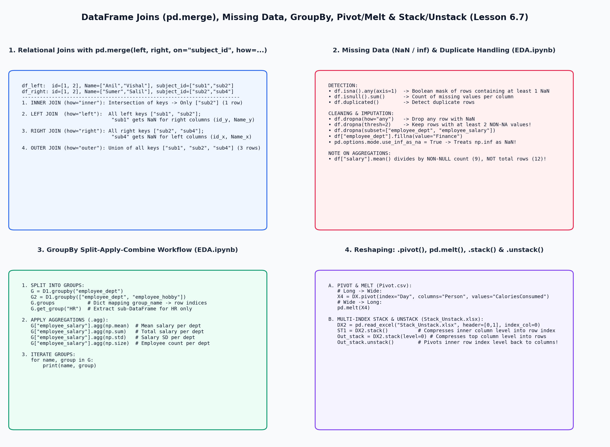
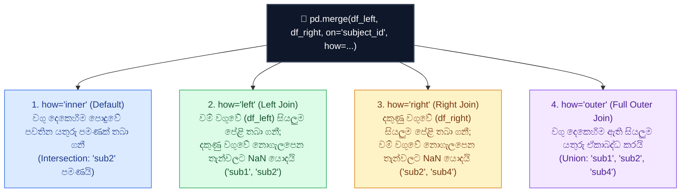
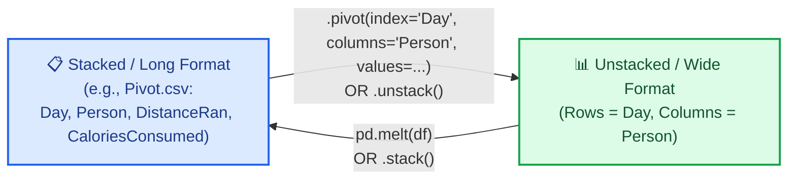

# පාඩම 6.7: DataFrame ගණිතමය ක්‍රියාකාරකම්, වගු ඒකාබද්ධ කිරීම (Merging/Joining) සහ උසස් EDA තාක්ෂණයන් (Missing Data, GroupBy, Pivot/Melt & Stack/Unstack)

**මූලාශ්‍රය (Source Lecture Notes):** `Introduction to Exploratory Data nalysis.pdf` (Slides 76 – 82) & `EDA.ipynb` (Cells 105 – 120, 212 – 280), `Pivot.csv`, `Stack_Unstack.xlsx`  
**විෂය (Module):** CI7340 - Applied Data Programming (Dr. Lochandaka Ranathunga)

---

> [!TIP]
> **📚 Prerequisite / Dependency Lesson Series:**  
> Relational Database-style Joins (`merge`), GroupBy Aggregations, Pivot Tables (`Pivot.csv`), සහ Stack/Unstack (`Stack_Unstack.xlsx`) පිළිබඳ සවිස්තරාත්මක අධ්‍යයනය සඳහා:
> - [Dep 01.4: Split-Apply-Combine, GroupBy, Pivot Tables, Reshaping and Relational Joins](../dependencies/Dep_01_Pandas_Zero_to_Hero/04_Split_Apply_Combine_GroupBy_Pivot_Tables_Reshaping_and_Relational_Joins.md)
> - [Dep 01.3: Data Cleaning, Missing Values, String and Datetime Methods](../dependencies/Dep_01_Pandas_Zero_to_Hero/03_Data_Cleaning_Missing_Values_Duplicates_String_and_Datetime_Methods.md)

---

## 1. හැඳින්වීම

මෙම පාඨමාලාවේ අවසාන පාඩම වන මෙහිදී අපි Data Science ව්‍යාපෘතියකදී නැතිවම බැරි උසස්ම Pandas තාක්ෂණයන් 5 ක් සිද්ධාන්ත සහ `EDA.ipynb` හි ප්‍රායෝගික කේත සමඟ ප්‍රගුණ කරමු:
1. **DataFrame Arithmetic & Matrix Dot Product:** `.add()`, `.sub()`, `.mul()`, `.div()`, සහ `.dot()`.
2. **Relational Merging & Concatenation:** `pd.merge()` (`inner`, `left`, `right`, `outer` joins) සහ `pd.concat()`.
3. **Handling Missing & Infinite Data:** `.isna()`, `.dropna(thresh=...)`, `.fillna()`, `.duplicated()`, සහ `use_inf_as_na`.
4. **GroupBy Aggregations:** Split-Apply-Combine ක්‍රමවේදය (`.groupby()`, `.get_group()`, `.agg()`).
5. **Reshaping DataFrames:** `Pivot.csv` සහ `Stack_Unstack.xlsx` භාවිතා කරමින් `.pivot()`, `pd.melt()`, `.stack()`, සහ `.unstack()`.



---

## 2. DataFrame මත ද්විමය ගණිතමය ක්‍රියාකාරකම් (Binary Operations - Slides 76 – 77 & `EDA.ipynb` Cells 105 – 107)

### A. DataFrame එකකට Series එකක් එකතු කිරීම (Slide 76):
```python
import pandas as pd

x = pd.DataFrame({0: [1, 2, 3], 1: [4, 5, 6], 2: [7, 8, 9]})
y = pd.Series([1, 2, 3])

# axis=0 මඟින් Series එකේ අගයන් DataFrame එකේ පේළි දිගේ (Row-wise broadcasting) සෑම තීරුවකටම එකතු කරයි:
new_x = x.add(y, axis=0)
print(new_x)
#    0   1   2
# 0  2   5   8   (1+1, 4+1, 7+1)
# 1  4   7  10   (2+2, 5+2, 8+2)
# 2  6   9  12   (3+3, 6+3, 9+3)
```

### B. DataFrames දෙකක් එකතු කිරීම සහ Matrix Dot Product (Slide 77 & `EDA.ipynb` Cells 105 – 107):
`.add()` මෙන්ම `.sub()` (අඩු කිරීම), `.mul()` (ගුණ කිරීම), සහ `.div()` (බෙදීම) ද භාවිතා කළ හැක. තවද `.dot()` මඟින් න්‍යාස ගුණිතය (Matrix Multiplication) ලබා ගත හැක:

```python
xa1 = pd.DataFrame({0: [1, 2, 3], 1: [3, 4, 5], 2: [6, 7, 8]})
ya1 = pd.DataFrame({0: [4, 5, 6], 1: [7, 8, 9], 2: [10, 11, 12]})

# 1. අවයවයෙන් අවයවය එකතු කිරීම (Element-wise addition)
new_xa1 = xa1.add(ya1, axis=1)

# 2. න්‍යාස ගුණිතය (Matrix Dot Product - Cell 107)
new_xa11 = xa1.dot(ya1)
print(new_xa11)
#     0    1    2
# 0  55   67   79
# 1  70   86  102
# 2  85  105  125
```

---

## 3. DataFrames ඒකාබද්ධ කිරීම: `pd.merge()` සහ `pd.concat()` (Slides 78 – 80 & `EDA.ipynb` Cells 109 – 118)

SQL දත්ත ගබඩාවල `JOIN` විධානයට සමානව, පොදු තීරුවක් (Key Column - උදා: `on='id'` හෝ `on='subject_id'`) මත පදනම්ව DataFrames දෙකක් ඒකාබද්ධ කිරීමට `pd.merge()` භාවිතා කරයි.



### Python කේතය (Slides 78, 80 & `EDA.ipynb` Cells 109 – 118):
```python
df_left = pd.DataFrame({
    'id': [1, 2],
    'Name': ['Anil', 'Vishal'],
    'subject_id': ['sub1', 'sub2']
})

df_right = pd.DataFrame({
    'id': [1, 2],
    'Name': ['Saman', 'Saliya'],
    'subject_id': ['sub2', 'sub4']
})

# 1. 'id' තීරුව මත පදනම්ව Merge කිරීම (Slide 78 & Cell 110)
# id=[1, 2] දෙකෙහිම ඇති නිසා පේළි 2ක් ලැබේ; සමාන නම් ඇති තීරු Name_x, Name_y ලෙස වෙන් වේ!
print(pd.merge(df_left, df_right, on='id'))

# 2. 'subject_id' මත පදනම්ව Join වර්ග 4 (Slide 80 & Cells 111-115)
print(pd.merge(df_left, df_right, on='subject_id', how='inner'))  # 'sub2' පමණයි
print(pd.merge(df_left, df_right, on='subject_id', how='left'))   # 'sub1', 'sub2'
print(pd.merge(df_left, df_right, on='subject_id', how='right'))  # 'sub2', 'sub4'
print(pd.merge(df_left, df_right, on='subject_id', how='outer'))  # 'sub1', 'sub2', 'sub4'

# 3. සමාන තීරු සහිත DataFrames දෙකක් එකක් යටින් එකක් ඇමිණීම (pd.concat - Slide 79)
df1 = pd.DataFrame([['a', 1], ['b', 2]], columns=['letter', 'number'])
df2 = pd.DataFrame([['c', 3], ['d', 4]], columns=['letter', 'number'])
print(pd.concat([df1, df2], ignore_index=True))
```

---

## 4. අස්ථානගත අගයන් (`NaN`), අනන්ත අගයන් (`np.inf`) සහ අනුපිටපත් (Duplicates) හැසිරවීම (`EDA.ipynb` Cells 212 – 257)

සැබෑ දත්ත පිරිසිදු කිරීමේදී (Data Cleaning) `EDA.ipynb` හි භාවිතා කර ඇති සියලුම Missing Data ශ්‍රිත පහත දැක්වේ:

```python
import numpy as np
import pandas as pnd

# 1. අස්ථානගත අගයන් (NaN / Null) පරීක්ෂා කිරීම (Cells 212-238)
print(df_miss.isna().any())          # සෑම තීරුවකම අවම වශයෙන් එක් NaN එකක් හෝ තිබේද? (Boolean Series)
print(df_miss.isna().any(axis=1))    # සෑම පේළියකම අවම වශයෙන් එක් NaN එකක් හෝ තිබේද?
print(df_miss.isnull().sum())        # එක් එක් තීරුවේ ඇති මුළු NaN ගණන!
print(df_miss.isnull().sum(axis=1))  # එක් එක් පේළියේ ඇති මුළු NaN ගණන!
print(df_miss.notna().sum())         # එක් එක් තීරුවේ ඇති වලංගු (Non-null) දත්ත ගණන!

# NaN අගයක් සහිත පේළි පමණක් පෙරහන් කර බැලීම:
print(df_miss[df_miss.isna().any(axis=1)])

# 2. අස්ථානගත අගයන් සහිත පේළි ඉවත් කිරීම (.dropna() - Cells 239-243)
df_miss.dropna(how='any')            # එක NaN එකක් හෝ ඇති ඕනෑම පේළියක් ඉවත් කරයි (Default)
df_miss.dropna(thresh=2)             # අවම වශයෙන් වලංගු (Non-NA) අගයන් 2ක් වත් ඇති පේළි පමණක් ඉතිරි කරයි!
df_miss.dropna(subset=['employee_dept', 'employee_salary'])  # නිශ්චිත තීරු දෙකෙහි NaN ඇත්නම් පමණක් ඉවත් කරයි

# 3. හිස් තැන් පිරවීම (.fillna() - Cell 244)
df_miss['employee_dept'] = df_miss['employee_dept'].fillna(value='Finance')

# 4. අනුපිටපත් පේළි (Duplicate Records) හඳුනා ගැනීම (Cell 245)
print(df_miss[df_miss.duplicated()])

# 5. අනන්ත අගයන් (np.inf) NaN ලෙස සලකා ඉවත් කිරීම (Cells 246-252)
# සාමාන්‍යයෙන් np.inf අගයක් dropna() මඟින් ඉවත් නොවේ. එය NaN ලෙස සැලකීමට:
pnd.options.mode.use_inf_as_na = True   # (නව Pandas සංස්කරණවල df.replace([np.inf, -np.inf], np.nan) භාවිතා වේ)

# 6. ⚠️ NaN තිබියදී ගණනය කිරීම් සිදුවන ආකාරය (Cells 253-257):
# df_miss හි මුළු පේළි 13 ක් තිබුණද, employee_salary හි වලංගු අගයන් ඇත්තේ 9 ක් පමණි (4ක් NaN වේ).
# df_miss['employee_salary'].mean() මඟින් එකතුව බෙදන්නේ 13 න් නොව වලංගු අගයන් ගණන වන 9 න් ය!
print(df_miss['employee_salary'].mean() == df_miss['employee_salary'].sum() / 9)  # True!
print(df_miss['employee_salary'].cumsum())  # සමුච්චිත එකතුව (Cumulative Sum)
```

---

## 5. `GroupBy` Operations — Split-Apply-Combine ක්‍රමවේදය (`EDA.ipynb` Cells 261 – 271)

දෙපාර්තමේන්තුව (`employee_dept`) හෝ විනෝදාංශය (`employee_hobby`) අනුව සේවකයින් කාණ්ඩවලට බෙදා එක් එක් කාණ්ඩයේ මධ්‍යන්‍ය වැටුප, එකතුව, සම්මත අපගමනය සහ සේවක සංඛ්‍යාව සෙවීම:

```python
# 1. තනි තීරුවක් අනුව Group කිරීම (Cell 261)
print(D1.groupby('employee_dept').groups)   # එක් එක් දෙපාර්තමේන්තුවට අයත් පේළි Index Dictionary එකක් ලෙස

# 2. තීරු දෙකක් (Multi-column) අනුව Group කිරීම (Cell 264)
D1_groups2 = D1.groupby(['employee_dept', 'employee_hobby']).groups

# 3. නිශ්චිත එක් කාණ්ඩයක DataFrame එක පමණක් වෙන් කර ගැනීම (.get_group() - Cell 265)
D1_groupsG = D1.groupby('employee_dept')
print(D1_groupsG.get_group('HR'))           # HR දෙපාර්තමේන්තුවේ සේවකයින් පමණක් ලබා දෙයි

# 4. කාණ්ඩ මත Aggregate Functions යෙදීම (.agg() - Cells 267-270)
print(D1_groupsG['employee_salary'].agg(np.mean))  # දෙපාර්තමේන්තුව අනුව සාමාන්‍ය වැටුප
print(D1_groupsG['employee_salary'].agg(np.sum))   # දෙපාර්තමේන්තුව අනුව මුළු වැටුප් එකතුව
print(D1_groupsG['employee_salary'].agg(np.std))   # දෙපාර්තමේන්තුව අනුව වැටුප් සම්මත අපගමනය
print(D1_groupsG['employee_salary'].agg(np.size))  # දෙපාර්තමේන්තුවේ සිටින සේවක සංඛ්‍යාව

# 5. සියලුම කාණ්ඩ හරහා ලූප් කිරීම (Iteration through Groups - Cell 271)
for name, group in D1_groupsG:
    print(name)
    print(group, '\n')
```

---

## 6. Pivot Tables, `pd.melt()`, `.stack()` සහ `.unstack()` (`EDA.ipynb` Cells 272 – 280)

અפි Lesson 6.3 හිදී ඉගෙන ගත් **Stacked (Long)** සහ **Unstacked (Wide)** දත්ත ආකෘති දෙක අතර දත්ත පරිවර්තනය කිරීමට Pandas හි ප්‍රබල මෙවලම් 4 ක් භාවිතා වේ:



### A. `Pivot.csv` භාවිතා කර `.pivot()` සහ `pd.melt()` ක්‍රියාත්මක කිරීම (Cells 272 – 277):
`Pivot.csv` ගොනුවේ පුද්ගලයින් 5 දෙනෙකු (`Mark`, `Sarah`, `Sam`, `Tania`, `Robert`) දින 5ක් තුළ දිවූ දුර (`DistanceRan`) සහ ලබාගත් කැලරි ප්‍රමාණය (`CaloriesConsumed`) Long Format එකෙන් අඩංගු වේ:

```python
# 1. Pivot.csv ගොනුව කියවීම
DX = pnd.read_csv('Pivot.csv')

# 2. Person පේළි (Index) ලෙසත්, Day තීරු (Columns) ලෙසත් Pivot කිරීම (Cell 274)
print(DX.pivot(index='Person', columns='Day'))

# 3. Day පේළි ලෙසත්, Person තීරු ලෙසත් ගෙන DistanceRan අගයන් පමණක් වගුගත කිරීම (Cell 275)
X3 = DX.pivot(index='Day', columns='Person', values='DistanceRan')
print(X3)

# 4. CaloriesConsumed සඳහා Pivot වගුව සෑදීම (Cell 276)
X4 = DX.pivot(index='Day', columns='Person', values='CaloriesConsumed')
print(X4)
# Person      Mark  Robert   Sam  Sarah  Tania
# Day                                         
# 07/10/2020  2475    2083  1523   1795   1524
# 08/10/2020  2013    2111  1958   1800   2137 ...

# 5. pd.melt() මඟින් Wide Format වගුව (X4) නැවත Long Format එකට හැරවීම! (Cell 278)
print(pnd.melt(X4))
```

### B. `Stack_Unstack.xlsx` භාවිතා කර Multi-Level `.stack()` සහ `.unstack()` ක්‍රියාත්මක කිරීම (Cells 279 – 280):
ශීර්ෂ පේළි දෙකක් (`header=[0, 1]` - MultiIndex Columns) සහිත Excel ගොනුවක් කියවා එහි තීරු මට්ටම් පේළි බවට පත් කිරීම (`.stack()`) සහ නැවත තීරු බවට පත් කිරීම (`.unstack()`):

```python
# 1. Multi-level Header (header=[0, 1]) සහිත Excel ගොනුව කියවීම
DX2 = pnd.read_excel('Stack_Unstack.xlsx', header=[0, 1], index_col=0)

# 2. .stack() මඟින් ඇතුළත තීරු මට්ටම (Innermost column level) පේළි Index එකට හැරවීම
ST1 = DX2.stack()
print(ST1.iloc[0])
print(ST1.loc['2020-10-10'])

# 3. stack(level=0) මඟින් පළමු (ඉහළම) තීරු මට්ටම පේළි බවට හැරවීම
Out_stack = DX2.stack(level=0)
print(Out_stack)

# 4. .unstack() මඟින් නැවතත් පේළි Index මට්ටම තීරු (Columns) බවට දිගහැරීම!
print(Out_stack.unstack())
```

---

## 7. පාඨමාලා සමාප්තිය සහ වැඩිදුර කියවීම් (Slide 82)

- **Missing Data Reference:** Salgado C.M. et al. (2016), *"Missing Data"*, In: Secondary Analysis of Electronic Health Records, Springer ([https://doi.org/10.1007/978-3-319-43742-2_13](https://doi.org/10.1007/978-3-319-43742-2_13)).
- **Statistics Video Reference:** How2Stats YouTube Channel.

🎉 **සුබ පැතුම්!** මේ සමඟ **CI7340: Applied Data Programming** පාඨමාලාවේ **Modules 6 හිම පාඩම් 32 ම** සියලුම සිද්ධාන්ත, ගණිතමය සූත්‍ර, Mermaid රූපසටහන්, අධි-විභේදන PNG ප්‍රස්තාර සහ ප්‍රායෝගික Python කේත සමඟින් සම්පූර්ණයෙන්ම අවසන් කර ඇත!

---

## 🛠️ Practical Task / Hands-On Exercise (ප්‍රායෝගික අභ්‍යාසය)

### Scenario:
`Pivot.csv` සහ `EDA.ipynb` හි අඩංගු සංකල්ප ඇසුරෙන් Customers සහ Orders Tables දෙකක් Relational Join (`merge`) කර `groupby` සහ `pivot_table` මඟින් විකුණුම් වාර්තාවක් සකස් කිරීම.

### Step-by-Step Tasks:
1. **Task 1 (Relational Merge):** Customers DataFrame සහ Orders DataFrame දෙක `customer_id` ඔස්සේ Inner Join සහ Left Join මඟින් සම්බන්ධ කරන්න.
2. **Task 2 (GroupBy Multi-Aggregations):** එක් එක් පාරිභෝගිකයා වියදම් කළ මුළු මුදල (`sum`) සහ ඇණවුම් ගණන (`count`) `.groupby()` මඟින් ගණනය කරන්න.
3. **Task 3 (Pivot Table):** නගරය (City) සහ භාණ්ඩ වර්ගය (Category) අනුව මුළු ආදායම දැක්වෙන `pivot_table()` එකක් සාදන්න.

### Reference Solution (පියවරෙන් පියවර විසඳුම):
```python
import pandas as pd

# Task 1: Customers and Orders
customers = pd.DataFrame({
    'customer_id': [1, 2, 3, 4],
    'name': ['Nisal', 'Kasun', 'Ruwan', 'Dilani'],
    'city': ['Colombo', 'Kandy', 'Colombo', 'Galle']
})

orders = pd.DataFrame({
    'order_id': [101, 102, 103, 104, 105],
    'customer_id': [1, 1, 2, 3, 5],
    'category': ['Electronics', 'Books', 'Electronics', 'Clothing', 'Books'],
    'amount': [500, 45, 120, 80, 60]
})

# Inner vs Left Merge
merged_inner = pd.merge(customers, orders, on='customer_id', how='inner')
print("--- Inner Join (Only Matching Customers & Orders) ---
", merged_inner)

merged_left = pd.merge(customers, orders, on='customer_id', how='left')
print("
--- Left Join (Includes Dilani who had 0 orders) ---
", merged_left)

# Task 2: GroupBy Aggregation
customer_summary = merged_inner.groupby('name')['amount'].agg(['count', 'sum']).rename(columns={'count': 'orders_count', 'sum': 'total_spent'})
print("
--- Customer Spending Summary ---
", customer_summary)

# Task 3: Pivot Table
pivot_rep = pd.pivot_table(merged_inner, values='amount', index='city', columns='category', aggfunc='sum', fill_value=0)
print("
--- City vs Category Sales Pivot Table ---
", pivot_rep)
```

---
