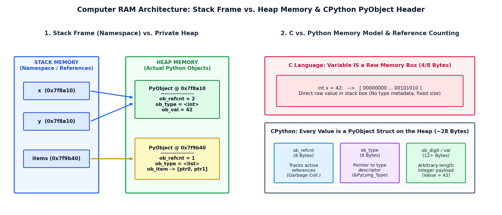
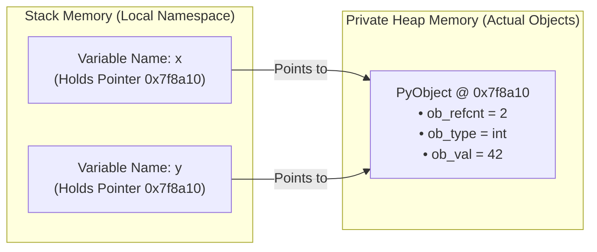

# Dependency Lesson 01.1: පරිගණක මතකය (RAM), Stack vs. Heap සහ Python `PyObject` ව්‍යුහය (How RAM Works: Stack vs. Heap & `PyObject` Structure)

**අදාළ ප්‍රධාන පාඩම් (Related Core Lessons):**
- [Lesson 2.1: Introduction to Python & The Python Interpreter](../../Module_02_Python_Programming_Foundations/Lesson_2.1_Introduction_to_Python_and_Interpreter.md)
- [Lesson 2.2: Python Syntax Fundamentals, Dynamic Typing & Numeric Types](../../Module_02_Python_Programming_Foundations/Lesson_2.2_Python_Syntax_Dynamic_Typing_and_Numeric_Types.md)
- [Lesson 2.7: Defining Functions, Reference Semantics & User Input](../../Module_02_Python_Programming_Foundations/Lesson_2.7_Defining_Functions_Reference_Semantics_and_Input.md)

---

## 1. හැඳින්වීම: මෙම පාඩම අපට අවශ්‍ය වන්නේ ඇයි? (Why Do We Need This?)

ඔබ `Lesson 2.2` හිදී **"Python is a strongly, dynamically typed language"** යන්නත්, Python 3 හිදී `int` එකකට **Unlimited Precision (අසීමිත විශාලත්වයක නිරවද්‍යතාවය)** ඇති බවත් ඉගෙන ගත්තා. එමෙන්ම `Lesson 2.7` හිදී Function එකක් ඇතුළතදී List එකක් වෙනස් කළ විට පිටත List එකත් ඉබේම වෙනස් වන බව (**Pass-by-Object-Reference**) දුටුවා.

නමුත් C හෝ Java වැනි භාෂාවක `int x = 42;` ලිවීමත්, Python හි `x = 42` ලිවීමත් අතර පරිගණකයේ **RAM (Random Access Memory)** එක ඇතුළත සිදුවන ක්‍රියාවලිය සම්පූර්ණයෙන්ම වෙනස්! මෙම මූලික පාඩමෙන් අපි කිසිදු පූර්ව දැනුමක් නොමැතිව, බින්දුවේ සිට (Zero-to-Hero) පරිගණක මතකය ක්‍රියා කරන ආකාරය, **Stack Memory** සහ **Heap Memory** අතර වෙනස, සහ Python හි සෑම අගයක්ම ඇතුළතින් **`PyObject`** එකක් ලෙස ගබඩා වන ආකාරය පියවරෙන් පියවර ඉගෙන ගනිමු.

---

## 2. පරිගණක මතකය (RAM) යනු කුමක්ද? (Real-World Intuition)

ඔබේ පරිගණකයේ **RAM (Random Access Memory)** එක යනු අංක යෙදූ තැපැල් පෙට්ටි (Mailboxes) බිලියන ගණනක් ඇති විශාල තැපැල් කාර්යාලයක් වැනිය.
* සෑම තැපැල් පෙට්ටියකටම අනන්‍ය ලිපිනයක් හෙවත් **Memory Address (මතක ලිපිනය)** එකක් ඇත (උදා: `0x7f8a10`).
* සෑම කුඩා කොටුවකම ගබඩා කළ හැක්කේ **1 Byte (8 Bits)** ක දත්ත ප්‍රමාණයක් පමණි.

Python වැඩසටහනක් ක්‍රියාත්මක වන විට, Python Virtual Machine (PVM) එක විසින් RAM එක ප්‍රධාන කලාප දෙකකට බෙදා පාවිච්චි කරයි:
1. **Stack Memory (Call Stack / Namespace Table)**
2. **Heap Memory (Private Heap)**



---

## 3. Stack Memory vs. Heap Memory අතර වෙනස

| ලක්ෂණය (Feature) | Stack Memory (Call Stack) | Heap Memory (Private Heap) |
| :--- | :--- | :--- |
| **ගබඩා වන්නේ මොනවාද?** | Function Calls (Stack Frames) සහ **Variable Names (විචල්‍ය නාමයන්)** හා ඒවායේ **Object References / Pointers (යොමු ලිපිනයන්)** පමණි. | සැබෑ Python Objects සියල්ලම (`int`, `float`, `str`, `list`, `dict`, `function` ආදී සෑම දෙයක්ම). |
| **විශාලත්වය (Size)** | කුඩා සහ ස්ථාවර ප්‍රමාණයකි (Fixed/Small size per pointer - 64-bit පද්ධතියක එක් Pointer එකක් සඳහා 8 Bytes). | ඉතා විශාල මතක කලාපයකි (Dynamic size — ලැයිස්තුවක් විශාල වන විට ඉඩ පුළුල් කළ හැක). |
| **කළමනාකරණය (Management)** | Function එකක් ආරම්භ වන විට ඉබේම නිර්මාණය වී, Function එක අවසන් වන විට (`return`) ක්ෂණිකව මැකී යයි (**LIFO - Last In, First Out**). | **Reference Counting (යොමු ගණනය කිරීම)** සහ **Garbage Collector** මගින් ස්වයංක්‍රීයව කළමනාකරණය වේ. |



---

## 4. C භාෂාවේ Memory Box එක vs. Python හි `PyObject` ව්‍යුහය

ඇයි C භාෂාවේදී `int x = 42;` ලෙස Type එක කලින් කිව යුතු අතර, Python හිදී `x = 42` ලෙස කෙලින්ම ලිවිය හැක්කේ?

### 1. C භාෂාවේ ක්‍රමය (Raw Memory Box):
* C භාෂාවේදී `int x = 42;` යැයි ලියූ විට, Stack මතකයේ **Bytes 4ක (32-bit)** කුඩා පෙට්ටියක් වෙන් කර, එයට `x` යන නම ලබා දී, එම පෙට්ටිය ඇතුළත කෙලින්ම `42` හි ද්වීමය අගය (`0000...101010`) තැන්පත් කරයි.
* එම පෙට්ටිය ඇතුළත "මෙය `int` එකකි" කියා ලියා නැත (No type metadata). එය දන්නේ C Compiler එක පමණි. එම නිසා එම පෙට්ටියට පසුව `"Hello"` වැනි වචනයක් දැමිය නොහැක!

### 2. Python (CPython) හි ක්‍රමය (`PyObject` Struct on the Heap):
* Python හිදී **"Everything in Python is an Object!"** (Python හි සෑම අගයක්ම Object එකකි).
* ඔබ `x = 42` ලියූ විට, Heap මතකයේ **`PyObject`** නමැති C ව්‍යුහයක් (Struct එකක්) නිර්මාණය වේ. එහි ප්‍රධාන කොටස් 3ක් ඇත:
  1. **`ob_refcnt` — Reference Count (යොමු ගණන):** දැනට මෙම Object එක දෙසට විචල්‍යයන් (Variables / Pointers) කීයක් යොමු වී ඇත්ද යන ගණන.
  2. **`ob_type` — Type Pointer (දත්ත වර්ගයේ යොමුව):** මෙම Object එක කුමන වර්ගයේද (`int`, `float`, `str`, `list`) යන්න සඳහන් කරන Type Object එක වෙත යොමුව. **Dynamic Typing** ක්‍රියාත්මක වන්නේ මෙම `ob_type` කොටස නිසාය!
  3. **`ob_val` / `ob_digit` — Value Payload (සැබෑ අගය):** සැබෑ දත්තය (`42`) ගබඩා වන කොටස.

> [!IMPORTANT]
> **ඇයි Python 3 හි `int` එකකට ඕනෑම විශාලත්වයක සංඛ්‍යාවක් (Unlimited Precision) ගබඩා කළ හැක්කේ?**  
> C භාෂාවේ `int` එකක් Bytes 4කට හෝ 8කට සීමා වුවත්, Python 3 හි `int` (`PyLongObject`) එකක අගය ගබඩා කරන්නේ අවශ්‍ය තරම් දිගු කළ හැකි Digit Array එකක් (`ob_digit[]`) ලෙසයි. එබැවින් ඔබ `2 ** 1000` ගණනය කළත් Integer Overflow දෝෂයක් නොපැමිණ RAM එකේ ඉඩ ඇති තාක් නිවැරදිව ගණනය කරයි!

---

## 5. Python කේතයෙන් `sys.getsizeof()` සහ `sys.getrefcount()` පරීක්ෂා කිරීම

අපි දැන් Python හි Built-in `sys` මොඩියුලය භාවිතා කර Heap මතකයේ ඇති `PyObject` එකක සැබෑ විශාලත්වය සහ **Reference Count (යොමු ගණන)** පරීක්ෂා කර බලමු:

```python
import sys

# 1. C භාෂාවේ int එකක් Bytes 4ක් වුවත්, Python int object එකක මතක විශාලත්වය බලමු:
x = 42
print("Size of int(42) in bytes:", sys.getsizeof(x))
# Output: 28 bytes! (8B ob_refcnt + 8B ob_type + 8B ob_size + 4B digit)

# 2. විශාල සංඛ්‍යාවක් ගබඩා කරන විට PyObject එක ස්වයංක්‍රීයව පුළුල් වන ආකාරය:
big_num = 2 ** 1000
print("Size of 2**1000 in bytes:", sys.getsizeof(big_num))
# Output: 160 bytes!

# 3. Reference Counting සහ Garbage Collection ක්‍රියා කරන ආකාරය:
my_data = [10, 20, 30]
# සටහන: getrefcount() වෙත argument එකක් ලෙස යැවීමේදී තාවකාලික යොමුවක් (+1) එකතු වේ
print("Ref count with 1 variable (my_data):", sys.getrefcount(my_data) - 1)  # 1

alias_1 = my_data
alias_2 = my_data
print("Ref count after adding alias_1 & alias_2:", sys.getrefcount(my_data) - 1)  # 3

del alias_1
print("Ref count after deleting alias_1:", sys.getrefcount(my_data) - 1)  # 2
```

* යම් Object එකක **`ob_refcnt` — Reference Count (යොමු ගණන)** බින්දුව (`0`) බවට පත් වූ සැණින්, Python හි **Garbage Collector** එක විසින් එම Object එක Heap මතකයෙන් මකා දමා ඉඩ නිදහස් කරයි!

---

## 6. 🛠️ Practical Task / Hands-On Exercise (ප්‍රායෝගික අභ්‍යාසය)

### Scenario / Goal:
ඔබ Data Science පද්ධතියක Memory Profiler කෙනෙකු ලෙස කටයුතු කරයි. විවිධ Python Data Types (`int`, `float`, `str`, `list`, `tuple`) සඳහා Heap මතකයේ වැය වන **Memory Overhead (මතක පිරිවැය)** සහ **Reference Count (යොමු ගණන)** මැන බැලීමට කුඩා Python script එකක් ලිවිය යුතුය.

### Step-by-Step Tasks:
1. `sys` මොඩියුලය import කර `0`, `42`, සහ `10**100` යන පූර්ණ සංඛ්‍යා තුනෙහි මතක විශාලත්වයන් (`sys.getsizeof()`) මුද්‍රණය කරන්න.
2. එකම අගයන් 5ක් (`1, 2, 3, 4, 5`) අඩංගු `list` එකක් සහ `tuple` එකක් සාදා, ඒ දෙකෙහි මතක විශාලත්වයන් සසඳන්න (ඇයි `tuple` එකට අඩු මතකයක් වැය වන්නේ?).
3. `sensor_readings = [25.4, 26.1, 24.9]` නමින් List එකක් සාදා, එයට තවත් විචල්‍ය දෙකක් (`backup_1`, `backup_2`) යොමු කර, `sys.getrefcount()` මගින් සැබෑ Reference Count එක පරීක්ෂා කරන්න.

### Starter Code:
```python
import sys

# Task 1: Compare memory sizes of integers
num_zero = 0
num_small = 42
num_huge = 10 ** 100
# TODO: Print sys.getsizeof() for each integer

# Task 2: Compare list vs tuple memory overhead
sample_list = [1, 2, 3, 4, 5]
sample_tuple = (1, 2, 3, 4, 5)
# TODO: Print sys.getsizeof() for sample_list and sample_tuple

# Task 3: Track active reference counts
sensor_readings = [25.4, 26.1, 24.9]
# TODO: Create backup_1 and backup_2 pointing to sensor_readings and print active references
```

### Expected Output / Reference Solution:
```python
import sys

# Task 1: Compare memory sizes of integers
num_zero = 0
num_small = 42
num_huge = 10 ** 100
print(f"int(0): {sys.getsizeof(num_zero)} bytes")
print(f"int(42): {sys.getsizeof(num_small)} bytes")
print(f"int(10**100): {sys.getsizeof(num_huge)} bytes")

# Task 2: Compare list vs tuple memory overhead
sample_list = [1, 2, 3, 4, 5]
sample_tuple = (1, 2, 3, 4, 5)
print(f"List [1..5]: {sys.getsizeof(sample_list)} bytes")
print(f"Tuple (1..5): {sys.getsizeof(sample_tuple)} bytes")

# Task 3: Track active reference counts
sensor_readings = [25.4, 26.1, 24.9]
backup_1 = sensor_readings
backup_2 = sensor_readings
active_refs = sys.getrefcount(sensor_readings) - 1
print(f"Active references to sensor_readings: {active_refs}")
```

**Expected Output:**
```text
int(0): 28 bytes
int(42): 28 bytes
int(10**100): 72 bytes
List [1..5]: 104 bytes
Tuple (1..5): 80 bytes
Active references to sensor_readings: 3
```

---

## 7. Summary & Exam Revision Cheat Sheet (සාරාංශය)

| සංකල්පය (Concept) | කෙටි විස්තරය (Exam Revision Point) |
| :--- | :--- |
| **Stack Memory** | විචල්‍ය නාමයන් (Variable names) සහ Heap එකේ ඇති Objects වල ලිපිනයන් (Pointers/References) ගබඩා කරයි. |
| **Heap Memory** | සියලුම Python Objects (`PyObject` structs) ගබඩා වන විශාල මතක කලාපයයි. |
| **`PyObject` Header** | සෑම Python object එකකම `ob_refcnt` (**Reference Count (යොමු ගණන)**), `ob_type` (Data type pointer) සහ `ob_val` (අගය) අඩංගු වේ. |
| **Dynamic Typing** | විචල්‍ය නාමයට Type එකක් නොමැත; Type එක (`ob_type`) ගබඩා වී ඇත්තේ Heap එකේ ඇති Object එක තුළය. |
| **Garbage Collection** | Object එකක `ob_refcnt` අගය `0` වූ විට එය ස්වයංක්‍රීයව මතකයෙන් ඉවත් කෙරේ. |

---

**ඊළඟ Dependency පාඩම:** [02_Variables_as_Name_Tags_id_is_vs_Double_Equals.md](02_Variables_as_Name_Tags_id_is_vs_Double_Equals.md) — Python විචල්‍යයන් "Name Tags" ලෙස ක්‍රියා කරන ආකාරය, `id()`, සහ `is` vs `==` අතර වෙනස ඉගෙන ගනිමු.  
**ආපසු ප්‍රධාන පාඩම් වෙත (Back to Core Lessons):** [Lesson 2.2](../../Module_02_Python_Programming_Foundations/Lesson_2.2_Python_Syntax_Dynamic_Typing_and_Numeric_Types.md) | [Lesson 2.7](../../Module_02_Python_Programming_Foundations/Lesson_2.7_Defining_Functions_Reference_Semantics_and_Input.md)
