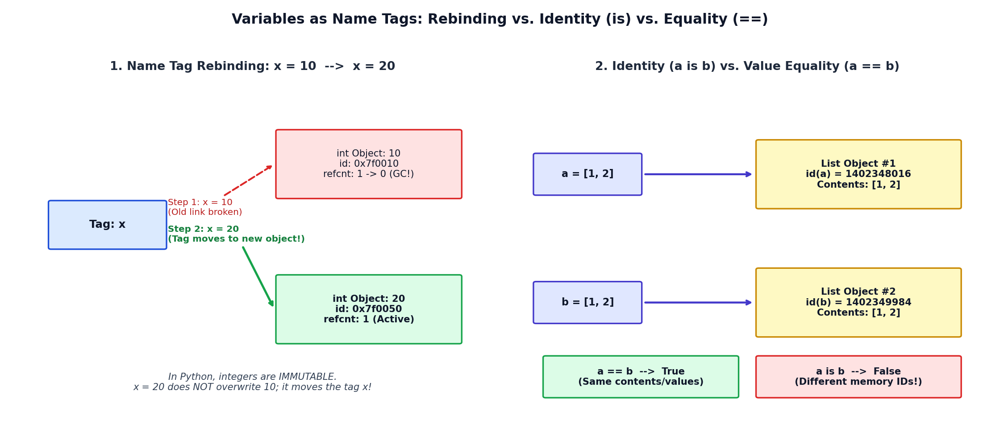
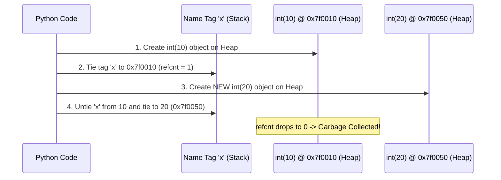

# Dependency Lesson 01.2: විචල්‍යයන් "Name Tags" ලෙස, `id()` ශ්‍රිතය සහ `is` vs. `==` අතර වෙනස (Variables as Name Tags, `id()`, `is` vs. `==`)

**අදාළ ප්‍රධාන පාඩම් (Related Core Lessons):**
- [Lesson 2.2: Python Syntax Fundamentals, Dynamic Typing & Numeric Types](../../Module_02_Python_Programming_Foundations/Lesson_2.2_Python_Syntax_Dynamic_Typing_and_Numeric_Types.md)
- [Lesson 2.3: Sequence Data Types — Strings, Unicode, Lists & Tuples](../../Module_02_Python_Programming_Foundations/Lesson_2.3_Sequence_Data_Types_Strings_Unicode_Lists_Tuples.md)
- [Lesson 2.7: Defining Functions, Reference Semantics & User Input](../../Module_02_Python_Programming_Foundations/Lesson_2.7_Defining_Functions_Reference_Semantics_and_Input.md)

---

## 1. හැඳින්වීම: Python විචල්‍යයන් "පෙට්ටි" නොව "Name Tags" වන්නේ ඇයි?

බොහෝ ආධුනිකයන් සිතන්නේ `x = 10` යැයි ලියූ විට `x` නමැති පෙට්ටියක් ඇතුළට `10` දමන බවත්, පසුව `x = 20` යැයි ලියූ විට එම පෙට්ටියේ තිබූ `10` මකා දමා ඒ තැනට `20` ලියන බවත්ය. **මෙය Python සම්බන්ධයෙන් සම්පූර්ණයෙන්ම වැරදි මතයකි!**

Python හිදී විචල්‍යයන් (Variables) යනු පෙට්ටි (Boxes) නොව, Objects මත අලවන **Name Tags (නාම පුවරු / ලේබල්)** වේ! මෙම පාඩමෙන් අපි:
1. **Name Tag Rebinding** (`x = 10` $\rightarrow$ `x = 20`) මතකයේදී සිදුවන ආකාරය,
2. **`id()` ශ්‍රිතය** මගින් Object එකක **Memory Address (මතක ලිපිනය)** පරීක්ෂා කරන ආකාරය, සහ
3. **Object Identity (`is` - වස්තු අනන්‍යතාවය)** හා **Value Equality (`==` - අගයන්ගේ සමානාත්මතාවය)** අතර ඇති තීරණාත්මක වෙනස ගැඹුරින් ඉගෙන ගනිමු.



---

## 2. Name Tag Rebinding: `x = 10` සිට `x = 20` දක්වා කුමක් සිදුවේද?

Python හි සංඛ්‍යා (`int`, `float`) සහ වචන (`str`) යනු **Immutable Objects (වෙනස් කළ නොහැකි වස්තූන්)** වේ. එනම් Heap මතකයේ `10` නමැති `int` object එකක් සෑදූ පසු, එම Object එක ඇතුළත ඇති `10` කිසිවිටෙකත් `20` බවට වෙනස් කළ නොහැක!

එසේ නම් පහත කේත පේළි දෙක ක්‍රියාත්මක වන විට කුමක් සිදුවේද?
```python
x = 10
x = 20
```



1. **`x = 10`:** මුලින්ම Heap මතකයේ `10` නමැති `int` object එක සෑදේ. ඉන්පසු `x` නමැති Name Tag එක නූලකින් එම `10` object එකට ගැටගසයි (**Binding**).
2. **`x = 20`:** Python විසින් `10` තිබූ Object එක අල්ලන්නේවත් නැත! ඒ වෙනුවට Heap මතකයේ **අලුත්ම `20` නමැති `int` object එකක්** සාදා, `x` නමැති Name Tag එක `10` න් ගලවා අලුත් `20` object එකට ගැටගසයි (**Rebinding**)!

> [!TIP]
> **Lesson 2.7 හි `hello_func(name, somelist)` රහස දැන් පැහැදිලියි නේද?**  
> `Lesson 2.7` හිදී Function එක ඇතුළත `name = "Caitlin"` ලියූ විට සිදු වූයේ `"Ben"` නමැති String එක වෙනස් වීම නොව, ඇතුළත තිබූ `name` නමැති Name Tag එක `"Ben"` ගෙන් ගලවා `"Caitlin"` නමැති අලුත් String එකකට ගැටගැසීමයි! එම නිසා පිටත තිබූ `myname` ලේබලය දිගටම `"Ben"` වෙතම යොමු වී පැවතුණි.

---

## 3. `id()` ශ්‍රිතය: Object එකක අනන්‍ය මතක ලිපිනය සෙවීම

ඕනෑම Python විචල්‍යයක් දැනට යොමු වී ඇති Object එකෙහි අනන්‍ය හඳුනුම් අංකය හෙවත් **Object Identity (වස්තු අනන්‍යතාවය)** බලා ගැනීමට Built-in **`id(obj)`** ශ්‍රිතය භාවිතා කරයි. CPython හිදී `id(x)` මගින් ලබා දෙන්නේ එම Object එක RAM එකෙහි පිහිටා ඇති සැබෑ **Memory Address (මතක ලිපිනය)** යි!

```python
x = 10
print("id of x when x=10:", id(x), "-> Hex:", hex(id(x)))

x = 20
print("id of x when x=20:", id(x), "-> Hex:", hex(id(x)))
# බලන්න! x = 20 කළ විට id(x) සම්පූර්ණයෙන්ම අලුත් මතක ලිපිනයක් බවට පත් විය!
```

---

## 4. `==` (Value Equality) vs. `is` (Object Identity) අතර තීරණාත්මක වෙනස

Python කේත ලිවීමේදී සහ විභාගවලදී බහුලවම අසන ප්‍රශ්නයක් වන්නේ **`a == b`** සහ **`a is b`** අතර වෙනස කුමක්ද යන්නයි:

| ක්‍රියාකරු (Operator) | නම (Mathematical/CS Term) | පරීක්ෂා කරන්නේ කුමක්ද? | Python ඇතුළතින් කරන පරීක්ෂාව |
| :--- | :--- | :--- | :--- |
| **`a == b`** | **Value Equality (අගයන්ගේ සමානාත්මතාවය)** | `a` සහ `b` යොමු වී ඇති Objects දෙකෙහි **අන්තර්ගත අගයන් (Contents/Values)** එක සමානද? | `a.__eq__(b)` කැඳවයි. |
| **`a is b`** | **Object Identity (වස්තු අනන්‍යතාවය)** | `a` සහ `b` යන Name Tags දෙකම ගැටගසා ඇත්තේ RAM එකේ ඇති **එකම Object එකටමද**? | `id(a) == id(b)` දැයි බලයි. |

### ප්‍රායෝගික කේත උදාහරණය:
```python
# එකම අගයන් සහිත වෙනස් Lists දෙකක් සාදමු:
a = [1, 2, 3]
b = [1, 2, 3]

# 1. Value Equality (==): දෙකේම ඇතුළත ඇත්තේ 1, 2, 3 නිසා True ලැබේ!
print("a == b :", a == b)   # Output: True

# 2. Object Identity (is): මේවා වෙනම සෑදූ Lists දෙකක් නිසා මතක ලිපිනයන් වෙනස්ය!
print("a is b :", a is b)   # Output: False
print("id(a)  :", id(a))
print("id(b)  :", id(b))

# 3. දැන් c = a ලෙස Alias එකක් සාදමු (එකම List එකට තවත් Name Tag එකක්):
c = a
print("a is c :", a is c)   # Output: True (id(a) == id(c))
```

---

## 5. CPython හි Integer Caching / String Interning විශේෂත්වය (Exam Trap!)

පහත කේතය Python REPL එකේ ක්‍රියාත්මක කළ විට ලැබෙන පුදුම සහගත ප්‍රතිඵලය බලන්න:

```python
# කුඩා පූර්ණ සංඛ්‍යා (-5 සිට 256 දක්වා):
p = 100
q = 100
print(p is q)   # Output: True! (ඇයි?)

# විශාල පූර්ණ සංඛ්‍යා (256 ට වැඩි):
m = 1000
n = 1000
print(m is n)   # Output: False! (සාමාන්‍ය පරිදි වෙනස් Objects දෙකක් සෑදේ)
```

* **ඇයි `p = 100; q = 100` සඳහා `p is q` අගය `True` වුණේ?**
  * Python වැඩසටහන්වලදී `-5` සිට `256` දක්වා ඇති කුඩා පූර්ණ සංඛ්‍යා නිරන්තරයෙන්ම භාවිතා වේ. එම නිසා මතකය සහ කාලය ඉතිරි කර ගැනීමට Python ආරම්භ වන විටම `-5` සිට `256` දක්වා Objects කලින්ම සාදා තබා ගනී (**Small Integer Caching**).
  * එහෙත් **කිසිවිටෙකත් සංඛ්‍යා හෝ Strings සමානදැයි බැලීමට `is` භාවිතා නොකරන්න!** අගයන් සැසඳීමට සෑමවිටම `==` භාවිතා කරන්න. `is` භාවිතා කළ යුත්තේ `if x is None:` වැනි Singleton පරීක්ෂාවන් සහ Object Identity පරීක්ෂාවන් සඳහා පමණි.

---

## 6. 🛠️ Practical Task / Hands-On Exercise (ප්‍රායෝගික අභ්‍යාසය)

### Scenario / Goal:
ඔබේ කණ්ඩායමේ කනිෂ්ඨ ක්‍රමලේඛකයෙකු (Junior Developer) Python හි Immutable (`int`, `str`) සහ Mutable (`list`) විචල්‍යයන්ගේ `id()` වෙනස් වන ආකාරය සහ `is` vs `==` පටලවාගෙන ඇත. එය පැහැදිලිව ඔප්පු කර පෙන්වන පරීක්ෂණ කේතයක් (Diagnostic Script) ඔබ විසින් ලිවිය යුතුය.

### Step-by-Step Tasks:
1. `score = 50` ලෙස විචල්‍යයක් සාදා එහි `id(score)` මුද්‍රණය කරන්න. ඉන්පසු `score = score + 10` ලෙස යාවත්කාලීන කර නව `id(score)` මුද්‍රණය කර, පැරණි සහ නව IDs සමානදැයි (`==`) පරීක්ෂා කරන්න.
2. `scores_list = [50, 60]` ලෙස List එකක් සාදා එහි `id(scores_list)` සටහන් කර ගන්න. ඉන්පසු `scores_list.append(70)` මගින් අගයක් එක් කර නැවත `id(scores_list)` පරීක්ෂා කරන්න (ID එක වෙනස් වුණාද?).
3. `list_1 = ['CH4', 'O2']`, `list_2 = ['CH4', 'O2']`, සහ `list_3 = list_1` ලෙස සාදා `(list_1 == list_2)`, `(list_1 is list_2)`, සහ `(list_1 is list_3)` යන තුනෙහි ප්‍රතිඵල මුද්‍රණය කරන්න.

### Starter Code:
```python
# Task 1: Immutable int rebinding test
score = 50
id_before = id(score)
score = score + 10
id_after = id(score)
# TODO: Print whether id_before == id_after

# Task 2: Mutable list in-place modification test
scores_list = [50, 60]
list_id_before = id(scores_list)
scores_list.append(70)
list_id_after = id(scores_list)
# TODO: Print whether list_id_before == list_id_after

# Task 3: Equality (==) vs Identity (is)
list_1 = ['CH4', 'O2']
list_2 = ['CH4', 'O2']
list_3 = list_1
# TODO: Print (list_1 == list_2), (list_1 is list_2), and (list_1 is list_3)
```

### Expected Output / Reference Solution:
```python
# Task 1: Immutable int rebinding test
score = 50
id_before = id(score)
score = score + 10
id_after = id(score)
print("Task 1 - Same int ID after +10?:", id_before == id_after)

# Task 2: Mutable list in-place modification test
scores_list = [50, 60]
list_id_before = id(scores_list)
scores_list.append(70)
list_id_after = id(scores_list)
print("Task 2 - Same list ID after .append()?:", list_id_before == list_id_after)

# Task 3: Equality (==) vs Identity (is)
list_1 = ['CH4', 'O2']
list_2 = ['CH4', 'O2']
list_3 = list_1
print("Task 3 - list_1 == list_2 :", list_1 == list_2)
print("Task 3 - list_1 is list_2 :", list_1 is list_2)
print("Task 3 - list_1 is list_3 :", list_1 is list_3)
```

**Expected Output:**
```text
Task 1 - Same int ID after +10?: False
Task 2 - Same list ID after .append()?: True
Task 3 - list_1 == list_2 : True
Task 3 - list_1 is list_2 : False
Task 3 - list_1 is list_3 : True
```

---

## 7. Summary & Exam Revision Cheat Sheet (සාරාංශය)

| ප්‍රකාශනය (Expression) | තේරුම (Meaning) | උදාහරණය (`a = [1, 2]`, `b = [1, 2]`) |
| :--- | :--- | :--- |
| **`id(x)`** | `x` යොමු වී ඇති Object එකෙහි **Memory Address (මතක ලිපිනය)** ලබා දෙයි. | `id(a) != id(b)` |
| **`a == b`** | **Value Equality (අගයන්ගේ සමානාත්මතාවය)** — අන්තර්ගත අගයන් සමානද? | `a == b` $\rightarrow$ `True` |
| **`a is b`** | **Object Identity (වස්තු අනන්‍යතාවය)** — දෙකම එකම මතක වස්තුවක්ද (`id(a) == id(b)`)? | `a is b` $\rightarrow$ `False` |
| **`x is None`** | විචල්‍යයක් `None` දැයි පරීක්ෂා කිරීමට PEP 8 නිර්දේශිත නිවැරදිම ක්‍රමය. | `if result is None:` |

---

**ඊළඟ Dependency පාඩම:** [03_Mutability_Aliasing_Shallow_Copy_and_Deep_Copy.md](03_Mutability_Aliasing_Shallow_Copy_and_Deep_Copy.md) — Aliasing (`b = a`), Shallow Copy (`.copy()`) සහ Deep Copy (`copy.deepcopy()`) අතර වෙනස ඉගෙන ගනිමු.  
**ආපසු ප්‍රධාන පාඩම් වෙත (Back to Core Lessons):** [Lesson 2.2](../../Module_02_Python_Programming_Foundations/Lesson_2.2_Python_Syntax_Dynamic_Typing_and_Numeric_Types.md) | [Lesson 2.3](../../Module_02_Python_Programming_Foundations/Lesson_2.3_Sequence_Data_Types_Strings_Unicode_Lists_Tuples.md) | [Lesson 2.7](../../Module_02_Python_Programming_Foundations/Lesson_2.7_Defining_Functions_Reference_Semantics_and_Input.md)
