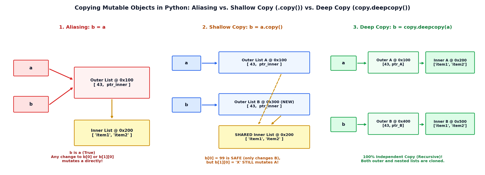
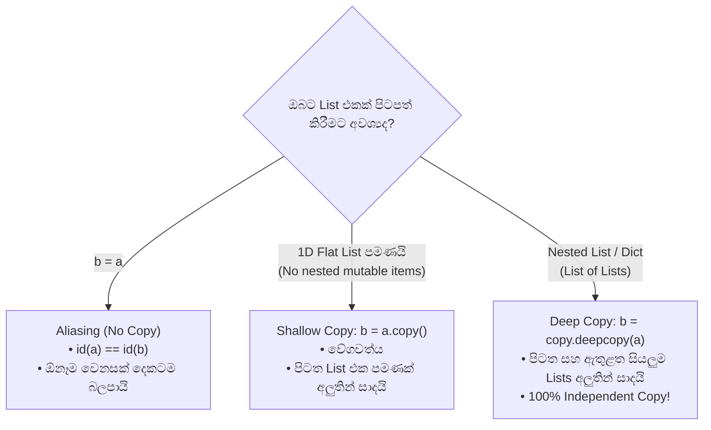

# Dependency Lesson 01.3: Mutability, Aliasing, Shallow Copy (`.copy()`) සහ Deep Copy (`copy.deepcopy()`)

**අදාළ ප්‍රධාන පාඩම් (Related Core Lessons):**
- [Lesson 2.3: Sequence Data Types — Strings, Unicode, Lists & Tuples](../../Module_02_Python_Programming_Foundations/Lesson_2.3_Sequence_Data_Types_Strings_Unicode_Lists_Tuples.md)
- [Lesson 2.4: Common & Mutable Sequence Operations](../../Module_02_Python_Programming_Foundations/Lesson_2.4_Common_and_Mutable_Sequence_Operations.md)
- [Lesson 2.7: Defining Functions, Reference Semantics & User Input](../../Module_02_Python_Programming_Foundations/Lesson_2.7_Defining_Functions_Reference_Semantics_and_Input.md)

---

## 1. හැඳින්වීම: `f1.ipynb` හි List Copy ගැටලුව ඇති වූයේ ඇයි?

අපගේ `f1.ipynb` ප්‍රායෝගික Notebook එකේ අවසාන කොටසේදී (`Cells 41–49`) සහ `Lesson 2.7` හිදී ඉතාම වැදගත් සිදුවීමක් අපි දුටුවෙමු:
* `myl1 = ['fish bun', 'toast', 'bread', 'patty']` ලෙස තිබූ List එකට Function එකක් හරහා අගයක් එක් කර `myl2` වෙත ලබා ගත් විට, **`myl2[2] = 89` ලෙස වෙනස් කළ සැණින් මුල් `myl1` එකත් ඉබේම වෙනස් විය!**
* ඉන්පසු එය වැළැක්වීමට `myl3 = myl1.copy()` භාවිතා කරන ලදී.
* එමෙන්ම `Lesson 2.4` (Slide 18) හිදී `s * n` යන්න **"n shallow copies of s concatenated"** ලෙස අර්ථ දක්වා තිබුණි.

**Aliasing**, **Shallow Copy (මතුපිට පිටපතක්)** සහ **Deep Copy (ගැඹුරු / පූර්ණ ස්වාධීන පිටපතක්)** යනු මොනවාද? Nested List එකකදී `.copy()` භාවිතා කළත් තවමත් මුල් List එක වෙනස් විය හැක්කේ ඇයි? මෙම පාඩමෙන් අපි මෙම සංකල්ප තුන රූපසටහන් සහ කේත මගින් 100%ක් නිරවුල්ව ඉගෙන ගනිමු.



---

## 2. Mutable vs. Immutable Data Types වර්ගීකරණය

මතකයේ ඇති Object එකක් සෑදූ පසු එහි අන්තර්ගතය (Internal state) එම මතක ලිපිනයේදීම (**In-place**) වෙනස් කළ හැකිද නැද්ද යන්න මත Python Data Types කොටස් දෙකකට බෙදේ:

| වර්ගය (Category) | Python Data Types | හැසිරීම (Memory Behavior) |
| :--- | :--- | :--- |
| **Immutable Types (වෙනස් කළ නොහැකි)** | `int`, `float`, `complex`, `bool`, `str`, `tuple`, `frozenset`, `bytes` | සෑදූ පසු අන්තර්ගතය කිසිසේත්ම වෙනස් කළ නොහැක. වෙනස් කිරීමට උත්සාහ කළහොත් **අලුත්ම Object එකක්** සෑදේ. |
| **Mutable Types (වෙනස් කළ හැකි)** | `list`, `dict`, `set`, `bytearray` | එම Memory Address (`id`) එක තුළම තබාගෙන අගයන් එකතු කිරීම, ඉවත් කිරීම හෝ වෙනස් කිරීම (**In-place Mutation**) කළ හැක. |

---

## 3. පියවර 1: Aliasing (`b = a`) — පිටපතක් නොව එකම වස්තුවට නම් දෙකක්!

ඔබ Mutable List එකක් සාදා `b = a` ලෙස ලියූ විට **කිසිදු පිටපතක් (Copy) සෑදෙන්නේ නැත!** සිදුවන්නේ `a` සහ `b` යන Name Tags දෙකම Heap මතකයේ ඇති **එකම List එකට** යොමු වීමයි. මෙය **Aliasing (අන්වර්ථ නාමකරණය)** ලෙස හැඳින්වේ.

```python
# f1.ipynb (Cells 42-48) උදාහරණය:
myl1 = ['fish bun', 'toast', 'bread', 'patty', 67]
myl2 = myl1             # Aliasing! අලුත් List එකක් සෑදෙන්නේ නැත (myl2 is myl1 -> True)

myl2[2] = 89            # myl2 හරහා 2 වන Index එක වෙනස් කරමු
print("myl2:", myl2)    # ['fish bun', 'toast', 89, 'patty', 67]
print("myl1:", myl1)    # ['fish bun', 'toast', 89, 'patty', 67] -> myl1 ද වෙනස් වී ඇත!
```

---

## 4. පියවර 2: Shallow Copy (`b = a.copy()` හෝ `a[:]`) — තනි මට්ටමේ ලැයිස්තු සඳහා විසඳුම සහ Nested Lists වල උගුල!

**Shallow Copy** එකක් සාදා ගත හැකි ක්‍රම 3කි:
1. `b = a.copy()` *(Python 3 සම්මත ක්‍රමය — `f1.ipynb` Cell 49)*
2. `b = a[:]` *(Full Slice ක්‍රමය)*
3. `b = list(a)` *(Constructor ක්‍රමය)*

### Shallow Copy එකකින් සිදුවන්නේ කුමක්ද?
එය Heap මතකයේ **අලුත්ම පිටත List එකක් (New Outer List)** සාදා, මුල් List එකේ තිබූ **References (Pointers)** ටික අලුත් List එක තුළට පිටපත් කරයි.

#### A. සාමාන්‍ය (1D / Flat) List එකකදී:
`myl1 = ['fish bun', 'toast', 'bread', 'patty']` වැනි Flat List එකක ඇතුළත ඇත්තේ Immutable strings හා integers පමණි. එබැවින් `.copy()` මගින් සම්පූර්ණයෙන්ම ආරක්ෂිත පිටපතක් ලැබේ:
```python
myl1 = ['fish bun', 'toast', 'bread', 'patty', 67]
myl3 = myl1.copy()      # Shallow copy (New outer list created)
myl3[2] = 89
print("myl3:", myl3)    # ['fish bun', 'toast', 89, 'patty', 67]
print("myl1:", myl1)    # ['fish bun', 'toast', 'bread', 'patty', 67] (ආරක්ෂිතයි!)
```

#### B. Nested List එකකදී (List inside a List) Shallow Copy වල ඇති භයානක උගුල!
`Lesson 2.3` හිදී අපි උගත් පරිදි List එකක් ඇතුළත තවත් List එකක් තිබුණහොත් (`a = [43, ['item1', 'item2']]`), `b = a.copy()` මගින් පිටත List එක පමණක් අලුතින් සාදන අතර, **`a[1]` සහ `b[1]` යන දෙකම තවමත් යොමු වී ඇත්තේ එකම ඇතුළත List එක (`['item1', 'item2']`) වෙතය!**

```python
a = [43, ['item1', 'item2']]
b = a.copy()                # Shallow Copy!

# 1. පිටත අගයක් වෙනස් කිරීම ආරක්ෂිතයි:
b[0] = 99
print("After b[0]=99 -> a:", a)  # [43, ['item1', 'item2']] (a වෙනස් නොවේ)

# 2. නමුත් ඇතුළත Nested List එකේ අගයක් වෙනස් කළහොත්:
b[1][0] = 'CHANGED!'
print("After b[1][0] -> b:", b)  # [99, ['CHANGED!', 'item2']]
print("After b[1][0] -> a:", a)  # [43, ['CHANGED!', 'item2']] -> a හි ඇතුළත List එකත් වෙනස් විය!
```

> [!WARNING]
> **`s * n` Shallow Copy උගුල (`Lesson 2.4` - Slide 18):**  
> ඔබ `matrix = [[0, 0]] * 3` ලෙස ලියූ විට සෑදෙන්නේ එකම `[0, 0]` ලැයිස්තුවට යොමු වූ Shallow references 3කි! එබැවින් `matrix[0][0] = 9` කළ විට පේළි තුනම `[[9, 0], [9, 0], [9, 0]]` බවට වෙනස් වේ!

---

## 5. පියවර 3: Deep Copy (`copy.deepcopy()`) — 100%ක් ස්වාධීන පිටපතක්!

Nested Lists හෝ සංකීර්ණ Dictionaries වලදී පිටත ව්‍යුහය පමණක් නොව, ඇතුළත ඇති සියලුම උප-ලැයිස්තුද (Sub-lists) Recursive ලෙස වෙනම පිටපත් කර **100%ක් ස්වාධීන පිටපතක් (Independent Deep Copy)** ලබා ගැනීමට Python හි Built-in `copy` මොඩියුලයේ **`copy.deepcopy()`** ශ්‍රිතය භාවිතා කරයි.



```python
import copy

a = [43, ['item1', 'item2']]
b = copy.deepcopy(a)        # Deep Copy!

b[1][0] = 'SAFE_CHANGE'
print("b:", b)              # [43, ['SAFE_CHANGE', 'item2']]
print("a:", a)              # [43, ['item1', 'item2']] -> මුල් List එක 100%ක් ආරක්ෂිතයි!
print("id(a[1]) == id(b[1]):", id(a[1]) == id(b[1]))  # False!
```

---

## 6. 🛠️ Practical Task / Hands-On Exercise (ප්‍රායෝගික අභ්‍යාසය)

### Scenario / Goal:
ඔබ රසායනාගාර පරීක්ෂණ දත්ත ගබඩා කරන Nested List එකක් (`lab_records = ['Batch_A', [16.04, 18.02]]`) මත Simulation පරීක්ෂණ දෙකක් සිදු කරයි. Shallow Copy සහ Deep Copy අතර හැසිරීම පරීක්ෂා කර මුල් දත්ත ආරක්ෂා කර ගැනීම ඔබේ ඉලක්කයයි.

### Step-by-Step Tasks:
1. `copy` මොඩියුලය import කර `lab_records = ['Batch_A', [16.04, 18.02]]` නිර්මාණය කරන්න.
2. `shallow_sim = lab_records.copy()` සහ `deep_sim = copy.deepcopy(lab_records)` ලෙස පිටපත් දෙකක් සාදන්න.
3. `deep_sim[1][0] = 99.99` ලෙස වෙනස් කර, `lab_records` වෙනස් වී ඇත්දැයි මුද්‍රණය කර බලන්න.
4. දැන් `shallow_sim[1][0] = 0.00` ලෙස වෙනස් කර, `lab_records` හි අගයට කුමක් සිදුවීදැයි මුද්‍රණය කර පැහැදිලි කරන්න.

### Starter Code:
```python
import copy

lab_records = ['Batch_A', [16.04, 18.02]]

# TODO: Create shallow_sim using .copy() and deep_sim using copy.deepcopy()

# TODO: Modify deep_sim[1][0] = 99.99 and print lab_records

# TODO: Modify shallow_sim[1][0] = 0.00 and print lab_records and deep_sim
```

### Expected Output / Reference Solution:
```python
import copy

lab_records = ['Batch_A', [16.04, 18.02]]

shallow_sim = lab_records.copy()
deep_sim = copy.deepcopy(lab_records)

# Step 3: Modify deep_sim
deep_sim[1][0] = 99.99
print("After modifying deep_sim    -> lab_records:", lab_records)

# Step 4: Modify shallow_sim
shallow_sim[1][0] = 0.00
print("After modifying shallow_sim -> lab_records:", lab_records)
print("Independent deep_sim remains            :", deep_sim)
```

**Expected Output:**
```text
After modifying deep_sim    -> lab_records: ['Batch_A', [16.04, 18.02]]
After modifying shallow_sim -> lab_records: ['Batch_A', [0.0, 18.02]]
Independent deep_sim remains            : ['Batch_A', [99.99, 18.02]]
```

---

## 7. Summary & Exam Revision Cheat Sheet (සාරාංශය)

| ක්‍රමය (Method) | කේතය (Syntax) | Outer List (`id(a) == id(b)`) | Inner Nested List (`id(a[1]) == id(b[1])`) | කවදාද භාවිතා කරන්නේ? |
| :--- | :--- | :--- | :--- | :--- |
| **Aliasing** | `b = a` | `True` (එකම List එක) | `True` (එකම Inner List එක) | එකම List එකට නම් දෙකකින් පිවිසීමට අවශ්‍ය විට. |
| **Shallow Copy** | `b = a.copy()` හෝ `a[:]` | `False` (අලුත් Outer List එකක්) | `True` (Inner List එක හවුලේ බෙදා ගනී!) | සාමාන්‍ය (1D Flat) Lists පිටපත් කිරීමට. |
| **Deep Copy** | `b = copy.deepcopy(a)` | `False` (අලුත් Outer List එකක්) | `False` (අලුත්ම Inner List එකක්!) | Nested Lists හා සංකීර්ණ Dictionaries 100%ක් ස්වාධීනව පිටපත් කිරීමට. |

---

**ආපසු ප්‍රධාන පාඩම් වෙත (Back to Core Lessons):**
- [Lesson 2.3: Sequence Data Types — Strings, Unicode, Lists & Tuples](../../Module_02_Python_Programming_Foundations/Lesson_2.3_Sequence_Data_Types_Strings_Unicode_Lists_Tuples.md)
- [Lesson 2.4: Common & Mutable Sequence Operations](../../Module_02_Python_Programming_Foundations/Lesson_2.4_Common_and_Mutable_Sequence_Operations.md)
- [Lesson 2.7: Defining Functions, Reference Semantics & User Input](../../Module_02_Python_Programming_Foundations/Lesson_2.7_Defining_Functions_Reference_Semantics_and_Input.md)
