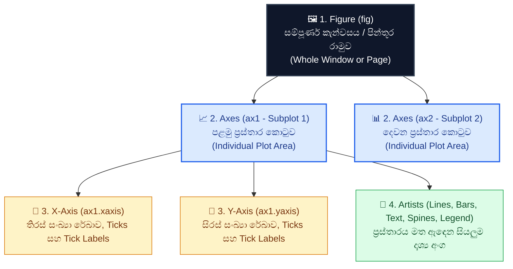
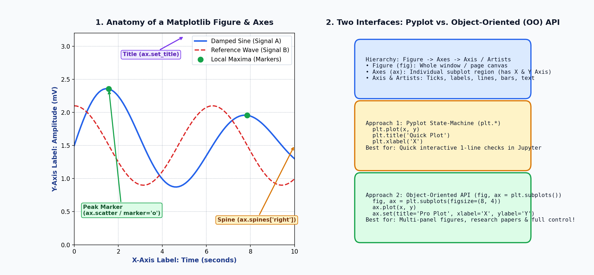

# Dep 01 - පාඩම 01: Matplotlib හි අභ්‍යන්තර ව්‍යුහය — Figure, Axes, සහ Pyplot vs. Object-Oriented API (Zero-to-Hero Guide)

**අදාළ ප්‍රධාන පාඩම් (Related Core Lessons):**
- [⬅️ Back to Lesson 5.1: Purpose of Data Visualization & Tufte Principles](../../Module_05_Data_Visualization_Principles_and_Techniques/Lesson_5.1_Purpose_of_Data_Visualization_and_Tufte_Principles.md)
- [⬅️ Back to Lesson 5.2: Choosing the Right Visualization — Distributions & Relationships](../../Module_05_Data_Visualization_Principles_and_Techniques/Lesson_5.2_Choosing_Right_Visualization_Distributions_and_Relationships.md)

---

## 1. හැඳින්වීම: ඇයි අපට Matplotlib අවශ්‍ය වන්නේ? (Why Was Matplotlib Invented?)

ඔබ Python හෝ NumPy භාවිතා කර දත්ත දහස් ගණනක් සහිත Array එකක් හෝ වගුවක් ගණනය කළා යැයි සිතන්න. උදාහරණයක් ලෙස තත්පරයට සාම්පල 100 බැගින් ගත් **Voltage (වෝල්ටීයතාවය)** අගයන් 200ක් දෙස ඉලක්කම් වශයෙන් බලා සිටීමෙන් එය Sine තරංගයක්ද, නැතිනම් එහි **Outliers (අසාමාන්‍ය අගයන්)** තිබේද යන්න කිසිවෙකුටත් එකවර කිව නොහැක.

2003 වසරේදී ස්නායු විද්‍යාඥයෙකු වූ **John D. Hunter** විසින් MATLAB මෘදුකාංගයේ තිබූ ප්‍රස්තාර ඇඳීමේ පහසුව Python වෙත ගෙන ඒම සඳහා **Matplotlib** නිර්මාණය කරන ලදී. අද වන විට Python Data Science ලෝකයේ සියලුම දෘශ්‍යකරණ පුස්තකාලවල (Seaborn, Pandas `.plot()`, Scikit-Learn plots ඇතුළුව) මූලික පදනම (Foundation Engine) වන්නේ **Matplotlib** ය.

> [!IMPORTANT]
> **NumPy Prerequisite:** `Visualize.ipynb` හි විශේෂයෙන් සඳහන් කර ඇති පරිදි, Matplotlib ක්‍රියාත්මක වීමට අනිවාර්යයෙන්ම **NumPy** පුස්තකාලය පද්ධතියේ තිබිය යුතුය (`NumPy has to be available to use Matplotlib`). මන්ද Matplotlib අභ්‍යන්තරව සියලුම ඛණ්ඩාංක (Coordinates) ගණනය කරන්නේ NumPy Arrays මඟිනි.

---

## 2. Matplotlib ප්‍රස්තාරයක ව්‍යුහ විද්‍යාව (Anatomy of a Figure)

ආධුනිකයින්ට Matplotlib ඉගෙන ගැනීමේදී ඇතිවන ලොකුම ගැටලුව වන්නේ **`Figure`**, **`Axes`**, සහ **`Axis`** යන වචන තුන පටලවා ගැනීමයි. අපි මෙය චිත්‍ර ශිල්පියෙකුගේ උදාහරණයකින් ඉතා සරලව තේරුම් ගනිමු:



1. **`Figure` (`fig` - සම්පූර්ණ කැන්වසය):**
   - මෙය ඔබේ පරිගණක තිරයේ විවෘත වන සම්පූර්ණ කවුළුව හෝ ඔබ Save කරන `.png` / `.pdf` පිටුවයි.
   - `Figure` එකක් තුළ දත්ත කෙලින්ම අඳින්නේ නැත; එය ප්‍රස්තාර කොටු (`Axes`) එකක් හෝ කිහිපයක් දරා සිටින ප්‍රධාන බඳුනයි (Top-level Container).
2. **`Axes` (`ax` - තනි ප්‍රස්තාර කොටුව / Subplot):**
   - බොහෝ දෙනා "Plot" හෝ "Graph" ලෙස හඳුන්වන, X සහ Y ඛණ්ඩාංක තලය සහිත සැබෑ ප්‍රස්තාර කොටුව Matplotlib හි **`Axes`** ලෙස හැඳින්වේ.
   - එක `Figure` එකක් ඇතුළත `Axes` 1ක්, 2ක්, 4ක් (`2x2 Grid`) හෝ ඕනෑම ගණනක් තිබිය හැක.
   - ප්‍රස්තාරයේ මාතෘකාව (`Title`), X-ලේබලය (`xlabel`), සහ Y-ලේබලය (`ylabel`) අයත් වන්නේ මෙම `Axes` Object එකටයි.
3. **`Axis` (`ax.xaxis` / `ax.yaxis` - සංඛ්‍යා අක්ෂය):**
   - `Axes` (බහුවචන) සහ `Axis` (ඒකවචන) පටලවා නොගන්න!
   - `Axis` යනු ප්‍රස්තාර කොටුවේ පහළින් ඇති X සංඛ්‍යා රේඛාව හෝ වම් පසින් ඇති Y සංඛ්‍යා රේඛාවයි. පරිමාණ සීමාවන් (**Scale Limits**), **Ticks (කෙටි ඉරි)** සහ **Tick Labels (අක්ෂයේ ඉලක්කම්)** පාලනය කරන්නේ `Axis` මඟිනි.
4. **`Artists` සහ `Spines`:**
   - ප්‍රස්තාරය මත පෙනෙන සෑම රේඛාවක්ම (`Line2D`), තීරුවක්ම (`Rectangle`), අකුරක්ම (`Text`) Matplotlib හි **Artist** එකක් ලෙස හැඳින්වේ.
   - ප්‍රස්තාර කොටුව වටා ඇති කළු පැහැති මායිම් ඉරි 4 (Top, Bottom, Left, Right borders) **Spines** ලෙස හැඳින්වේ.



---

## 3. Matplotlib භාවිතා කරන ක්‍රම දෙක: Pyplot API vs. Object-Oriented (OO) API

Matplotlib හි කේත ලිවීමට ප්‍රධාන ක්‍රම (Interfaces) දෙකක් ඇත. `Visualize.ipynb` නෝට්බුක් එක තුළ මෙම ක්‍රම දෙකම භාවිතා කර ඇති බැවින්, ඒ දෙකේ වෙනස හරියටම තේරුම් ගැනීම ඉතා වැදගත් වේ.

### ක්‍රමය 1: Pyplot State-Machine Interface (`plt.plot()`)
- ඔබ `import matplotlib.pyplot as plt` ලෙස ගෙන කෙලින්ම `plt.plot()`, `plt.title()`, `plt.xlabel()` ලෙස විධාන ලබා දෙන විට, Matplotlib විසින් පසුබිමෙන් (Behind the scenes) ස්වයංක්‍රීයව `Figure` එකක් සහ `Axes` එකක් සාදා, ඔබ දෙන සියලුම විධාන **"දැනට සක්‍රීයව පවතින ප්‍රස්තාරයට" (Current Active Axes)** අදාළ කරයි.
- **Implicit X-Axis (`Visualize.ipynb` Cell 3):**
  ඔබ `plt.plot()` වෙත එක් සංඛ්‍යා ලැයිස්තුවක් පමණක් ලබා දුන්නොත්, Matplotlib එය **Y-අක්ෂයේ අගයන්** ලෙස සලකන අතර, එම ලැයිස්තුවේ Index අගයන් (`0, 1, 2, ...`) ස්වයංක්‍රීයව **X-අක්ෂය** ලෙස යොදා ගනී!

```python
import numpy as np
import matplotlib.pyplot as plt

# 1. එක් ලැයිස්තුවක් පමණක් දුන් විට X = [0, 1, 2, 3, 4, 5] ස්වයංක්‍රීයව ගනී (Cell 3)
plt.plot([1, 2, 3, 4, 7, 5])
plt.title("Implicit X-Indices Example")
plt.show()

# 2. X සහ Y ලැයිස්තු දෙකම ලබා දීම (Cell 4 & 6)
xVal = [1, 2, 3, 4, 5]
yVal = [1, 4, 6, 4, 9]
plt.plot(xVal, yVal)
plt.title("Explicit X and Y Values")
plt.xlabel("X Axis")
plt.ylabel("Y Axis")
plt.show()
```

### ක්‍රමය 2: Object-Oriented (OO) Interface (`fig, ax = plt.subplots()`)
- ඔබ එකම පිටුවක ප්‍රස්තාර කිහිපයක් (Subplots) අඳින විට හෝ පර්යේෂණ මට්ටමේ ප්‍රස්තාරයක් සියුම්ව පාලනය කරන විට, `plt.*` ක්‍රමය භාවිතා කළහොත් කුමන විධානය කුමන ප්‍රස්තාරයට අදාළ වේදැයි පැටලීමක් සිදුවේ.
- එබැවින් වෘත්තීය Data Scientists ලා භාවිතා කරන්නේ `fig, ax = plt.subplots()` මඟින් `Figure` සහ `Axes` Objects කෙලින්ම විචල්‍යයන් දෙකකට ලබා ගෙන, `ax.plot()`, `ax.set_title()` ලෙස අදාළ ප්‍රස්තාර කොටුවටම විධාන ලබා දෙන **Object-Oriented API** එකයි (`Visualize.ipynb` Cells 14–16, 18).

```python
import numpy as np
import matplotlib.pyplot as plt

# Visualize.ipynb Cell 14: Axes කිසිවක් නැති හිස් Figure එකක්
fig_empty = plt.figure()

# Visualize.ipynb Cell 15 & 18: Single Axes සහිත Figure එකක් (OO ක්‍රමය)
t = np.arange(0.0, 2.0, 0.01)
s1 = np.sin(2 * np.pi * t)

fig, ax = plt.subplots(figsize=(8, 4))
ax.plot(t, 1 + s1)

# ax.set() මඟින් ලේබල් සහ මාතෘකාව එකවර ලබා දිය හැක
ax.set(xlabel='time (seconds)',
       ylabel='Voltage (mV)',
       title='Sine Function (Object-Oriented API)')

plt.tight_layout()
plt.show()
```

---

## 4. Pyplot vs. Object-Oriented API විධාන සංසන්දනාත්මක වගුව

| කාර්යය (Task) | Pyplot State-Machine (`plt.*`) | Object-Oriented API (`ax.*`) — නිර්දේශිත ක්‍රමය |
| :--- | :--- | :--- |
| **ප්‍රස්තාරය ආරම්භ කිරීම** | ස්වයංක්‍රීයව සෑදේ (නැතහොත් `plt.figure()`) | `fig, ax = plt.subplots(figsize=(8, 5))` |
| **රේඛාවක් ඇඳීම** | `plt.plot(x, y)` | `ax.plot(x, y)` |
| **මාතෘකාව යෙදීම** | `plt.title('My Title')` | `ax.set_title('My Title')` |
| **X සහ Y ලේබල් යෙදීම** | `plt.xlabel('X')`, `plt.ylabel('Y')` | `ax.set_xlabel('X')`, `ax.set_ylabel('Y')` |
| **අක්ෂවල සීමාවන් (Limits)** | `plt.xlim(0, 10)`, `plt.ylim(-1, 1)` | `ax.set_xlim(0, 10)`, `ax.set_ylim(-1, 1)` |
| **සියල්ල එකවර සැකසීම** | වෙන වෙනම ලිවිය යුතුය | `ax.set(title='...', xlabel='...', ylabel='...')` |

---

## 🛠️ 5. Practical Task / Hands-On Exercise (ප්‍රායෝගික අභ්‍යාසය)

### Scenario / Goal:
ඔබ විද්‍යුත් ඉංජිනේරු පර්යේෂණාගාරයක තත්පර $0$ සිට $4$ දක්වා කාල පරාසයක් තුළ සංවේදකයකින් ලැබෙන **Damped Oscillation Signal (ක්ෂය වන දෝලන සංඥාවක්)**:
$$V(t) = e^{-0.5t} \cos(2\pi t)$$
නිරීක්ෂණය කරයි. මෙය Object-Oriented Matplotlib API එක භාවිතා කර පැහැදිලිව ඇඳීම ඔබේ කාර්යයයි.

### Step-by-Step Tasks:
1. `np.linspace(0, 4, 400)` මඟින් කාල අගයන් (`t`) සාදා, ඉහත සූත්‍රයට අනුව `V` අගයන් ගණනය කරන්න.
2. `fig, ax = plt.subplots(figsize=(8, 4.5))` මඟින් Object-Oriented ප්‍රස්තාරයක් ආරම්භ කරන්න.
3. `ax.plot()` මඟින් `t` සහ `V` ඇඳ, ඊට සමගාමීව $e^{-0.5t}$ ඉහළ මායිම් වක්‍රය (**Upper Envelope**) කඩ-ඉරි රේඛාවකින් (`linestyle='--'`) එකම `ax` මත අඳින්න.
4. `ax.set()` භාවිතා කර Title, X-label (`Time (s)`), Y-label (`Voltage (V)`), සහ Y-axis සීමාවන් (`ylim=(-1.2, 1.2)`) යොදා `ax.legend()` සහ `ax.grid(True)` සක්‍රීය කරන්න.

### Starter Code:
```python
import numpy as np
import matplotlib.pyplot as plt

# 1. Generate time array and compute Voltage
t = np.linspace(0, 4, 400)
# TODO: Compute V and envelope

# 2. Create fig, ax using plt.subplots()
# TODO: Plot signal and envelope on ax, set labels, legend, and grid
```

### Expected Output / Reference Solution:
```python
import numpy as np
import matplotlib.pyplot as plt

# 1. කාල පරාසය සහ වෝල්ටීයතා අගයන් ගණනය කිරීම
t = np.linspace(0, 4, 400)
V = np.exp(-0.5 * t) * np.cos(2 * np.pi * t)
envelope = np.exp(-0.5 * t)

# 2. Object-Oriented API මඟින් Figure සහ Axes සෑදීම
fig, ax = plt.subplots(figsize=(8, 4.5))

# 3. ප්‍රධාන සංඥාව සහ Envelope වක්‍රය ඇඳීම
ax.plot(t, V, color='royalblue', linewidth=2, label='Damped Signal $V(t)$')
ax.plot(t, envelope, color='crimson', linestyle='--', linewidth=1.8, label='Decay Envelope $e^{-0.5t}$')

# 4. අක්ෂ ලේබල්, සීමාවන් සහ Grid එකතු කිරීම
ax.set(title='Sensor Damped Oscillation Response',
       xlabel='Time (seconds)',
       ylabel='Voltage (V)',
       xlim=(0, 4),
       ylim=(-1.2, 1.2))

ax.grid(True, linestyle=':', alpha=0.6)
ax.legend(loc='upper right')

plt.tight_layout()
plt.show()
```

---

**🔗 Next Dependency Lesson:** [02_Customizing_Plots_Colors_Markers_Labels_Legends_and_Spines.md](02_Customizing_Plots_Colors_Markers_Labels_Legends_and_Spines.md)
