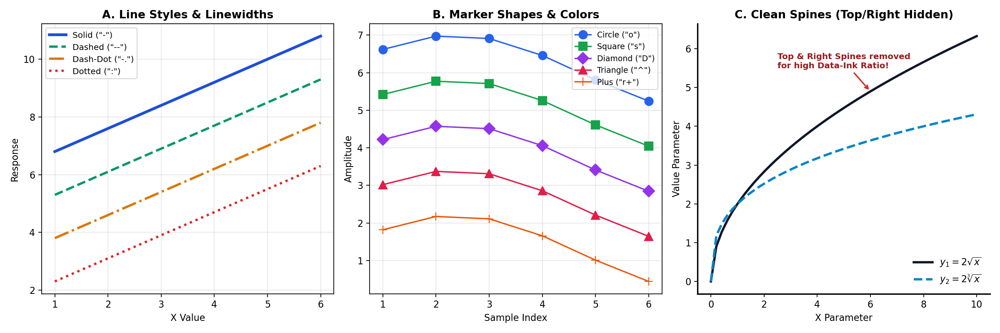

# Dep 01 - පාඩම 02: ප්‍රස්තාර අලංකරණය සහ හැඩගැන්වීම — Colors, Markers, LineStyles, Legends, rcParams & Spines

**අදාළ ප්‍රධාන පාඩම් (Related Core Lessons):**
- [⬅️ Back to Lesson 5.1: Purpose of Data Visualization & Tufte Principles](../../Module_05_Data_Visualization_Principles_and_Techniques/Lesson_5.1_Purpose_of_Data_Visualization_and_Tufte_Principles.md)
- [⬅️ Back to Lesson 5.2: Choosing the Right Visualization — Distributions & Relationships](../../Module_05_Data_Visualization_Principles_and_Techniques/Lesson_5.2_Choosing_Right_Visualization_Distributions_and_Relationships.md)
- [⬅️ Back to Lesson 5.5: Graph Selection Criteria & Human Visual Perception](../../Module_05_Data_Visualization_Principles_and_Techniques/Lesson_5.5_Graph_Selection_Criteria_and_Human_Visual_Perception.md)

---

## 1. හැඳින්වීම: Default ප්‍රස්තාරයකින් ඔබ්බට යාම

ඔබ `plt.plot(x, y)` ලෙස පමණක් ලියූ විට Matplotlib විසින් සාමාන්‍ය නිල් පැහැති සිහින් රේඛාවක් අඳියි. නමුත්:
- එකම ප්‍රස්තාරයේ වක්‍ර 3ක් තිබේ නම් ඒවා එකිනෙකින් වෙන් කර හඳුනා ගන්නේ කෙසේද?
- කළු-සුදු මුද්‍රිත පත්‍රිකාවක (Black & White Print - Slide 25) වර්ණ නොමැතිව දත්ත කාණ්ඩ වෙන් කර පෙන්වන්නේ කෙසේද?
- Edward Tufte ගේ නීතිවලට අනුව **Chart-Junk** ඉවත් කර, සම්පූර්ණ ලේබල් සහිත පැහැදිලි ප්‍රස්තාරයක් සාදා ගන්නේ කෙසේද?

මෙම පාඩමෙන් අපි `Visualize.ipynb` (Cells 7–12, 18–20) හි ඇති සියලුම හැඩගැන්වීම් සහ තවත් උසස් Matplotlib ක්‍රමවේද මුල සිට සරලව ඉගෙන ගනිමු.



---

## 2. වර්ණ, රේඛා විලාස සහ ලක්ෂ්‍ය හැඩතල (Colors, LineStyles & Markers)

### A. කෙටි Format Strings (`'r+'`, `'bo--'`) භාවිතය (`Visualize.ipynb` Cell 9):
`plt.plot(x, y, fmt)` හි තුන්වන පරාමිතිය ලෙස `[color][marker][linestyle]` යන අනුපිළිවෙලින් කෙටි අක්ෂර සංයෝජනයක් ලබා දිය හැක:
- `'r+'` $\rightarrow$ රතු පැහැති (`r`), `+` ලකුණු පමණයි (රේඛාවක් නැත - Cell 9).
- `'go--'` $\rightarrow$ කොළ පැහැති (`g`), රවුම් ලක්ෂ්‍ය (`o`), කඩ-ඉරි රේඛාව (`--`).
- `'ks:'` $\rightarrow$ කළු පැහැති (`k`), සමචතුරස්‍ර ලක්ෂ්‍ය (`s`), තිත් රේඛාව (`:`).

### B. Keyword Arguments මඟින් පැහැදිලිව ලබා දීම (`Visualize.ipynb` Cells 8, 10, 12):
වෘත්තීය කේතවලදී කියවීමේ පහසුව සඳහා Keyword Arguments භාවිතා කිරීම වඩාත් නිර්දේශ කෙරේ:

```python
import matplotlib.pyplot as plt

xVal = [1, 2, 3, 4, 5]
yVal = [1, 4, 6, 4, 9]

# Cell 8: රේඛාවේ ගණකම වැඩි කිරීම
plt.plot(xVal, yVal, linewidth=5)

# Cell 10: වර්ණය, රවුම් Marker එක සහ එහි විශාලත්වය (markersize=12)
plt.plot(xVal, yVal, color='indigo', marker='o', markersize=12)

# Cell 12: Diamond හැඩැති Marker ('D') සමඟ Title සහ Axis Labels යෙදීම
plt.plot(xVal, yVal, color='#2563eb', linestyle='-.', linewidth=2.5,
         marker='D', markersize=10, markerfacecolor='gold', markeredgecolor='black')
plt.title('Sample Title Here', fontsize=18)
plt.xlabel('Label of X-axis', fontsize=14)
plt.ylabel('Label of Y-axis', fontsize=14)
plt.show()
```

### ප්‍රධාන Markers සහ LineStyles යොමු වගුව:

| Marker කේතය | හැඩය (Shape) | LineStyle කේතය | රේඛා විලාසය (Style) |
| :---: | :--- | :---: | :--- |
| `'o'` | Circle (රවුම) | `'-'` | Solid Line (තනි රේඛාව) |
| `'s'` | Square (සමචතුරස්‍රය) | `'--'` | Dashed Line (කඩ-ඉරි රේඛාව) |
| `'D'` | Diamond (දියමන්ති හැඩය) | `'-.'` | Dash-Dot Line (ඉරි-තිත් රේඛාව) |
| `'^'` / `'v'` | Triangle Up / Down (ත්‍රිකෝණය) | `':'` | Dotted Line (තිත් රේඛාව) |
| `'+'` / `'x'` | Plus / Cross (ධන / කතිර ලකුණ) | `'None'` හෝ `''` | රේඛාවක් නැත (Markers පමණයි) |

---

## 3. එකම ප්‍රස්තාරයේ වක්‍ර කිහිපයක් සහ Legends යෙදීම (`Visualize.ipynb` Cell 20)

ඔබ එකම `Axes` එකක් මත `plot()` විධානය කිහිප වරක් ක්‍රියාත්මක කළ විට, Matplotlib විසින් එම වක්‍ර සියල්ල එකම ප්‍රස්තාරය මත විවිධ වර්ණවලින් අඳියි. එක් එක් වක්‍රය කුමක්දැයි පාඨකයාට හඳුනා ගැනීමට:
1. සෑම `plot()` විධානයක් තුළම **`label='...'`** පරාමිතිය ලබා දෙන්න.
2. අවසානයේ අනිවාර්යයෙන්ම **`plt.legend()`** (හෝ `ax.legend()`) කැඳවන්න!

```python
import numpy as np
import matplotlib.pyplot as plt

# Visualize.ipynb Cell 20: වර්ගමූලය සහ ඝනමූලය සංසන්දනය
x1 = np.arange(1, 100.5, 0.5)
y1 = 2.0 * np.sqrt(x1)          # Square Root
y2 = 2.0 * x1**(1.0 / 3.0)      # Cubic Root

fig, ax = plt.subplots(figsize=(8, 4.5))
ax.plot(x1, y1, label='y1: $2\sqrt{x}$', linewidth=2.5, color='#1d4ed8')
ax.plot(x1, y2, label='y2: $2\sqrt[3]{x}$', linewidth=2.5, linestyle='--', color='#dc2626')

# Legend එකේ ස්ථානය (loc='upper left', 'lower right', 'best') සහ රාමුව පාලනය කිරීම
ax.legend(loc='upper left', fontsize=12, frameon=True)

ax.set_title('SQRT vs Cubic Root', fontsize=18)
ax.set_xlabel('X Parameter', fontsize=13)
ax.set_ylabel('Value Parameter', fontsize=13)
plt.tight_layout()
plt.show()
```

---

## 4. `plt.rcParams.update()` මඟින් Global Settings වෙනස් කිරීම (`Visualize.ipynb` Cell 18)

ඔබ පර්යේෂණ වාර්තාවකට ප්‍රස්තාර 10ක් අඳින විට, සෑම ප්‍රස්තාරයකම `fontsize=20` ලෙස නැවත නැවත ලිවීම වෙනුවට Matplotlib හි **Runtime Configuration Parameters (`plt.rcParams`)** dictionary එක යාවත්කාලීන කිරීමෙන් සියලුම ප්‍රස්තාරවල අකුරු ප්‍රමාණයන් සහ රේඛා ගණකම එකවර සැකසිය හැක:

```python
import matplotlib.pyplot as plt

# ගෝලීය වශයෙන් (Globally) අක්ෂ ලේබල් සහ මාතෘකා ප්‍රමාණයන් වෙනස් කිරීම (Cell 18)
parameters = {
    'axes.labelsize': 16,
    'axes.titlesize': 20,
    'xtick.labelsize': 12,
    'ytick.labelsize': 12,
    'lines.linewidth': 2.0
}
plt.rcParams.update(parameters)

# (අවශ්‍ය නම් පෙර තිබූ Default තත්ත්වයට පත් කිරීමට: plt.rcdefaults() භාවිතා කරන්න)
```

---

## 5. Spines, Ticks සහ Tufte ගේ Data-Ink Ratio වැඩි දියුණු කිරීම

Edward Tufte පෙන්වා දුන් පරිදි ප්‍රස්තාරයක ඉහළ (`top`) සහ දකුණු (`right`) කොටු මායිම් ඉරි (**Spines**) කිසිදු දත්තයක් නිරූපණය නොකරයි. Object-Oriented API හි `ax.spines` මඟින් ඒවා ඉවත් කර පිරිසිදු විද්‍යාත්මක පෙනුමක් ලබා ගත හැක:

```python
fig, ax = plt.subplots(figsize=(7, 4))
ax.plot([0, 1, 2, 3], [10, 25, 18, 35], marker='o', color='teal')

# 1. ඉහළ සහ දකුණු Spines සැඟවීම (Despining)
ax.spines['top'].set_visible(False)
ax.spines['right'].set_visible(False)

# 2. X-අක්ෂයේ Ticks සඳහා අභිරුචි නම් (Custom Tick Labels) ලබා දීම
ax.set_xticks([0, 1, 2, 3])
ax.set_xticklabels(['Q1 (Jan-Mar)', 'Q2 (Apr-Jun)', 'Q3 (Jul-Sep)', 'Q4 (Oct-Dec)'], rotation=15)

ax.set_title('Quarterly Revenue Growth (Clean Spines)')
ax.set_ylabel('Revenue ($ Millions)')
plt.tight_layout()
plt.show()
```

---

## 🛠️ 6. Practical Task / Hands-On Exercise (ප්‍රායෝගික අභ්‍යාසය)

### Scenario / Goal:
IEEE පර්යේෂණ පත්‍රිකාවක් කළු-සුදු (Black & White Print) ලෙස මුද්‍රණය කිරීමට නියමිතය. එහි වීඩියෝ Encoders තුනක (`H.264`, `H.265/HEVC`, `AV1`) Bitrate අගයන් (`[500, 1000, 2000, 4000, 6000]` kbps) සමඟ ලැබෙන **PSNR (dB)** අගයන් එකම ප්‍රස්තාරයක ඇඳිය යුතුය. කළු-සුදු මුද්‍රණයේදී පැහැදිලිව වෙන්කර හඳුනා ගත හැකි ලෙස විවිධ **LineStyles**, **Markers**, සහ **Grayscale Shades** යොදා ප්‍රස්තාරය නිර්මාණය කරන්න.

### Step-by-Step Tasks:
1. පහත දී ඇති `bitrates` සහ Encoders 3 හි PSNR දත්ත භාවිතා කරන්න.
2. `fig, ax = plt.subplots(figsize=(8, 5))` සාදා, Encoders තුන සඳහා වෙනස් `linestyle` (`'-'`, `'--'`, `'-.'`) සහ වෙනස් `marker` (`'o'`, `'s'`, `'^'`) යොදා අඳින්න.
3. ඉහළ සහ දකුණු `spines` ඉවත් කරන්න (`set_visible(False)`).
4. Title, X/Y Labels (ඒකක සමඟ), Grid සහ Legend එකතු කරන්න.

### Starter Code:
```python
import matplotlib.pyplot as plt

bitrates = [500, 1000, 2000, 4000, 6000]
psnr_h264 = [31.2, 34.5, 37.8, 40.1, 41.5]
psnr_hevc = [33.0, 36.4, 39.5, 41.8, 43.1]
psnr_av1  = [34.1, 37.6, 40.7, 42.9, 44.2]

# TODO: Create B&W publication-ready plot with distinct markers, linestyles, and despined axes
```

### Expected Output / Reference Solution:
```python
import matplotlib.pyplot as plt

bitrates = [500, 1000, 2000, 4000, 6000]
psnr_h264 = [31.2, 34.5, 37.8, 40.1, 41.5]
psnr_hevc = [33.0, 36.4, 39.5, 41.8, 43.1]
psnr_av1  = [34.1, 37.6, 40.7, 42.9, 44.2]

fig, ax = plt.subplots(figsize=(8, 5))

# කළු-සුදු මුද්‍රණයකදී පවා පැහැදිලිව පෙනෙන ලෙස LineStyle + Marker + Grayscale සංයෝජනය කිරීම
ax.plot(bitrates, psnr_av1,  color='black',   linestyle='-',  marker='^', markersize=8, lw=2.2, label='AV1 Encoder')
ax.plot(bitrates, psnr_hevc, color='dimgray', linestyle='--', marker='s', markersize=7, lw=2.0, label='H.265 / HEVC')
ax.plot(bitrates, psnr_h264, color='gray',    linestyle='-.', marker='o', markersize=7, lw=2.0, label='H.264 / AVC')

# Tufte මූලධර්මය අනුව අනවශ්‍ය Spines ඉවත් කිරීම
ax.spines['top'].set_visible(False)
ax.spines['right'].set_visible(False)

ax.set_title('Rate-Distortion Performance Comparison (B&W Print Ready)', fontsize=14, fontweight='bold')
ax.set_xlabel('Encoding Bitrate (kbps)', fontsize=12)
ax.set_ylabel('Peak Signal-to-Noise Ratio — PSNR (dB)', fontsize=12)
ax.grid(True, linestyle=':', alpha=0.5, color='black')
ax.legend(frameon=True, edgecolor='black', fontsize=11)

plt.tight_layout()
plt.show()
```

---

**🔗 Next Dependency Lesson:** [03_Subplots_GridSpec_Annotations_and_Saving_Publication_Figures.md](03_Subplots_GridSpec_Annotations_and_Saving_Publication_Figures.md)
