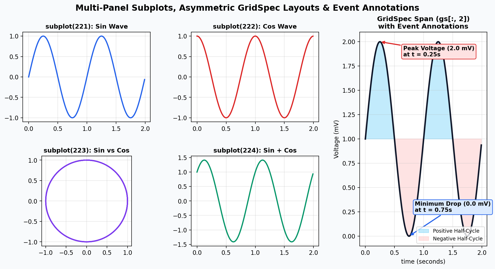

# Dep 01 - පාඩම 03: බහු-පැනල ප්‍රස්තාර, Annotations සහ රූප සුරැකීම — Subplots, GridSpec, Annotations & Saving Figures

**අදාළ ප්‍රධාන පාඩම් (Related Core Lessons):**
- [⬅️ Back to Lesson 5.1: Purpose of Data Visualization & Tufte Principles](../../Module_05_Data_Visualization_Principles_and_Techniques/Lesson_5.1_Purpose_of_Data_Visualization_and_Tufte_Principles.md)
- [⬅️ Back to Lesson 5.2: Choosing the Right Visualization — Distributions & Relationships](../../Module_05_Data_Visualization_Principles_and_Techniques/Lesson_5.2_Choosing_Right_Visualization_Distributions_and_Relationships.md)
- [⬅️ Back to Lesson 5.4: Visualizing the Impossible — High-Dimensional & Multivariate Data](../../Module_05_Data_Visualization_Principles_and_Techniques/Lesson_5.4_Visualizing_the_Impossible_High_Dimensional_and_Multivariate.md)

---

## 1. හැඳින්වීම: ඇයි අපට Multi-Panel Subplots අවශ්‍ය වන්නේ?

දේශන සටහන්වල (Slide 22: *Reducing the Dimension*) අපි ඉගෙන ගත් පරිදි, විචල්‍යයන් රාශියක් එකම ප්‍රස්තාරයක පටලවා අඳිනවාට වඩා, එකම `Figure` එකක් තුළ කුඩා ප්‍රස්තාර කිහිපයක් (**Small Multiples / Subplots**) පෙළගැස්වීමෙන් දත්ත අතර සම්බන්ධතා ඉතා පහසුවෙන් සංසන්දනය කළ හැක.

මෙම පාඩමෙන් අපි:
1. `plt.subplot(221)` සහ `fig, axes = plt.subplots(2, 2)` භාවිතය (`Visualize.ipynb` Cells 16–17)
2. අසමමිතික (Asymmetric) Dashboard පිරිසැලසුම් සඳහා **`GridSpec`** භාවිතය
3. ප්‍රස්තාරයේ වැදගත් සිදුවීම් පෙන්වීමට **`plt.annotate()` / `ax.annotate()`** භාවිතය (`Visualize.ipynb` Cell 22 & Slide 9)
4. උසස් තත්ත්වයේ ප්‍රස්තාර ගොනු ලෙස Save කිරීම (`plt.savefig()` - `Visualize.ipynb` Cells 12, 32)
යන කරුණු ගැඹුරින් ඉගෙන ගනිමු.



---

## 2. Subplots නිර්මාණය කරන ක්‍රම 3

### A. ක්‍රමය 1: `plt.subplot(nrows, ncols, index)` (`Visualize.ipynb` Cell 17)
MATLAB ශෛලියට අනුව ඉලක්කම් 3ක කේතයක් (උදා: `221` $\rightarrow$ පේළි 2යි, තීරු 2යි, 1 වන ප්‍රස්තාරය) ලබා දී වරකට එක් කොටුවක් සක්‍රීය කර ගනී:

```python
import numpy as np
import matplotlib.pyplot as plt

t = np.arange(0.0, 2, 0.01)
s1 = np.sin(2 * np.pi * t)
s2 = np.cos(2 * np.pi * t)

plt.figure(1, figsize=(9, 6))

plt.subplot(221)           # පේළි 2, තීරු 2 Grid එකේ 1 වන කොටුව (Top-Left)
plt.plot(t, s1)
plt.title('Sin Function')

plt.subplot(222)           # 2 වන කොටුව (Top-Right)
plt.plot(t, s2)
plt.title('Cos Function')

plt.subplot(223)           # 3 වන කොටුව (Bottom-Left)
plt.plot(s1, s2)
plt.title('Sin vs Cos')

plt.subplot(224)           # 4 වන කොටුව (Bottom-Right)
plt.plot(t, s1 + s2)
plt.title('Sin + Cos Function')

# ඉතා වැදගත්: ප්‍රස්තාරවල මාතෘකා සහ ඉලක්කම් එක මත එක වැටීම (Overlapping) වැළැක්වීමට!
plt.tight_layout()
plt.show()
```

### B. ක්‍රමය 2: `fig, ax = plt.subplots(nrows, ncols)` (`Visualize.ipynb` Cells 16, 27)
Object-Oriented ක්‍රමයට `plt.subplots(2, 2)` කැඳවූ විට, `ax` යනු `2x2` NumPy Array එකකි! එවිට `ax[0, 0]`, `ax[0, 1]`, `ax[1, 0]`, `ax[1, 1]` ලෙස Indexing මඟින් ඕනෑම කොටුවකට කෙලින්ම විධාන ලබා දිය හැක.
- **`sharex=True, sharey=True`:** සියලුම Subplots එකම පරිමාණයකින් (Common Scale - Tufte Principle!) සංසන්දනය කිරීමට `plt.subplots(2, 2, sharex=True, sharey=True)` භාවිතා කළ හැක.

```python
fig, ax = plt.subplots(nrows=1, ncols=2, figsize=(9, 4), sharey=True)

ax[0].plot(t, s1, color='blue')
ax[0].set_title('Sine Wave')

ax[1].plot(t, s2, color='red')
ax[1].set_title('Cosine Wave')

fig.tight_layout()
plt.show()
```

### C. ක්‍රමය 3: `matplotlib.gridspec.GridSpec` (විවිධ ප්‍රමාණයේ ප්‍රස්තාර එක් කිරීමට)
සමහර අවස්ථාවලදී අපට වම් පැත්තේ කුඩා ප්‍රස්තාර 4ක් සහ දකුණු පැත්තේ පේළි දෙකම ආවරණය කරන විශාල ප්‍රස්තාරයක් (`gs[:, 2]`) ඇඳීමට අවශ්‍ය වේ (ඉහත රූපසටහනේ දකුණු පැනලය බලන්න). ඒ සඳහා `GridSpec` භාවිතා කරයි:

```python
import matplotlib.pyplot as plt
import matplotlib.gridspec as gridspec

fig = plt.figure(figsize=(10, 5))
gs = gridspec.GridSpec(2, 2, width_ratios=[1, 1.5])

ax_top_left = fig.add_subplot(gs[0, 0])      # 0 පේළිය, 0 තීරුව
ax_bot_left = fig.add_subplot(gs[1, 0])      # 1 පේළිය, 0 තීරුව
ax_full_right = fig.add_subplot(gs[:, 1])    # පේළි දෙකම (:) ආවරණය කරන 1 තීරුව!
```

---

## 3. වැදගත් සිදුවීම් ලකුණු කිරීම: `annotate()` සහ `text()` (Slide 9 & `Visualize.ipynb` Cell 22)

Tufte ගේ 4 වන නීතිය වන්නේ **"Clear, detailed and thorough labeling (including important events)"** යන්නයි. ප්‍රස්තාරයක යම් උපරිම ලක්ෂ්‍යයක් (Peak), අසාමාන්‍ය අගයක් (Outlier) හෝ බුබුලක අගයක් පෙන්වීමට `annotate()` භාවිතා කරයි:

### A. සෑම ලක්ෂ්‍යයක් මතම අගය ලිවීම (`Visualize.ipynb` Cell 22):
```python
for i, txt in enumerate(np.round(area)):
    plt.annotate(txt, (x3[i], y3[i]))
```

### B. ඊතලයක් (Arrow) සහිතව විශේෂ සිදුවීමක් පෙන්වීම:
`ax.annotate()` හි වැදගත් පරාමිතීන් 3ක් ඇත:
1. `text`: පෙන්විය යුතු වාක්‍යය.
2. `xy=(x_point, y_point)`: ඊතලයේ තුඩ යොමු විය යුතු සැබෑ දත්ත ලක්ෂ්‍යය.
3. `xytext=(x_text, y_text)`: අකුරු පෙළ (Text Box) පිහිටිය යුතු ස්ථානය.

```python
ax.annotate('Peak Voltage (2.0 mV)',
            xy=(0.25, 2.0),             # ඊතලය යොමු වන ලක්ෂ්‍යය
            xytext=(0.7, 1.8),          # Text එක තබන ස්ථානය
            arrowprops=dict(arrowstyle='->', color='red', lw=1.8))
```

---

## 4. ප්‍රස්තාර උසස් තත්ත්වයෙන් Save කිරීම (`savefig` - Cells 12, 32)

ප්‍රස්තාරයක් Word වාර්තාවකට, LaTeX පත්‍රිකාවකට හෝ වෙබ් අඩවියකට ඇතුළත් කිරීමට `plt.savefig()` හෝ `fig.savefig()` භාවිතා කරයි:

```python
# Visualize.ipynb Cell 12 & 32:
fig.savefig('population_high_res.png',
            dpi=300,                # Dots Per Inch (මුද්‍රණය සඳහා 160 - 300 අතර අගයක් යොදන්න)
            bbox_inches='tight',    # වටේ ඇති අනවශ්‍ය හිස් ඉඩ (Whitespace) කපා හරියි
            facecolor='white')
```

> [!WARNING]
> **Golden Rule of `plt.savefig()` vs `plt.show()`:**
> ඔබ `plt.savefig()` භාවිතා කරන විට එය සැමවිටම **`plt.show()` ට පෙර** ලිවිය යුතුය! මන්ද `plt.show()` ක්‍රියාත්මක වූ පසු Matplotlib විසින් වත්මන් කැන්වසය හිස් කරන බැවින්, ඊට පසුව `plt.savefig()` ලිව්වොත් හිස් සුදු පින්තූරයක් (Blank Image) Save විය හැක. (නැතහොත් Object-Oriented `fig.savefig()` භාවිතා කරන්න).

---

## 🛠️ 5. Practical Task / Hands-On Exercise (ප්‍රායෝගික අභ්‍යාසය)

### Scenario / Goal:
ජාල ඉංජිනේරුවෙකු ලෙස ඔබ Gaming Server එකක පැය 24ක් තුළ **Server Latency (ms)** සහ **Packet Loss (%)** නිරීක්ෂණය කරයි. පැය 14.0 දී (2:00 PM) සිදුවූ DDoS ප්‍රහාරයක් නිසා Latency අගය $185\text{ ms}$ දක්වා ක්ෂණිකව ඉහළ ගොස් ඇත. ඉහළින් සහ පහළින් පිහිටි Subplots දෙකක් (`nrows=2, ncols=1, sharex=True`) ඇඳ, එම Spike එක ඊතලයකින් Annotate කර `'server_incident.png'` ලෙස Save කරන්න.

### Step-by-Step Tasks:
1. `fig, (ax1, ax2) = plt.subplots(2, 1, figsize=(8, 6), sharex=True)` සාදන්න.
2. `ax1` මත `hours` සහ `latency` ඇඳ, පැය 14 දී ඇති $(14, 185)$ ලක්ෂ්‍යයට `ax1.annotate("DDoS Attack Spike (185 ms)", ...)` මඟින් ඊතලයක් යොදන්න.
3. `ax2` මත `hours` සහ `packet_loss` තීරු ප්‍රස්තාරයක් (`ax2.bar()`) ලෙස අඳින්න.
4. `plt.tight_layout()` යොදා `fig.savefig('server_incident.png', dpi=160)` මඟින් Save කරන්න.

### Starter Code:
```python
import numpy as np
import matplotlib.pyplot as plt

hours = np.arange(0, 24)
latency = np.array([22, 20, 19, 18, 21, 25, 30, 35, 42, 45, 48, 50,
                    52, 55, 185, 95, 60, 52, 48, 44, 38, 32, 28, 24])
packet_loss = np.array([0.1, 0.0, 0.0, 0.0, 0.1, 0.2, 0.3, 0.4, 0.5, 0.6, 0.5, 0.7,
                        0.8, 1.1, 8.5, 3.2, 1.0, 0.6, 0.5, 0.4, 0.3, 0.2, 0.1, 0.1])

# TODO: Create 2x1 subplots, plot latency & packet_loss, annotate spike at hour 14, and save figure
```

### Expected Output / Reference Solution:
```python
import numpy as np
import matplotlib.pyplot as plt

hours = np.arange(0, 24)
latency = np.array([22, 20, 19, 18, 21, 25, 30, 35, 42, 45, 48, 50,
                    52, 55, 185, 95, 60, 52, 48, 44, 38, 32, 28, 24])
packet_loss = np.array([0.1, 0.0, 0.0, 0.0, 0.1, 0.2, 0.3, 0.4, 0.5, 0.6, 0.5, 0.7,
                        0.8, 1.1, 8.5, 3.2, 1.0, 0.6, 0.5, 0.4, 0.3, 0.2, 0.1, 0.1])

# 1. X-අක්ෂය පොදුවේ බෙදා ගන්නා (sharex=True) Subplots 2ක් සෑදීම
fig, (ax1, ax2) = plt.subplots(nrows=2, ncols=1, figsize=(8, 6), sharex=True)

# 2. ඉහළ ප්‍රස්තාරය: Server Latency + Event Annotation
ax1.plot(hours, latency, color='#2563eb', marker='o', lw=2)
ax1.set_title('24-Hour Gaming Server Telemetry & Incident Report', fontsize=13, fontweight='bold')
ax1.set_ylabel('Latency (ms)', fontsize=11)
ax1.grid(True, linestyle=':', alpha=0.6)

ax1.annotate('DDoS Attack Spike (185 ms)\nat 14:00 hrs',
             xy=(14, 185), xytext=(16.5, 150),
             arrowprops=dict(arrowstyle='->', color='#dc2626', lw=2),
             fontsize=10, fontweight='bold', color='#991b1b')

# 3. පහළ ප්‍රස්තාරය: Packet Loss (%)
ax2.bar(hours, packet_loss, color='#ef4444', alpha=0.8, width=0.6)
ax2.set_xlabel('Hour of Day (00:00 - 23:00)', fontsize=11)
ax2.set_ylabel('Packet Loss (%)', fontsize=11)
ax2.grid(True, linestyle=':', alpha=0.6)

plt.tight_layout()
fig.savefig('server_incident.png', dpi=160, bbox_inches='tight')
plt.show()
```

---

**🔗 Next Dependency Lesson:** [04_Statistical_Charts_in_Matplotlib_Histograms_Boxplots_ErrorBars_Heatmaps.md](04_Statistical_Charts_in_Matplotlib_Histograms_Boxplots_ErrorBars_Heatmaps.md)
