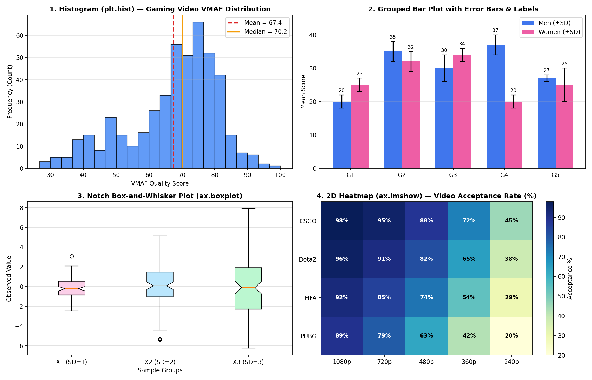

# Dep 01 - පාඩම 04: සංඛ්‍යානමය ප්‍රස්තාර Matplotlib මඟින් නිර්මාණය කිරීම — Histograms, Boxplots, Error Bars, Stackplots & Heatmaps

**අදාළ ප්‍රධාන පාඩම් (Related Core Lessons):**
- [⬅️ Back to Lesson 5.2: Choosing the Right Visualization — Distributions & Relationships](../../Module_05_Data_Visualization_Principles_and_Techniques/Lesson_5.2_Choosing_Right_Visualization_Distributions_and_Relationships.md)
- [⬅️ Back to Lesson 5.3: Visualizing Composition, Spread & Comparisons](../../Module_05_Data_Visualization_Principles_and_Techniques/Lesson_5.3_Visualizing_Composition_Spread_and_Comparisons.md)
- [⬅️ Back to Lesson 5.4: Visualizing the Impossible — High-Dimensional & Multivariate Data](../../Module_05_Data_Visualization_Principles_and_Techniques/Lesson_5.4_Visualizing_the_Impossible_High_Dimensional_and_Multivariate.md)

---

## 1. හැඳින්වීම

සරල රේඛා ප්‍රස්තාරවලට (`ax.plot`) අමතරව Data Science සහ Exploratory Data Analysis (EDA) වලදී අපට **Probability Distribution (සම්භාවිතා ව්‍යාප්තිය)**, **Interquartile Range - IQR (අන්තර්-චතුර්ථක පරාසය)**, **Confidence Interval (විශ්වාසනීය ප්‍රාන්තරය)** සහ **Multivariate Matrices (බහු-විචල්‍ය න්‍යාස)** දෘශ්‍යකරණය කිරීමට සිදුවේ.

මෙම පාඩමෙන් අපි `Visualize.ipynb` (Cells 22–32) සහ `Intro-to-Visualization.pdf` (Slides 11–26) හි ඇති සියලුම සංඛ්‍යානමය ප්‍රස්තාර Matplotlib මඟින් නිර්මාණය කරන ආකාරය සම්පූර්ණයෙන්ම ඉගෙන ගනිමු.



---

## 2. Histograms (`ax.hist`) — 1D දත්තවල ව්‍යාප්තිය

1D සන්තතික දත්ත කට්ටලයක් (Continuous Data) පන්ති ප්‍රාන්තර (**Bins**) කිහිපයකට බෙදා එක් එක් පරාසය තුළ දත්ත කොපමණ වැටී ඇත්ද (Frequency) යන්න පෙන්වීමට `ax.hist()` භාවිතා කරයි:

```python
import numpy as np
import matplotlib.pyplot as plt

np.random.seed(42)
vmaf_data = np.random.normal(loc=75, scale=10, size=500)

fig, ax = plt.subplots(figsize=(7, 4))

# bins=20 මඟින් පරාසය සමාන කොටස් 20කට බෙදයි; edgecolor='black' මඟින් තීරු වෙන් කර පෙන්වයි
counts, bin_edges, patches = ax.hist(vmaf_data, bins=20, color='#3b82f6', edgecolor='black', alpha=0.8)

# Mean (මධ්‍යන්‍යය) සිරස් රේඛාවක් ලෙස ලකුණු කිරීම
ax.axvline(np.mean(vmaf_data), color='red', linestyle='--', linewidth=2, label='Mean VMAF')

ax.set_title('Distribution of VMAF Video Quality Scores')
ax.set_xlabel('VMAF Score')
ax.set_ylabel('Frequency')
ax.legend()
plt.show()
```
- **Overlapping Histograms (Slide 20):** විචල්‍යයන් දෙකක ව්‍යාප්තිය එකම අක්ෂයක සංසන්දනය කිරීමට `ax.hist(data1, alpha=0.5, label='A')` සහ `ax.hist(data2, alpha=0.5, label='B')` ලෙස විනිවිද පෙනෙන භාවය (`alpha=0.5`) භාවිතා කරයි.

---

## 3. Bar Plots: Simple, Stacked & Grouped Bars with Error Bars (`Visualize.ipynb` Cells 24, 25, 29)

### A. Stacked Bar Plot with Error Bars (`bottom=` සහ `yerr=` - Cell 25):
කාණ්ඩ දෙකක් එකම තීරුවක එකක් මත එකක් ඇඳීමට දෙවන `ax.bar()` විධානයට **`bottom=men_mean`** ලබා දෙයි. එමෙන්ම **Standard Deviation (සම්මත අපගමනය)** හෝ **95% Confidence Interval (විශ්වාසනීය ප්‍රාන්තරය)** පෙන්වීමට **`yerr=`** පරාමිතිය භාවිතා කරයි:

```python
labels = ['G1', 'G2', 'G3', 'G4', 'G5']
men_mean = [20, 35, 30, 37, 27]
women_mean = [25, 32, 34, 20, 25]
men_std = [2, 3, 4, 3, 1]
women_std = [2, 3, 2, 2, 5]

fig, ax = plt.subplots(figsize=(7, 4.5))
ax.bar(labels, men_mean, width=0.5, yerr=men_std, capsize=4, label='Men')
ax.bar(labels, women_mean, width=0.5, yerr=women_std, bottom=men_mean, capsize=4, label='Women')
ax.set_title('Stacked Bar Graph with Error Bars')
ax.set_ylabel('Scores')
ax.legend()
plt.show()
```

### B. Grouped (Side-by-Side) Bars & `ax.bar_label()` (`Visualize.ipynb` Cell 29):
තීරු දෙක දෙපැත්තෙන් තබා ඇඳීමට `x = np.arange(len(labels))` සාදා, පළමු තීරුව `x - width/2` හිද, දෙවන තීරුව `x + width/2` හිද ස්ථානගත කරයි. `ax.bar_label(rect)` මඟින් සෑම තීරුවක් මුදුනේම එහි සංඛ්‍යාත්මක අගය ස්වයංක්‍රීයව මුද්‍රණය කරයි!

---

## 4. Box-and-Whisker Plots (`ax.boxplot` - `Visualize.ipynb` Cell 27)

Box Plot එකක් මඟින් **Median (මධ්‍යස්ථය)**, **Lower & Upper Quartiles ($Q_1, Q_3$ - පහළ සහ ඉහළ චතුර්ථක)**, **Interquartile Range - IQR (අන්තර්-චතුර්ථක පරාසය)**, සහ **Outliers (අසාමාන්‍ය අගයන්)** පෙන්වයි:
- `vert=True`: කොටු සිරස්ව (Vertical) අඳියි (`vert=False` දුන් විට තිරස්ව අඳියි).
- `patch_artist=True`: කොටු ඇතුළත වර්ණ (`set_facecolor`) පිරවීමට ඉඩ ලබා දෙයි.
- `notch=True`: **Median (මධ්‍යස්ථය)** වටා ඇති **Confidence Interval (විශ්වාසනීය ප්‍රාන්තරය)** පෙන්වීමට කොටුව මැදින් හැකිලුණු (Notched) හැඩයක් ලබා දෙයි.

---

## 5. Bubble Charts, Stackplots & 2D Heatmaps

### A. 4D Scatter Bubble Plot (`ax.scatter` - Cell 22):
- `ax.scatter(x, y, s=area, c=colors, alpha=0.5)` මඟින් X, Y, Size (`s`), සහ Color (`c`) යන මානයන් 4 එකවර නිරූපණය කරයි.

### B. Stacked Area Plot (`ax.stackplot` - Cells 31–32):
- කාලයත් සමඟ කාණ්ඩ කිහිපයක සංයුතිය වෙනස් වන ආකාරය `ax.stackplot(year, dict_data.values(), labels=dict_data.keys())` මඟින් අඳියි.

### C. 2D Heatmap (`ax.imshow` + `colorbar` - Slide 24):
Matplotlib හි 2D න්‍යාසයක් (Matrix) Heatmap එකක් ලෙස ඇඳීමට `ax.imshow(matrix, cmap='YlGnBu')` භාවිතා කරන අතර, වර්ණ පරිමාණය පෙන්වීමට `fig.colorbar(im)` එකතු කරයි:

```python
import numpy as np
import matplotlib.pyplot as plt

matrix = np.array([[95, 88, 70],
                   [90, 80, 55],
                   [82, 65, 35]])

fig, ax = plt.subplots(figsize=(6, 4.5))
im = ax.imshow(matrix, cmap='YlGnBu')

ax.set_xticks([0, 1, 2])
ax.set_xticklabels(['1080p', '720p', '480p'])
ax.set_yticks([0, 1, 2])
ax.set_yticklabels(['CSGO', 'Dota2', 'FIFA'])

# කොටු ඇතුළත සංඛ්‍යාත්මක අගයන් ලිවීම
for i in range(3):
    for j in range(3):
        ax.text(j, i, f"{matrix[i, j]}%", ha="center", va="center", color="black", fontweight="bold")

fig.colorbar(im, ax=ax, label='Acceptance Rate (%)')
ax.set_title('Gaming Video Quality Acceptance Heatmap')
plt.tight_layout()
plt.show()
```

---

## 🛠️ 6. Practical Task / Hands-On Exercise (ප්‍රායෝගික අභ්‍යාසය)

### Scenario / Goal:
ඔබ Slide 26 හි දැක්වෙන **CSGO Gaming Video Sequence** පර්යේෂණය ප්‍රතිනිර්මාණය කරයි. විවිධ Bitrates 4කදී (`['500k', '1500k', '3000k', '6000k']`) Resolutions දෙකක් (`720p` සහ `1080p`) සඳහා ලැබුණු **Mean Opinion Score - MOS (මධ්‍යන්‍ය මත ලකුණු)** සහ ඒවායේ **95% Confidence Interval (95% විශ්වාසනීය ප්‍රාන්තරය)** පෙන්වන **Multi-Variate Grouped Bar Plot** එකක් නිර්මාණය කරන්න.

### Step-by-Step Tasks:
1. `x = np.arange(len(bitrates))` සහ `width = 0.35` ලෙස ගන්න.
2. `ax.bar()` මඟින් `720p` (`x - width/2`) සහ `1080p` (`x + width/2`) තීරු ඇඳ, ඒවාට අදාළ `yerr=ci_720p` සහ `yerr=ci_1080p` (`capsize=5` සහිතව) ලබා දෙන්න.
3. `ax.bar_label()` මඟින් තීරු මත MOS අගයන් පෙන්වන්න.
4. Y-අක්ෂයේ සීමාව `(1, 5.3)` ලෙස සකසා, Title, Labels, Grid සහ Legend එකතු කරන්න.

### Starter Code:
```python
import numpy as np
import matplotlib.pyplot as plt

bitrates = ['500 kbps', '1500 kbps', '3000 kbps', '6000 kbps']
mos_720p  = [2.4, 3.3, 3.8, 4.1]
ci_720p   = [0.25, 0.20, 0.18, 0.15]

mos_1080p = [2.1, 3.5, 4.3, 4.7]
ci_1080p  = [0.30, 0.22, 0.16, 0.12]

# TODO: Plot grouped bar chart with 95% CI error bars and bar labels
```

### Expected Output / Reference Solution:
```python
import numpy as np
import matplotlib.pyplot as plt

bitrates = ['500 kbps', '1500 kbps', '3000 kbps', '6000 kbps']
mos_720p  = [2.4, 3.3, 3.8, 4.1]
ci_720p   = [0.25, 0.20, 0.18, 0.15]

mos_1080p = [2.1, 3.5, 4.3, 4.7]
ci_1080p  = [0.30, 0.22, 0.16, 0.12]

x = np.arange(len(bitrates))
width = 0.35

fig, ax = plt.subplots(figsize=(8.5, 5))

r1 = ax.bar(x - width/2, mos_720p,  width, yerr=ci_720p,  capsize=5, label='720p Resolution',  color='#3b82f6', edgecolor='black')
r2 = ax.bar(x + width/2, mos_1080p, width, yerr=ci_1080p, capsize=5, label='1080p Resolution', color='#10b981', edgecolor='black')

ax.set_title('CSGO Video Sequence: MOS with 95% Confidence Interval', fontsize=14, fontweight='bold')
ax.set_xlabel('Bitrate Category', fontsize=12)
ax.set_ylabel('Mean Opinion Score — MOS (1 to 5)', fontsize=12)
ax.set_xticks(x)
ax.set_xticklabels(bitrates)
ax.set_ylim(1.0, 5.3)

ax.bar_label(r1, padding=4, fmt='%.1f')
ax.bar_label(r2, padding=4, fmt='%.1f')

ax.yaxis.grid(True, linestyle='--', alpha=0.5)
ax.legend(loc='upper left', fontsize=11)

plt.tight_layout()
plt.show()
```

---

**🔗 Return to Module 5 Core Lessons:**
- [Lesson 5.1: Purpose of Data Visualization & Tufte Principles](../../Module_05_Data_Visualization_Principles_and_Techniques/Lesson_5.1_Purpose_of_Data_Visualization_and_Tufte_Principles.md)
- [Lesson 5.2: Choosing the Right Visualization — Distributions & Relationships](../../Module_05_Data_Visualization_Principles_and_Techniques/Lesson_5.2_Choosing_Right_Visualization_Distributions_and_Relationships.md)
- [Lesson 5.3: Visualizing Composition, Spread & Comparisons](../../Module_05_Data_Visualization_Principles_and_Techniques/Lesson_5.3_Visualizing_Composition_Spread_and_Comparisons.md)
- [Lesson 5.4: Visualizing the Impossible — High-Dimensional & Multivariate Data](../../Module_05_Data_Visualization_Principles_and_Techniques/Lesson_5.4_Visualizing_the_Impossible_High_Dimensional_and_Multivariate.md)
- [Lesson 5.5: Graph Selection Criteria & Human Visual Perception](../../Module_05_Data_Visualization_Principles_and_Techniques/Lesson_5.5_Graph_Selection_Criteria_and_Human_Visual_Perception.md)
