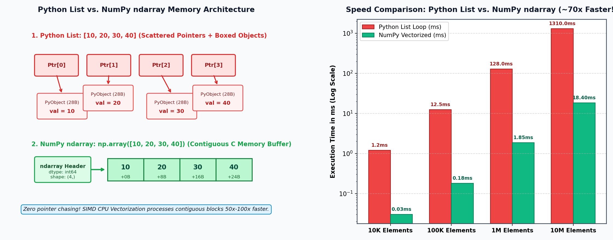
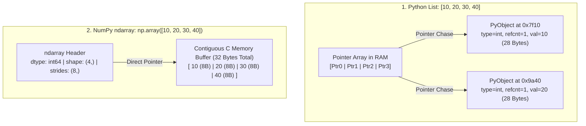

# Dependency Lesson 01.1: NumPy යනු කුමක්ද? `ndarray` සහ Memory Architecture මුල සිට සරලව (What is NumPy & `ndarray` Memory Architecture)

**ආශ්‍රිත ප්‍රධාන පාඩම් (Connected Module 4 Core Lessons):**
- [Lesson 4.1: Linear Algebra Revision — Vectors & Vector Operations](../../Module_04_Mathematics_and_Statistics_for_Data_Science/Lesson_4.1_Linear_Algebra_Vectors_and_Vector_Operations.md)
- [Lesson 4.2: Matrices, Determinants, Transpose & Matrix Terminology](../../Module_04_Mathematics_and_Statistics_for_Data_Science/Lesson_4.2_Matrices_Determinants_Transpose_and_Terminology.md)

---

## 1. හැඳින්වීම: ඇයි අපිට සාමාන්‍ය Python Lists මදි වුණේ? (Why Was NumPy Invented?)

ඔබ Python මුලින්ම ඉගෙන ගන්නා විට සංඛ්‍යා කිහිපයක් එකට ගබඩා කිරීමට භාවිතා කරන්නේ **Python List** එකකි (උදා: `xL = [1, 2, 3, 4]`). සාමාන්‍ය පොඩි වැඩකට Python List එකක් හොඳටම ප්‍රමාණවත්. නමුත් **Data Science**, **Machine Learning**, සහ **Linear Algebra (රේඛීය වීජ ගණිතය)** වලදී අපිට දත්ත ලක්ෂ ගණනක් හෝ මිලියන ගණනක් සමඟ ගණිතමය සුළු කිරීම් කිරීමට සිදුවේ.

එවැනි අවස්ථාවක සාමාන්‍ය Python Lists භාවිතා කිරීමේදී ප්‍රධාන ගැටලු 2ක් මතු වේ:
1. **Python Lists ගණිතමය Vectors ලෙස ක්‍රියා නොකරයි:**
   අපගේ `Maths&stat.ipynb` Notebook එකේ පෙන්වා දී ඇති පරිදි, ඔබ Python Lists දෙකක් `+` ලකුණෙන් එකතු කළහොත් (`[1, 2, 3, 4] + [6, 7, 8, 9]`), එය අනුරූප සංඛ්‍යා එකතු කරන්නේ නැත! ඒ වෙනුවට Lists දෙක එකට අමුණා (`List Concatenation`: `[1, 2, 3, 4, 6, 7, 8, 9]`) ලබා දෙයි.
2. **අධික මන්දගාමී බව (Slow Execution Speed) සහ වැඩි RAM භාවිතය:**
   Python List එකකට ඕනෑම Data Type එකක් (`int`, `float`, `str`) දැමිය හැකි නිසා, Python විසින් සෑම අගයක්ම වෙනම **Boxed Python Object (`PyObject`)** එකක් ලෙස RAM එකේ තැනින් තැන ගබඩා කර, ඒවායේ Memory Addresses (Pointers) පමණක් List එක තුළ තබා ගනී.

මෙම ගැටලු දෙකම විසඳීම සඳහා C භාෂාව පදනම් කරගෙන නිර්මාණය කළ බලවත්ම Numerical Computing Library එක වන්නේ **NumPy (Numerical Python)** ය!



---

## 2. Python List vs. NumPy `ndarray` Memory Architecture

NumPy හි ප්‍රධානතම Data Structure එක හඳුන්වන්නේ **`ndarray` (N-dimensional array)** ලෙසයි. ඉහත රූපසටහනේ දැක්වෙන පරිදි පරිගණකයේ RAM එක තුළ Python List එකක් සහ NumPy `ndarray` එකක් ගබඩා වන ආකාරය සංසන්දනය කර බලමු:



### ඇයි NumPy `ndarray` එක 50x – 100x ගුණයකින් වේගවත් වන්නේ?
1. **Homogeneous Data Type (`dtype`):** NumPy Array එකක ඇති සියලුම අවයව එකම Data Type එකකට (උදා: `int64` හෝ `float64`) අයත් විය යුතුය. එබැවින් සෑම අවයවයක් ගැනම Type Checking කිරීමට අවශ්‍ය නැත.
2. **Contiguous Memory Buffer:** සියලුම සංඛ්‍යා RAM එකේ එක ලඟ පිහිටි තනි අඛණ්ඩ මතක කලාපයක (**Contiguous Memory Block**) ගබඩා වේ.
3. **SIMD Vectorization & CPU Cache Locality:** දත්ත එක ලඟ පිහිටා ඇති නිසා CPU එකට C-level Loops සහ **SIMD (Single Instruction, Multiple Data)** registers හරහා එකවර සංඛ්‍යා රාශියක් ගණනය කළ හැක.

---

## 3. NumPy ස්ථාපනය කිරීම, Import කිරීම සහ මූලික ගුණාංග (`Attributes`)

අපගේ `Maths&stat.ipynb` Notebook එකෙහි ආරම්භයේදීම NumPy import කරන ආකාරය සහ Python List එකක් සමඟ එහි වෙනස පරීක්ෂා කර ඇත:

```python
# NumPy ස්ථාපනය කර නොමැති නම්: !pip install numpy
import numpy as np

# 1. සාමාන්‍ය Python Lists දෙකක්:
xL = [1, 2, 3, 4]
xL3 = [6, 7, 8, 9]

# Python List '+' ක්‍රියා කරන්නේ List Concatenation ලෙසයි:
print("Python List + :", xL + xL3)
# Output: [1, 2, 3, 4, 6, 7, 8, 9]

# 2. NumPy මගින් Vector Addition (අනුරූප අවයව එකතු කිරීම):
xLa = np.add(xL, xL3)
print("NumPy np.add :", xLa)
# Output: array([ 7,  9, 11, 13])

print("Data Structure Type:", type(xLa))
# Output: <class 'numpy.ndarray'>
```

> [!NOTE]
> **Jupyter / IPython `Out[n]` විශේෂාංගය (`Maths&stat.ipynb` Cell 9):**
> Jupyter Notebook එකකදී යම් Cell එකක (උදා: Cell `8` හි) ප්‍රතිදානය (Output) වෙනත් විචල්‍යයකට ලබා ගැනීමට `xL2 = Out[8]` ලෙස භාවිතා කළ හැක. එය IPython kernel එක මගින් පෙර ප්‍රතිදානයන් Dictionary එකක් ලෙස මතක තබා ගන්නා පහසු ක්‍රමයකි.

### `ndarray` එකක ප්‍රධාන Attributes 5:
ඕනෑම NumPy Array එකක් පරීක්ෂා කිරීමට පහත Attributes 5 නිතරම භාවිතා වේ:

```python
arr = np.array([[0, 0, 0], [10, 10, 10], [20, 20, 20], [30, 30, 30]])

print("1. ndim (මාන ගණන / Number of dimensions):", arr.ndim)       # 2 (2D Matrix)
print("2. shape (පේළි සහ තීරු ගණන / Order):", arr.shape)           # (4, 3) -> පේළි 4, තීරු 3
print("3. size (මුළු අවයව ගණන / Total elements):", arr.size)       # 12 (4 * 3)
print("4. dtype (දත්ත වර්ගය / Data type):", arr.dtype)             # int64
print("5. itemsize (එක් අවයවයක Bytes ගණන):", arr.itemsize)         # 8 bytes
```

---

## 4. NumPy Mathematical Constants ($\pi, e$) සහ Trigonometry

NumPy තුළ ගණිතමය නියතයන් (**Mathematical Constants**) සහ ත්‍රිකෝණමිතික ශ්‍රිත (**Trigonometric Functions**) සෘජුවම අන්තර්ගත වේ (`Maths&stat.ipynb` Cells 3–7):

* **`np.pi` ($\pi$):** වෘත්තයක පරිධිය එහි විෂ්කම්භයට දක්වන අනුපාතය ($\approx 3.141592653589793$).
* **`np.e` ($e$):** Euler ගේ නියතය හෙවත් **Natural Logarithm (ස්වභාවික ලඝුගණක)** පාදය ($\approx 2.718281828459045$).

> [!WARNING]
> **Radians vs. Degrees උගුල (`Maths&stat.ipynb` Cells 5–7):**
> `np.sin()`, `np.cos()`, `np.tan()` වැනි සියලුම NumPy ත්‍රිකෝණමිතික ශ්‍රිතවලට කෝණය ලබා දිය යුත්තේ **Radians (රේඩියන)** වලිනි! ඔබ වැරදීමකින් අංශක 30 (`degree_angle = 30.0`) කෙලින්ම `np.sin(30.0)` ලෙස ලබා දුන්නොත්, එය රේඩියන 30 ලෙස සලකා `-0.98803` වැනි වැරදි පිළිතුරක් ලබා දෙයි!
> * **Radians $\to$ Degrees:** $\text{Degrees} = \frac{\text{Radians}}{\pi} \times 180$ (හෝ `np.degrees(rad)`)
> * **Degrees $\to$ Radians:** $\text{Radians} = \frac{\text{Degrees}}{180} \times \pi$ (හෝ `np.radians(deg)`)

```python
import numpy as np

print("Pi value:", np.pi)   # 3.141592653589793
print("Euler's e:", np.e)   # 2.718281828459045

# රේඩියන pi/6 යනු අංශක 30 කි:
angle = np.pi / 6
degree_angle = (angle / np.pi) * 180
print("Angle in Degrees:", degree_angle)        # 30.0

# වැරදි ක්‍රමය: අංශක අගය කෙලින්ම np.sin() වෙත ලබා දීම:
print("Wrong sin(30 rad):", np.sin(degree_angle)) # -0.9880316240928618

# නිවැරදි ක්‍රමය: රේඩියන අගය (angle = pi/6) ලබා දීම:
print("Correct sin(pi/6):", np.sin(angle))        # 0.49999999999999994 (0.5)
print("Correct cos(pi/6):", np.cos(angle))        # 0.8660254037844387 (sqrt(3)/2)
```

---

## 🛠️ Practical Task / Hands-On Exercise (ප්‍රායෝගික අභ්‍යාසය)

### Scenario / Goal:
ඔබ IoT Sensor පද්ධතියකින් ලැබෙන උෂ්ණත්ව දත්ත සහ කෝණික දත්ත විශ්ලේෂණය කරන Data Engineer කෙනෙකි. Python List එකක් `ndarray` එකක් බවට හරවා එහි Memory ගුණාංග පරීක්ෂා කිරීමටත්, අංශක 60 ($\pi/3$) කෝණයක $\sin$ සහ $\cos$ අගයන් නිවැරදිව ගණනය කිරීමටත් ඔබට පැවරී ඇත.

### Step-by-Step Tasks:
1. `sensor_a = [12, 15, 18, 21, 24]` සහ `sensor_b = [3, 5, 2, 4, 6]` යන Python Lists දෙක සාදා, `np.add()` මගින් ඒවායේ **Vector Addition (දෛශික එකතුව)** `total_sensor` ලෙස ලබා ගන්න.
2. `total_sensor` හි `type`, `shape`, `size`, සහ `dtype` මුද්‍රණය කරන්න.
3. $\text{angle\_rad} = \frac{\pi}{3}$ කෝණය අංශක (Degrees) බවට හරවා, එහි $\sin(\pi/3)$ සහ $\cos(\pi/3)$ අගයන් ගණනය කර $\sin^2\theta + \cos^2\theta = 1.0$ බව Python මගින් තහවුරු කරන්න.

### Starter Code:
```python
import numpy as np

sensor_a = [12, 15, 18, 21, 24]
sensor_b = [3, 5, 2, 4, 6]

# Task 1: Element-wise addition using NumPy
total_sensor = None # ඔබේ කේතය මෙහි ලියන්න

# Task 2: Print type, shape, size, and dtype

# Task 3: Calculate degrees, sin, cos for pi/3 and verify sin^2 + cos^2 == 1
angle_rad = np.pi / 3
```

### Expected Output / Reference Solution:
```python
import numpy as np

sensor_a = [12, 15, 18, 21, 24]
sensor_b = [3, 5, 2, 4, 6]

# Task 1: Element-wise addition using NumPy
total_sensor = np.add(sensor_a, sensor_b)
print("Total Sensor Array:", total_sensor)

# Task 2: Print type, shape, size, and dtype
print("Type:", type(total_sensor))
print("Shape:", total_sensor.shape, "| Size:", total_sensor.size, "| Dtype:", total_sensor.dtype)

# Task 3: Calculate degrees, sin, cos for pi/3 and verify sin^2 + cos^2 == 1
angle_rad = np.pi / 3
angle_deg = (angle_rad / np.pi) * 180
sin_val = np.sin(angle_rad)
cos_val = np.cos(angle_rad)

print(f"Angle: {angle_deg:.1f}° | sin: {sin_val:.4f} | cos: {cos_val:.4f}")
print("Identity sin^2 + cos^2:", np.round(sin_val**2 + cos_val**2, 6))
```
**Expected Output:**
```text
Total Sensor Array: [15 20 20 25 30]
Type: <class 'numpy.ndarray'>
Shape: (5,) | Size: 5 | Dtype: int64
Angle: 60.0° | sin: 0.8660 | cos: 0.5000
Identity sin^2 + cos^2: 1.0
```

---

## 📝 Summary & Exam Revision Cheat Sheet

| විශේෂාංගය (Feature) | Python `list` (`[1, 2, 3]`) | NumPy `ndarray` (`np.array([1, 2, 3])`) |
| :--- | :--- | :--- |
| **Memory Layout** | තැනින් තැන විසිරුණු Boxed Objects + Pointers | එක ලඟ පිහිටි **Contiguous C Memory Buffer** |
| **Data Types** | Heterogeneous (විවිධ Data types මිශ්‍ර කළ හැක) | Homogeneous (එකම `dtype` එකක් පමණි, උදා: `int64`, `float64`) |
| **`a + b` ක්‍රියාකාරීත්වය** | List Concatenation (`[1, 2, 3, 4, 5, 6]`) | **Vector Addition (දෛශික එකතු කිරීම)** (`array([5, 7, 9])`) |
| **Trigonometry (`np.sin`)** | සෘජුවම List මත ක්‍රියා නොකරයි | මුළු Array එකටම එකවර ක්‍රියා කරයි (**Input must be in Radians!**) |

---

**ඊළඟ Dependency පාඩම:** [02_Array_Creation_Indexing_Slicing_and_Reshaping.md](02_Array_Creation_Indexing_Slicing_and_Reshaping.md)  
**ආපසු ප්‍රධාන පාඩමට (Back to Main Lesson):** [Lesson 4.1: Linear Algebra Revision — Vectors & Vector Operations](../../Module_04_Mathematics_and_Statistics_for_Data_Science/Lesson_4.1_Linear_Algebra_Vectors_and_Vector_Operations.md)
