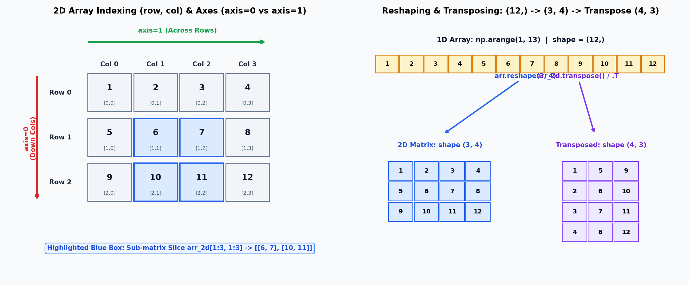
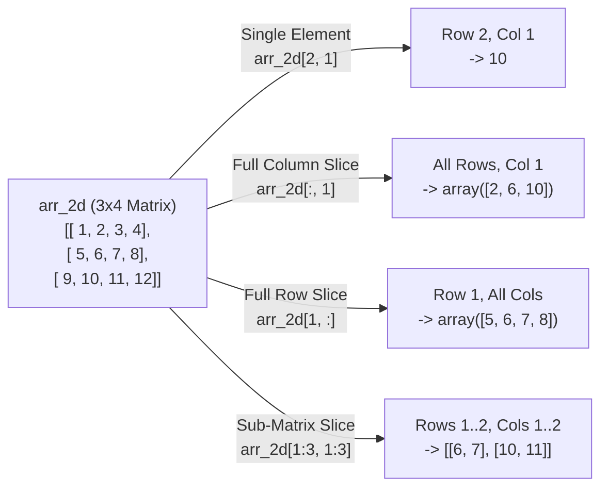

# Dependency Lesson 01.2: NumPy Array නිර්මාණය, Indexing, Slicing, Reshaping සහ ගොනු සුරැකීම (Array Creation, Indexing, Slicing, Reshaping & File I/O)

**ආශ්‍රිත ප්‍රධාන පාඩම් (Connected Module 4 Core Lessons):**
- [Lesson 4.1: Linear Algebra Revision — Vectors & Vector Operations](../../Module_04_Mathematics_and_Statistics_for_Data_Science/Lesson_4.1_Linear_Algebra_Vectors_and_Vector_Operations.md)
- [Lesson 4.2: Matrices, Determinants, Transpose & Matrix Terminology](../../Module_04_Mathematics_and_Statistics_for_Data_Science/Lesson_4.2_Matrices_Determinants_Transpose_and_Terminology.md)

---

## 1. හැඳින්වීම: 1D Vectors සහ 2D Matrices නිර්මාණය කිරීම (Creating Arrays)

Linear Algebra වලදී අපට හමුවන **Vectors (දෛශික)** සහ **Matrices (න්‍යාස)** Python තුළ නිර්මාණය කිරීමට NumPy විසින් ඉතා පහසු Functions කිහිපයක් ලබා දෙයි:

```python
import numpy as np

# 1. 1D Vector එකක් නිර්මාණය කිරීම (1D Array):
vec = np.array([1, 2, 3, 4])                 # shape: (4,)

# 2. 2D Matrix එකක් නිර්මාණය කිරීම (Nested List of Rows):
mat_a = np.array([
    [0,  0,  0],
    [10, 10, 10],
    [20, 20, 20],
    [30, 30, 30]
])                                           # shape: (4, 3) -> පේළි 4, තීරු 3

# 3. විශේෂ Vectors සහ Matrices ස්වයංක්‍රීයව නිර්මාණය කිරීම:
zero_vec = np.zeros(3)                       # Zero Vector (ශූන්‍ය දෛශිකය): [0., 0., 0.]
ones_mat = np.ones((2, 3))                   # Ones Matrix: 2x3 සියලුම අවයව 1 වූ න්‍යාසය
ident_mat = np.eye(3)                        # Identity Matrix (ඒකක න්‍යාසය - 3x3 ප්‍රධාන විකර්ණය 1)
seq_arr = np.arange(0, 12, 1)                # 0 සිට 11 දක්වා සංඛ්‍යා පෙළ: [0, 1, ..., 11]
```



---

## 2. 2D Matrix Indexing සහ Sub-Matrix Slicing (`Maths&stat.ipynb` Cells 25–26, 91–93)

NumPy හි **Indexing** සෑමවිටම ආරම්භ වන්නේ **`0`** සිටයි (`0-based indexing`). 2D Matrix එකක යම් අවයවයක් තෝරා ගැනීමට **`matrix[row_index, col_index]`** ආකෘතිය භාවිතා වේ.



අපගේ `Maths&stat.ipynb` Notebook එකෙහි ඇති උදාහරණ පියවරෙන් පියවර බලමු:

```python
import numpy as np

mat_a = np.array([[0, 0, 0], [10, 10, 10], [20, 20, 20], [30, 30, 30]])

# 1. තනි අවයවයක් තෝරා ගැනීම (Addressing elements):
print(mat_a[0, 0])          # 0  (0 වන පේළියේ 0 වන තීරුව)
print(mat_a[2, 1])          # 20 (2 වන පේළියේ 1 වන තීරුව)

# 2. Slicing: arr_2d[start_row:end_row, start_col:end_col]
# (මතක තබා ගන්න: end_index එක ඇතුළත් නොවේ - Exclusive!)
arr_2d = np.array([
    [1,  2,  3,  4],
    [5,  6,  7,  8],
    [9, 10, 11, 12]
])

# දෙවන තීරුව (Index 1 column) සම්පූර්ණයෙන්ම තෝරා ගැනීම:
print(arr_2d[:, 1])         # array([ 2,  6, 10])

# දෙවන පේළිය (Index 1 row) සම්පූර්ණයෙන්ම තෝරා ගැනීම:
print(arr_2d[1, :])         # array([5, 6, 7, 8])

# උප-න්‍යාසයක් (Sub-matrix) කපා ගැනීම (පේළි 1,2 සහ තීරු 1,2):
print(arr_2d[1:3, 1:3])
# Output:
# array([[ 6,  7],
#        [10, 11]])
```

### කොන්දේසියක් මත Index සෙවීම (`np.where` සහ `np.partition`):
* **`np.where(condition)`:** දී ඇති කොන්දේසිය සත්‍ය වන ස්ථානවල **(Row indices, Column indices)** Tuple එකක් ලෙස ලබා දෙයි (`Maths&stat.ipynb` Cell 91).
* **`np.partition(arr, -k)[-k:]`:** මුළු Array එකම Sort නොකර, විශාලතම අගයන් $k$ ගණන ඉතා වේගයෙන් වෙන් කර ගැනීමට භාවිතා කරයි (`Maths&stat.ipynb` Cell 192).

```python
# arr_2d හි විශාලතම අගය (12) පිහිටි (Row, Col) Index එක සෙවීම:
loc = np.where(arr_2d == arr_2d.max())
print(loc)                  # (array([2]), array([3])) -> Row 2, Column 3!
```

---

## 3. Reshaping සහ Matrix Transpose (`transpose()` / `.T`)

* **`reshape(new_rows, new_cols)`:** මුළු අවයව ගණන (`size`) වෙනස් නොකර Array එකක හැඩය (`shape`) වෙනස් කරයි.
* **`transpose()` හෝ `.T` — Transpose (පෙරළුම):** න්‍යාසයක පේළි (Rows) තීරු (Columns) බවටත්, තීරු පේළි බවටත් හුවමාරු කරයි ($(m \times n) \to (n \times m)$).

```python
mat_b = np.array([[0, 1, 2], [3, 4, 5], [6, 7, 8], [9, 10, 11]]) # Shape: (4, 3)

mat_b_T = mat_b.transpose()
print("Transposed Matrix:\n", mat_b_T)
print("New Shape:", mat_b_T.shape)  # (3, 4)
```

---

## 4. NumPy Arrays ගොනු ලෙස සුරැකීම සහ කියවීම (`.npy` Binary vs `.txt` Text — `Maths&stat.ipynb` Cells 94–117)

ඔබ ගණනය කළ NumPy Array එකක් පසුව භාවිතා කිරීම සඳහා Hard Disk එකේ සුරැකීමට ක්‍රම 2ක් `Maths&stat.ipynb` හි පෙන්වා දී ඇත:

| ක්‍රමය (Method) | Save Function | Load Function | ගොනු දිගුව (Extension) | Data Type (`dtype`) ආරක්ෂා වේද? |
| :--- | :--- | :--- | :--- | :--- |
| **1. Binary Format (නිර්දේශිත)** | `np.save('arr1', arr_2d)` | `np.load('arr1.npy')` | `.npy` | **ඔව්!** මුල් `int64` dtype එක සහ shape එක 100%ක්ම ආරක්ෂා වේ. |
| **2. Plain Text Format** | `np.savetxt('tmp/arr1.txt', arr_2d)` | `np.loadtxt('tmp/arr1.txt')` | `.txt` | **නැත!** නැවත කියවන විට Default ලෙස `float64` බවට පත් වේ! |

```python
import os
import numpy as np

arr_2d = np.array([[1, 2, 3, 4], [5, 6, 7, 8], [9, 10, 11, 12]]) # dtype: int64

# 1. Binary (.npy) ගොනුවක් ලෙස සුරැකීම සහ නැවත කියවීම:
np.save('arr1', arr_2d)                 # ස්වයංක්‍රීයව 'arr1.npy' ලෙස සුරැකේ
np_load = np.load('arr1.npy')
print("Loaded .npy dtype:", np_load.dtype)  # dtype('int64') -> මුල් dtype එකම ලැබේ!

# 2. Text (.txt) ගොනුවක් ලෙස සුරැකීම සහ නැවත කියවීම:
os.makedirs('tmp', exist_ok=True)
np.savetxt('tmp/arr1.txt', arr_2d)
arr_txt = np.loadtxt('tmp/arr1.txt')
print("Loaded .txt dtype:", arr_txt.dtype)  # dtype('float64') -> float64 බවට වෙනස් වී ඇත!
```

---

## 🛠️ Practical Task / Hands-On Exercise (ප්‍රායෝගික අභ්‍යාසය)

### Scenario / Goal:
ඔබට $3 \times 4$ ප්‍රමාණයේ ශිෂ්‍ය ලකුණු න්‍යාසයක් (`scores`) ලබා දී ඇත. එහි උප-න්‍යාස (Sub-matrices) කපා ගැනීම, Transpose කිරීම, ඉහළම ලකුණ තිබෙන `(row, col)` ස්ථානය සෙවීම සහ `.npy` ගොනුවක් ලෙස සුරැකීම ඔබේ කාර්යයයි.

### Step-by-Step Tasks:
1. `scores = np.array([[45, 78, 82, 91], [60, 88, 75, 95], [52, 69, 84, 89]])` නිර්මාණය කරන්න.
2. එහි පළමු පේළි 2 සහ අවසාන තීරු 2 අඩංගු $2 \times 2$ උප-න්‍යාසය (`sub_scores`) Slicing මගින් වෙන් කර ගන්න.
3. `np.where()` භාවිතා කර වැඩිම ලකුණ (`95`) පිහිටි `(row, col)` ස්ථානය සොයන්න.
4. `scores` න්‍යාසය Transpose කර එහි නව `shape` එක පරීක්ෂා කරන්න.

### Starter Code:
```python
import numpy as np

scores = np.array([
    [45, 78, 82, 91],
    [60, 88, 75, 95],
    [52, 69, 84, 89]
])

# Task 2: Slice first 2 rows and last 2 columns
sub_scores = None

# Task 3: Find (row, col) of the maximum score using np.where
max_loc = None

# Task 4: Transpose and check shape
scores_T = None
```

### Expected Output / Reference Solution:
```python
import numpy as np

scores = np.array([
    [45, 78, 82, 91],
    [60, 88, 75, 95],
    [52, 69, 84, 89]
])

# Task 2: Slice first 2 rows (0:2) and last 2 columns (2:4)
sub_scores = scores[0:2, 2:4]
print("Sub-matrix (2x2):\n", sub_scores)

# Task 3: Find (row, col) of the maximum score using np.where
max_loc = np.where(scores == scores.max())
print(f"Max Score ({scores.max()}) is at Row {max_loc[0][0]}, Col {max_loc[1][0]}")

# Task 4: Transpose and check shape
scores_T = scores.transpose()
print("Transposed Shape:", scores_T.shape)
```
**Expected Output:**
```text
Sub-matrix (2x2):
 [[82 91]
 [75 95]]
Max Score (95) is at Row 1, Col 3
Transposed Shape: (4, 3)
```

---

## 📝 Summary & Exam Revision Cheat Sheet

| කේතය (Syntax) | කාර්යය (Operation) | උදාහරණ ප්‍රතිදානය |
| :--- | :--- | :--- |
| `arr[r, c]` | `r` වන පේළියේ `c` වන තීරුවේ අගය (0-indexed) | `mat_a[2, 1]` $\to$ `20` |
| `arr[:, c]` | සියලුම පේළිවල `c` වන තීරුව (Column Slice) | `arr_2d[:, 1]` $\to$ `array([2, 6, 10])` |
| `arr[r, :]` | `r` වන පේළියේ සියලුම තීරු (Row Slice) | `arr_2d[1, :]` $\to$ `array([5, 6, 7, 8])` |
| `arr[1:3, 1:3]` | පේළි 1..2 සහ තීරු 1..2 අඩංගු උප-න්‍යාසය (Sub-matrix) | `[[6, 7], [10, 11]]` |
| `np.where(cond)` | කොන්දේසිය සත්‍ය වන Index ස්ථාන Tuple එකක් ලෙස | `(array([2]), array([3]))` |
| `np.save` / `np.load` | Binary `.npy` ගොනුවක් ලෙස සුරැකීම (`int64` ආරක්ෂා වේ) | `arr1.npy` |
| `np.savetxt` / `np.loadtxt` | Text `.txt` ගොනුවක් ලෙස සුරැකීම (`float64` ලෙස කියවේ) | `arr1.txt` |

---

**ඊළඟ Dependency පාඩම:** [03_Vectorization_Broadcasting_and_Universal_Functions.md](03_Vectorization_Broadcasting_and_Universal_Functions.md)  
**ආපසු ප්‍රධාන පාඩමට (Back to Main Lesson):** [Lesson 4.2: Matrices, Determinants, Transpose & Matrix Terminology](../../Module_04_Mathematics_and_Statistics_for_Data_Science/Lesson_4.2_Matrices_Determinants_Transpose_and_Terminology.md)
