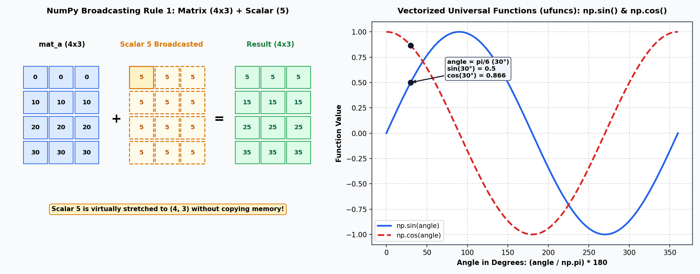
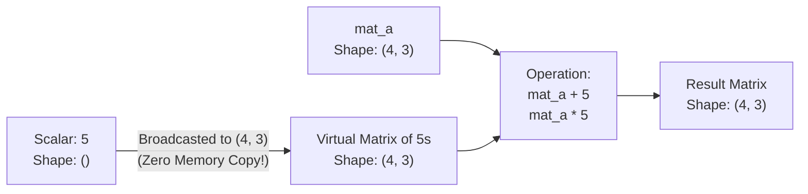

# Dependency Lesson 01.3: Vectorization, Broadcasting සහ Universal Functions (`ufuncs`) මුල සිට සරලව

**ආශ්‍රිත ප්‍රධාන පාඩම් (Connected Module 4 Core Lessons):**
- [Lesson 4.1: Linear Algebra Revision — Vectors & Vector Operations](../../Module_04_Mathematics_and_Statistics_for_Data_Science/Lesson_4.1_Linear_Algebra_Vectors_and_Vector_Operations.md)
- [Lesson 4.2: Matrices, Determinants, Transpose & Matrix Terminology](../../Module_04_Mathematics_and_Statistics_for_Data_Science/Lesson_4.2_Matrices_Determinants_Transpose_and_Terminology.md)

---

## 1. හැඳින්වීම: Vectorization යනු කුමක්ද? (What is Vectorization?)

සාමාන්‍ය Python වලදී න්‍යාසයක (Matrix) ඇති සෑම සංඛ්‍යාවකටම `5` බැගින් එකතු කිරීමට හෝ Lists දෙකක අනුරූප අගයන් එකිනෙකින් බෙදීමට ඔබට `for` loop එකක් ලිවීමට සිදුවේ. නමුත් NumPy හිදී **`for` loops කිසිවක් නොලියා**, මුළු Array එකටම එකවර ගණිතමය ක්‍රියාවලි යෙදීමේ හැකියාව **Vectorization** ලෙස හැඳින්වේ!



---

## 2. Element-Wise Array Operations vs. Matrix Multiplication

එකම හැඩය (`shape`) සහිත NumPy Arrays දෙකක් අතර `+`, `-`, `*`, `/` ලකුණු භාවිතා කළ විට ඒවා ක්‍රියාත්මක වන්නේ **Element-wise (අනුරූප අවයව අතර)** ය (`Maths&stat.ipynb` Cells 28–32):

```python
import numpy as np

mat_a = np.array([[0, 0, 0], [10, 10, 10], [20, 20, 20], [30, 30, 30]]) # (4, 3)
mat_b = np.array([[0, 1, 2], [3, 4, 5], [6, 7, 8], [9, 10, 11]])        # (4, 3)

# 1. Matrix Addition (අනුරූප අවයව එකතු කිරීම):
print(mat_a + mat_b)        # හෝ np.add(mat_a, mat_b)

# 2. Element-wise Multiplication (Hadamard Product - අනුරූප අවයව ගුණ කිරීම):
print(mat_a * mat_b)
# Output:
# [[  0,   0,   0],
#  [ 30,  40,  50],
#  [120, 140, 160],
#  [270, 300, 330]]
```

> [!IMPORTANT]
> **`*` සහ `np.matmul()` (`@`) අතර වෙනස:**
> * `mat_a * mat_b` මගින් සිදු කරන්නේ **Element-wise multiplication** (අනුරූප කොටු දෙක ගුණ කිරීම) පමණි.
> * සැබෑ Linear Algebra **Matrix Multiplication (න්‍යාස ගුණිතය)** සිදු කිරීමට `np.matmul(A, B)` හෝ `A @ B` භාවිතා කළ යුතුය!

---

## 3. NumPy Broadcasting යනු කුමක්ද? (`Maths&stat.ipynb` Cells 30–31)

ඔබ $4 \times 3$ න්‍යාසයකට තනි සංඛ්‍යාවක් (**Scalar (අදිශයක්)** - උදා: `5`) එකතු කළ විට (`mat_a + 5`) හෝ ගුණ කළ විට (`mat_a * 5`) කුමක් සිදුවේද?

ගණිතමය වශයෙන් එකිනෙකට වෙනස් හැඩයන් (`shapes`) ඇති Arrays දෙකක් අතර ගණනය කිරීමක් සිදු කිරීමේදී, NumPy විසින් කුඩා Array එක (හෝ Scalar අගය) විශාල Array එකේ හැඩයට ගැලපෙන සේ **අතථ්‍යව ප්‍රසාරණය කිරීම (Virtual stretching without copying memory)** **Broadcasting** ලෙස හැඳින්වේ!



```python
# Scalar Addition (Broadcasting): සෑම අවයවයකටම 5 බැගින් එකතු වේ
print(mat_a + 5)
# [[ 5,  5,  5],
#  [15, 15, 15],
#  [25, 25, 25],
#  [35, 35, 35]]

# Scalar Multiplication (Broadcasting): සෑම අවයවයක්ම 5න් ගුණ වේ
print(mat_a * 5)
# [[  0,   0,   0],
#  [ 50,  50,  50],
#  [100, 100, 100],
#  [150, 150, 150]]
```

### Broadcasting Rules (නීති 3):
Arrays දෙකක Shapes දකුණු කෙළවරේ මානයේ (Trailing dimension) සිට වමට සංසන්දනය කරන විට:
1. එම මාන දෙක **සමාන** නම්, හෝ
2. ඉන් එක් මානයක් **`1`** නම් (හෝ Scalar එකක් නම්),
ඒවා **Broadcastable (අනුකූල)** වේ! (උදා: `(4, 3)` න්‍යාසයකට `(1, 3)` පේළි දෛශිකයක් හෝ `(4, 1)` තීරු දෛශිකයක් එකතු කළ හැක).

---

## 4. Universal Functions (`ufuncs`) සහ Dictionary Lists සමඟ භාවිතය (`Maths&stat.ipynb` Cells 61–74)

NumPy හි ඇති `np.add()`, `np.sin()`, `np.cos()`, `np.arccos()`, `np.sqrt()` වැනි Functions හඳුන්වන්නේ **Universal Functions (`ufuncs`)** ලෙසයි. ඒවායේ ඇති විශේෂත්වය නම්:
* ඔබ ඒවාට සාමාන්‍ය Python Lists ලබා දුන්නත් (උදා: `data['wins']`), `ufunc` එක මගින් ස්වයංක්‍රීයව ඒවා NumPy `ndarray` බවට හරවා C-level වේගයෙන් ගණනය කර ප්‍රතිඵලය `ndarray` එකක් ලෙස ලබා දීමයි!

`Maths&stat.ipynb` හි පාපන්දු කණ්ඩායම් (`FCBarcelona`, `RMadrid`, `ValenciaCF`) දත්ත Dictionary උදාහරණය බලන්න:

```python
data = {
    'year':   [2010, 2011, 2012, 2010, 2011, 2012, 2010, 2011, 2012],
    'team':   ['FCBarcelona', 'FCBarcelona', 'FCBarcelona',
               'RMadrid', 'RMadrid', 'RMadrid',
               'ValenciaCF', 'ValenciaCF', 'ValenciaCF'],
    'wins':   [30, 28, 32, 29, 32, 26, 21, 17, 19],
    'draws':  [6,  7,  4,  5,  4,  7,  8, 10,  8],
    'losses': [2,  3,  2,  4,  2,  5,  9, 11, 11]
}

# 1. Nested np.add() මගින් සෑම වසරකම මුළු තරග ගණන (Total matches) සෙවීම:
tot = np.add(data['wins'], np.add(data['draws'], data['losses']))
print("Total matches:", tot)
# Output: array([38, 38, 38, 38, 38, 38, 38, 38, 38])

# 2. Vectorized Division & Broadcasting (* 100) මගින් ජයග්‍රහණ ප්‍රතිශතය (Win %):
wp = data['wins'] / tot * 100
print("Win Percentages:", np.round(wp, 2))
# Output: [78.95 73.68 84.21 76.32 84.21 68.42 55.26 44.74 50.  ]
```

---

## 🛠️ Practical Task / Hands-On Exercise (ප්‍රායෝගික අභ්‍යාසය)

### Scenario / Goal:
ඔබ සතුව ශාඛා 3ක මාස 4ක විකුණුම් දත්ත (`sales_lkr` - රුපියල් දහස්වලින්) අඩංගු $3 \times 4$ න්‍යාසයක් ඇත. Broadcasting භාවිතා කර සෑම අගයකටම රු. 10,000ක ප්‍රසාද දීමනාවක් (`+ 10`) එකතු කිරීමටත්, 15%ක බදු අඩු කිරීමෙන් පසු (`* 0.85`) ශුද්ධ ආදායම සෙවීමටත් ඔබට පැවරී ඇත.

### Step-by-Step Tasks:
1. `sales = np.array([[100, 120, 150, 130], [80, 95, 110, 105], [200, 210, 190, 240]])` සාදන්න.
2. Broadcasting මගින් සෑම අගයකටම `10` ක් එකතු කර `sales_with_bonus` සාදන්න.
3. `sales_with_bonus` අගය `0.85` න් ගුණ කර 15% බදු අඩු කළ පසු ලැබෙන `net_sales` න්‍යාසය ලබා ගන්න.
4. `branch_tax_rates = np.array([[0.90], [0.85], [0.80]])` (හැඩය `(3, 1)`) සමඟ `sales_with_bonus` (හැඩය `(3, 4)`) ගුණ කර 2D Broadcasting පරීක්ෂා කරන්න.

### Starter Code:
```python
import numpy as np

sales = np.array([
    [100, 120, 150, 130],
    [80,   95, 110, 105],
    [200, 210, 190, 240]
])

# Task 2: Add scalar 10
sales_with_bonus = None

# Task 3: Multiply by scalar 0.85
net_sales = None

# Task 4: Multiply (3, 4) matrix by (3, 1) column vector
branch_multipliers = np.array([[0.90], [0.85], [0.80]])
custom_net_sales = None
```

### Expected Output / Reference Solution:
```python
import numpy as np

sales = np.array([
    [100, 120, 150, 130],
    [80,   95, 110, 105],
    [200, 210, 190, 240]
])

# Task 2: Add scalar 10
sales_with_bonus = sales + 10
print("Sales with Bonus:\n", sales_with_bonus)

# Task 3: Multiply by scalar 0.85
net_sales = sales_with_bonus * 0.85
print("Net Sales (Uniform 15% Tax):\n", net_sales)

# Task 4: Multiply (3, 4) matrix by (3, 1) column vector
branch_multipliers = np.array([[0.90], [0.85], [0.80]])
custom_net_sales = sales_with_bonus * branch_multipliers
print("Custom Branch Net Sales:\n", custom_net_sales)
```
**Expected Output:**
```text
Sales with Bonus:
 [[110 130 160 140]
 [ 90 105 120 115]
 [210 220 200 250]]
Net Sales (Uniform 15% Tax):
 [[ 93.5  110.5  136.   119.  ]
 [ 76.5   89.25 102.    97.75]
 [178.5  187.   170.   212.5 ]]
Custom Branch Net Sales:
 [[ 99.   117.   144.   126.  ]
 [ 76.5   89.25 102.    97.75]
 [168.   176.   160.   200.  ]]
```

---

## 📝 Summary & Exam Revision Cheat Sheet

| සංකල්පය (Concept) | කේතය (Example Code) | විස්තරය (Explanation) |
| :--- | :--- | :--- |
| **Vectorization** | `np.add(xL, xL3)` / `a + b` | Python `for` loops නොමැතිව C-level වේගයෙන් මුළු Array එකම ගණනය කිරීම. |
| **Scalar Broadcasting** | `mat_a + 5`, `mat_a * 5` | තනි Scalar අගයක් මුළු න්‍යාසයේම සෑම අවයවයකටම අදාළ කිරීම. |
| **Element-wise Product** | `mat_a * mat_b` | එකම හැඩයේ න්‍යාස දෙකක අනුරූප අවයව ගුණ කිරීම (Hadamard Product). |
| **Universal Functions** | `np.sin()`, `np.sqrt()`, `np.arccos()` | Array එකක සෑම අවයවයක් මතම ක්‍රියාත්මක වන Vectorized ගණිතමය ශ්‍රිත. |

---

**ඊළඟ Dependency පාඩම:** [04_NumPy_Linear_Algebra_linalg_and_Statistical_Aggregations.md](04_NumPy_Linear_Algebra_linalg_and_Statistical_Aggregations.md)  
**ආපසු ප්‍රධාන පාඩමට (Back to Main Lesson):** [Lesson 4.1: Linear Algebra Revision — Vectors & Vector Operations](../../Module_04_Mathematics_and_Statistics_for_Data_Science/Lesson_4.1_Linear_Algebra_Vectors_and_Vector_Operations.md)
