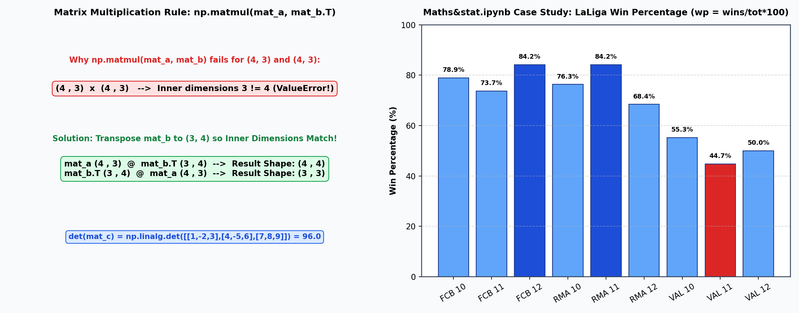
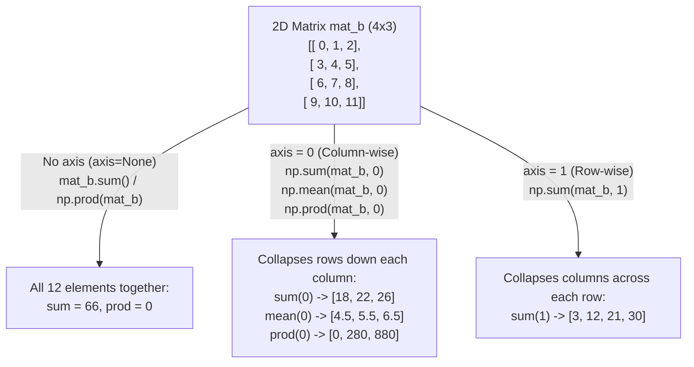

# Dependency Lesson 01.4: NumPy Linear Algebra (`np.linalg`) සහ Statistical Aggregations සම්පූර්ණ මාර්ගෝපදේශය

**ආශ්‍රිත ප්‍රධාන පාඩම් (Connected Module 4 Core Lessons):**
- [Lesson 4.1: Linear Algebra Revision — Vectors & Vector Operations](../../Module_04_Mathematics_and_Statistics_for_Data_Science/Lesson_4.1_Linear_Algebra_Vectors_and_Vector_Operations.md)
- [Lesson 4.2: Matrices, Determinants, Transpose & Matrix Terminology](../../Module_04_Mathematics_and_Statistics_for_Data_Science/Lesson_4.2_Matrices_Determinants_Transpose_and_Terminology.md)
- [Lesson 4.4: Descriptive Statistics I — Measures of Central Tendency](../../Module_04_Mathematics_and_Statistics_for_Data_Science/Lesson_4.4_Descriptive_Statistics_I_Measures_of_Central_Tendency.md)
- [Lesson 4.5: Descriptive Statistics II — Measures of Spread & Correlation](../../Module_04_Mathematics_and_Statistics_for_Data_Science/Lesson_4.5_Descriptive_Statistics_II_Measures_of_Spread_and_Correlation.md)

---

## 1. හැඳින්වීම: NumPy Linear Algebra සහ Statistics බලඇණිය

`Maths&stat.ipynb` Notebook එකෙහි Linear Algebra සහ Basic Statistics ගණනය කිරීම් සියල්ලම පාහේ ගොඩනැගී ඇත්තේ NumPy හි කොටස් දෙකක් මතය:
1. **Linear Algebra Functions:** `np.dot()`, `np.cross()`, `np.matmul()`, `np.linalg.norm()`, `np.linalg.det()`, `np.linalg.eig()`, සහ `np.linalg.matrix_rank()`.
2. **Statistical Aggregation Functions:** `.sum()`, `.prod()`, `.min()`, `.max()`, `.mean()`, `.std()`, `.var()`, `np.ptp()`, සහ `np.percentile()`.



---

## 2. Vector & Matrix Linear Algebra Functions (`Maths&stat.ipynb` Cells 17–23, 37–41)

### 1. `np.dot(a, b)` — Dot Product (තිත් ගුණිතය):
එකම දිගකින් යුත් දෛශික දෙකක අනුරූප අවයව ගුණ කර ඒවායේ එකතුව (Scalar අගයක්) ලබා දෙයි:
$$\mathbf{a} \cdot \mathbf{b} = \sum_{i=1}^{n} a_i b_i$$

```python
import numpy as np

xL  = [1, 2, 3, 4]
xL3 = [6, 7, 8, 9]

# (1*6) + (2*7) + (3*8) + (4*9) = 6 + 14 + 24 + 36 = 80
print("Dot Product:", np.dot(xL, xL3))          # 80
```

### 2. `np.cross(a1, a2)` — Cross Product (කතිර ගුණිතය):
ත්‍රිමාණ (3D) දෛශික දෙකකටම ලම්බක (Perpendicular / Orthogonal) වූ නව 3D දෛශිකයක් ලබා දෙයි:
```python
a1 = np.array([1, 2, 3])
a2 = np.array([-1, 2, -2])
print("Cross Product:", np.cross(a1, a2))       # array([-10,  -1,   4])
```

### 3. `np.linalg.norm(x)` — Vector Magnitude / Euclidean Norm (දෛශිකයක විශාලත්වය):
දෛශිකයක දිග ($\|\mathbf{x}\| = \sqrt{\sum x_i^2}$) සහ දෛශික දෙකක් අතර කෝණය ($\theta$) සෙවීමට භාවිතා වේ:
```python
# ||xL|| = sqrt(1^2 + 2^2 + 3^2 + 4^2) = sqrt(30) = 5.477225575051661
print("Magnitude:", np.linalg.norm(xL))
print("Verify sqrt(30):", np.sqrt(30))

# xL = [1, 2, 3, 4] සහ Unit Vector [0, 0, 1, 0] අතර කෝණය:
u_vec = [0, 0, 1, 0]
cos_theta = np.dot(xL, u_vec) / (np.linalg.norm(xL) * np.linalg.norm(u_vec))
angle_deg = (np.arccos(cos_theta) / np.pi) * 180
print(f"cos(theta) = {cos_theta:.4f} | Angle = {angle_deg:.2f}°") # 56.79°
```

### 4. `np.matmul(A, B)` — Matrix Multiplication (න්‍යාස ගුණිතය) සහ Dimensional Rule:
න්‍යාස දෙකක් ගුණ කිරීමට නම් **පළමු න්‍යාසයේ තීරු ගණන, දෙවන න්‍යාසයේ පේළි ගණනට සමාන විය යුතුමය** ($(m \times \mathbf{k}) \times (\mathbf{k} \times n) \to (m \times n)$).
* `Maths&stat.ipynb` Cell 37 හි `mat_a` $(4 \times 3)$ සහ `mat_b` $(4 \times 3)$ කෙලින්ම `np.matmul(mat_a, mat_b)` කළ විට `ValueError: matmul: Input operand 1 has a mismatch in its core dimension 0 (size 4 is different from 3)` ලැබෙන්නේ එබැවිනි!
* එය නිවැරදි කිරීමට `mat_b.transpose()` $(3 \times 4)$ භාවිතා කරයි:

```python
mat_a = np.array([[0, 0, 0], [10, 10, 10], [20, 20, 20], [30, 30, 30]]) # (4, 3)
mat_b = np.array([[0, 1, 2], [3, 4, 5], [6, 7, 8], [9, 10, 11]])        # (4, 3)

# (4, 3) @ (3, 4) -> (4, 4) Matrix
res_4x4 = np.matmul(mat_a, mat_b.transpose())

# (3, 4) @ (4, 3) -> (3, 3) Matrix
res_3x3 = np.matmul(mat_b.transpose(), mat_a)
```

### 5. `np.linalg.det(C)` — Matrix Determinant (නිශ්චායකය):
Square Matrix (සමචතුරස්‍ර න්‍යාසයක) නිශ්චායකය ගණනය කරයි (`Maths&stat.ipynb` Cell 41):
```python
mat_c = np.array([[1, -2, 3], [4, -5, 6], [7, 8, 9]])
print("Determinant:", np.linalg.det(mat_c))     # 95.99999999999999 (96.0)
```

---

## 3. Axis-Based Statistical Aggregations (`axis=0` vs `axis=1`)

`Maths&stat.ipynb` Cells 42–60 හි 1D සහ 2D Arrays මත සංඛ්‍යානමය ගණනය කිරීම් සිදු කරන ආකාරය පෙන්වා දී ඇත:



```python
st_ages = np.array([22, 21, 23, 28, 23, 34, 30, 24, 49, 27, 23, 22, 32, 28, 26])

print("Max:", st_ages.max())                    # 49
print("Min:", st_ages.min())                    # 21
print("Sum:", st_ages.sum())                    # 412
print("Mean:", st_ages.mean())                  # 27.466666666666665
print("Std Dev (Population):", st_ages.std())   # 6.878630354624063
print("Variance (Population):", st_ages.var())  # 47.315555555555555
print("Range (Peak-to-Peak):", np.ptp(st_ages)) # 28 (49 - 21)

# Quartiles සහ Interquartile Range - IQR (අන්තර්-චතුර්ථක පරාසය):
q1, q3 = np.percentile(st_ages, [25, 75])
print("Q1:", q1, "| Q3:", q3, "| IQR:", q3 - q1) # Q1: 23.0 | Q3: 29.0 | IQR: 6.0

# np.prod() - සියලුම අවයවවල ගුණිතය (Product of elements):
print("1*2*3*4 =", np.prod([1, 2, 3, 4]))       # 24
print("Col-wise prod of mat_b:", np.prod(mat_b, 0)) # array([  0, 280, 880])
```

---

## 🛠️ Practical Task / Hands-On Exercise (ප්‍රායෝගික අභ්‍යාසය)

### Scenario / Goal:
`Maths&stat.ipynb` හි ඇති LaLiga පාපන්දු දත්ත කට්ටලය (`data`) භාවිතා කර අවම ජයග්‍රහණ ගණනක් ලැබූ කණ්ඩායම සහ වසර සෙවීමටත්, ඉහළම ජයග්‍රහණ ප්‍රතිශතය (`wp.max()`) ලබාගත් සියලුම කණ්ඩායම් `np.where()` මගින් සොයා මුද්‍රණය කිරීමටත් ඔබට පැවරී ඇත.

### Step-by-Step Tasks:
1. `data` dictionary එකෙහි `wins` ලැයිස්තුවෙන් අවම අගය (`min_w`) සොයා, එම අගය පිහිටි Index එකට අදාළ `year`, `team`, `wins`, `draws`, `losses` මුද්‍රණය කරන්න.
2. මුළු තරග ගණන `tot` සහ ජයග්‍රහණ ප්‍රතිශතය `wp = data['wins'] / tot * 100` ගණනය කරන්න.
3. `np.where(wp == wp.max())[0]` භාවිතා කර ඉහළම ජයග්‍රහණ ප්‍රතිශතය (84.21%) වාර්තා කළ සියලුම කණ්ඩායම් සහ වසරවල් මුද්‍රණය කරන්න.

### Starter Code:
```python
import numpy as np

data = {
    'year':   [2010, 2011, 2012, 2010, 2011, 2012, 2010, 2011, 2012],
    'team':   ['FCBarcelona', 'FCBarcelona', 'FCBarcelona',
               'RMadrid', 'RMadrid', 'RMadrid',
               'ValenciaCF', 'ValenciaCF', 'ValenciaCF'],
    'wins':   [30, 28, 32, 29, 32, 26, 21, 17, 19],
    'draws':  [6,  7,  4,  5,  4,  7,  8, 10,  8],
    'losses': [2,  3,  2,  4,  2,  5,  9, 11, 11]
}

# Write your solution here
```

### Expected Output / Reference Solution:
```python
import numpy as np

data = {
    'year':   [2010, 2011, 2012, 2010, 2011, 2012, 2010, 2011, 2012],
    'team':   ['FCBarcelona', 'FCBarcelona', 'FCBarcelona',
               'RMadrid', 'RMadrid', 'RMadrid',
               'ValenciaCF', 'ValenciaCF', 'ValenciaCF'],
    'wins':   [30, 28, 32, 29, 32, 26, 21, 17, 19],
    'draws':  [6,  7,  4,  5,  4,  7,  8, 10,  8],
    'losses': [2,  3,  2,  4,  2,  5,  9, 11, 11]
}

# Task 1: Minimum wins record
min_idx = data['wins'].index(np.array(data['wins']).min())
print("--- Minimum Wins Record ---")
for k in data.keys():
    print(f"{k}: {data[k][min_idx]}")

# Task 2 & 3: Highest Win Percentage teams using np.where
tot = np.add(data['wins'], np.add(data['draws'], data['losses']))
wp = data['wins'] / tot * 100
top_indices = np.where(wp == wp.max())[0]

print("\n--- Teams with Highest Win Percentage (84.21%) ---")
for idx in top_indices:
    print(f"Year: {data['year'][idx]} | Team: {data['team'][idx]} | Win %: {wp[idx]:.2f}%")
```
**Expected Output:**
```text
--- Minimum Wins Record ---
year: 2011
team: ValenciaCF
wins: 17
draws: 10
losses: 11

--- Teams with Highest Win Percentage (84.21%) ---
Year: 2012 | Team: FCBarcelona | Win %: 84.21%
Year: 2011 | Team: RMadrid | Win %: 84.21%
```

---

## 📝 Summary & Exam Revision Cheat Sheet

| Function | විස්තරය (Description) |
| :--- | :--- |
| `np.dot(a, b)` | **Dot Product (තිත් ගුණිතය)** $\sum a_i b_i$ |
| `np.cross(a, b)` | 3D දෛශික දෙකක **Cross Product (කතිර ගුණිතය)** |
| `np.linalg.norm(a)` | දෛශිකයක දිග / **Magnitude (විශාලත්වය)** $\sqrt{\sum a_i^2}$ |
| `np.matmul(A, B)` | **Matrix Multiplication (න්‍යාස ගුණිතය)** |
| `np.linalg.det(A)` | සමචතුරස්‍ර න්‍යාසයක **Determinant (නිශ්චායකය)** |
| `np.ptp(arr)` | **Range (පරාසය)** = $\text{Max} - \text{Min}$ (Peak-to-Peak) |
| `np.percentile(arr, [25, 75])` | $Q_1$ සහ $Q_3$ චතුර්ථක සෙවීම ($\text{IQR} = Q_3 - Q_1$) |
| `np.prod(arr, axis)` | සියලුම අවයවවල ගුණිතය (Product of elements) |

---

**ආපසු ප්‍රධාන පාඩම්වලට (Back to Main Lessons):**
- [Lesson 4.1: Linear Algebra Revision — Vectors & Vector Operations](../../Module_04_Mathematics_and_Statistics_for_Data_Science/Lesson_4.1_Linear_Algebra_Vectors_and_Vector_Operations.md)
- [Lesson 4.2: Matrices, Determinants, Transpose & Matrix Terminology](../../Module_04_Mathematics_and_Statistics_for_Data_Science/Lesson_4.2_Matrices_Determinants_Transpose_and_Terminology.md)
- [Lesson 4.5: Descriptive Statistics II — Measures of Spread & Correlation](../../Module_04_Mathematics_and_Statistics_for_Data_Science/Lesson_4.5_Descriptive_Statistics_II_Measures_of_Spread_and_Correlation.md)
